# Business flows

The business flows of MediLab from the start of each one to its business result, with the actors who take part. Each flow lists the user stories it walks through, the states it moves, and an activity diagram with one lane per actor. The diagrams show who does what and leave out how the system works inside.

The core flows WF-01 to WF-06 carry a test request from order to report, and WF-07 keeps the laboratory files the testing work produces. The supporting flows SF-01 to SF-09 run beside them. Each path of a flow, its main path, alternative paths and exceptions, belongs to that flow alone; a flow that also touches a path names the flow that holds it. Each path starts from the state the flow names, so no path repeats the steps of the flows before it.

| Flow  | Name                                    | Actors                                                          |
| ----- | --------------------------------------- | --------------------------------------------------------------- |
| WF-01 | Order to approved test request          | Customer, Sales, Accountant, Head of Sales                      |
| WF-02 | Sample reception and handover           | Customer, Sample delivery staff, Head of department             |
| WF-03 | Testing assignment and scheduling       | Head of department, Tester                                      |
| WF-04 | Result entry and approval               | Tester, Head of department                                      |
| WF-05 | Outsourced testing                      | Head of department, Sample delivery staff, Subcontractor        |
| WF-06 | Report signing, release and delivery    | Lab head, Head of department, Sample delivery staff, Customer   |
| WF-07 | Laboratory files                        | Tester, Head of department, Administrator                       |
| SF-01 | Invoicing and payment collection        | Accountant, Sales, Customer                                     |
| SF-02 | Order cancellation                      | Customer, Sales                                                 |
| SF-03 | Change request on a signed document     | Requester, signers of the change-request chain                  |
| SF-04 | Sample retention and disposal           | Tester                                                          |
| SF-05 | Machine calibration and unavailability  | Administrator, Head of department, Tester                       |
| SF-06 | Accreditation and registration renewal  | Administrator                                                   |
| SF-07 | Priority order and urgent tests         | Customer, Sales, Head of department, Tester                     |
| SF-08 | Laboratory setup                        | Administrator                                                   |
| SF-09 | Customer support and feedback           | Customer, Sales                                                 |

## WF-01 Order to approved test request

- **Trigger:** a customer submits a cart on the portal, or sales creates an order for a customer.
- **Result:** the order is approved and its test request is confirmed, with expected samples and their selected ways calculated from the accepted order and sampling requirements.
- **Stories:** US-C08, US-C09, US-C13, US-C14, US-C15, US-S01, US-S02, US-S05, US-S06, US-S07, US-S08, US-S10, US-S12, US-S13, US-S14, US-S15, US-A03, US-A06, US-A08.
- **Starts from:** a catalog with priced parameters and packages, and demo customers.
- **Main path:** A customer orders on the portal; sales claims it, confirms the selected ways and expected sampling needs, obtains Head of Sales approval if its discount or total exceeds a configured threshold, and sends it with an advance; the customer pays online; sales confirms and requests approval; the Head of Sales signs.
- **Alternative paths:**
  - WF-01-A1: Sales creates the order for a customer who called, instead of the customer ordering on the portal.
  - WF-01-A2: A visitor who is not signed in submits a cart with their details and e-mail address.
  - WF-01-A3: A returning customer reorders a completed order, or sales creates the order from the customer's template.
  - WF-01-A4: The customer pays the advance by bank transfer or in cash; sales records it and the accountant confirms it.
  - WF-01-A5: The customer declines the quotation with a reason; sales revises it and sends the new version, which the customer accepts.
  - WF-01-A6: The quotation passes its payment deadline and is flagged expired; sales extends it.
  - WF-01-A7: The Head of Sales sends a quotation without an advance to a customer allowed to order on credit; the order goes ahead unpaid.
  - WF-01-A8: The Head of Sales rejects the approval with a reason; sales is told, corrects the order and requests approval again.
  - WF-01-A9: Sales withdraws the approval request to change the order, then requests it again.
- **Exceptions:**
  - WF-01-E1: An unavailable default is never silently replaced; choose a viable alternative explicitly or do not order that parameter and sample type. A quotation above the approval thresholds cannot be sent before Head of Sales approval.
  - WF-01-E2: Submitting a cart without an e-mail address is refused.
  - WF-01-E3: The salesperson who requested approval cannot approve the order.
  - WF-01-E4: The old version of a revised quotation cannot be sent or confirmed.
  - WF-01-E5: The test request of an unpaid order whose customer may not order on credit cannot be confirmed.
- **Paths in other flows:** SF-02 for cancelling an order; SF-07 for the estimated date and priority orders.
- **States:** quotation draft → sent → accepted; order submitted → claimed → confirmed, approval requested → approved; test request draft → confirmed → paid.

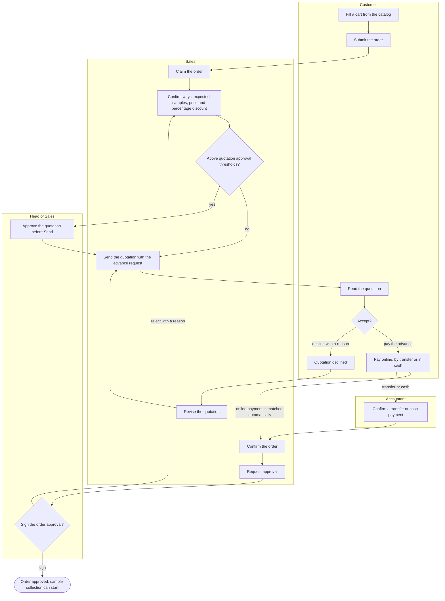

## WF-02 Sample reception and handover

- **Trigger:** samples arrive at the laboratory, or sample delivery staff collect them from the customer.
- **Result:** every sample is coded, labelled and received, and its testing tasks wait in the queue of each department that tests it.
- **Stories:** US-SD01, US-SD02, US-SD03, US-SD04, US-SD05, US-SD06, US-SD07, US-SD08, US-SD09, US-SD10, US-SD11, US-SD12, US-HD06, US-HD07.
- **Starts from:** an approved order whose test request expects its samples.
- **Main path:** The customer brings the samples; sample delivery staff adjust the calculated expected samples to the actual handover, record conditions and differences, obtain the customer's signature, print labels and hand samples to their departments.
- **Alternative paths:**
  - WF-02-A1: Sample delivery staff collect the samples at the customer's site from their collection task, take photos through the web interface and obtain the customer's confirmation signature. Collection feasibility includes the configurable travel buffer, 60 minutes by default.
  - WF-02-A2: Sample delivery staff create a test request at reception for a customer without an order; it skips the paid step.
  - WF-02-A3: A sample tested by two departments is handed to both, and each records its own receipt.
  - WF-02-A4: An insufficient sample goes on hold; the head of department asks for more; the collection task brings it back to received.
  - WF-02-A5: A mistake in a signed handover record is corrected with a new record; the old one is kept.
  - WF-02-A6: Fewer samples wait for another collection or Sales cancels the missing part.
  - WF-02-A7: Extra samples are held pending a revised quotation and customer agreement before testing.
- **Exceptions:**
  - WF-02-E1: An unusable sample is rejected with its condition note and gets no testing task.
  - WF-02-E2: A person outside the department scanning the label is refused.
  - WF-02-E3: Confirming a test request without a sample, or a sample without a parameter, is refused.
  - WF-02-E4: A signed handover record cannot be edited.
- **States:** sample expected → received, or → on hold → received, or → rejected; test request paid → sample received.

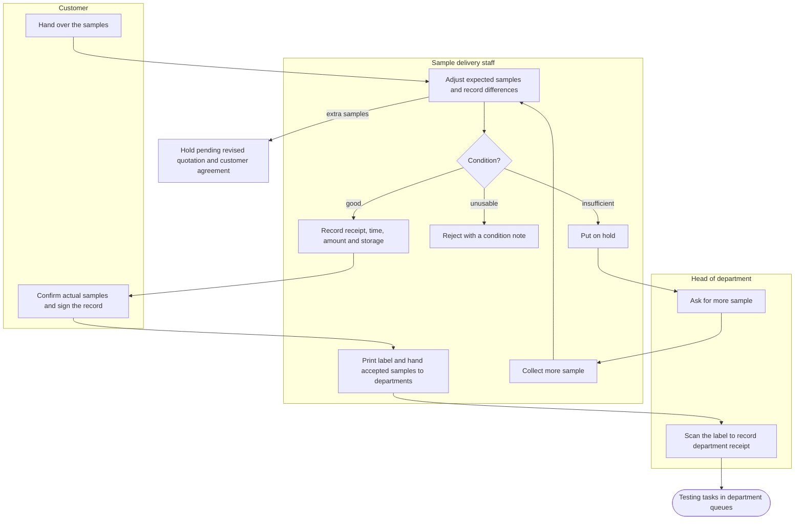

## WF-03 Testing assignment and scheduling

- **Trigger:** a testing task enters the queue of its department.
- **Result:** the test is assigned to an authorized person and planned in a run of its agreed way, reserving required locations and a fit machine only when needed.
- **Stories:** US-HD01, US-HD02, US-HD03, US-HD04, US-HD05, US-HD12, US-HD14, US-T01, US-T02, US-T03, US-T04, US-T19, US-T20, US-T21.
- **Starts from:** received samples with selected ways and department tasks, authorized people and available required resources.
- **Main path:** The head assigns an authorized tester, or that tester claims the task; a run of the agreed way is planned within capacity for that person and the available resources, and receives a reminder. Lab Head's person-to-parameter authorization has no validity dates.
- **Alternative paths:**
  - WF-03-A1: A tester claims an unassigned task of their department instead of waiting to be assigned.
  - WF-03-A2: The head of department moves a task to another person or department with a reason.
  - WF-03-A3: The tester moves or cancels a booking; the slot goes back to the queue.
  - WF-03-A4: The head changes an internal due date with a reason. Preserve it when the promised return date changes; recalculate only automatic dates. The feasibility check uses company working days, holidays and leave, proposes the earliest feasible date and moves no bookings. An infeasible date may be kept with a reason and risk flag.
  - WF-03-A5: A run reserves its tester and required rooms, plus a machine only if needed. A no-machine way supplies its own duration and capacity, default capacity 1.
  - WF-03-A6: A tester marks a test urgent with a reason; it takes the next free slot first.
  - WF-03-A7: The head of department bumps an urgent test and decides what happens to the tests it would make late.
  - WF-03-A8: A booking that cannot meet its due date sends an initial risk notice and daily consolidated summaries to its tester and head until resolved. Sales notifies the customer if the promised date is affected or at risk.
  - WF-03-A9: The head books outside working hours with a reason and records planned OverTime for the tester and outside-hours interval, without a prerequisite HR overtime shift.
  - WF-03-A10: Approved leave or a room-unavailable interval returns overlapping not-started work to the queue for head assignment or authorized claiming.
  - WF-03-A11: Moving a booking cancels its unsent old reminder and schedules the new one; send immediately inside the warning window and deduplicate the update.
- **Exceptions:**
  - WF-03-E1: A second tester claiming the same task is told it is already claimed.
  - WF-03-E2: Claiming another department's task or a parameter the tester is not authorized for is refused.
  - WF-03-E3: Moving a task without a reason is refused.
  - WF-03-E4: Bumping without a reason, or bumping a test that is not urgent, is refused.
- **Paths in other flows:** WF-05 for an agreed subcontracted way; SF-05 for machine disruption; SF-07 for a changed promised date. A schedule never silently changes the accepted way.
- **States:** sample test waiting → assigned → testing; run queued → scheduled → in progress → done, with machine reservations only when needed.

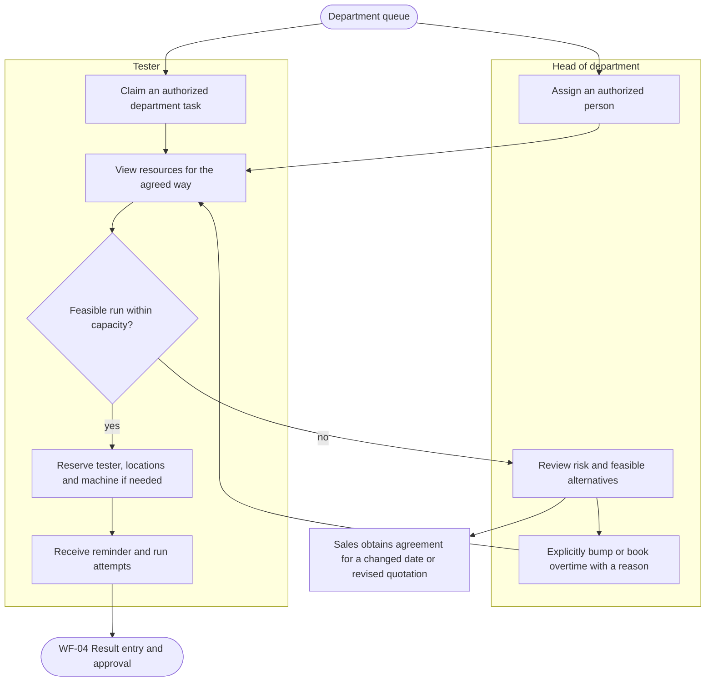

## WF-04 Result entry and approval

- **Trigger:** a booked test is run.
- **Result:** the Head of Department approves the measured result, with assessment only for requested regulation comparisons, and the sample completes when all its tests do.
- **Stories:** US-T05, US-T06, US-T07, US-T08, US-T17, US-T22, US-HD08, US-HD09, US-LH05.
- **Starts from:** sample tests in testing with their bookings, on samples with and without a regulation.
- **Main path:** The tester follows the agreed method, records an attempt in its run with the snapshotted unit and LOD/LOQ, assesses any requested comparison, then sends it to the Head of Department for approval.
- **Alternative paths:**
  - WF-04-A1: The tester confirms text for a value below LOD/LOQ; the report prints the snapshot threshold and unit and keeps a raw number if available, never zero as a substitute.
  - WF-04-A2: The head rejects the result with a reason; the tester retests, the rejected result stays on record and the new one is approved.
  - WF-04-A3: The tester withdraws a result they sent before the head acts.
  - WF-04-A4: An unusual result warns before sending; the tester sends it anyway and the head sees the warning.
  - WF-04-A5: The head cancels a test that cannot be done, with a reason; the sample completes with its other tests approved.
  - WF-04-A6: The Head of Department may enter and approve their own result; the Lab Head reviews it when signing the report before issue.
  - WF-04-A7: Without requested QCVN comparison, return measurements with no pass/fail conclusion. For requested scope, any assessed failure fails that scope; all required comparisons must pass to conclude pass; otherwise record insufficient basis.
  - WF-04-A8: Changing a sample's regulation refreshes applicable limits only after confirmation and clears old comparison conversions and conclusions; signed results first require withdrawal where permitted, or change requests and new versions. Raw measurement, way and LOD/LOQ snapshots stay, and retesting requires professional assessment.
- **Exceptions:**
  - WF-04-E1: An entrant other than the Head of Department cannot approve their own result.
  - WF-04-E2: A missing applicable limit or unresolved text assessment cannot be treated as a pass. Requested comparisons explicitly state insufficient basis when appropriate.
  - WF-04-E3: Cancelling a test without a reason, or a test with an approved result, is refused.
- **Paths in other flows:** SF-03 for changing a result whose process is completed.
- **States:** sample test testing → result entered → approved, or → testing when rejected; sample testing → awaiting approval → completed.

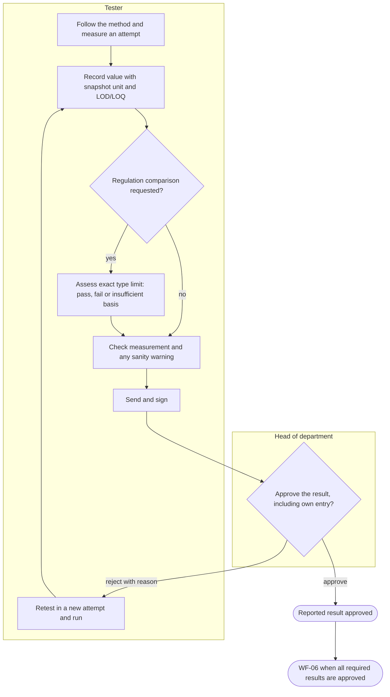

## WF-05 Outsourced testing

- **Trigger:** the agreed way is subcontracted, or a subcontracted alternative is proposed because in-house resources cannot meet the due date.
- **Result:** the subcontractor's result is approved like any other result.
- **Stories:** US-HD05, US-HD10, US-HD11, US-HD13, US-SD13, US-SUB01, US-SUB02, US-T09, US-HD08.
- **Starts from:** sample tests with an outsourcing suggestion, and accredited subcontractors.
- **Main path:** For the agreed subcontracted way, the head creates a dispatch of attempts with sending date, due date and returned report; staff carry it, results are entered and independently approved. Changing an accepted way first needs customer agreement through a revised quotation.
- **Alternative paths:**
  - WF-05-A1: A dispatch goes by a delivery service with its tracking number.
  - WF-05-A2: A lab QA enters the results the subcontractor sent back.
  - WF-05-A3: The head initiates an urgent outsourcing proposal with a reason; Sales obtains an agreed revised quotation before replacing an accepted way.
  - WF-05-A4: The head rejects the subcontractor's result; the test goes back to outsourced and a new result is entered.
  - WF-05-A5: A dispatch is cancelled before any result; its tests stay outsourced for another dispatch.
- **Exceptions:**
  - WF-05-E1: A dispatch whose tests have results cannot be cancelled.
  - WF-05-E2: A subcontractor user sees only its own dispatches and never a sample's customer.
  - WF-05-E3: An emergency proposal needs a reason; a test already running cannot be outsourced directly, and an accepted way cannot change without customer agreement.
- **Paths in other flows:** SF-06 for subcontractor accreditation expiry.
- **States:** sample test waiting → outsourced → result entered → approved; dispatch draft → sent → received.

## WF-06 Report signing, release and delivery

- **Trigger:** every sample test of a test request is approved or cancelled, and the system creates the draft report and a signing task for the lab head.
- **Result:** the signed report is issued, delivered to the customer and downloadable on the portal.
- **Stories:** US-LH01, US-LH02, US-SD14, US-C07, US-C18, US-C19.
- **Starts from:** test requests whose sample tests are all approved or cancelled, with their draft reports.
- **Main path:** The Lab Head reviews the results and any requested regulation basis, signs the report, and releases its numbered signed PDF. Staff record delivery and the customer is notified once the PDF is ready.
- **Alternative paths:**
  - WF-06-A1: The report is delivered in person or by post; recording it sends no e-mail.
  - WF-06-A2: The request asks for an English, a Vietnamese or a bilingual report.
  - WF-06-A3: The lab head rejects the report naming results and a reason; the results go back to the head of department's queue, are approved again and the lab head signs the new task.
  - WF-06-A4: A request with a cancelled test issues a report without it.
  - WF-06-A5: The lifecycle test: one order runs from the portal through reception, testing and approval to the issued report.
  - WF-06-A6: A regulation expires during testing: testing continues, but before issue the Lab Head confirms the comparison basis. Sales obtains customer agreement for a changed scope; no regulation is switched or dropped automatically.
  - WF-06-A7: A corrected result returns an initial or replacement report to draft; once corrected results are approved, a fresh signing task is created even if the request is already reported.
- **Exceptions:**
  - WF-06-E1: With Viettel Sign unavailable the report is not marked signed, and signing is retried.
  - WF-06-E2: Rejecting a report without a reason or without naming a result is refused.
  - WF-06-E3: An unissued report cannot be delivered, and a customer downloads only their own reports.
- **Paths in other flows:** SF-03 for a change request on an issued report; SF-04 for the samples after the report.
- **States:** test report draft → signing → issued; test request completed → reported; order completed.

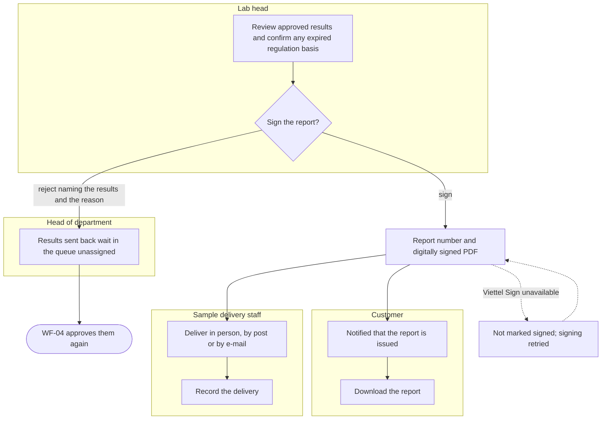

## WF-07 Laboratory files

- **Trigger:** a tester saves a file in a folder bound in Medilab Sync, or a head of department creates a sample's folders.
- **Result:** every version of every laboratory file is kept and traceable, conflicts keep both versions, and the version a report relies on is signed.
- **Stories:** US-T23, US-T24, US-T25, US-T26, US-T27, US-T28, US-T29, US-HD15, US-HD16, US-AD29, US-AD30, US-AD31.
- **States:** upload prepared → uploading → finalizing → completed or conflict; editing session open → saving → committed; lock active → released or expired.
- **Starts from:** sample folders with members, bound on two testers' computers, and the editing service running.
- **Main path:** A tester saves a result file in a bound folder; Medilab Sync uploads it as a new version; the head of department signs that version.
- **Alternative paths:**
  - WF-07-A1: The head of department creates a sample's raw-data and result folders, and the owner adds the testers as members.
  - WF-07-A2: A colleague's new version downloads to a two-way folder on another computer.
  - WF-07-A3: Two testers change the same file from one version; the second upload is kept as a conflict, and the tester takes the server's version with a backup of their own.
  - WF-07-A4: A tester restores an earlier version, which becomes the new current version.
  - WF-07-A5: Two testers edit a result spreadsheet together in the browser; saving adds a version.
  - WF-07-A6: A tester locks a working file, edits and unlocks it; an administrator releases a lock someone left.
  - WF-07-A7: A tester browses and downloads a sample's files in the back office.
  - WF-07-A8: An administrator archives a folder; it keeps every version until its retention date.
- **Exceptions:**
  - WF-07-E1: A file outside the folder's sync rules is not uploaded.
  - WF-07-E2: Uploading a file someone else has locked is refused.
  - WF-07-E3: A revoked device can no longer sync, and the person's other devices keep working.
  - WF-07-E4: A removed member's pending files are paused and nothing on their computer is deleted.
  - WF-07-E5: A turned-off folder refuses uploads and still allows downloads.
  - WF-07-E6: With the editing service down, syncing, history and restore keep working.
  - WF-07-E7: Rejecting a file version without a reason is refused.

## SF-01 Invoicing and payment collection

- **Trigger:** an order needs its final invoice, or a payment arrives.
- **Result:** every invoice is paid, and each day's online payments match the PayOS transactions and are locked.
- **Stories:** US-A01, US-A02, US-A04, US-A05, US-A07, US-A08, US-A09, US-A10, US-A11, US-A12, US-A13, US-C16, US-C17, US-S11.
- **Starts from:** orders with a paid advance whose testing is completed.
- **Main path:** The accountant creates and e-mails the final invoice; the customer pays it online; a receipt is issued and the order is paid.
- **Alternative paths:**
  - SF-01-A1: The customer pays part online, then the rest; the invoice is partially paid, then paid.
  - SF-01-A2: Sales records a cash payment; the accountant confirms it.
  - SF-01-A3: The accountant rejects a payment sales recorded; the salesperson is told the reason and the invoice returns to its previous status.
  - SF-01-A4: An adjustment invoice lowers or raises what is owed; the original invoice is unchanged.
  - SF-01-A5: An invoice unpaid after its due date reminds the customer at each interval.
  - SF-01-A6: A PayOS transaction with no payment is flagged; the accountant creates its payment, the flag clears and the day is locked.
- **Exceptions:**
  - SF-01-E1: A payment above the amount still owed is refused.
  - SF-01-E2: A posted invoice cannot be edited.
  - SF-01-E3: An online payment of a locked day cannot be changed.
  - SF-01-E4: A repeated PayOS notification records no second payment.
- **States:** invoice posted → partially paid → paid; payment pending → confirmed or rejected; reconciliation day open → locked.

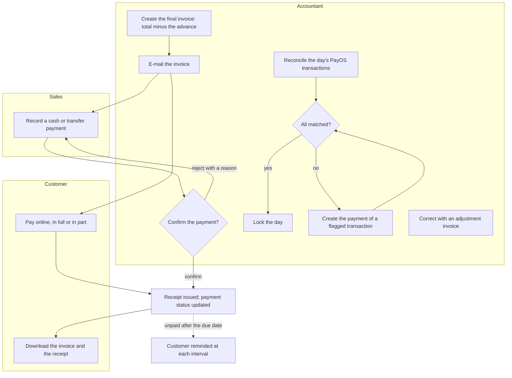

## SF-02 Order cancellation

- **Trigger:** a customer wants to cancel an order.
- **Result:** the accepted cancellation scope is cancelled, or Sales declines with a reply. Cancelling an unfulfillable part preserves other work and completed results.
- **Stories:** US-C11, US-C12, US-S16, US-S17.
- **Starts from:** orders in each status, some with completed tests.
- **Main path:** A customer requests the cancellation of a confirmed order with a reason; sales accepts; the order and its test request are cancelled.
- **Alternative paths:**
  - SF-02-A1: The customer cancels an order that is not confirmed yet, without asking.
  - SF-02-A2: Sales declines the request with a reply the customer sees on the order.
  - SF-02-A3: Sales cancels an order on their own while no testing is completed.
  - SF-02-A4: An approved order is cancelled through a change request the Head of Sales approves.
  - SF-02-A5: The customer refuses a proposed later return date. Sales handles a request to cancel the unfulfillable part, keeps unaffected work and completed results, and tells the customer the decision.
- **Exceptions:**
  - SF-02-E1: A request without a reason is refused.
  - SF-02-E2: Whole-order cancellation with a completed test is blocked. Cancelling an unfulfillable part must preserve completed results and follow the affected sample-test and signed-order rules.
- **States:** cancellation request open → accepted or declined; whole-order cancellation → order cancelled, while partial cancellation leaves the remaining work active.

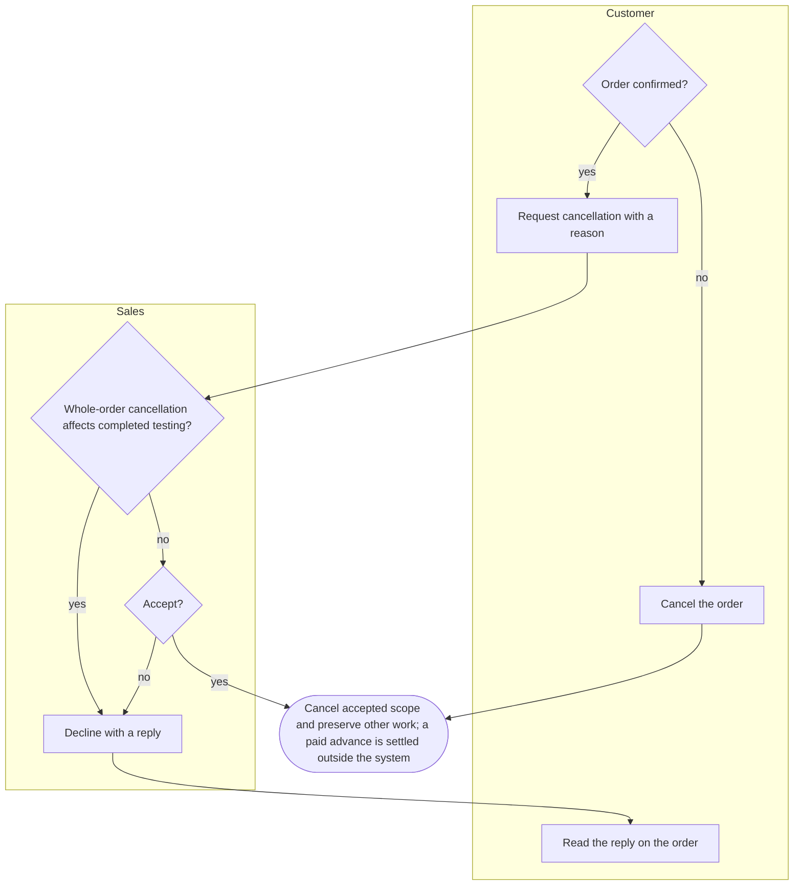

## SF-03 Change request on a signed document

- **Trigger:** a person who can edit a type of document finds a mistake in one whose process is completed, such as a result or a report.
- **Result:** a new version replaces the signed one, which is kept unchanged, or the request is rejected and the document stays as it is.
- **Stories:** US-T11, US-LH03, SH-07.
- **Starts from:** completed results and issued reports, and signed documents still in process.
- **Main path:** A tester raises a change request on a completed result; the change-request chain signs it; a new version replaces the old one, which stays readable.
- **Alternative paths:**
  - SF-03-A1: A change request on an issued report is approved by the lab head and creates a new report version.
  - SF-03-A2: The chain rejects a change request; the signed document stays unchanged and the reason is kept.
  - SF-03-A3: Before the process is completed, signers withdraw from the top level down and the document can be edited again.
  - SF-03-A4: Correcting a result in an issued report automatically creates or links that report's open change request. Wait for its required approvals and all corrected results to be approved, then prepare a replacement draft and signing task. Notify the customer when its signed PDF is ready; only issue marks the old report replaced.
  - SF-03-A5: A result correction may be proposed while a report awaits signature. Before applying it, stop signing and return the report to draft. Completed results retain their own change requests. A fresh signing task is created after correction approval for both initial and replacement reports; old tasks cannot sign stale content.
  - SF-03-A6: Quotations and orders use change requests once their process is completed.
- **Exceptions:**
  - SF-03-E1: A change request without what to change or why is refused.
  - SF-03-E2: Withdrawing a signature while a higher level still has one, or after the process is completed, is refused.
- **States:** change request requested → approved → applied, or → rejected; document version → replaced.

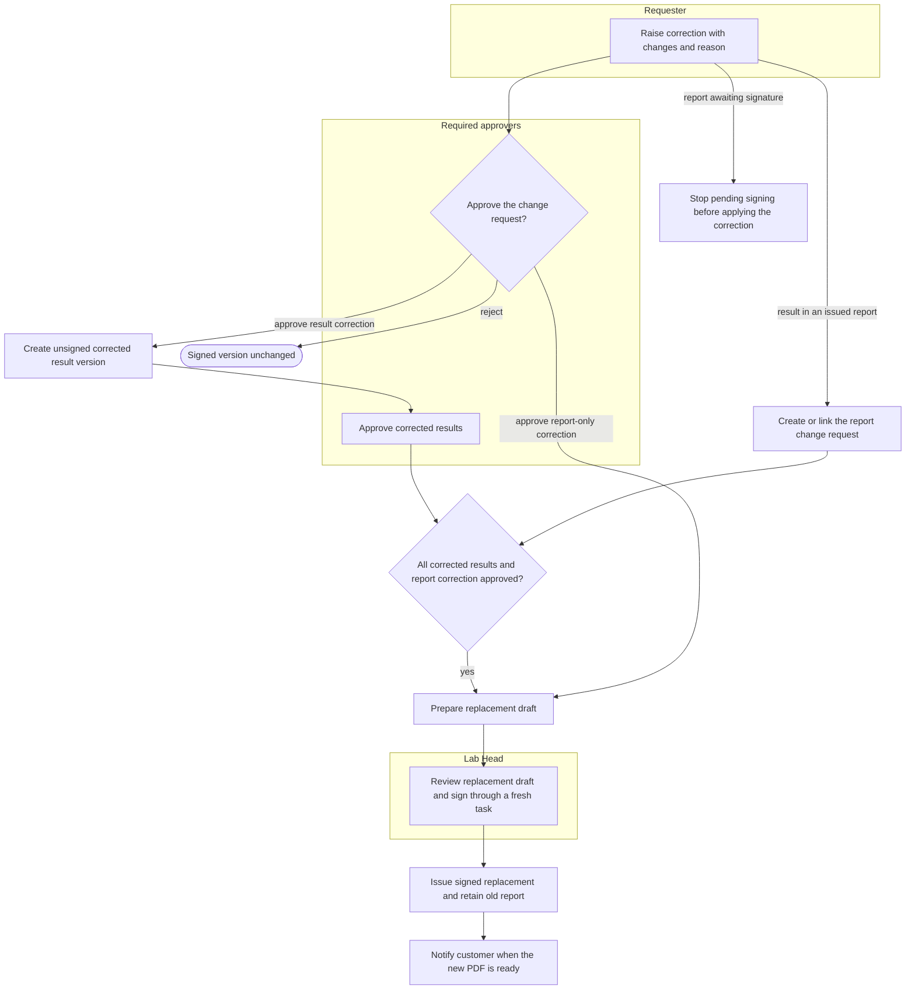

## SF-04 Sample retention and disposal

- **Trigger:** the report of a sample's test request is issued.
- **Result:** every sample that is not kept, or whose retention period is over, is disposed of with a record of when, by whom and how.
- **Stories:** US-T10.
- **Starts from:** reported samples, kept and not kept, and samples of cancelled requests.
- **Main path:** A kept sample's retention period ends; it appears on the tester's daily to-do and the tester records its disposal.
- **Alternative paths:**
  - SF-04-A1: A sample that is not kept is disposed of right after its report.
  - SF-04-A2: A sample of a cancelled request is disposed of.
- **Exceptions:**
  - SF-04-E1: Disposing of a sample with no method on it or its sample type is refused.
  - SF-04-E2: A disposed sample cannot be disposed of again or changed back.
- **States:** sample reported → retained → disposed, or reported → disposed.

## SF-05 Machine calibration and unavailability

- **Trigger:** calibration is absent or expired, maintenance is planned or overdue, or a machine breaks or enters repair.
- **Result:** new bookings use fit machines; affected not-started work is replanned within the same way, interrupted measurements are retained for assessment, and unserviceable work remains visible in the queue.
- **Stories:** US-AD09, US-AD10, US-T21, US-HD03, US-HD05.
- **Starts from:** machines with scheduled bookings, calibration dates and service records.
- **Main path:** The administrator records downtime; not-started bookings return to the queue and move to another suitable machine for the same way if available, with notices to the tester and head. Returning to use requires all calibration, maintenance and availability conditions to be satisfied.
- **Alternative paths:**
  - SF-05-A1: A machine with no currently valid calibration, including a never-calibrated machine, gets no new booking until valid calibration is recorded.
  - SF-05-A2: Separate windows warn 7 days before calibration, 7 days before maintenance and 7 days after repair by default; warnings do not override a block.
  - SF-05-A3: Planned maintenance reserves downtime; overdue maintenance blocks new bookings until recorded completion.
  - SF-05-A4: A fault interrupts a run: retain all data and let the head assess each attempt as usable, retest or more sample needed. Retesting creates new attempts in a new run linked to the interrupted one.
- **Exceptions:**
  - SF-05-E1: Without another suitable machine, keep work queued and notify its tester and head. Sales informs the customer if the promised date is affected. A different way needs an agreed revised quotation.
  - SF-05-E2: A machine with queued, scheduled or running bookings cannot be archived.
- **States:** machine in use → under repair → in use; booking scheduled → queued → scheduled on another machine.

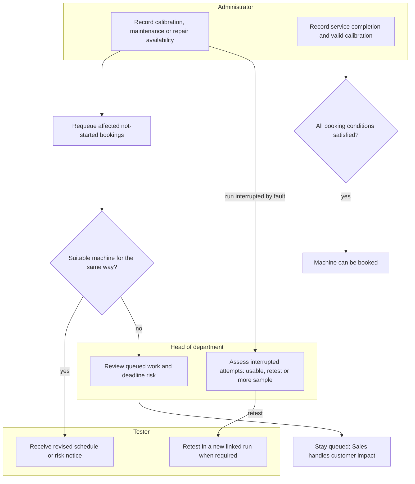

## SF-06 Accreditation and registration renewal

- **Trigger:** the laboratory receives an accreditation certificate or registers a quality dossier, or one of them, or a subcontractor's accreditation, nears its expiry.
- **Result:** reports carry the accredited and registered marks only while they are valid, and renewed dates restore them.
- **Stories:** US-AD08, US-AD12, US-AD28.
- **Starts from:** accreditation certificates, quality dossiers and subcontractors near and past their expiry.
- **Main path:** The administrator imports scope lines identifying methods, parameters and sample types. An in-house sample test is accredited only when a valid line covers all three, allowing an ancestor sample type for accreditation scope.
- **Alternative paths:**
  - SF-06-A1: A quality dossier warns before and on its expiry day; after it, its mark is no longer printed; renewing it prints the mark again.
  - SF-06-A2: A subcontractor whose accreditation expired cannot be chosen; renewing the date makes it selectable again.
  - SF-06-A3: Archiving or restoring a certificate recomputes accreditation for matching sample tests; validity dates still apply.
- **Exceptions:**
  - SF-06-E1: Importing a row without a code is refused; an omitted title defaults to its code.
  - SF-06-E2: A subcontracted sample test is not within the laboratory's own accreditation scope. A method match alone is insufficient for an in-house sample test.
- **States:** certificate, dossier or subcontractor accreditation valid → expired → valid again when renewed.

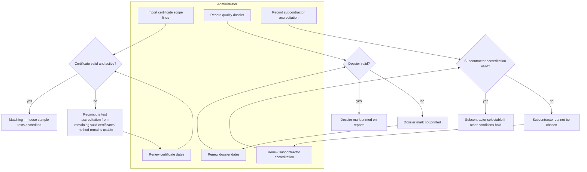

## SF-07 Priority order and urgent tests

- **Trigger:** a customer asks for results earlier than the laboratory's estimate, or a test must go ahead of others.
- **Result:** an order the laboratory can meet is accepted as a priority order, and its urgent tests are scheduled first.
- **Stories:** US-C22, US-S21, US-S22, US-T19, US-HD12, US-HD13, US-HD14.
- **Starts from:** quotations in preparation, authorized people and required resource schedules, and outsourced ways with transport and processing turnaround.
- **Main path:** The customer requests priority on the portal; Sales checks the date and accepts or declines priority on the quotation. The estimate includes every in-house and outsourced branch plus the safety margin, and reserves nothing. Accepted priority makes its tests urgent.
- **Alternative paths:**
  - SF-07-A1: Adding a parameter updates the estimated return date.
  - SF-07-A2: A promised date becomes infeasible: Sales offers the earliest feasible replacement and records old date, new date and customer confirmation before changing it. If refused, Sales handles a cancellation request for the unfulfillable part; no automatic cancellation or way change.
- **Exceptions:**
  - SF-07-E1: A date the laboratory cannot meet is not accepted as a customer promise; show the earliest feasible date. Missing outsourced turnaround means no complete estimate is available. An internal due-date override does not change the customer promise.
- **Paths in other flows:** WF-03 for marking tests urgent and bumping; WF-05 for outsourcing straight away.
- **States:** sample test created urgent; booking queued ahead of tests that are not urgent; bumped bookings planned again.

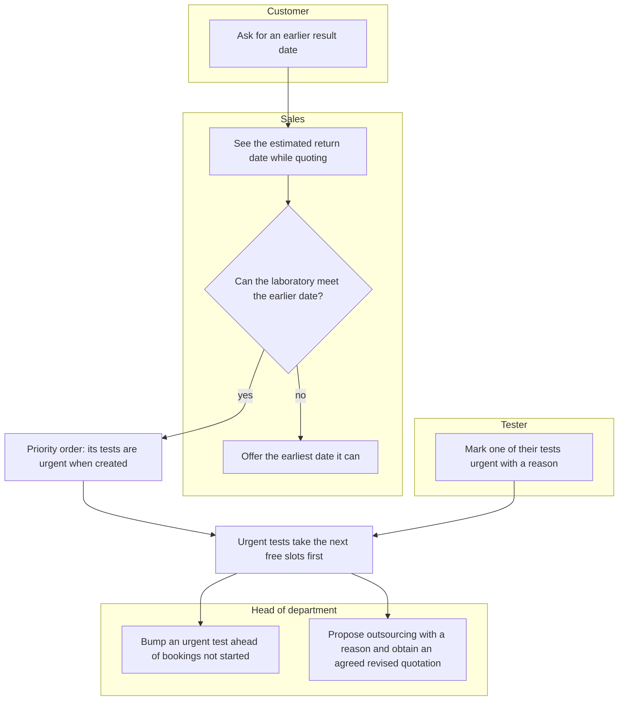

## SF-08 Laboratory setup

- **Trigger:** a laboratory starts using MediLab, or its catalog, people or rules change.
- **Result:** everything an order needs exists: the catalog with its ways of testing, prices and taxes, people and roles, approval chains and settings.
- **Stories:** US-AD01, US-AD02, US-AD03, US-AD04, US-AD05, US-AD06, US-AD07, US-AD09, US-AD10, US-AD11, US-AD13, US-AD14, US-AD15, US-AD16, US-AD17, US-AD18, US-AD19, US-AD20, US-AD26, US-AD27, US-LH04, SH-03.
- **Starts from:** an empty laboratory with the modules installed.
- **Main path:** The administrator configures parameters, ways, explicit sample-type applicability, sampling requirements and prices. The Lab Head authorizes testers per parameter without validity dates. Regulation comparison limits are optional; the measurement-to-report flow works without them.
- **Alternative paths:**
  - SF-08-A1: The administrator creates a service package; the customer orders it whole at its own price.
  - SF-08-A2: The administrator gives a person a role; the person sees the menus of that role and no others.
  - SF-08-A3: A VAT rate changes from a date; quotations dated after it use the new rate.
  - SF-08-A4: The administrator sets the approval chain of a document type; its documents are signed level by level.
- **Exceptions:**
  - SF-08-E1: A parameter without a price and tax cannot be added to a cart.
  - SF-08-E2: Archiving a record still in use is refused with the list of what uses it.
  - SF-08-E3: A code that already exists is refused.

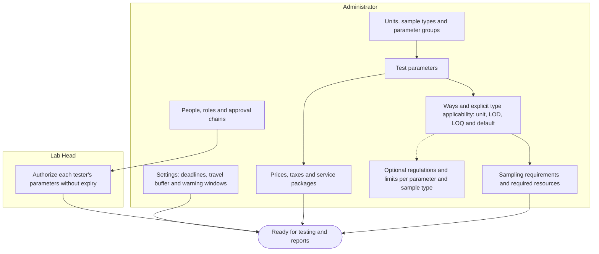

## SF-09 Customer support and feedback

- **Trigger:** a customer registers, or contacts the laboratory through the portal.
- **Result:** the customer's account and contacts are kept, their questions are answered, and a completed order can be rated.
- **Stories:** US-C01, US-C02, US-C03, US-C04, US-C05, US-C06, US-C20, US-C21, US-S03, US-S04, US-S20.
- **Starts from:** registered customers with completed and open orders.
- **Main path:** A customer opens a support request about an order; the order's salesperson answers; the request is answered and the customer notified.
- **Alternative paths:**
  - SF-09-A1: A support request about no order is visible to every salesperson until one takes it.
  - SF-09-A2: A customer registers, keeps their profile and contacts, and uploads a logo.
  - SF-09-A3: Sales invites a customer to the portal and merges a duplicate profile.
  - SF-09-A4: The customer rates a completed order.
- **Exceptions:**
  - SF-09-E1: Rating an order that is not completed, or rating it twice, is refused.
  - SF-09-E2: Another customer never sees the customer's support requests or feedback.
- **States:** support request open → answered → closed; order completed → rated.

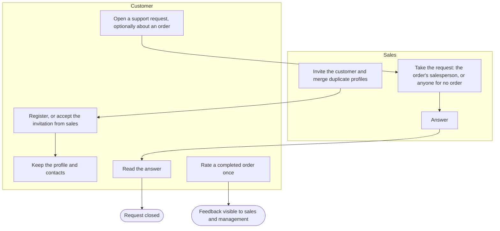

## Related documents

- [Overview](index.md)
- [Laboratory overview](laboratory_module/overview.md)
- [E-commerce overview](ecommerce_module/overview.md)
- [Shared technical features](shared.md)
- [Business rules](../business/readme.md)
