# Business flows

The business flows of MediLab from the start of each one to its business result, with the actors who take part. Each flow lists the user stories it walks through, the states it moves, and an activity diagram with one lane per actor. The diagrams show who does what and leave out how the system works inside.

The core flows WF-01 to WF-06 carry a test request from order to report. The supporting flows SF-01 to SF-11 run beside them. An alternative path is another normal route to the flow's result. An exception describes a problem and the steps that recover the work or reach its permitted outcome. Invalid-input, permission and immutability checks belong to the linked feature acceptance criteria. Each path belongs to one flow; other flows name its owner instead of repeating it. Each path starts from the state the flow names.

| Flow  | Name                                    | Actors                                                          |
| ----- | --------------------------------------- | --------------------------------------------------------------- |
| WF-01 | Order to confirmed test request         | Customer, Sales, Accountant, Head of Sales                      |
| WF-02 | Sample reception and handover           | Customer, Sample delivery staff, Head of department             |
| WF-03 | Testing assignment and scheduling       | Head of department, Tester                                      |
| WF-04 | Result entry and approval               | Tester, Head of department                                      |
| WF-05 | Outsourced testing                      | Head of department, Sample delivery staff, Subcontractor        |
| WF-06 | Report signing, release and delivery    | Lab head, Head of department, Sample delivery staff, Customer   |
| SF-01 | Invoicing and payment collection        | Accountant, Sales, Customer                                     |
| SF-02 | Order cancellation                      | Customer, Sales                                                 |
| SF-03 | Change request on a signed document     | Requester, signers of the change-request chain                  |
| SF-04 | Sample retention, return and disposal   | Tester, Sample delivery staff                                   |
| SF-05 | Machine calibration and unavailability  | Administrator, Head of department, Tester                       |
| SF-06 | Accreditation and registration renewal  | Administrator                                                   |
| SF-07 | Result dates and priority orders        | Customer, Sales, Head of department                            |
| SF-08 | Laboratory setup                        | Administrator                                                   |
| SF-09 | Customer support and feedback           | Customer, Sales                                                 |
| SF-10 | Scheduling plan and revisions           | Tester, Head of department, Sales                              |
| SF-11 | Laboratory file administration          | Head of department, Tester, Administrator                      |

## WF-01 Order to confirmed test request

- **Trigger:** a customer submits a cart on the portal, or sales creates an order for a customer.
- **Result:** the order and its test request are confirmed, with expected samples and their selected ways calculated from the accepted order and sampling requirements, and sample collection can start.
- **Stories:** US-C08, US-C09, US-C13, US-C14, US-C15, US-S01, US-S02, US-S05, US-S06, US-S07, US-S08, US-S10, US-S12, US-S15, US-A03, US-A06, US-A08.
- **States:** quotation draft → sent → accepted; order submitted → claimed → confirmed; test request draft → confirmed → paid.
- **Starts from:** a catalog with priced parameters and packages, and demo customers.
- **Main path:** A customer orders on the portal; sales claims it, confirms the selected ways and expected sampling needs, obtains Head of Sales approval if its discount or total exceeds a configured threshold, and sends it with an advance; the customer pays online; sales confirms the order, and sample collection can start.
- **Alternative paths:**
  - WF-01-A1: Sales creates the order for a customer who called, instead of the customer ordering on the portal.
  - WF-01-A2: A visitor who is not signed in submits a cart with their details and e-mail address.
  - WF-01-A3: A returning customer reorders a completed order, or sales creates the order from the customer's template.
  - WF-01-A4: The customer pays the advance by bank transfer or in cash; sales records it and the accountant confirms it.
  - WF-01-A5: The Head of Sales sends a quotation without an advance to a customer allowed to order on credit; the order goes ahead unpaid.
- **Exceptions:**
  - WF-01-E1: The customer declines the quotation with a reason; sales revises it and sends the new version, which the customer accepts.
  - WF-01-E2: The quotation passes its payment deadline and is flagged expired; sales extends it. The customer pays within the extended deadline.
- **Acceptance criteria:** See [Sales](ecommerce_module/features/sales.md) and [Customer](ecommerce_module/features/customer.md). An unavailable default is never silently replaced; choose a viable alternative explicitly or do not order that parameter and sample type. A quotation above the approval thresholds cannot be sent before Head of Sales approval. Submitting a cart without an e-mail address is refused. A confirmed order's content changes only through a revised quotation the customer accepts. The old version of a revised quotation cannot be sent or confirmed. The test request of an unpaid order whose customer may not order on credit cannot be confirmed. Another customer opening the quotation, invoice or result is denied.
- **Paths in other flows:** SF-02 for cancelling an order; SF-07 for the estimated date and priority orders.

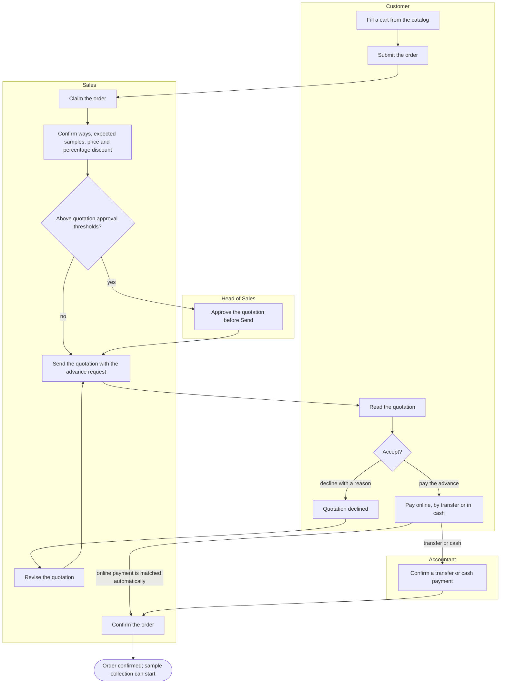

## WF-02 Sample reception and handover

- **Trigger:** samples arrive at the laboratory, or sample delivery staff collect them from the customer.
- **Result:** every sample is coded, labelled and received, and its testing tasks wait in the queue of each department that tests it.
- **Stories:** US-SD01, US-SD02, US-SD03, US-SD04, US-SD05, US-SD06, US-SD07, US-SD08, US-SD09, US-SD10, US-SD11, US-SD12, US-HD06, US-HD07.
- **States:** sample expected → received, or → on hold → received, or → rejected; test request paid → sample received.
- **Starts from:** a confirmed order whose test request expects its samples.
- **Main path:** The customer brings the samples; sample delivery staff adjust the calculated expected samples to the actual handover, record conditions and differences, obtain the customer's signature, print labels and hand samples to their departments.
- **Alternative paths:**
  - WF-02-A1: Sample delivery staff collect the samples at the customer's site from their collection task, take photos through the web interface and obtain the customer's confirmation signature. Collection feasibility includes the configurable travel buffer, 60 minutes by default.
  - WF-02-A2: Sample delivery staff create a test request at reception for a customer without an order; it skips the paid step.
  - WF-02-A3: A sample tested by two departments is handed to both, and each records its own receipt.
- **Exceptions:**
  - WF-02-E1: An insufficient sample goes on hold; the head of department asks for more; the collection task brings it back to received.
  - WF-02-E2: A mistake in a signed handover record is corrected with a new record; the old one is kept.
  - WF-02-E3: Fewer samples wait for another collection or Sales cancels the missing part.
  - WF-02-E4: Extra samples and excess material are recorded with the actual handover the customer confirms. Testing stays within the agreed scope: they add no test, change no order and stay with the sample until the customer asks for them back.
- **Acceptance criteria:** See [Sample delivery staff](laboratory_module/features/sample-delivery-staff.md) and [Head of department](laboratory_module/features/head-of-department.md). An unusable sample is rejected with its condition note and gets no testing task. A person outside the department scanning the label is refused. Confirming a test request without a sample, or a sample without a parameter, is refused. A signed handover record cannot be edited.

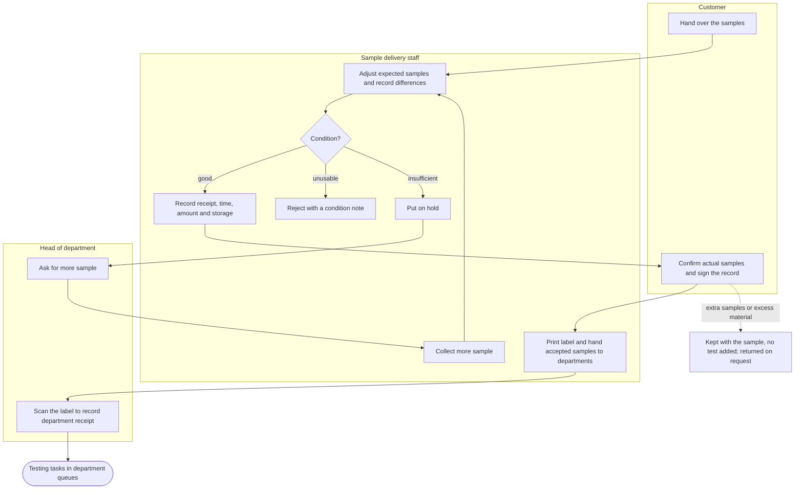

## WF-03 Testing assignment and scheduling

- **Trigger:** a testing task enters the queue of its department.
- **Result:** the test is assigned to an authorized person and booked in its agreed way, reserving required locations and a fit machine only when needed.
- **Stories:** US-HD01, US-HD02, US-HD03, US-HD05, US-T01, US-T02, US-T04, US-T21.
- **States:** sample test waiting → assigned → testing; booking proposed → scheduled → in progress → done, with machine reservations only when needed.
- **Starts from:** received samples with selected ways and department tasks, authorized people and available required resources.
- **Main path:** The head assigns an authorized tester, or that tester claims the task; the department's plan proposes a booking of the agreed way in priority order, the tester or head accepts it, and it receives a reminder. Lab Head's person-to-parameter authorization has no validity dates.
- **Alternative paths:**
  - WF-03-A1: A tester claims an unassigned task of their department instead of waiting to be assigned.
  - WF-03-A2: A booking reserves its tester and required rooms, plus a machine only if needed. Bookings whose ways use the same method share a machine for exactly the same interval, within the capacity of the machine-and-method link. A no-machine way supplies its own duration and capacity, default capacity 1.
  - WF-03-A3: The head records planned OverTime for a tester and an outside-hours interval with a reason, without a prerequisite HR overtime shift; the tester can then be booked in that interval.
- **Exceptions:**
  - WF-03-E1: The assigned tester cannot do the work; the head moves the task to another person or department with a reason, and an authorized person accepts the booking.
  - WF-03-E2: No feasible slot for the agreed way meets the due date; the head reviews viable resources and date options. SF-07 handles the committed return date, and WF-05 handles an agreed subcontracted alternative.
- **Acceptance criteria:** See [Tester](laboratory_module/features/tester.md), [Head of department](laboratory_module/features/head-of-department.md) and [SH-10](shared.md#sh-10-tasks-and-to-do-list). A second tester claiming the same task is told it is already claimed. Claiming another department's task or a parameter the tester is not authorized for is refused. Moving a task without a reason is refused. A schedule never silently changes the accepted way. Bookings share a machine only for the same method and interval, within its capacity. A sample test whose sample its department has not received cannot be booked.
- **Paths in other flows:** WF-05 for an agreed subcontracted way; SF-05 for machine disruption; SF-07 for result dates and internal due-date changes; SF-10 for urgency, moving or cancelling bookings, reminders and plan revisions.

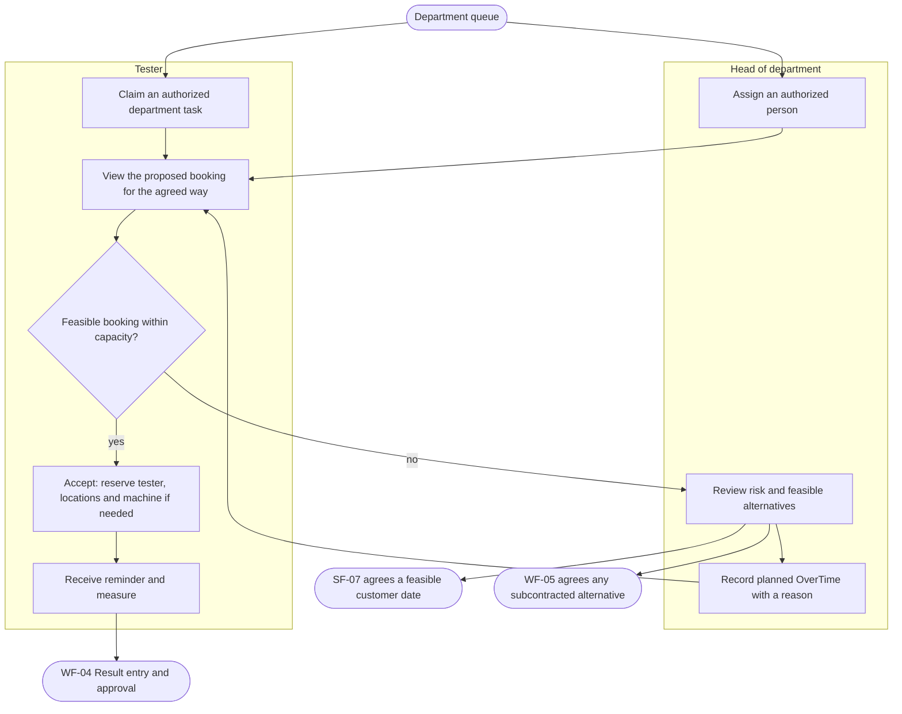

## WF-04 Result entry and approval

- **Trigger:** a booked test starts.
- **Result:** The Head of Department approves the measured result, with assessment only for requested regulation comparisons, and the sample completes when all its tests do. Laboratory files retain their versions and the result-file version relied on is signed.
- **Stories:** US-T05, US-T06, US-T07, US-T08, US-T17, US-T22, US-T23, US-T24, US-T25, US-T26, US-T27, US-HD08, US-HD09, US-HD16, US-LH05.
- **States:** sample test testing → result entered → approved, or → testing when rejected; sample testing → awaiting approval → completed; upload prepared → uploading → finalizing → completed or conflict; editing session open → saving → committed; result-file version uploaded → signed.
- **Starts from:** sample tests in testing with their bookings, on samples with and without a regulation; when files are produced, sample folders have members and are bound in Medilab Sync or opened through the back office.
- **Main path:** The tester follows the agreed method, records the result of the booking with the snapshotted unit and LOD/LOQ, assesses any requested comparison, then sends and signs the result for Head of Department approval; submitting it completes the testing task. When testing produces files, the tester saves them in the sample's folder; Medilab Sync uploads new versions and the head signs the result-file version with its hash.
- **Alternative paths:**
  - WF-04-A1: The tester confirms text for a value below LOD/LOQ; the report prints the snapshot threshold and unit and keeps a raw number if available, never zero as a substitute.
  - WF-04-A2: The tester withdraws a result they sent before the head acts.
  - WF-04-A3: The Head of Department may enter and approve their own result; the Lab Head reviews it when signing the report before issue.
  - WF-04-A4: Without requested QCVN comparison, return measurements with no pass/fail conclusion. For requested scope, any assessed failure fails that scope; all required comparisons must pass to conclude pass; otherwise record insufficient basis.
  - WF-04-A5: Changing a sample's regulation refreshes applicable limits only after confirmation and clears old comparison conversions and conclusions; signed results first require withdrawal where permitted, or change requests and new versions. Raw measurement, way and LOD/LOQ snapshots stay, and retesting requires professional assessment.
  - WF-04-A6: A colleague's new version downloads to a two-way folder on another computer.
  - WF-04-A7: A tester restores an earlier version, which becomes the new current version.
  - WF-04-A8: Two testers edit a result spreadsheet together in the browser; saving adds a version.
  - WF-04-A9: A tester locks a working file, edits it and unlocks it.
  - WF-04-A10: A tester browses and downloads a sample's files in the back office.
- **Exceptions:**
  - WF-04-E1: The head rejects the result with a reason; a new testing task opens, the tester retests with a new booking, the rejected result stays on record and the new one is approved.
  - WF-04-E2: An unusual result warns before sending; the tester sends it anyway and the head sees the warning.
  - WF-04-E3: The head cancels a test that cannot be done, with a reason; the sample completes with its other tests approved.
  - WF-04-E4: Two testers change the same file from one version; the second upload is kept as a conflict, and the tester takes the server's version with a backup of their own.
  - WF-04-E5: The head rejects a result-file version with a reason; the tester saves a corrected version, which is reviewed and signed.
  - WF-04-E6: With the editing service down, testers work in their desktop programs and Medilab Sync uploads their versions; syncing, history and restore keep working.
- **Acceptance criteria:** See [Tester](laboratory_module/features/tester.md), [Head of department](laboratory_module/features/head-of-department.md) and [Laboratory files](../specs/laboratory-files.md). An entrant other than the Head of Department cannot approve their own result. A missing applicable limit or unresolved text assessment cannot be treated as a pass. Requested comparisons explicitly state insufficient basis when appropriate. Cancelling a test without a reason, or a test with an approved result, is refused. A file outside the folder's sync rules is not uploaded. Rejecting a file version without a reason is refused. Every file version is kept and traceable, including both versions of a conflict. Samples await approval after results are submitted for approval, not merely entered; cancelled tests are excluded under the sample lifecycle rules.
- **Paths in other flows:** SF-03 for changing a result whose process is completed; WF-06 for results the Lab Head sends back; SF-11 for folders, membership, devices and abandoned locks.

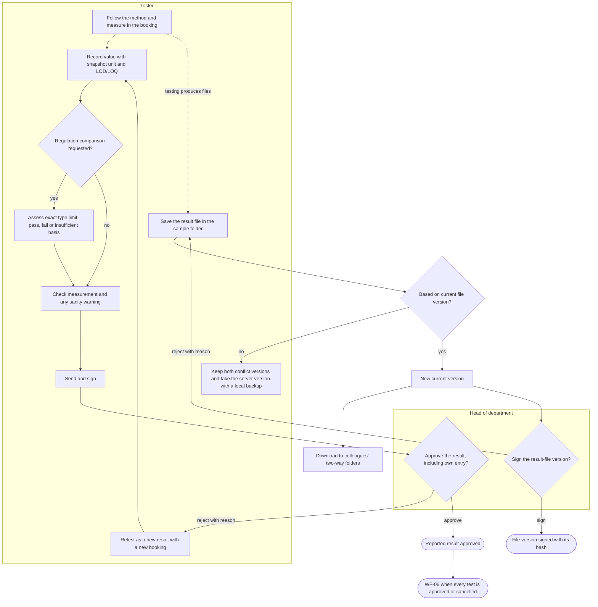

## WF-05 Outsourced testing

- **Trigger:** the agreed way is subcontracted, or a subcontracted alternative is proposed because in-house resources cannot meet the due date.
- **Result:** the subcontractor's result is approved like any other result.
- **Stories:** US-HD05, US-HD10, US-HD11, US-HD13, US-SD13, US-SUB01, US-SUB02, US-T09, US-HD08.
- **States:** sample test waiting → outsourced → result entered → approved; dispatch draft → sent → received.
- **Starts from:** sample tests with an outsourcing suggestion, and accredited subcontractors.
- **Main path:** For the agreed subcontracted way, the head creates a dispatch of sample tests with sending date, due date and returned report; staff carry it, results are entered and independently approved. Changing an accepted way first needs customer agreement through a revised quotation.
- **Alternative paths:**
  - WF-05-A1: A dispatch goes by a delivery service with its tracking number.
  - WF-05-A2: A lab QA enters the results the subcontractor sent back.
  - WF-05-A3: The head initiates an urgent outsourcing proposal with a reason; Sales obtains an agreed revised quotation before replacing an accepted way.
- **Exceptions:**
  - WF-05-E1: The head rejects the subcontractor's result; the test goes back to outsourced and a new result is entered.
  - WF-05-E2: A dispatch cannot proceed; it is cancelled before any result and its tests stay outsourced for another dispatch.
- **Acceptance criteria:** See [Head of department](laboratory_module/features/head-of-department.md) and [Subcontractor](laboratory_module/features/subcontractor.md). A dispatch whose tests have results cannot be cancelled. A subcontractor user sees only its own dispatches and never a sample's customer. An emergency proposal needs a reason; a test already running cannot be outsourced directly, and an accepted way cannot change without customer agreement.
- **Paths in other flows:** SF-06 for subcontractor accreditation expiry.

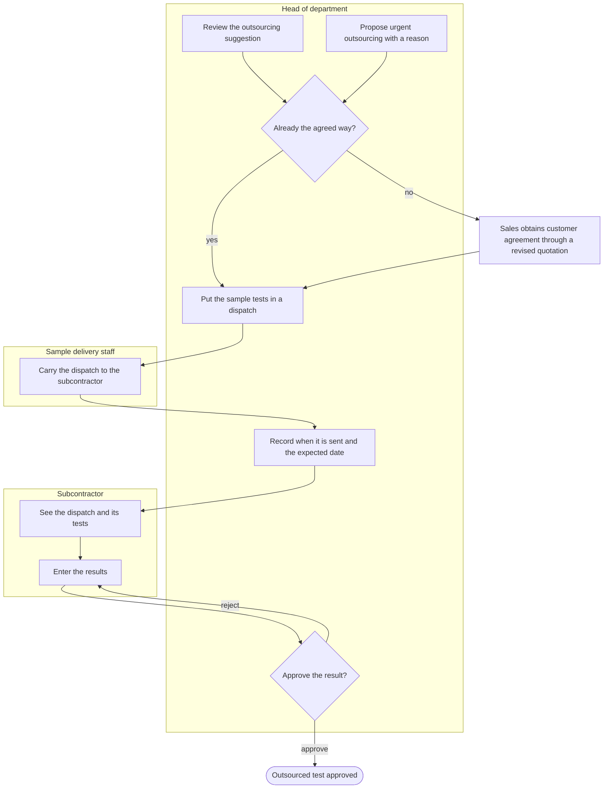

## WF-06 Report signing, release and delivery

- **Trigger:** every sample test of a test request is approved or cancelled, and the system creates the draft report and a signing task for the lab head.
- **Result:** the signed report is issued, delivered to the customer and downloadable on the portal.
- **Stories:** US-LH01, US-LH02, US-SD14, US-SD15, US-C07, US-C18, US-C19.
- **States:** test report draft → signing → issued, where signing retains final internal approval while required digital signing is pending; test request completed → reported and order completed only on issue.
- **Starts from:** test requests whose sample tests are all approved or cancelled, with their draft reports.
- **Main path:** MediLab fills the draft from an available template version and approved business data. Authorized editors prepare layout and explanatory text in ONLYOFFICE, finish saving and prepare the PDF with its reserved number. The Lab Head reviews that PDF, its approved results and any requested regulation basis, then gives final internal approval. With digital signing enabled, MediLab digitally signs that same PDF and stores it before issuing the report. Issue makes the reserved number official, updates the request and order, and enables delivery and customer notification.
- **Alternative paths:**
  - WF-06-A1: The report is delivered in person or by post; recording it sends no e-mail.
  - WF-06-A2: The request asks for an English, a Vietnamese or a bilingual report.
  - WF-06-A3: A request with a cancelled test issues a report without it.
  - WF-06-A4: With digital signing disabled, MediLab stores the reviewed PDF without a digital signature and issues it after final internal approval.
  - WF-06-A5: Editing an unsigned draft or choosing a different available template invalidates its prepared PDF and requires fresh review. A draft with signatures must first follow the permitted withdrawal order.
  - WF-06-A6: A customer collecting the report in person asks for the extra samples or excess material back; sample delivery staff return them and record what, when, by whom and to whom, without changing the sample's state.
- **Exceptions:**
  - WF-06-E1: Viettel Sign is unavailable or cannot complete signing: keep the internal approvals and the reviewed PDF, leave the report unissued and retry that same PDF. Issue and notify only after the signed PDF is stored; a replacement leaves the previous report current until then.
  - WF-06-E2: The lab head rejects the report naming results and a reason; the results go back to the head of department's queue, are approved again and the lab head signs the new task.
  - WF-06-E3: A regulation expires during testing: testing continues, but before issue the Lab Head confirms the comparison basis. Sales obtains customer agreement for a changed scope; no regulation is switched or dropped automatically.
  - WF-06-E4: A pending or failed save, editing conflict, business-data mismatch or conversion outage blocks preparation. Editors resolve the save, content or service problem, prepare a new PDF and obtain fresh review. An unchanged prepared candidate can proceed without reopening ONLYOFFICE, and an outage does not block delivery of an already issued PDF.
- **Acceptance criteria:** See [Lab head](laboratory_module/features/lab-head.md), [Test reports](../specs/test-reports.md) and [Digital signing](../specs/digital-signing.md). Rejecting a report without a reason or without naming a result is refused. An unissued report cannot be delivered, and a customer downloads only their own reports. Final internal approval does not issue a report whose required digital signature is pending or failed. No customer notification, download, delivery or replacement of an earlier report occurs before issue. The full order lifecycle runs from the portal through reception, testing and approval to the issued report.
- **Paths in other flows:** SF-03 for correcting results in an initial or replacement report and for a change request on an issued report; SF-04 for samples after issue.

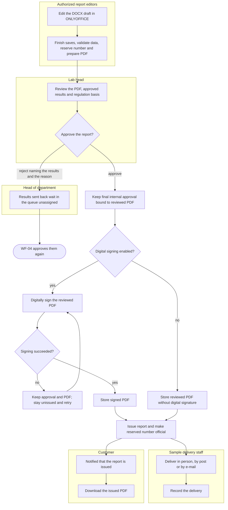

## SF-01 Invoicing and payment collection

- **Trigger:** an order needs its final invoice, or a payment arrives.
- **Result:** every invoice is paid, and each day's online payments match the PayOS transactions and are locked.
- **Stories:** US-A01, US-A02, US-A04, US-A05, US-A07, US-A08, US-A09, US-A10, US-A11, US-A12, US-A13, US-C16, US-C17, US-S11.
- **States:** invoice posted → partially paid → paid; payment pending → confirmed or rejected; reconciliation day open → locked.
- **Starts from:** orders with a paid advance whose testing is completed.
- **Main path:** The accountant creates and e-mails the final invoice; the customer pays it online; a receipt is issued and the order is paid.
- **Alternative paths:**
  - SF-01-A1: The customer pays part online, then the rest; the invoice is partially paid, then paid.
  - SF-01-A2: Sales records a cash payment; the accountant confirms it.
  - SF-01-A3: An adjustment invoice lowers or raises what is owed; the original invoice is unchanged.
- **Exceptions:**
  - SF-01-E1: The accountant rejects a payment sales recorded; the salesperson is told the reason and the invoice returns to its previous status.
  - SF-01-E2: An invoice unpaid after its due date reminds the customer at each interval.
  - SF-01-E3: A PayOS transaction with no payment is flagged; the accountant creates its payment, the flag clears and the day is locked.
- **Acceptance criteria:** See [Accountant](ecommerce_module/features/accountant.md) and [Customer](ecommerce_module/features/customer.md). A payment above the amount still owed is refused. A posted invoice cannot be edited. An online payment of a locked day cannot be changed. A repeated PayOS notification records no second payment.

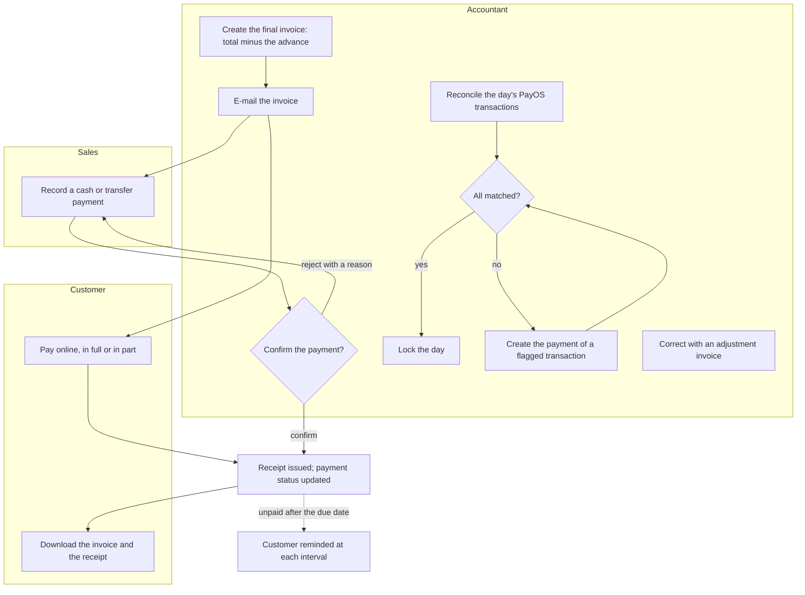

## SF-02 Order cancellation

- **Trigger:** a customer wants to cancel an order.
- **Result:** the accepted cancellation scope is cancelled, or Sales declines with a reply. Cancelling an unfulfillable part preserves other work and completed results.
- **Stories:** US-C11, US-C12, US-S16, US-S17.
- **States:** cancellation request open → accepted or declined; whole-order cancellation → order cancelled, while partial cancellation leaves the remaining work active.
- **Starts from:** orders in each status, some with completed tests.
- **Main path:** A customer requests the cancellation of a confirmed order with a reason; sales accepts; the order and its test request are cancelled.
- **Alternative paths:**
  - SF-02-A1: The customer cancels an order that is not confirmed yet, without asking.
  - SF-02-A2: Sales declines the request with a reply the customer sees on the order.
  - SF-02-A3: Sales cancels an order on their own while no testing is completed.
  - SF-02-A4: Once the order's samples are collected, cancellation goes through a change request the Head of Sales approves; before that, Sales decides alone.
  - SF-02-A5: The customer refuses a proposed later return date. Sales handles a request to cancel the unfulfillable part, keeps unaffected work and completed results, and tells the customer the decision.
- **Acceptance criteria:** See [Customer](ecommerce_module/features/customer.md), [Sales](ecommerce_module/features/sales.md) and [Head of department](laboratory_module/features/head-of-department.md). A request without a reason is refused. Whole-order cancellation with a completed test is blocked. Cancelling an unfulfillable part must preserve completed results and follow the affected sample-test rules. Cancelling an order whose samples are collected needs the Head of Sales's approval.

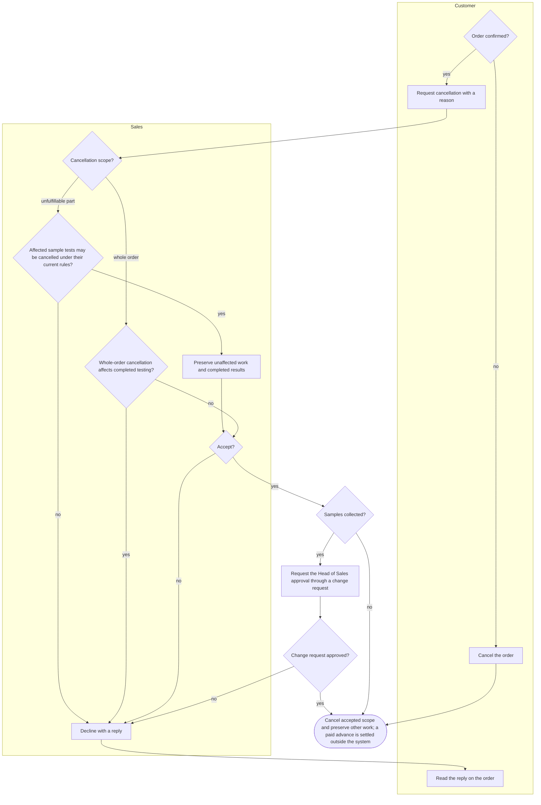

## SF-03 Change request on a signed document

- **Trigger:** a person who can edit a type of document finds a mistake in one whose process is completed, such as a result or a report.
- **Result:** a new version replaces the signed one, which is kept unchanged, or the request is rejected and the document stays as it is.
- **Stories:** US-T11, US-LH03, SH-07.
- **States:** change request requested → approved → applied, or → rejected; document version → replaced.
- **Starts from:** completed results and issued reports, and signed documents still in process.
- **Main path:** A tester raises a change request on a completed result; the change-request chain signs it; a new version replaces the old one, which stays readable.
- **Alternative paths:**
  - SF-03-A1: A change request on an issued report is approved by the lab head and creates a new report version.
  - SF-03-A2: Before the process is completed, signers withdraw in the reverse order they signed and the document can be edited again.
  - SF-03-A3: Correcting a result in an issued report automatically creates or links that report's open change request. Wait for its required approvals and all corrected results to be approved, then prepare a replacement draft and fresh signing task. Complete WF-06, including required digital signing and PDF storage, before issuing the replacement, marking the previous report replaced and notifying the customer.
  - SF-03-A4: A result correction may be proposed while an initial or replacement report awaits internal or digital signing. Before applying it, stop pending signing and return the report to draft through the permitted signature withdrawals. Completed results retain their own change requests. After correction approval, create a fresh report signing task even if the request is already reported; old tasks cannot sign stale content.
  - SF-03-A5: Quotations and orders use change requests once their process is completed.
- **Exceptions:**
  - SF-03-E1: The chain rejects a change request; the signed document stays unchanged and the reason is kept.
- **Acceptance criteria:** See [SH-07](shared.md#sh-07-signed-documents-are-locked), [Reports and change requests](laboratory_module/overview.md#reports-and-change-requests) and [Test reports](../specs/test-reports.md). A change request without what to change or why is refused. Withdrawing a signature while a signature given after it stands, or after the process is completed, is refused. A failed digital signature preserves the replacement's internal approval but leaves it unissued; the earlier issued report stays current.
- **Paths in other flows:** WF-06 owns final report approval, required digital signing, PDF storage and issue for initial and replacement reports.

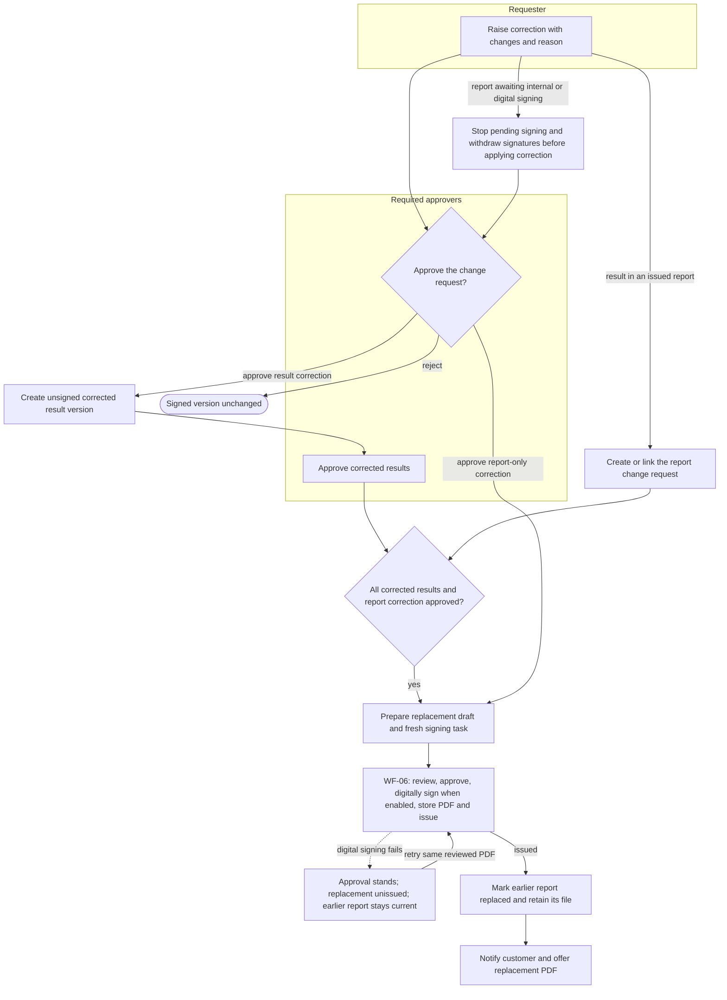

## SF-04 Sample retention, return and disposal

- **Trigger:** the report of a sample's test request is issued.
- **Result:** every sample that is not kept, or whose retention period is over, is disposed of with a record of when, by whom and how, unless the customer asked for a retained sample back after its retention period.
- **Stories:** US-T10, US-SD15.
- **States:** sample reported → retained → disposed or returned, or reported → disposed.
- **Starts from:** reported samples, kept and not kept, and samples of cancelled requests.
- **Main path:** A kept sample's retention period ends; it appears on the tester's daily to-do and the tester records its disposal.
- **Alternative paths:**
  - SF-04-A1: A sample that is not kept is disposed of right after its report.
  - SF-04-A2: A sample of a cancelled request is disposed of.
  - SF-04-A3: The customer asks for a retained sample after its retention period; sample delivery staff return it and record what, when, by whom and to whom, and the sample ends as returned.
- **Acceptance criteria:** See [Tester](laboratory_module/features/tester.md) and [Sample delivery staff](laboratory_module/features/sample-delivery-staff.md). Disposing of a sample with no method on it or its sample type is refused. A disposed sample cannot be disposed of again or changed back. A retained sample cannot be returned before its retention period ends.

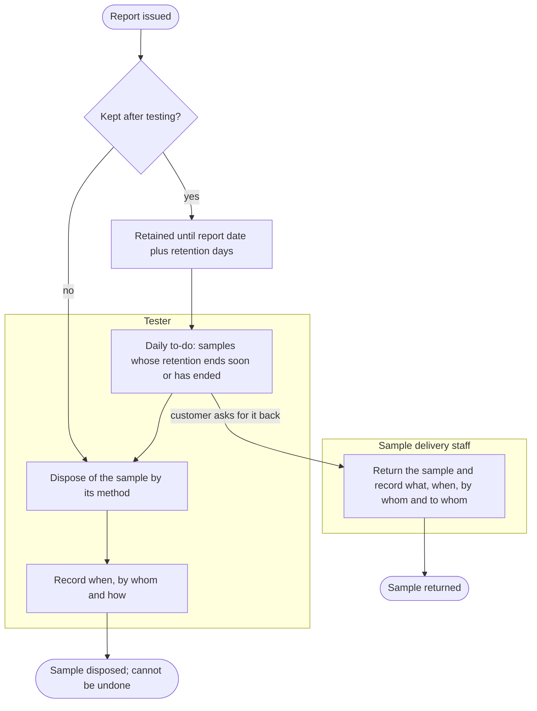

## SF-05 Machine calibration and unavailability

- **Trigger:** calibration is absent or expired, maintenance is planned or overdue, or a machine breaks or enters repair.
- **Result:** new bookings use fit machines; affected not-started work is replanned on another machine linked to the same method, interrupted measurements are retained for assessment, and unserviceable work remains visible in the queue.
- **Stories:** US-AD09, US-AD10, US-T21, US-HD03, US-HD05.
- **States:** machine in use → under repair → in use; booking scheduled → proposed again → scheduled on another machine.
- **Starts from:** machines with scheduled bookings, calibration dates and service records.
- **Main path:** The administrator records downtime; not-started bookings return to the plan and move to another machine linked to the same method if available, with notices to the tester and head. Returning to use requires all calibration, maintenance and availability conditions to be satisfied, and after a repair a calibration or maintenance record dated after it.
- **Alternative paths:**
  - SF-05-A1: A machine with no currently valid calibration, including a never-calibrated machine, gets no new booking until valid calibration is recorded, and no booking ends after its calibration validity.
  - SF-05-A2: Separate windows warn 7 days before calibration, 7 days before maintenance and 7 days after repair by default; warnings do not override a block.
  - SF-05-A3: Planned maintenance reserves downtime; overdue maintenance blocks new bookings until recorded completion.
- **Exceptions:**
  - SF-05-E1: Without another machine linked to the same method, keep the work unplaced and notify its tester and head. Sales informs the customer if the committed return date is affected. A different way needs an agreed revised quotation.
  - SF-05-E2: A breakdown or lost calibration interrupts a booking: the booking ends, its recorded data is kept as an interrupted result, and the head assesses it as usable, needing a retest or needing more sample. A retest is a new result with a new booking.
- **Acceptance criteria:** See [Administrator](laboratory_module/features/admin.md) and [Head of department](laboratory_module/features/head-of-department.md). A machine with queued, scheduled or running bookings cannot be archived.
- **Paths in other flows:** SF-10 owns queue order and rescheduling; WF-05 owns any customer-agreed change to a subcontracted way.

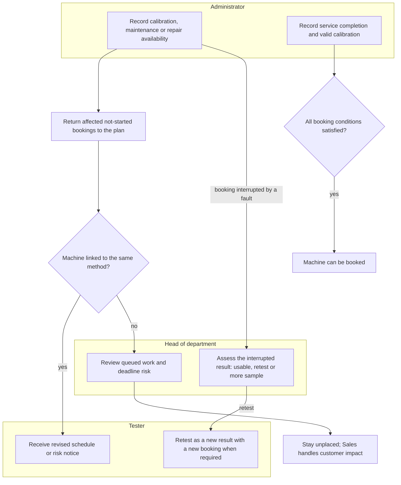

## SF-06 Accreditation and registration renewal

- **Trigger:** the laboratory receives an accreditation certificate or registers a quality dossier, or one of them, or a subcontractor's accreditation, nears its expiry.
- **Result:** reports carry the accredited and registered marks only while they are valid, and renewed dates restore them.
- **Stories:** US-AD08, US-AD12, US-AD28.
- **States:** certificate, dossier or subcontractor accreditation valid → expired → valid again when renewed.
- **Starts from:** accreditation certificates, quality dossiers and subcontractors near and past their expiry.
- **Main path:** The administrator imports scope lines identifying methods, parameters and sample types. An in-house sample test is accredited only when a valid line covers all three, allowing an ancestor sample type for accreditation scope.
- **Alternative paths:**
  - SF-06-A1: A quality dossier warns before and on its expiry day; after it, its mark is no longer printed; renewing it prints the mark again.
  - SF-06-A2: A subcontractor whose accreditation expired cannot be chosen; renewing the date makes it selectable again.
  - SF-06-A3: Archiving or restoring a certificate recomputes accreditation for matching sample tests; validity dates still apply.
- **Acceptance criteria:** See [Administrator](laboratory_module/features/admin.md). Importing a row without a code is refused; an omitted title defaults to its code. A subcontracted sample test is not within the laboratory's own accreditation scope. A method match alone is insufficient for an in-house sample test.

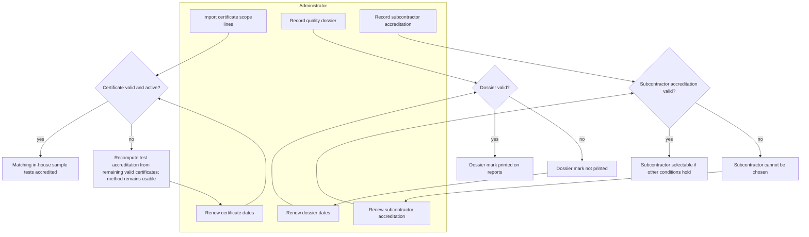

## SF-07 Result dates and priority orders

- **Trigger:** Sales prepares a quotation or changes its scope, a customer asks for earlier results, or a committed or internal result date needs review.
- **Result:** The customer has a feasible committed return date beside their requested date, internal due dates are derived or explicitly overridden, and accepted priority marks the tests urgent.
- **Stories:** US-C22, US-S21, US-S22, US-HD04, US-HD13, US-HD14.
- **States:** proposed return date → committed return date; automatic internal due dates recalculated, manual overrides retained; accepted priority → urgent tests.
- **Starts from:** quotations in preparation, authorized people and required resource schedules, and outsourced ways with transport and processing turnaround.
- **Main path:** Sales checks the estimated return date while quoting. The estimate includes every in-house and outsourced branch plus the safety margin, and reserves nothing. Sales records the customer's requested date and commits a feasible return date with the customer; automatic internal due dates follow the committed date.
- **Alternative paths:**
  - SF-07-A1: The customer requests priority on the portal; Sales accepts or declines it on the quotation after checking feasibility. Accepted priority makes its tests urgent.
  - SF-07-A2: Adding a parameter updates the estimated return date.
  - SF-07-A3: The head changes an internal due date with a reason. Preserve it when the committed return date changes; recalculate only automatic dates. The feasibility check only reads: it uses company working days, holidays and leave, proposes the earliest feasible date and reserves or moves no bookings. An infeasible date may be kept with a reason and risk flag.
- **Exceptions:**
  - SF-07-E1: A committed return date becomes infeasible: Sales offers the earliest feasible replacement and records old date, new date and customer confirmation before changing it. If refused, Sales handles a cancellation request for the unfulfillable part; no automatic cancellation or way change.
  - SF-07-E2: The requested date is infeasible; Sales offers the earliest feasible date instead. Missing outsourced transport or processing turnaround prevents a complete estimate until those values are supplied; no incomplete estimate becomes a committed return date.
- **Acceptance criteria:** See [Sales](ecommerce_module/features/sales.md), [Head of department](laboratory_module/features/head-of-department.md) and [SH-11](shared.md#sh-11-schedules-and-reminders). A date the laboratory cannot meet is not accepted as a committed return date; show the earliest feasible date. Missing outsourced turnaround means no complete estimate is available. An internal due-date override does not change the committed return date. A feasibility check reserves and moves no bookings. The customer sees the requested and committed dates, never an internal due date.
- **Paths in other flows:** SF-10 owns priority order and plan revisions; WF-05 owns any agreed subcontracted alternative; SF-02 owns cancellation of an unfulfillable part.

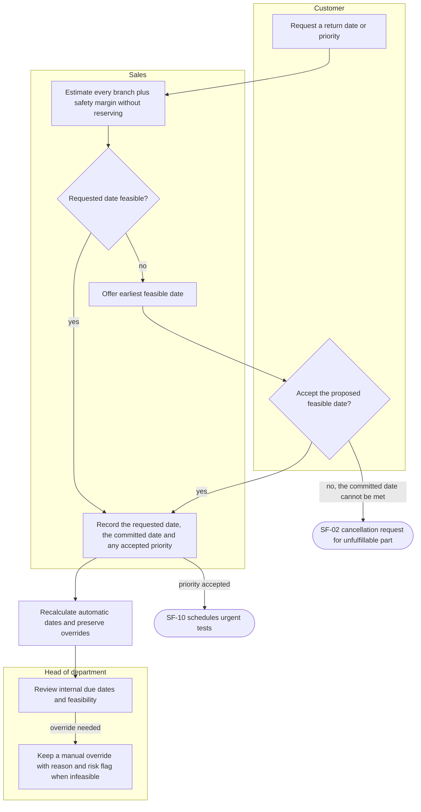

## SF-08 Laboratory setup

- **Trigger:** a laboratory starts using MediLab, or its catalog, people or rules change.
- **Result:** everything an order needs exists: the catalog with its ways of testing, prices and taxes, people and roles, approval chains and settings.
- **Stories:** US-AD01, US-AD02, US-AD03, US-AD04, US-AD05, US-AD06, US-AD07, US-AD09, US-AD10, US-AD11, US-AD13, US-AD14, US-AD15, US-AD16, US-AD17, US-AD18, US-AD19, US-AD20, US-AD26, US-AD27, US-LH04, SH-03.
- **Starts from:** an empty laboratory with the modules installed.
- **Main path:** The administrator configures parameters, ways, explicit sample-type applicability, sampling requirements and prices. The Lab Head authorizes testers per parameter without validity dates. Regulation comparison limits are optional; the measurement-to-report flow works without them.
- **Alternative paths:**
  - SF-08-A1: The administrator creates a service package; the customer orders it whole at its own price.
  - SF-08-A2: The administrator gives a person a role; the person sees the menus of that role and no others.
  - SF-08-A3: A VAT rate changes from a date; quotations dated after it use the new rate.
  - SF-08-A4: The administrator sets the approval chain of a document type; its documents are signed level by level.
- **Acceptance criteria:** See [Administrator](laboratory_module/features/admin.md). A parameter without a price and tax cannot be added to a cart. Archiving a record still in use is refused with the list of what uses it. A code that already exists is refused.

## SF-09 Customer support and feedback

- **Trigger:** a customer registers, or contacts the laboratory through the portal.
- **Result:** the customer's account and contacts are kept, their questions are answered, and a completed order can be rated.
- **Stories:** US-C01, US-C02, US-C03, US-C04, US-C05, US-C06, US-C20, US-C21, US-S03, US-S04, US-S20.
- **States:** support request open → answered → closed; order completed → rated.
- **Starts from:** registered customers with completed and open orders.
- **Main path:** A customer opens a support request about an order; the order's salesperson answers; the request is answered and the customer notified.
- **Alternative paths:**
  - SF-09-A1: A support request about no order is visible to every salesperson until one takes it.
  - SF-09-A2: A customer registers, keeps their profile and contacts, and uploads a logo.
  - SF-09-A3: Sales invites a customer to the portal and merges a duplicate profile.
  - SF-09-A4: The customer rates a completed order.
- **Acceptance criteria:** See [Customer](ecommerce_module/features/customer.md) and [Sales](ecommerce_module/features/sales.md). Rating an order that is not completed, or rating it twice, is refused. Another customer never sees the customer's support requests or feedback.

## SF-10 Scheduling plan and revisions

- **Trigger:** testing work arrives, or urgency, a booking change, a result, a cancellation, resource availability or a customer date changes the plan.
- **Result:** Bookings of the agreed way reserve available testers and required locations, plus fit machines when needed; work is planned by priority, deadline risks remain visible until resolved, and no committed return date is passed without the customer's agreement.
- **Stories:** US-T03, US-T19, US-T20, US-HD04, US-HD09, US-HD12, US-HD14, SH-11.
- **States:** booking proposed → scheduled → in progress → done, or cancelled; plan revision proposed → approved by each affected department → applied, with moves that would miss a committed date held back.
- **Starts from:** proposed and scheduled bookings, including bookings sharing a machine interval and ways without machines, with authorized testers and required resources.
- **Main path:** The plan places received, not-started work one at a time by priority class, urgent, due soon, then normal, then by committed return date and arrival, each in the earliest interval where its tester, machine when needed and required locations are free. An accepted booking keeps those reservations together, then progresses through testing and result entry.
- **Alternative paths:**
  - SF-10-A1: A tester or head marks an eligible test urgent with a reason, or removes the mark; accepted priority also makes tests urgent.
  - SF-10-A2: The tester moves or cancels their not-started booking, or the head does so for the department, which pins it. Update all required reservations together; cancelling returns the sample test to the plan without cancelling it.
  - SF-10-A3: The head cancels a sample test with no approved result and a reason. Cancel its testing task and end only its own booking; bookings sharing its machine interval continue.
  - SF-10-A4: Moving a booking cancels its unsent old reminder and schedules the new one; send immediately inside the warning window and deduplicate the update.
  - SF-10-A5: Entering the result or marking the measurement finished frees the machine before the booking's end.
- **Exceptions:**
  - SF-10-E1: Urgent work needs a slot that scheduled bookings hold: the recalculation becomes a plan revision listing every moved booking with its new slot, internal due date and committed return date. The head of each affected department approves the moves in their department, and their people are notified once applied; running bookings are never moved.
  - SF-10-E2: A move would pass its internal due date and so miss a committed return date: it is held back and its booking keeps its slot until Sales records the customer's agreement to a new date (SF-07); the other moves are recalculated without it. The head may instead free capacity with planned OverTime or another machine linked to the same method. A proposed different way follows WF-05 and customer agreement.
  - SF-10-E3: A sample test whose planned finish is after its internal due date, that no free slot lets finish by then, or whose booking overran sends an initial risk notice and daily consolidated summaries to its tester and head until resolved. Sales notifies the customer only when the committed return date is affected or at risk. An overrunning booking keeps its machine and flags the next bookings on it; entering the result clears it.
  - SF-10-E4: Approved leave or a room-unavailable interval returns overlapping not-started bookings to the plan for head assignment or authorized claiming.
- **Acceptance criteria:** See [Tester](laboratory_module/features/tester.md), [Head of department](laboratory_module/features/head-of-department.md) and [SH-11](shared.md#sh-11-schedules-and-reminders). Marking a test urgent without a reason is refused. A tester cannot mark another person's task urgent. Running bookings, and bookings the head moved by hand, are never moved by a plan revision. Replanning preserves the accepted way and the bookings sharing a machine interval.
- **Paths in other flows:** WF-03 owns initial assignment and accepting bookings; SF-05 owns machine faults and service availability; WF-05 owns agreed outsourcing; SF-07 owns changes to the committed return date and internal due dates.

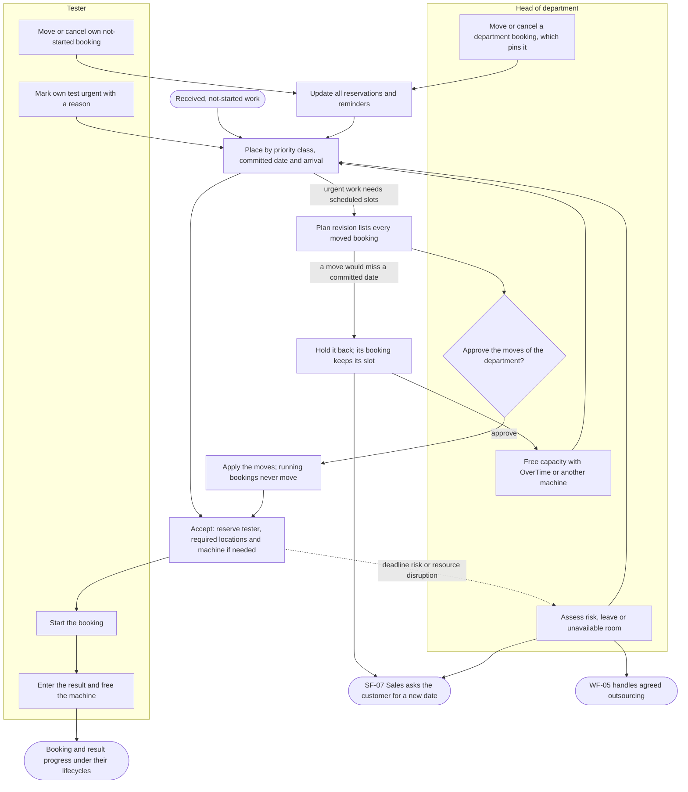

## SF-11 Laboratory file administration

- **Trigger:** a sample needs its folders, or a folder, membership, device or lock needs administration.
- **Result:** The sample's folders and members support testing, device access is controlled, and abandoned locks or unavailable folders can be addressed while stored versions remain traceable.
- **Stories:** US-HD15, US-T28, US-T29, US-AD29, US-AD30, US-AD31.
- **States:** folder in use → turned off → in use, or archived; device signed in → revoked; lock active → released or expired.
- **Starts from:** samples without folders, folders with members and bound computers, and active or abandoned locks.
- **Main path:** The head of department creates a sample's raw-data and result folders, and the owner adds testers as members. Testers bind their authorized folders in Medilab Sync.
- **Alternative paths:**
  - SF-11-A1: A folder owner adds or removes members under the folder permissions.
  - SF-11-A2: A tester signs in on another authorized computer and binds their folders.
  - SF-11-A3: An administrator archives a folder and keeps its versions and retention information; archiving does not delete stored content.
  - SF-11-A4: An administrator turns a folder off; it refuses uploads and still allows downloads. Turning it on restores its availability.
- **Exceptions:**
  - SF-11-E1: A working file remains locked by someone who left; uploads stay refused until an administrator releases the abandoned lock.
  - SF-11-E2: A tester loses a computer; the administrator revokes that device, and the tester uses an authorized computer while their other devices keep working.
- **Acceptance criteria:** See [Laboratory files](../specs/laboratory-files.md), [Tester](laboratory_module/features/tester.md) and [Administrator](laboratory_module/features/admin.md). Uploading a file someone else has locked is refused. A revoked device can no longer sync, and the person's other devices keep working. A removed member's pending files are paused and nothing on their computer is deleted. A turned-off folder refuses uploads and still allows downloads.
- **Paths in other flows:** WF-04 owns saving, versioning, online editing and signing result files.

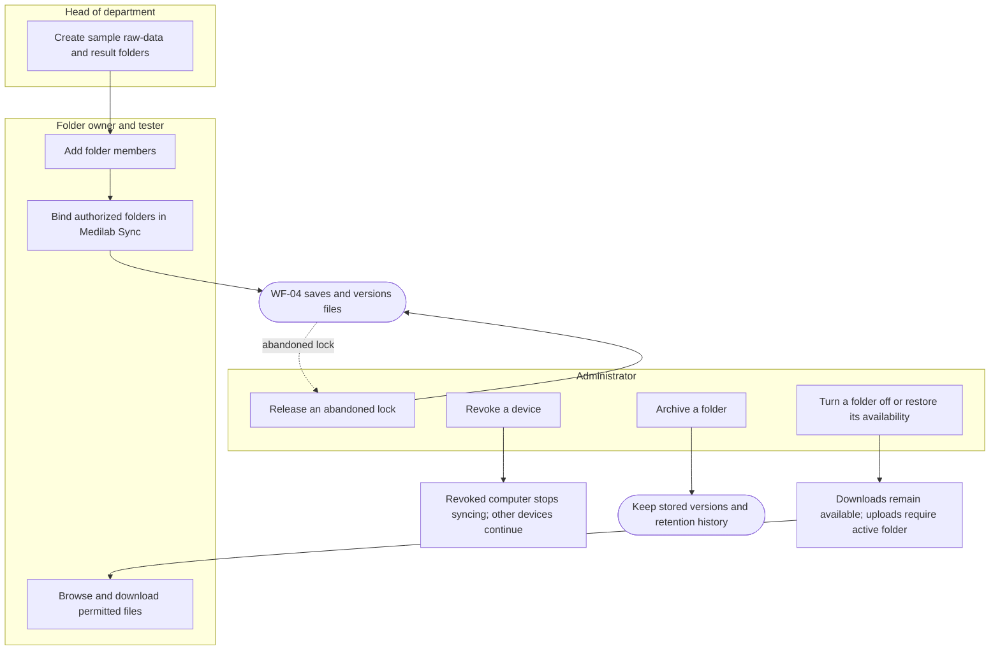

## Related documents

- [Overview](index.md)
- [Laboratory overview](laboratory_module/overview.md)
- [E-commerce overview](ecommerce_module/overview.md)
- [Shared technical features](shared.md)
- [Business rules](../business/readme.md)
