# Business flows

The business flows of MediLab from the start of each one to its business result, with the actors who take part. Each flow lists the user stories it walks through, the states it moves, and an activity diagram with one lane per actor. The diagrams show who does what and leave out how the system works inside.

The core flows WF-01 to WF-06 carry a test request from order to report, and WF-07 keeps the laboratory files the testing work produces. The supporting flows SF-01 to SF-10 run beside them. An alternative path is another normal way to the flow's result. An exception starts when something goes wrong and shows how another actor or extra steps still bring the flow to its result; refusing invalid input is an acceptance criterion of a feature, not a path. Each path belongs to one flow alone; a flow that also touches a path names the flow that holds it. Each path starts from the state the flow names, so no path repeats the steps of the flows before it.

| Flow  | Name                                    | Actors                                                          |
| ----- | --------------------------------------- | --------------------------------------------------------------- |
| WF-01 | Order to approved test request          | Customer, Sales, Accountant, Head of Sales                      |
| WF-02 | Sample reception and handover           | Customer, Sample delivery staff, Head of department             |
| WF-03 | Testing assignment and scheduling       | Head of department, Tester                                      |
| WF-04 | Result entry and approval               | Tester, Head of department                                      |
| WF-05 | Outsourced testing                      | Head of department, Sample delivery staff, Subcontractor        |
| WF-06 | Report signing, release and delivery    | Lab head, Head of department, Sample delivery staff, Customer   |
| WF-07 | Laboratory files                        | Tester, Head of department, Administrator                       |
| SF-01 | Invoicing and payment collection        | Accountant, Sales, Customer                                     |
| SF-02 | Order cancellation                      | Customer, Sales                                                 |
| SF-03 | Change request on a signed document     | Requester, signers of the change-request chain                  |
| SF-04 | Sample retention and disposal           | Tester                                                          |
| SF-05 | Machine calibration and unavailability  | Administrator, Head of department, Tester                       |
| SF-06 | Accreditation and registration renewal  | Administrator                                                   |
| SF-07 | Result dates and priority orders        | Customer, Sales, Head of department, Administrator              |
| SF-08 | Laboratory setup                        | Administrator                                                   |
| SF-09 | Customer support and feedback           | Customer, Sales                                                 |
| SF-10 | Machine queue and rescheduling          | Tester, Head of department                                      |

## WF-01 Order to approved test request

- **Trigger:** a customer submits a cart on the portal, or sales creates an order for a customer.
- **Result:** the order is approved and its test request is confirmed, with one expected sample for each sample on the quotation.
- **Stories:** US-C08, US-C09, US-C13, US-C14, US-C15, US-S01, US-S02, US-S05, US-S06, US-S07, US-S08, US-S10, US-S12, US-S13, US-S14, US-S15, US-A03, US-A06, US-A08.
- **States:** quotation draft → sent → accepted; order submitted → claimed → confirmed, approval requested → approved; test request draft → confirmed → paid.
- **Starts from:** a catalog with priced parameters and packages, and demo customers.
- **Main path:** A customer orders on the portal; sales claims it, puts the lines on samples and sends the quotation with an advance; the customer pays online; sales confirms and requests approval; the Head of Sales signs.
- **Alternative paths:**
  - WF-01-A1: Sales creates the order for a customer who called, instead of the customer ordering on the portal.
  - WF-01-A2: A visitor who is not signed in submits a cart with their details and e-mail address, and becomes a customer.
  - WF-01-A3: A returning customer reorders a completed order, or sales creates the order from the customer's template.
  - WF-01-A4: The customer pays the advance by bank transfer or in cash; sales records it and the accountant confirms it.
  - WF-01-A5: The Head of Sales sends a quotation without an advance to a customer allowed to order on credit; the order goes ahead unpaid.
- **Exceptions:**
  - WF-01-E1: The customer declines the quotation with a reason; sales revises it and sends the new version, which the customer accepts.
  - WF-01-E2: The quotation passes its payment deadline unpaid and is flagged expired; sales extends it and the customer pays.
  - WF-01-E3: The Head of Sales rejects the approval with a reason; sales is told, corrects the order and requests approval again, and the Head of Sales signs.
  - WF-01-E4: Sales needs to change an order under approval; they withdraw the request, change it and request approval again.
- **Paths in other flows:** SF-02 for cancelling an order; SF-07 for the estimated date and priority orders.

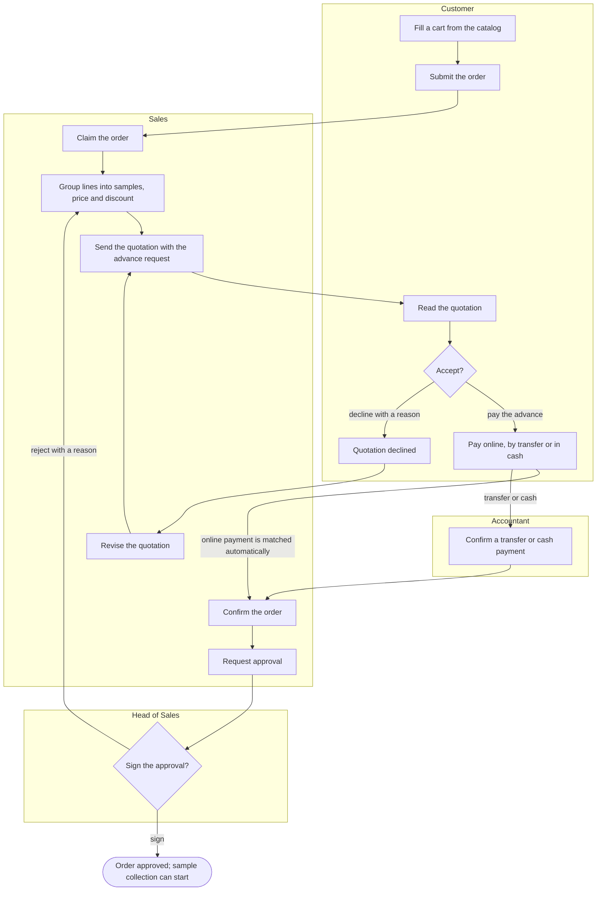

## WF-02 Sample reception and handover

- **Trigger:** samples arrive at the laboratory, or sample delivery staff collect them from the customer.
- **Result:** every sample is coded, labelled and received, and its testing tasks wait in the queue of each department that tests it.
- **Stories:** US-SD01, US-SD02, US-SD03, US-SD04, US-SD05, US-SD06, US-SD07, US-SD08, US-SD09, US-SD10, US-SD11, US-SD12, US-HD06, US-HD07.
- **States:** sample expected → received, or → on hold → received, or → rejected; test request paid → sample received.
- **Starts from:** an approved order whose test request expects its samples.
- **Main path:** The customer brings the samples; sample delivery staff record each receipt in good condition, print its label, the customer signs the handover record and the department scans the label.
- **Alternative paths:**
  - WF-02-A1: Sample delivery staff collect the samples at the customer's site from their collection task, take photos and have the customer sign on the phone.
  - WF-02-A2: Sample delivery staff create a test request at reception for a customer without an order; it skips the paid step.
  - WF-02-A3: A sample tested by two departments is handed to both, and each records its own receipt.
- **Exceptions:**
  - WF-02-E1: A sample arrives insufficient; it goes on hold, the head of department asks for more, sample delivery staff collect it through a collection task, and it is received.
  - WF-02-E2: A sample arrives unusable; it is rejected with its condition note and the request goes on with its other samples.
  - WF-02-E3: A signed handover record holds a mistake; staff make a corrected record for the customer to sign, and the old one is kept.

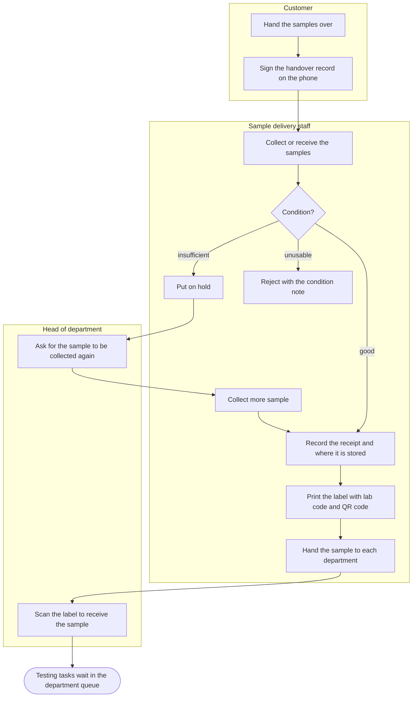

## WF-03 Testing assignment and scheduling

- **Trigger:** a testing task enters the queue of its department.
- **Result:** the test is assigned and booked on the fit machine, and the rooms of its method's steps, that finish it soonest before its due date.
- **Stories:** US-HD01, US-HD02, US-HD03, US-HD05, US-T01, US-T02, US-T04, US-T21.
- **States:** sample test waiting → assigned → testing; machine booking queued → scheduled.
- **Starts from:** received samples whose testing tasks wait in the department queue, and fit machines.
- **Main path:** The head of department assigns a sample to a tester; the scheduler recommends the way of testing and machine that finish soonest within the due date; the tester books it and it shows on the schedule with a reminder.
- **Alternative paths:**
  - WF-03-A1: A tester claims an unassigned task of their department instead of waiting to be assigned.
  - WF-03-A2: A test with a step in a bookable room books the machine and the room together.
- **Exceptions:**
  - WF-03-E1: The assigned tester cannot do the work; the head of department moves the task to another person or department with a reason, and that person books it.
  - WF-03-E2: No fit machine can finish the test before its due date; the scheduler suggests outsourcing it, and the head of department accepts the suggestion.
- **Paths in other flows:** SF-07 for how due dates are set; SF-10 for the booking once it is in the machine's queue; WF-05 for the outsourcing that follows.

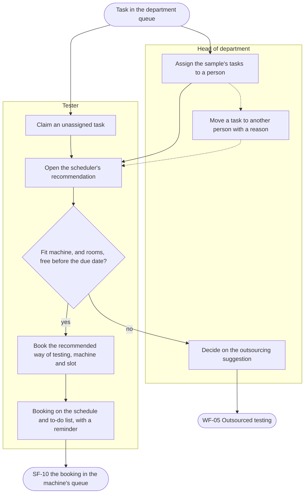

## WF-04 Result entry and approval

- **Trigger:** a booked test is run.
- **Result:** the reported result is approved against the sample's regulation limit, and the sample is completed once all its tests are.
- **Stories:** US-T05, US-T06, US-T07, US-T08, US-T17, US-T22, US-HD08, US-HD09.
- **States:** sample test testing → result entered → approved, or → testing when rejected; sample testing → awaiting approval → completed.
- **Starts from:** sample tests in testing with their bookings, on samples with and without a regulation.
- **Main path:** The tester follows the method's steps, enters a number and its conclusion, sends and signs it; the head approves it and the sample is completed.
- **Alternative paths:**
  - WF-04-A1: The tester enters a text result, such as Not detected.
  - WF-04-A2: The tester withdraws a result they sent, corrects it and sends it again before the head acts.
- **Exceptions:**
  - WF-04-E1: The head rejects the result with a reason; the tester retests, the rejected result stays on record and the new one is approved.
  - WF-04-E2: An unusual result warns before sending; the tester checks it, sends it anyway and the head sees the warning before approving.
  - WF-04-E3: A test cannot be done on the sample; the head cancels it with a reason and the sample completes with its other tests approved.
- **Paths in other flows:** SF-03 for changing a result whose process is completed; WF-06 for results the lab head sends back.

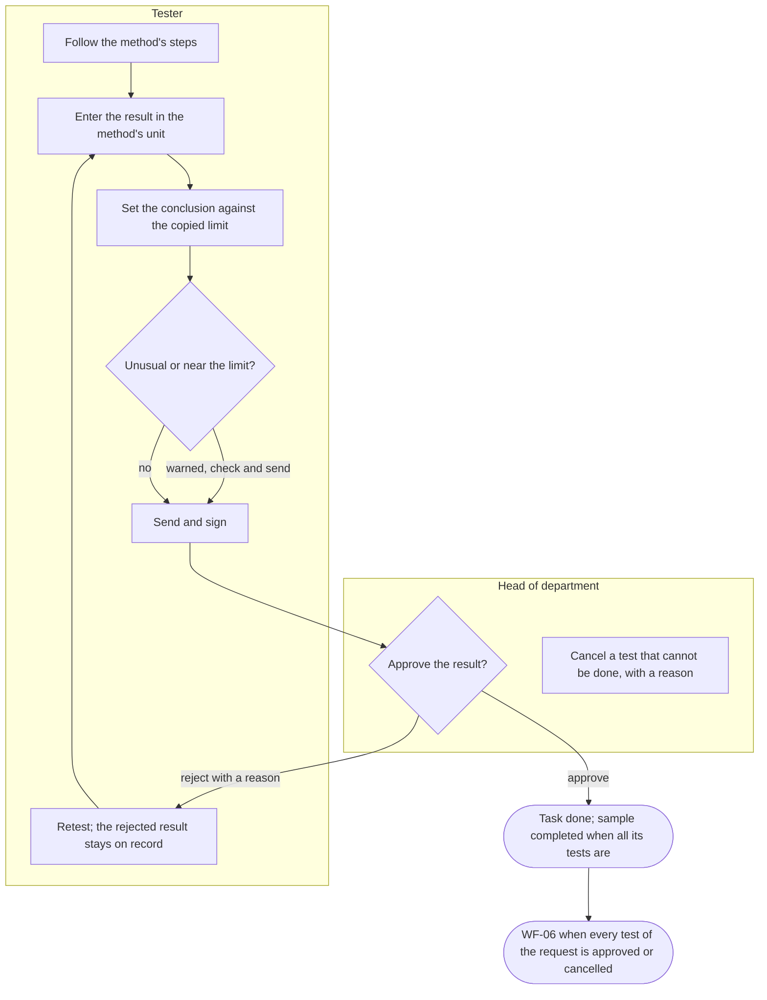

## WF-05 Outsourced testing

- **Trigger:** no fit machine can finish a test before its due date, or the head of department outsources it straight away in an emergency.
- **Result:** the subcontractor's result is approved like any other result.
- **Stories:** US-HD05, US-HD10, US-HD11, US-HD13, US-SD13, US-SUB01, US-SUB02, US-T09, US-HD08.
- **States:** sample test waiting → outsourced → result entered → approved; dispatch draft → sent → received.
- **Starts from:** sample tests with an outsourcing suggestion, and accredited subcontractors.
- **Main path:** The head accepts the suggestion; sample delivery staff carry the dispatch; the subcontractor enters the result; the head approves it.
- **Alternative paths:**
  - WF-05-A1: A dispatch goes by a delivery service with its tracking number.
  - WF-05-A2: The subcontractor sends its results back on paper; a lab QA enters them.
  - WF-05-A3: The head outsources a test straight away in an emergency, with a reason.
- **Exceptions:**
  - WF-05-E1: The head rejects the subcontractor's result; the test goes back to outsourced and the subcontractor enters a new result, which is approved.
  - WF-05-E2: A dispatch cannot go out; it is cancelled before any result and its tests go in another dispatch.
- **Paths in other flows:** SF-06 for subcontractor accreditation expiry.

```mermaid
flowchart TD
    subgraph lane12 ["Head of department"]
        h1[Accept the outsourcing suggestion] --> h2[Put the tests in a dispatch]
        h0[Outsource straight away with a reason] --> h2
        h3[Record when it is sent and the expected date]
        h4{Approve the result?}
    end
    subgraph lane13 ["Sample delivery staff"]
        d1[Carry the dispatch to the subcontractor]
    end
    subgraph lane14 ["Subcontractor"]
        s1[See the dispatch and its tests] --> s2[Enter the results]
    end
    h2 --> d1 --> h3 --> s1
    s2 --> h4
    h4 -->|reject| s2
    h4 -->|approve| done([Outsourced test approved])
```

## WF-06 Report signing, release and delivery

- **Trigger:** every sample test of a test request is approved or cancelled, and the system creates the draft report and a signing task for the lab head.
- **Result:** the signed report is issued, delivered to the customer and downloadable on the portal.
- **Stories:** US-LH01, US-LH02, US-SD14, US-C07, US-C18, US-C19.
- **States:** test report draft → signing → issued; test request completed → reported; order completed.
- **Starts from:** test requests whose sample tests are all approved or cancelled, with their draft reports.
- **Main path:** The lab head signs the report; it gets a number and a signed PDF; staff record an e-mail delivery; the customer is notified and downloads it.
- **Alternative paths:**
  - WF-06-A1: The report is delivered in person or by post; recording it sends no e-mail.
  - WF-06-A2: The request asks for an English, a Vietnamese or a bilingual report.
  - WF-06-A3: A request with a cancelled test issues a report without it.
  - WF-06-A4: The lifecycle test: one order runs from the portal through reception, testing and approval to the issued report.
- **Exceptions:**
  - WF-06-E1: The lab head rejects the report naming results and a reason; the results go back to the head of department's queue, are approved again, and the lab head signs the new task.
  - WF-06-E2: Viettel Sign is unavailable when the lab head signs; the report is not marked signed, signing is retried and the report is issued once it succeeds.
- **Paths in other flows:** SF-03 for a change request on an issued report; SF-04 for the samples after the report.

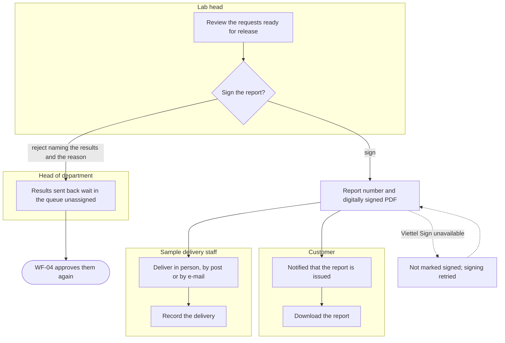

## WF-07 Laboratory files

- **Trigger:** a tester saves a file in a folder bound in Medilab Sync, or a head of department creates a sample's folders.
- **Result:** every version of every laboratory file is kept and traceable, conflicts keep both versions, and the version a report relies on is signed.
- **Stories:** US-T23, US-T24, US-T25, US-T26, US-T27, US-T28, US-T29, US-HD15, US-HD16, US-AD29, US-AD30, US-AD31.
- **States:** upload prepared → uploading → finalizing → completed or conflict; editing session open → saving → committed; lock active → released or expired.
- **Starts from:** sample folders with members, bound on two testers' computers, and the editing service running.
- **Main path:** A tester saves a result file in a bound folder; Medilab Sync uploads it as a new version; the head of department signs that version.
- **Alternative paths:**
  - WF-07-A1: The head of department creates a sample's raw-data and result folders, and the owner adds the testers as members.
  - WF-07-A2: A colleague's new version downloads to a two-way folder on another computer.
  - WF-07-A3: A tester restores an earlier version, which becomes the new current version.
  - WF-07-A4: Two testers edit a result spreadsheet together in the browser; saving adds a version.
  - WF-07-A5: A tester locks a working file, edits and unlocks it.
  - WF-07-A6: A tester browses and downloads a sample's files in the back office.
  - WF-07-A7: An administrator archives a folder; it keeps every version until its retention date.
- **Exceptions:**
  - WF-07-E1: Two testers change the same file from one version; the second upload is kept as a conflict, and that tester takes the server's version with a backup of their own.
  - WF-07-E2: A file stays locked by someone who left; uploads are refused until an administrator releases the lock.
  - WF-07-E3: A tester's computer is lost; an administrator revokes its device and the tester signs in on another computer and goes on.
  - WF-07-E4: A member loses access to a folder; their pending files pause, nothing on the computer is deleted, and they upload once access is given back.
  - WF-07-E5: An administrator turns a folder off; new files wait and upload once it is turned on again.
  - WF-07-E6: The editing service is down; the tester saves the file in its own program, Medilab Sync uploads it, and history and restore keep working.
  - WF-07-E7: The head rejects a result file version with a reason; the tester saves a corrected version, which the head signs.

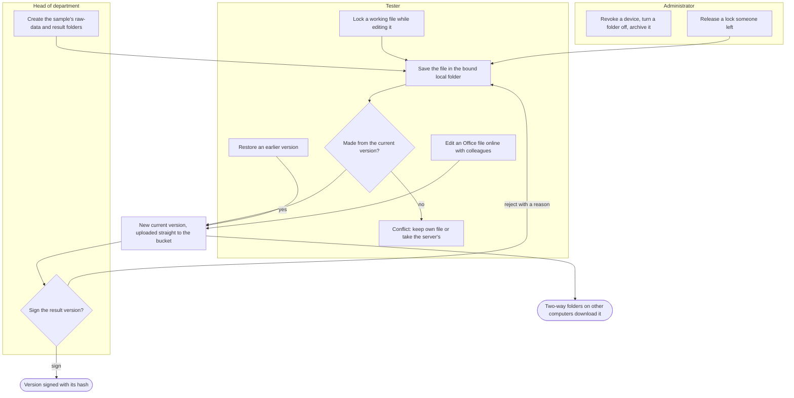
## SF-01 Invoicing and payment collection

- **Trigger:** an order needs its final invoice, or a payment arrives.
- **Result:** every invoice is paid, and each day's online payments match the PayOS transactions and are locked.
- **Stories:** US-A01, US-A02, US-A04, US-A05, US-A07, US-A08, US-A09, US-A10, US-A11, US-A12, US-A13, US-C16, US-C17, US-S11.
- **States:** invoice posted → partially paid → paid; payment pending → confirmed or rejected; reconciliation day open → locked.
- **Starts from:** orders with a paid advance whose testing is completed.
- **Main path:** The accountant creates and e-mails the final invoice; the customer pays it online; a receipt is issued and the order is paid.
- **Alternative paths:**
  - SF-01-A1: The customer pays part online, then the rest; the invoice is partially paid, then paid.
  - SF-01-A2: Sales records a cash payment; the accountant confirms it.
  - SF-01-A3: An adjustment invoice lowers or raises what is owed; the original invoice is unchanged.
- **Exceptions:**
  - SF-01-E1: The accountant rejects a payment sales recorded; the salesperson is told the reason, records the correct one, and the accountant confirms it.
  - SF-01-E2: An invoice is still unpaid after its due date; the customer is reminded at each interval until they pay.
  - SF-01-E3: A PayOS transaction has no payment in MediLab; it is flagged, the accountant creates its payment, the flag clears and the day is locked.

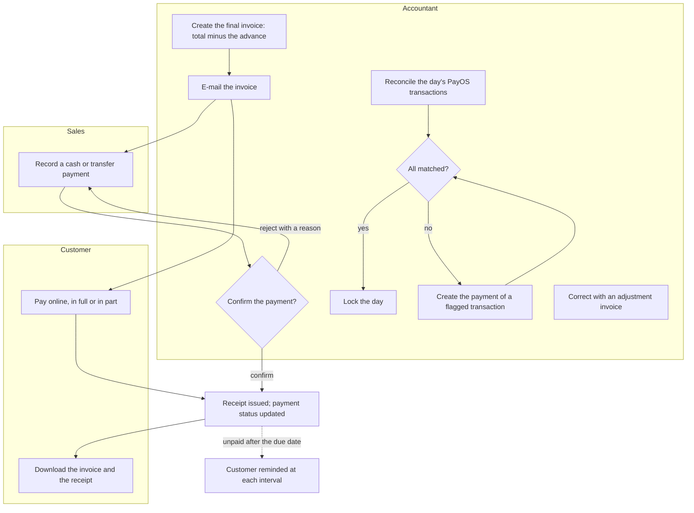

## SF-02 Order cancellation

- **Trigger:** a customer wants to cancel an order.
- **Result:** the order and everything the laboratory created for it are cancelled, or the request is declined with a reply.
- **Stories:** US-C11, US-C12, US-S16, US-S17.
- **States:** cancellation request open → accepted or declined; order → cancelled.
- **Starts from:** orders in each status, some with completed tests.
- **Main path:** A customer requests the cancellation of a confirmed order with a reason; sales accepts; the order and its test request are cancelled.
- **Alternative paths:**
  - SF-02-A1: The customer cancels an order that is not confirmed yet, without asking.
  - SF-02-A2: Sales cancels an order on their own while no testing is completed.
- **Exceptions:**
  - SF-02-E1: Sales declines the request with a reply the customer sees on the order, and the order goes on.
  - SF-02-E2: The order is already approved; it is cancelled through a change request the Head of Sales approves.

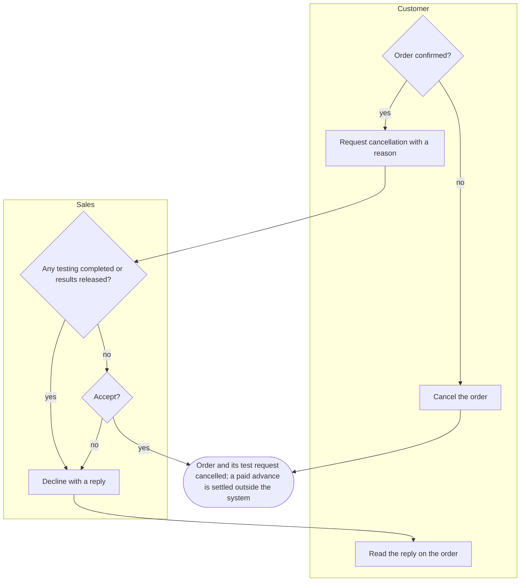

## SF-03 Change request on a signed document

- **Trigger:** a person who can edit a type of document finds a mistake in one whose process is completed, such as a result or a report.
- **Result:** a new version replaces the signed one, which is kept unchanged, or the request is rejected and the document stays as it is.
- **Stories:** US-T11, US-LH03, SH-07.
- **States:** change request requested → approved → applied, or → rejected; document version → replaced.
- **Starts from:** completed results and issued reports, and signed documents still in process.
- **Main path:** A tester raises a change request on a completed result; the change-request chain signs it; a new version replaces the old one, which stays readable.
- **Alternative paths:**
  - SF-03-A1: A change request on an issued report is approved by the lab head and creates a new report version.
  - SF-03-A2: Before the process is completed, signers withdraw from the top level down, the document is corrected and signed again.
- **Exceptions:**
  - SF-03-E1: The chain rejects the change request with a reason; the signed document stays unchanged and the requester sees why.

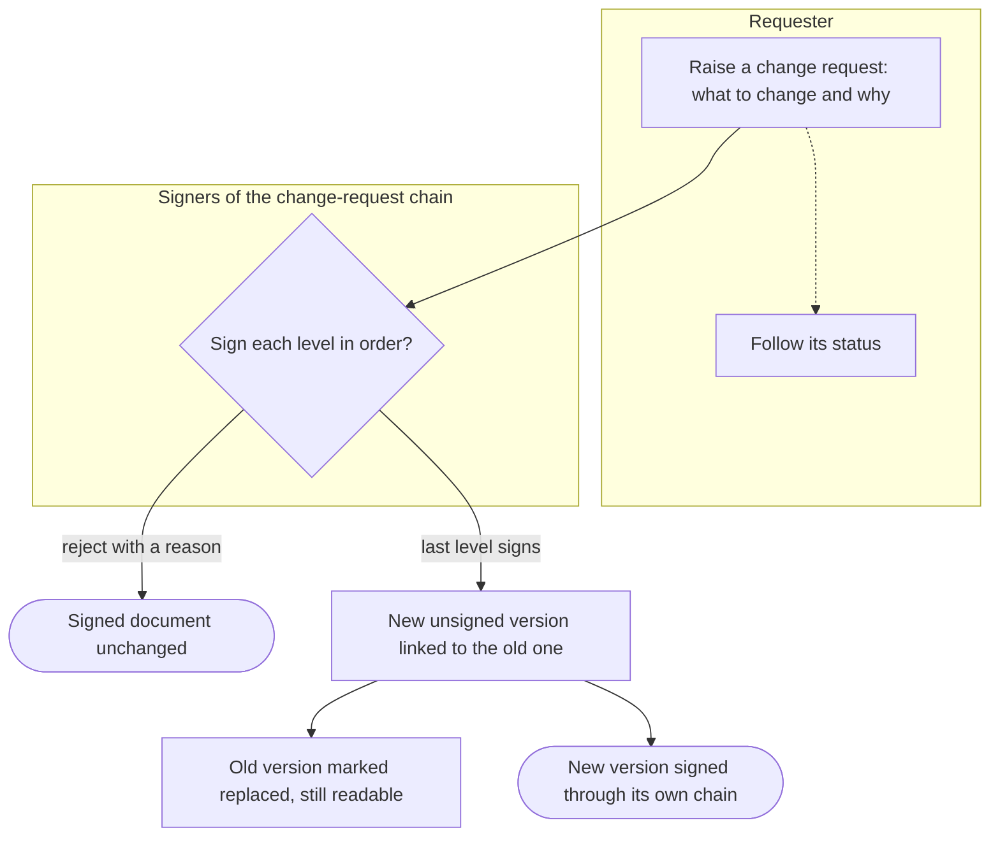

## SF-04 Sample retention and disposal

- **Trigger:** the report of a sample's test request is issued.
- **Result:** every sample that is not kept, or whose retention period is over, is disposed of with a record of when, by whom and how.
- **Stories:** US-T10.
- **States:** sample reported → retained → disposed, or reported → disposed.
- **Starts from:** reported samples, kept and not kept, and samples of cancelled requests.
- **Main path:** A kept sample's retention period ends; it appears on the tester's daily to-do and the tester records its disposal.
- **Alternative paths:**
  - SF-04-A1: A sample that is not kept is disposed of right after its report.
  - SF-04-A2: A sample of a cancelled request is disposed of.

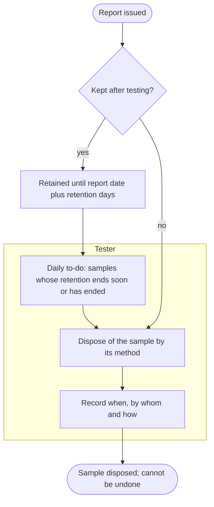

## SF-05 Machine calibration and unavailability

- **Trigger:** a machine's calibration falls due, or a machine is under repair.
- **Result:** no test runs on an unfit machine; its bookings move to other machines or are suggested for outsourcing, and the machine returns to use once serviced.
- **Stories:** US-AD09, US-AD10, US-T21, US-HD03, US-HD05.
- **States:** machine in use → under repair → in use; booking scheduled → queued → scheduled on another machine.
- **Starts from:** machines with scheduled bookings, calibration dates and service records.
- **Main path:** The administrator sets a machine under repair; its bookings move to another fit machine and their testers are told; recording the repair makes it usable again.
- **Alternative paths:**
  - SF-05-A1: A machine passes its calibration date; it gets no new booking until a calibration is recorded.
  - SF-05-A2: Booking a machine whose calibration is due soon, or that was repaired recently, warns and still books.
- **Exceptions:**
  - SF-05-E1: No other machine can finish a moved booking in time; it gets an outsourcing suggestion, which the head of department accepts.

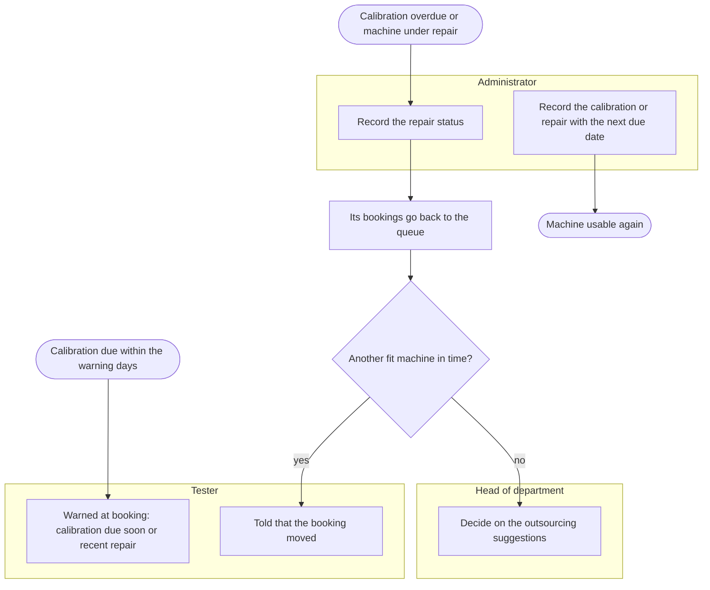

## SF-06 Accreditation and registration renewal

- **Trigger:** the laboratory receives an accreditation certificate or registers a quality dossier, or one of them, or a subcontractor's accreditation, nears its expiry.
- **Result:** reports carry the accredited and registered marks only while they are valid, and renewed dates restore them.
- **Stories:** US-AD08, US-AD12, US-AD28.
- **States:** certificate, dossier or subcontractor accreditation valid → expired → valid again when renewed.
- **Starts from:** accreditation certificates, quality dossiers and subcontractors near and past their expiry.
- **Main path:** The administrator imports a certificate's methods; the ways of testing are accredited while it is valid and lose it the day after its last valid day.
- **Alternative paths:**
  - SF-06-A1: A quality dossier warns before and on its expiry day; after it, its mark is no longer printed; renewing it prints the mark again.
  - SF-06-A2: A subcontractor's accreditation expires; it cannot be chosen until its renewed date is recorded.
  - SF-06-A3: Archiving a certificate removes the accreditation of its methods; restoring it gives it back.

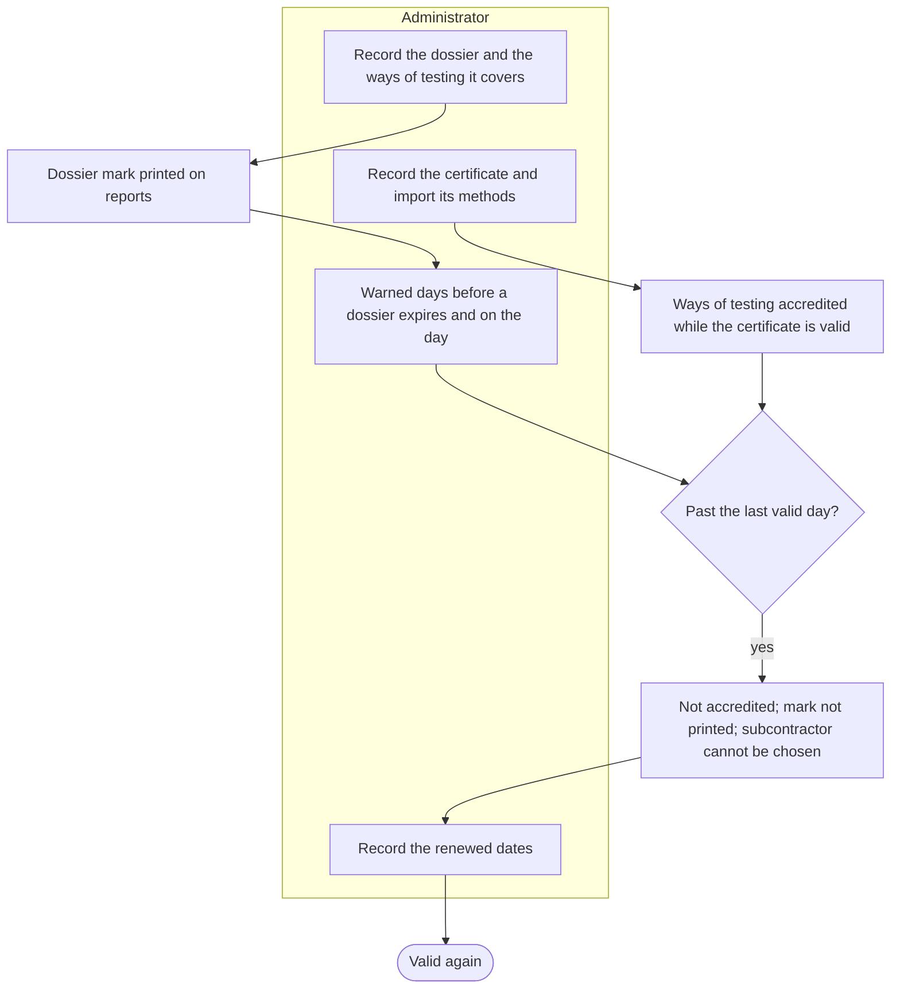

## SF-07 Result dates and priority orders

- **Trigger:** sales prepares a quotation, a customer asks when results can be ready, or a due date is set or changed.
- **Result:** every sample test has a due date the laboratory can meet, the customer knows the earliest date results can be returned, and a priority order the laboratory can meet makes its tests urgent.
- **Stories:** US-S21, US-S22, US-HD05, SH-03.
- **States:** test request expected date set; sample test due date worked out, or changed by hand; priority order → urgent sample tests.
- **Starts from:** a catalog with ways of testing and machines, machine queues with free and busy slots, and quotations in preparation.
- **Main path:** Sales adds parameters to a quotation, which shows the estimated return date; the customer's expected date is at or after it; when the order is confirmed, each sample test is due at the end of the day the safety margin before that date.
- **Alternative paths:**
  - SF-07-A1: The customer asks for an earlier date the laboratory can meet; sales accepts it as a priority order and its tests are urgent when created.
  - SF-07-A2: A parameter only a subcontractor tests is named and left out of the estimate.
  - SF-07-A3: The expected date on a test request changes; the due dates of its sample tests are worked out again.
  - SF-07-A4: An administrator changes the safety margin; due dates already worked out stay, new ones use the new margin.
- **Exceptions:**
  - SF-07-E1: The customer's earlier date can be met only by outsourcing named parameters; sales tells the customer, who accepts, and those parameters are outsourced.
  - SF-07-E2: The customer's earlier date cannot be met; the check suggests the earliest date that can, and sales offers it.
  - SF-07-E3: The head of department changes a sample test's due date by hand to a date that cannot be met; the scheduler reports it with the earliest possible date, and the head moves other bookings or outsources.
- **Paths in other flows:** SF-10 for how urgent tests are queued.

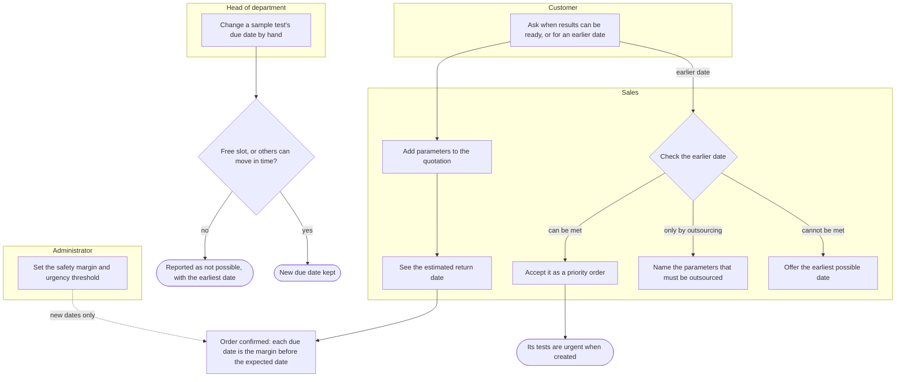

## SF-08 Laboratory setup

- **Trigger:** a laboratory starts using MediLab, or its catalog, people or rules change.
- **Result:** everything an order needs exists: the catalog with its ways of testing, prices and taxes, people and roles, approval chains and settings.
- **Stories:** US-AD01, US-AD02, US-AD03, US-AD04, US-AD05, US-AD06, US-AD07, US-AD09, US-AD10, US-AD11, US-AD13, US-AD14, US-AD15, US-AD16, US-AD17, US-AD18, US-AD19, US-AD20, US-AD26, US-AD27, SH-03.
- **Starts from:** an empty laboratory with the modules installed.
- **Main path:** The administrator creates a parameter with its way of testing, regulation limit and price; a customer can order it and a tester can run it.
- **Alternative paths:**
  - SF-08-A1: The administrator creates a service package; the customer orders it whole at its own price.
  - SF-08-A2: The administrator gives a person a role; the person sees the menus of that role and no others.
  - SF-08-A3: A VAT rate changes from a date; quotations dated after it use the new rate.
  - SF-08-A4: The administrator sets the approval chain of a document type; its documents are signed level by level.

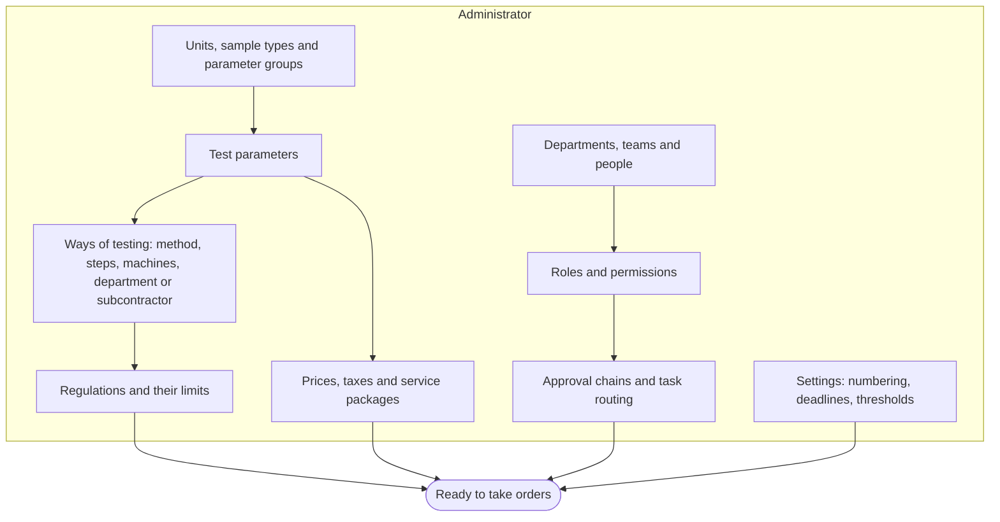

## SF-09 Customer support and feedback

- **Trigger:** a customer registers, or contacts the laboratory through the portal.
- **Result:** the customer's account and contacts are kept, their questions are answered, and a completed order can be rated.
- **Stories:** US-C01, US-C02, US-C03, US-C04, US-C05, US-C06, US-C20, US-C21, US-S03, US-S04, US-S20.
- **States:** support request open → answered → closed; order completed → rated.
- **Starts from:** registered customers with completed and open orders.
- **Main path:** A customer opens a support request about an order; the order's salesperson answers; the request is answered and the customer notified.
- **Alternative paths:**
  - SF-09-A1: A support request about no order is visible to every salesperson until one takes it.
  - SF-09-A2: A customer registers, keeps their profile and contacts, and uploads a logo.
  - SF-09-A3: Sales invites a customer to the portal and merges a duplicate profile.
  - SF-09-A4: The customer rates a completed order.

## SF-10 Machine queue and rescheduling

- **Trigger:** a test joins a machine's queue, or something changes the queue: a move, an urgent test, a bump, a result or a cancellation.
- **Result:** every booking runs in order on a fit machine, urgent tests first, and tests that will miss their due date are seen in time.
- **Stories:** US-T03, US-T19, US-T20, US-HD04, US-HD12, US-HD14.
- **States:** machine booking queued → scheduled → in progress → done, or → cancelled; scheduled → queued when moved or bumped.
- **Starts from:** machines with queued, scheduled and running bookings for urgent and ordinary tests.
- **Main path:** A booking joins the machine's queue, gets the next free slot, starts when the tester starts the test, and is done when the result is entered.
- **Alternative paths:**
  - SF-10-A1: Urgent tests, marked with a reason or due within the urgency threshold, get the next free slot before ordinary tests; the rest follow the order they joined the queue.
  - SF-10-A2: The tester moves their booking; the slot goes back to the queue and the booking is planned again.
  - SF-10-A3: The head of department moves or cancels a booking of someone in the department.
  - SF-10-A4: A result is entered while a booking still waits in the queue; that booking is cancelled.
  - SF-10-A5: The head of department cancels the sample test; its bookings, running ones included, are cancelled.
- **Exceptions:**
  - SF-10-E1: An urgent test cannot wait for its slot; the head of department bumps it to the earliest fit slot, and the bookings that had not started go back to the queue, are planned again and their people are told.
  - SF-10-E2: A bump would make other tests late; the head chooses to let them run late or to outsource them straight away, and the bump goes ahead.
  - SF-10-E3: A booking ends without a result, or after the due date; the test is at risk, its tester and head are told once, and the head bumps it, moves it or outsources it.
- **Paths in other flows:** SF-05 for setting a machine under repair or recording its calibration; WF-05 for outsourcing a test the queue cannot finish in time.

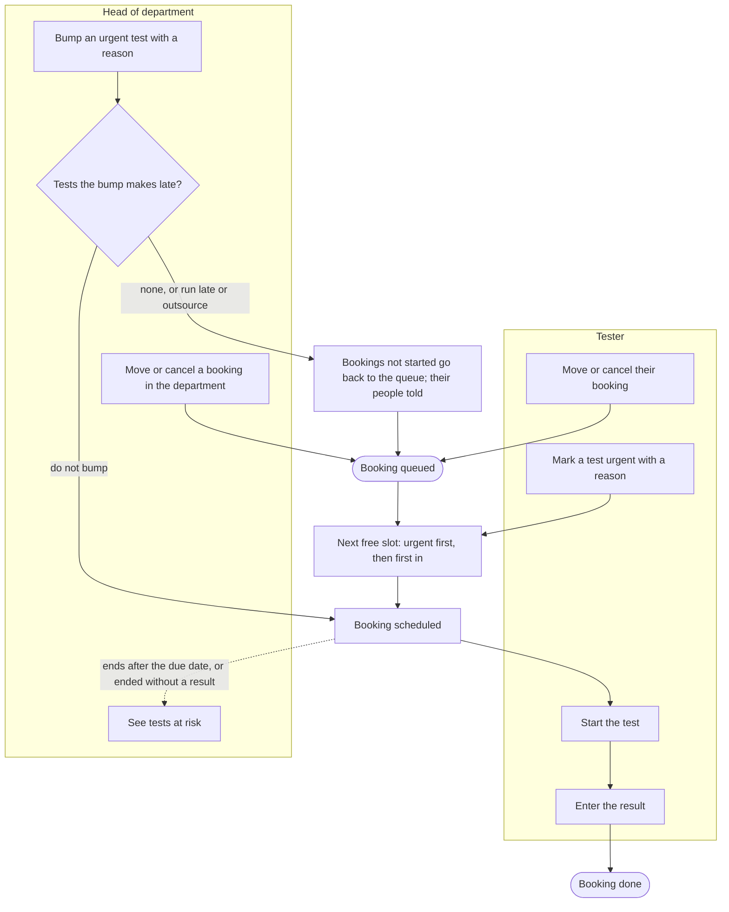

## Related documents

- [Overview](index.md)
- [Laboratory overview](laboratory_module/overview.md)
- [E-commerce overview](ecommerce_module/overview.md)
- [Shared technical features](shared.md)
- [Business rules](../business/readme.md)
