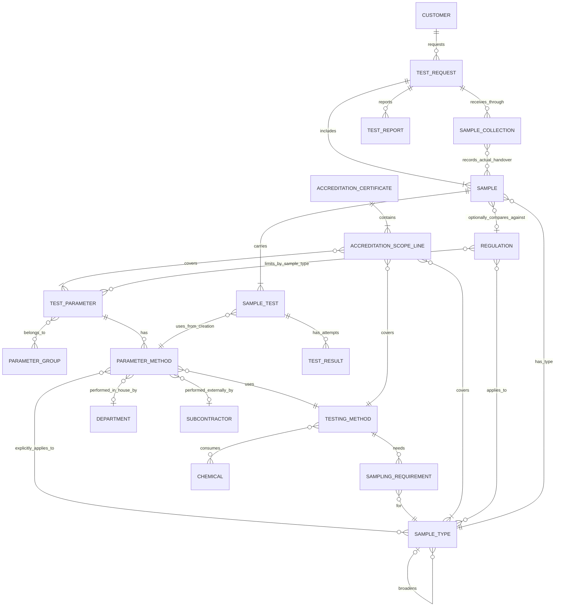
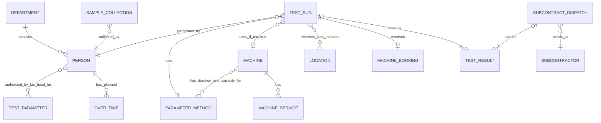
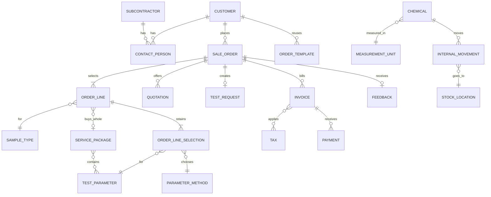

# Conceptual model

The business concepts of Laboratory, E-commerce, Inventory and scheduling. Names follow the [glossary](../glossaries.md); detailed rules belong to the actor features and [business flows](business-flows.md). The [Prisma diagrams](../infrastructure/readme.md) draw Odoo tables and are updated with the implementation through the [database-diagram workflow](../workflows/syncing-database-diagram.md).

## Model scope

Medilab Sync belongs to the product but is outside this conceptual model. Technical concepts and attribute-level details are omitted: audit entries, notification and email messages, notification preferences, signing certificates, payment methods, portal accounts, roles, document versions and signed PDFs. Portal identities belong to Customer or Person at this level.

Gateway transactions are part of Payment, tax rates part of Tax, unit categories part of MeasurementUnit, parameter prices part of TestParameter, and subcontract costs part of ParameterMethod. Invoice lines are omitted. Service-package membership and chemical consumption are many-to-many relationships. Regulation limits are a Regulation–TestParameter relationship qualified by SampleType, not a single limit shared by all sample types.

## Catalog and laboratory work

| Relationship | Rule |
| --- | --- |
| Way and sample type | A way has one parameter, method and performing party. Explicit applicability gives the unit, optional LOD/LOQ and display precision for one sample type. Each offered parameter and sample type has one default. Technical applicability does not inherit. |
| Sampling | A method's sample-type requirement gives amount, container and preservation. Compatible container and preservation groups share a physical sample and their amounts add. Expected objects per type are the largest line quantity; objects times groups gives expected samples. Collection records the actual handover and customer confirmation. |
| Accreditation | A sample test is accredited only when its in-house way's method, parameter and sample type or ancestor match a valid certificate scope line. A method outside accreditation can still be used. |
| Regulation | Comparison is optional. Scope includes descendants; limits are explicit per regulation, parameter and sample type and never inherited. The selected method, such as a TCVN, determines how to test; a QCVN determines requested comparisons. |
| Attempt | Each attempt keeps its unit and LOD/LOQ snapshot and any exact sample-type regulation limit snapshot. It belongs to exactly one run or subcontract dispatch. |

## Runs and people

Mermaid ER notation cannot express the exclusive ownership of an attempt: each `TEST_RESULT` belongs to exactly one `TEST_RUN` or one `SUBCONTRACT_DISPATCH`, never both or neither, as the Attempt rule above requires.

A run has one way, one tester and one interval, and may combine attempts from several samples, customers and requests up to capacity. Its machine is optional when the way needs none; then duration and capacity belong to the way, with capacity 1 by default. A machine booking reserves the run. Staff shifts and approved leave come from HR; service records supply machine downtime. OverTime records the planned outside-hours interval, work, reason and assigner for a tester, without payroll or actual-hours confirmation.

The Lab Head configures person-to-parameter authorization indefinitely, without start or expiry dates. The Head of Department assigns work and approves results, including their own entries. The Lab Head reviews the results and signs reports. A result correction and its affected issued report have linked change requests, and a replacement report needs fresh approval and signing before issue.

## Commerce and inventory

An order line contains a parameter or a whole package, with a sample type and quantity. Its selections retain one parameter and its selected or resolved default way per included parameter: one selection for a parameter line and one for every parameter in a package line. Each quotation version keeps those selections; later catalog membership or default changes do not rewrite the accepted version. Sample tests use its retained selections. A package line keeps the package price. Accepted ways change only through a revised quotation and customer agreement. Templates have no price of their own. Payments include gateway payments; posted invoices are corrected by adjustment invoices or credit notes, while completed orders, quotations, results and reports use change requests.

## Related documents

- [Overview](index.md)
- [Laboratory overview](laboratory_module/overview.md)
- [E-commerce overview](ecommerce_module/overview.md)
- [Inventory overview](inventory_module/overview.md)
- [Glossaries](../glossaries.md)
