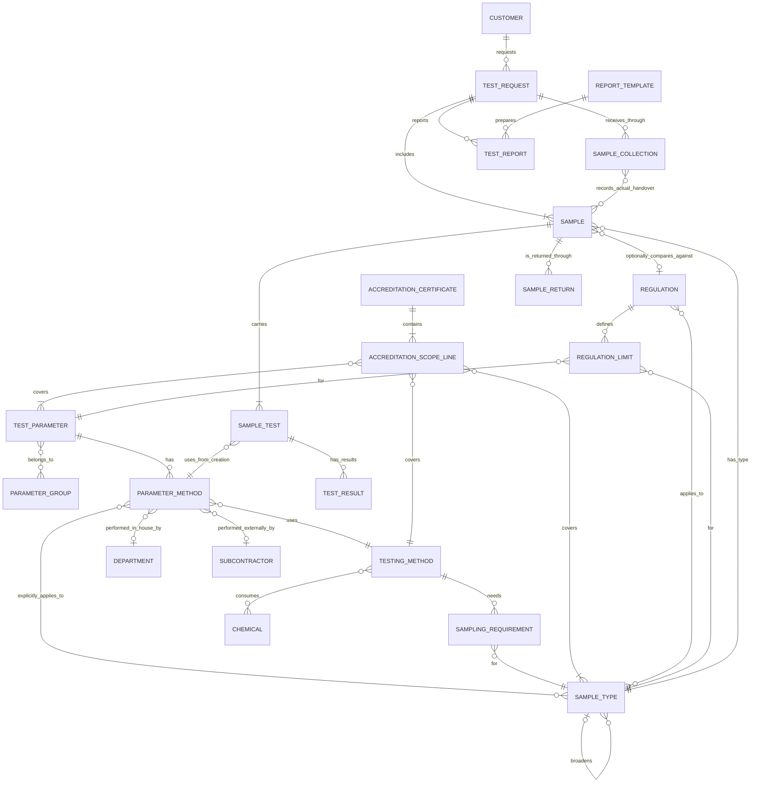
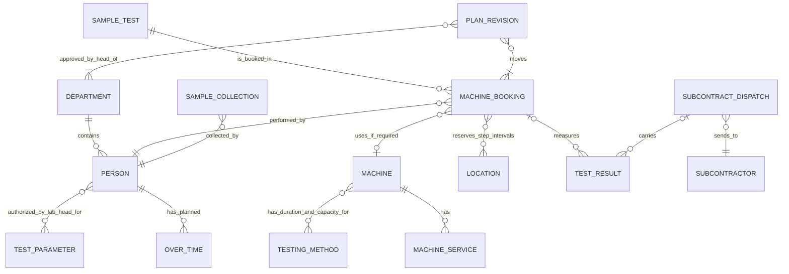
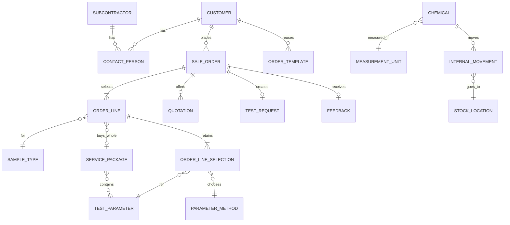

# Conceptual model

The business concepts of Laboratory, E-commerce, Inventory and scheduling. Names follow the [glossary](../glossaries.md); detailed rules belong to the actor features and [business flows](business-flows.md). The [Prisma diagrams](../infrastructure/readme.md) draw Odoo tables and are updated with the implementation through the [database-diagram workflow](../workflows/syncing-database-diagram.md).

## Model scope

Medilab Sync belongs to the product but is outside this conceptual model. Technical concepts and attribute-level details are omitted: audit entries, notification and email messages, notification preferences, signing certificates, portal accounts, roles, document versions and signed PDFs. Portal identities belong to Customer or Person at this level.

Unit categories are part of MeasurementUnit, parameter prices part of TestParameter, and subcontract costs part of ParameterMethod. Invoicing and payments are described in the E-commerce specifications. Service-package membership and chemical consumption are many-to-many relationships. Each RegulationLimit belongs to one Regulation, TestParameter and SampleType; that combination is unique and its limit is not shared across sample types.

## Catalog and laboratory work

| Relationship | Rule |
| --- | --- |
| Way and sample type | A way has one parameter, method and performing party. Explicit applicability gives the unit, optional LOD/LOQ and display precision for one sample type. Each offered parameter and sample type has one default. Technical applicability does not inherit. |
| Sampling | A method's sample-type requirement gives amount, container and preservation. Compatible container and preservation groups share a physical sample and their amounts add. Expected objects per type are the largest line quantity; objects times groups gives expected samples. Collection records the actual handover and customer confirmation. |
| Accreditation | A sample test is accredited only when its in-house way's method, parameter and sample type or ancestor match a valid certificate scope line. A method outside accreditation can still be used. |
| Regulation | Comparison is optional. Scope includes descendants; limits are explicit per regulation, parameter and sample type and never inherited. The selected method, such as a TCVN, determines how to test; a QCVN determines requested comparisons. |
| Result | Each result keeps its unit and LOD/LOQ snapshot and any exact sample-type regulation limit snapshot. It belongs to exactly one booking or subcontract dispatch; a retest is a new result with a new booking. |
| Sample return | A return records what was returned to the customer, when, by whom and to whom. Returning extra samples or excess material leaves the sample's state unchanged; returning a retained sample after its retention period ends it as returned. |
| Report preparation | A report uses one template version and approved business data to create its internal draft. Approval binds the saved draft, result versions and prepared PDF; issued files stay unchanged. Template versions and working files are omitted at this conceptual level. |

## Bookings and people

Mermaid ER notation cannot express the exclusive ownership of a result: each `TEST_RESULT` belongs to exactly one `MACHINE_BOOKING` or one `SUBCONTRACT_DISPATCH`, never both or neither, as the Result rule above requires.

A booking has one sample test, one tester and one interval, and a machine only when the way needs one. Bookings whose ways use the same testing method share a machine for exactly the same interval, up to the capacity in samples of the machine-and-method link; a way that needs no machine has its own duration and capacity, 1 by default. Each department's plan proposes bookings for its received, not-started sample tests. A plan revision moves scheduled bookings once the head of each affected department approves its moves, and holds back a move that would miss a committed return date until the customer agrees. Staff shifts and approved leave come from HR; service records supply machine downtime. OverTime records a planned outside-hours interval and reason the head enters for a tester, without payroll or actual-hours confirmation.

The Lab Head configures person-to-parameter authorization indefinitely, without start or expiry dates. The Head of Department assigns work and approves results, including their own entries. The Lab Head reviews the results and signs reports. A result correction and its affected issued report have linked change requests, and a replacement report needs fresh approval and signing before issue.

## Commerce and inventory

An order line contains a parameter or a whole package, with a sample type and quantity. Its selections retain one parameter and its selected or resolved default way per included parameter: one selection for a parameter line and one for every parameter in a package line. Each quotation version keeps those selections; later catalog membership or default changes do not rewrite the accepted version. Sample tests use its retained selections. A package line keeps the package price. Accepted ways change only through a revised quotation and customer agreement. Templates have no price of their own. Completed orders, quotations, results and reports use change requests.

## Related documents

- [Overview](index.md)
- [Laboratory overview](laboratory_module/overview.md)
- [E-commerce overview](ecommerce_module/overview.md)
- [Inventory overview](inventory_module/overview.md)
- [Glossaries](../glossaries.md)
