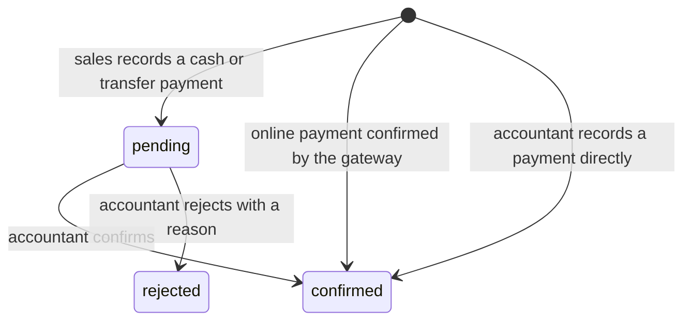

# Features of: Accountant

The accountant is the laboratory's financial user. The accountant issues and tracks invoices, confirms every payment, and reports on revenue and cash flow. The accountant does not set prices, quotations or approvals.

## I. User Stories

### Invoices

- **US-A01** As an accountant, I want to see every invoice, filtered by customer, status and date, so that I know what has been billed.
- **US-A02** As an accountant, I want to bill the agreed work performed and apply verified advances, so that service revenue, customer debt and money received are recorded without duplication.
- **US-A03** As an accountant, I want advance requests and verified receipts recorded separately from invoices and revenue, so that a request for payment does not create service revenue or invoice debt.
- **US-A04** As an accountant, I want to send an invoice by email and download it as PDF, so that I can give the customer a document in the format they need.
- **US-A05** As an accountant, I want tax to be calculated according to the applicable rules, so that invoices comply with local regulations.

### Payments

- **US-A06** As an accountant, I want verified online receipts recorded once against their original request or invoice, so that money is not lost or counted twice.
- **US-A07** As an accountant, I want to record cash and bank-transfer receipts for an advance request or invoice, so that the order's received money and invoice balances are correct.
- **US-A08** As an accountant, I want to confirm or reject the payments that sales recorded from customers, so that only verified money counts as paid.
- **US-A09** As an accountant, I want partial receipts supported, so that customers can pay in instalments while the remaining advance requirement and invoice balances stay clear.
- **US-A10** As an accountant, I want a payment receipt to be issued for every payment, so that the customer has proof of payment.
- **US-A11** As an accountant, I want to see the payment status of every order (not paid, partially paid, paid), so that I can follow up on what is owed.
- **US-A12** As an accountant, I want the system to remind customers of overdue payments, so that I do not chase them one by one.
- **US-A13** As an accountant, I want to reconcile each day's PayOS transactions with the payments in the system and lock the day once it matches, so that no online payment is missing or changed afterwards.

### Reports and KPIs

- **US-A14** As an accountant, I want revenue, outstanding amounts and cash-flow reports for a period, so that I can manage the laboratory's finances.
- **US-A15** As an accountant, I want to export reports to a spreadsheet, so that I can use them in the laboratory's accounting records.
- **US-A16** As an accountant, I want to see how long payments take after an invoice is sent, so that I can measure collection performance.

## II. Feature Details

### 1. Invoices (US-A01 to US-A05)

| Document or event | Responsibility | Effect |
| --- | --- | --- |
| Advance payment request | Created when Sales sends a quotation | Requests the required amount; posts no invoice, receivable or revenue. |
| Verified advance receipt | Accountant verification or verified PayOS transaction | Records actual money and the customer advance, with a receipt; does not by itself recognize service revenue. |
| Service billing | Accountant when the service meets revenue-recognition conditions | Records the service revenue and receivable and applies verified advances, even if collection is incomplete. |
| Adjustment or credit note | Accountant, linked to a posted invoice | Corrects the invoiced difference without editing the original. |

- Bill what was actually tested under the agreed quotation and revisions. Missing cancelled samples are not billed as performed work; extras need the agreed revision.
- Preserve the agreed service price before VAT. Display tax, total, verified money applied and the remaining amount separately; a quotation snapshot does not freeze the rate for later billing.
- Invoices are internal Odoo documents, emailed with a PDF and available to the customer on the portal. Tax-authority e-invoice integration is outside this scope.
- A posted invoice cannot be reset or edited for a quotation revision. A raising adjustment is a separate posted invoice with its own payment action and residual. A reconciled lowering credit note reduces the corrected invoice's residual. Order and customer debt totals include all outstanding invoices.
- If verified advances exceed the total payable for performed work after agreed cancellation, record the excess for the accountant to refund manually. Correct posted invoices with credit notes as needed and link the refund to the order and original receipt. Do not automatically refund or carry it forward to another order. A credit note does not prove money was returned.
- Expiry alone does not establish a refund. Retain a partial advance on the same order while Sales agrees continuation, revision or cancellation.

Acceptance criteria:

- Sending a quotation with an advance request creates no posted advance invoice or invoice debt.
- A verified partial advance is recorded once without service revenue or automatic quotation acceptance.
- Fully performed work is billed at its agreed total payable, with verified advances applied once; cancelled missing work is excluded.
- A reconciled lowering credit note of 500,000 VND against a 5,000,000 VND residual leaves 4,500,000 VND owed and preserves the original posted invoice.
- An 8,000,000 VND verified advance against 5,000,000 VND actual total payable leaves 3,000,000 VND for manual refund, with no negative customer charge.
- An original invoice residual of 5,000,000 VND and a raising adjustment of 2,000,000 VND show total debt of 7,000,000 VND and separate payment targets.
- An invoice shows service amount, tax, total, money applied and remaining amount, and can be downloaded as PDF.

### 2. Payments (US-A06 to US-A13)

| Source                                            | How it is recorded                                                                                                                                                                                                                                        |
| ------------------------------------------------- | --------------------------------------------------------------------------------------------------------------------------------------------------------------------------------------------------------------------------------------------------------- |
| Online payment | A verified signed PayOS notification or a server-side query confirms actual receipt once. Match its original request or invoice. A transfer discovered through an obsolete link awaits accountant review before allocation to a new request; a browser return never confirms payment. |
| Cash or bank transfer, recorded by the accountant | The accountant selects the order and advance request or posted invoice, actual amount, date and method. |
| Cash or bank transfer, recorded by sales          | Sales creates a pending record; it counts only after the accountant confirms it.                                                                                                                                                                          |
| Bank transfer by QR code                          | Each invoice, on its PDF and in the portal, shows a VietQR code for the laboratory's bank account with the amount and invoice number, from Odoo's Vietnamese localisation. The customer pays by bank transfer; the accountant confirms the payment once it reaches the account. |

Rules:

- **Partial payments.** A payment can be less than the amount due; the invoice is then partially paid and the remaining amount stays open. A new manual payment or PayOS payment request cannot exceed the remaining amount. If a PayOS transfer has already arrived, record the full amount and flag its excess for the accountant; do not refund it automatically.
- **Payment status.** Show verified money, pending verification, money awaiting allocation, the advance still required and total uncollected order value separately. Invoice payment status is calculated from money applied to each posted invoice; advance acceptance does not mean the entire order is paid.
- **Receipts.** A receipt is issued for each confirmed payment and is available to the customer.
- **Pending amounts.** The accountant sees the pending amount per order so that a payment recorded by sales is not entered a second time.
- **Overdue reminders.** When an invoice passes its due date unpaid, the customer is reminded by their chosen notification channel at a fixed interval until it is paid; the accountant sees the list of overdue invoices.
- **Advance gate.** An order requiring an advance cannot start collection or testing until the full advance is verified, the customer has accepted and order approval is complete. Credit permission does not waive this gate.

Acceptance criteria:

- A payment recorded by sales does not change the payment status until the accountant confirms it.
- A rejected payment returns the invoice to its previous status and notifies the salesperson with the reason.
- A repeated gateway notification for the same payment is ignored.
- Initiating a payment larger than the remaining amount is refused; an already-arrived PayOS transfer is recorded in full and its excess flagged, without automatic refund.

#### Reconciliation (US-A13)

The accountant reconciles each day's PayOS transactions with the payments in the system.

| Rule     | Description                                                                                                                                                                                               |
| -------- | --------------------------------------------------------------------------------------------------------------------------------------------------------------------------------------------------------- |
| Day view | For a chosen day, list each PayOS transfer's bank reference, amount, actual transfer time, original request or invoice, receipt and allocation status. |
| Mismatch | A transaction PayOS reports as paid with no payment in the system, or a payment with no PayOS transaction, is flagged. The accountant creates the missing payment from a flagged transaction in one step. |
| Lock     | Once a day is reconciled, the accountant locks it, and its online payments can no longer be changed. The day's PayOS total can be printed.                                                                |

Acceptance criteria:

- A PayOS transaction paid with no payment in the system is flagged as a mismatch.
- Creating the receipt from a flagged transaction retains its original request or invoice and clears the missing-receipt flag; allocation review of an obsolete request remains separate.
- An online payment of a locked day cannot be changed.
- A locked day prints its PayOS total.

### 3. Reports and KPIs (US-A14 to US-A16)

| Report                 | Content                                                                 |
| ---------------------- | ----------------------------------------------------------------------- |
| Revenue                | Invoiced and collected amounts per period, customer and main parameter group. A group's revenue is the revenue of its parameters; a package line's amount is spread over its parameters in proportion to their own prices times quantities. |
| Outstanding            | Unpaid and overdue invoices, with age of the debt                       |
| Cash flow              | Money received per period, per payment method                           |
| Collection performance | Time from invoice sent to payment, share of invoices paid on time       |

- Reports can be filtered by period and customer and exported to a spreadsheet.
- Reports use confirmed payments only; pending records are shown separately, in the Pending payments report.
- Revenue excludes VAT and follows the service's revenue-recognition event, not the sending of a payment request or receipt of an advance. Show advances and collections separately. Applying an advance to a service invoice does not recognize or reverse that service's revenue a second time; corrections retain their accounting evidence.
- A package line is spread by rounding the running total of its parameters' shares, so its parts add up to the line to the dong.
- The age of a debt counts the days since the due date: not due, 1 to 30, 31 to 60, 61 to 90 or over 90 days.
- An invoice is sent when emailed. Invoice collection performance uses the actual dates of verified receipts applied to that invoice. Advance-request deadlines and time to verified full funding are tracked separately from invoice debt and revenue.
- The reports are under the Reporting menu of the Sales app, for those holding the read permission of the report. Each has a pivot table that downloads as a spreadsheet with the rows and totals it shows.

## IV. Related documents

- [E-commerce module overview](../overview.md)
- [Sales features](sales.md)
- [Customer features](customer.md)
- [Payment requests](../../../specs/payment-requests.md)
- [Invoices](../../../specs/invoices.md)
