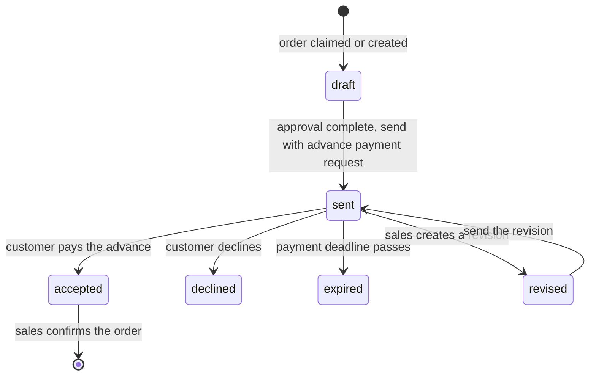
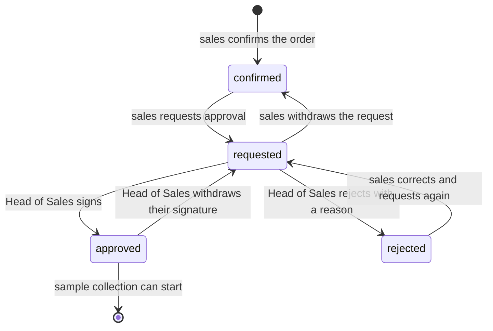

# Features of: Sales

Sales is the laboratory's salesperson. Sales turns customer orders into quotations, collects the advance payment, confirms the order and gets it approved so the laboratory can collect samples. Sales owns the relationship with the customer: profiles, contacts and follow-up.

## I. User Stories

### Orders and customers

- **US-S01** As a salesperson, I want to see the orders customers have submitted and claim one, so that every order has a single owner and nothing waits unnoticed.
- **US-S02** As a salesperson, I want to create an order on behalf of a customer who contacted me by phone or in person, so that every sale goes through the same flow.
- **US-S03** As a salesperson, I want to view and manage customer profiles and their contact people, so that I know who to reach for each order.
- **US-S04** As a salesperson, I want to invite a customer to the portal and review accounts flagged as possible duplicates, so that each customer has exactly one profile.

### Quotation

- **US-S05** As a salesperson, I want to prepare a quotation from an order, checking the selected parameters, adding or removing them and grouping them into the samples the customer will send, so that the quotation matches what the customer needs and the laboratory knows which samples to expect.
- **US-S06** As a salesperson, I want to adjust prices with a discount before sending, so that I can offer the customer an agreed price.
- **US-S07** As a salesperson, I want to send the quotation together with the advance payment request, so that the customer can accept by paying.
- **US-S08** As a salesperson, I want to revise a quotation that has been sent, so that I can correct it without losing the earlier version.
- **US-S09** As a salesperson, I want to save a returning customer's order as a template and create their next orders from it, so that repeat orders are faster.
- **US-S10** As a salesperson, I want to see whether the customer has paid, declined or let the quotation expire, so that I know when to follow up.
- **US-S21** As a salesperson, I want to see the estimated date results can be returned while preparing a quotation, so that I can tell the customer when to expect them.
- **US-S22** As a salesperson, I want to check whether the laboratory can meet an earlier date the customer asks for, so that I only promise a priority order the laboratory can deliver.

### Payment collection

- **US-S11** As a salesperson, I want to record a cash or bank-transfer payment received from a customer, so that the accountant can confirm it without asking the customer again.

### Confirmation and approval

- **US-S12** As a salesperson, I want to confirm an order once the customer has accepted, so that it becomes a sale order the laboratory can work on.
- **US-S13** As a salesperson, I want to request approval of a confirmed order from the Head of Sales, and withdraw the request if I need to change something, so that the order is checked before samples are collected.
- **US-S14** As a salesperson, I want to be told when the order is approved or rejected and why, so that I can proceed or fix it.
- **US-S15** As a salesperson, I want to start sample collection only for approved orders, so that the laboratory never works on an unapproved order.

### Cancellation

- **US-S16** As a salesperson, I want to review the cancellation requests of my customers and accept or decline them with a reply, so that cancellations are handled consistently.
- **US-S17** As a salesperson, I want to cancel an order myself while the laboratory has not completed any testing, so that I can handle cancellations the customer asks for by other channels.

### Follow-up and analytics

- **US-S18** As a salesperson, I want to track the progress of my orders through testing and result release, so that I can answer customers' questions.
- **US-S19** As a salesperson, I want to see my pipeline and my performance, so that I can plan my work and see my results.

### Support

- **US-S20** As a salesperson, I want to take and answer customers' support requests, so that every customer question gets a reply.
- **US-S23** As a salesperson, I want to take and answer customers' support requests on my phone, so that a customer gets a reply when I am away from my desk.

## II. Feature Details

### 1. Orders and customers (US-S01 to US-S04)

- **Queue.** Submitted customer orders appear in an unclaimed queue, oldest first. A salesperson claims one; from then on only that salesperson (and the Head of Sales) sees and edits it. A claimed order is not visible to other salespeople.
- **Order on behalf of a customer.** Sales selects the customer, adds parameters and service packages in the same catalog the customer uses and saves it as an order owned by the salesperson. From here the flow is the same as a portal order.
- **Customer profile.** Name, tax code or citizen ID, addresses, the contact people of a business, and the customer's order history. Sales can set whether a customer is allowed to order on credit (see below). The customer itself is kept by the [Laboratory module](../../laboratory_module/overview.md#test-requests-and-samples); E-commerce keeps the customer's sales terms.
- **Customer bank accounts.** Maintain optional bank accounts on the customer's Odoo contact, allowing several accounts under the [customer rules](../../laboratory_module/overview.md#test-requests-and-samples). A customer can be saved without bank details. Each document selects and preserves any printed customer bank details under the same customer rules.
- **Portal invitation and duplicates.** Sales can invite a customer to the portal. A self-registered account that matches an existing profile on tax code or citizen ID is flagged; sales reviews it and either clears the flag or merges it into the profile it matched. Merging moves every order, document and person of the flagged account to that profile and deletes the flagged one; its login stays, as a contact of the remaining profile.
- **Duplicate warnings.** When staff create or edit a customer profile, warn when its name, telephone or mobile number, tax code or citizen ID matches another customer. A warning lets staff save and never merges profiles automatically. The registration flag and sales review above still apply to matching identity information.

Acceptance criteria:

- A claimed order cannot be claimed by another salesperson.
- A salesperson sees only the orders they own and the unclaimed queue; the Head of Sales sees all.
- Merging two profiles keeps every order and document on the remaining profile.
- Creating or editing a customer with another customer's name or telephone or mobile number shows a warning without blocking the save or merging the profiles.
- A customer's unchanged details do not match the customer itself in duplicate warnings.
- A customer can be saved with no bank account or several accounts; changing them never changes bank details printed on an issued document.
- A document that prints customer bank details omits them when there is no account and preselects the sole account when there is one. With several accounts, its preparer must select one before issue.
- A document issued with the selected account keeps those printed details when the customer's accounts change. A document that does not print bank details requires neither an account selection nor a snapshot.

### 2. Quotation (US-S05 to US-S10, US-S21, US-S22)

| Rule             | Description                                                                                                                                                                                       |
| ---------------- | ------------------------------------------------------------------------------------------------------------------------------------------------------------------------------------------------- |
| Parameters       | A quotation needs at least one parameter or service package. Sales may add or remove parameters and packages; the customer sees the change on the quotation. A package is added or removed whole. |
| Samples | Each line names its sample type and quantity. Expected physical samples, containers and amounts are calculated from the methods' sampling requirements and shown to the customer. The customer does not declare physical samples. Collection staff adjust expected samples to the actual handover and obtain customer confirmation. |
| Prices | Use catalog prices per parameter or package in VND. Discounts are percentages only: on a line, or a whole-quotation discount line calculated from a percentage. Fixed-amount discounts and separate customer price lists are not offered. |
| Quotation approval | If the quotation discount or total exceeds a threshold set by the Head of Sales, their approval is required before Send. Below the thresholds Sales may send it alone. This gate is separate from approval of the confirmed order. |
| Selected ways | The customer may choose each parameter's way, and Sales may choose or change it before acceptance. Otherwise fill the unique default for the parameter and sample type. Offer only viable ways under the [catalog rules](../../laboratory_module/features/admin.md#1-catalog-us-ad01-to-us-ad08-us-ad26-to-us-ad28). If the default is unavailable, show its reason and alternatives for explicit selection; with none, that pair cannot be ordered. After acceptance, a way changes only through a revised quotation and customer agreement. |
| Tax              | Each line takes the tax of its parameter or package, at the rate in force on the quotation date. Sales can change a line's tax, such as 0% for a foreign customer. The system adds the tax. |
| Advance payment  | When sending, sales chooses the collection method (online, bank transfer, cash) and the amount (full, percentage, fixed). The system creates the advance invoice and sends it with the quotation. |
| Manager shortcut | The Head of Sales can send without an advance payment, for customers with an agreement.                                                                                                           |
| Payment deadline | Default 3 days from sending, configurable by the administrator. Sales can set another date. An expired quotation is flagged, not cancelled; sales can extend it.                                  |
| Revisions        | A revision copies the quotation into a new draft linked to the one it replaces. The old version becomes read-only and the customer sees the revision list.                                        |
| Templates        | A returning customer's order can be saved as a template (named set of parameters and packages) to create their next orders faster. A template has no price of its own; a new order takes current catalog prices. Templates are never sent or confirmed. |
| Return estimate  | The quotation shows the [estimated return date](../../laboratory_module/overview.md#testing-work-and-scheduling) of its samples and parameters, worked out again when they change. The expected result date defaults to it, and the customer sees it on the quotation. |
| Changed return date | When a promised date is at risk, Sales informs the customer and proposes the earliest feasible replacement. Save a changed promised date only with customer agreement, recording old date, new date and confirmation. If the customer refuses, Sales handles a cancellation request for the unfulfillable part; never cancel automatically or change the agreed way. Internal-only due-date changes do not trigger customer notice. |
| Priority order | A customer may request priority on the portal. Sales checks resource feasibility, including outsourced turnaround, and accepts or declines it on the quotation. Accept only a date the laboratory can meet; accepted priority makes the request's tests urgent. |
| Acceptance       | There is no customer signature. Payment of the advance invoice means acceptance. A declined quotation carries the customer's reason and notifies sales.                                           |

Acceptance criteria:

- A quotation without parameters or packages cannot be sent.
- A quotation carries each parameter's sample type and selected or resolved default way, including a separate selection for every parameter of a package, and shows expected sampling needs before sending.
- Changing catalog defaults or package membership does not rewrite an accepted quotation's selections; sample tests use those retained selections.
- Send is blocked above the Head of Sales's thresholds until they approve; below them Sales can send alone.
- An unavailable default is explained and is never silently replaced.
- An accepted way cannot be edited directly; its replacement needs a revised quotation and customer agreement.
- A proposed later return date does not overwrite the customer's promised date before agreement.
- Sending a quotation with an advance request creates exactly one advance invoice and one notification to the customer.
- A revised quotation cannot be sent or confirmed in its old version.
- Sales sees at a glance whether a sent quotation is unpaid, paid, declined or expired.
- Adding a parameter to a quotation updates its estimated return date.
- An expected result date earlier than the estimate is accepted as a priority order only when the check says the laboratory can meet it; otherwise the check shows the earliest date it can.
- The tests of a priority order's test request are urgent when they are created.

#### Order templates (US-S09)

Sales saves an accessible order as a named template from **Save as template**. Templates belong to that order's customer and retain its source order. **Sales → Order templates** lists the saved selections.

| Rule | Description |
| --- | --- |
| Selections | Keep top-level parameters, whole packages and quantities, including fractional quantities of at least 1. Generated package components, samples, prices, discounts and taxes are not saved. |
| Selection integrity | A template always retains at least one selection. Removing or moving its last selection is refused; replacing all selections in one saved edit is allowed. Newly entered selections must identify catalog parameters or packages. Later retirement does not prevent editing a saved template; availability is checked when it is reused. Invalid edits roll back without changing the template or its selections. |
| Authorization | Sales needs template permissions, read access to the source order and assignment of that order. Read access to the unclaimed queue does not grant template access. Head of Sales and administrators retain their existing source-order access. |
| Handover | Reassigning the source order transfers template access. Its customer and source references cannot be edited on the template. If the source changes customer, ordinary Sales cannot access the template. Nobody can reuse it while the customers differ. |
| Administrative recovery | Head of Sales and administrators with source-order read access and the relevant template permissions can find inconsistent templates with the Customer mismatch filter. They can inspect, archive or delete them, and save a replacement from the correct order. The form explains the mismatch. Deletion releases the source-order reference and preserves audit history. Archived records are found with the Archived filter. |
| Source lifecycle | A completed or signed order can be read to save, edit or reuse a template without changing the source. A source order cannot be deleted while any template refers to it. |
| Reuse | Create a fresh Sales draft: native state draft, order status claimed, owned by the acting salesperson. Current customer contact and fiscal-position rules apply. Sales checks sample types, ways and expected sampling needs and follows the ordinary quotation workflow. |
| Current catalog | Use current catalog prices and current package composition. A template stores only package identity and quantity. No historical financial values, signatures, payments or laboratory documents are copied. |
| Unavailable selections | Skip archived or unavailable products, variants, parameters, prices or packages. An unavailable required component skips its whole package. The new order permanently lists skipped names and reasons. |
| Empty result | If every selection is unavailable, explain why and create no order. Unexpected errors roll back the complete creation. |
| Archive | Archived templates remain available to authorized readers with the Archived filter and cannot create orders. Archiving does not change source or generated orders. |

Acceptance criteria:

- Saving preserves parameter and package selections and fractional quantities without rounding.
- Reuse creates an unsent Sales draft at current prices and package contents, using the same pricing and taxes as ordinary Sales creation.
- Sales cannot access templates belonging to another salesperson or an unclaimed order through the queue.
- Skipped names and reasons remain visible after reopening the order; no valid selections means no new order.
- Template operations do not send quotations, issue invoices, confirm orders or start laboratory work.

### 3. Payment collection (US-S11)

When a customer pays sales directly in cash or by bank transfer, sales records the amount, date and method on the order. The record is **pending**: it does not count as paid until the accountant confirms it (see [accountant](accountant.md)). The order shows the pending amount so the same payment is not recorded twice, and the amount cannot exceed what the customer still owes.

### 4. Confirmation and approval (US-S12 to US-S15)

| Rule           | Description                                                                                                                                                                                                                                                                                                                                            |
| -------------- | ------------------------------------------------------------------------------------------------------------------------------------------------------------------------------------------------------------------------------------------------------------------------------------------------------------------------------------------------------ |
| Test request | Confirming creates a test request with at least one expected sample, calculated from the accepted order's sampling requirements, and each sample's tests with their required selected ways. Sales sets expected date, report language, delivery method and recipient. Collection staff record actual samples; fewer samples wait or the missing part is cancelled, and extra samples wait for an agreed revision before testing. |
| Confirm        | Confirming does not wait for approval or payment. An order with no payment shows a warning, because the customer may have an agreement.                                                                                                                                                                                                                |
| Credit gate    | The laboratory core cannot confirm the test request of an order that has no payment unless the customer is marked as allowed to order on credit. Only the Head of Sales sets that flag.                                                                                                                                                                |
| Approval       | Two levels: the salesperson requests, the Head of Sales signs or rejects. Approval can only be requested on a confirmed order.                                                                                                                                                                                                                         |
| Separation     | The person who requested approval cannot also approve the same order.                                                                                                                                                                                                                                                                                  |
| Frozen content | Requesting approval is the salesperson's signature, so from the request on, customer, prices, validity date and parameters cannot be changed. To edit, the signers withdraw from the top level down: the Head of Sales first if they have signed, then sales. Once the order is completed, a [change request](../../shared.md#sh-07-signed-documents-are-locked) is needed. |
| Collection     | **Start sample collection** is available only when the order is approved.                                                                                                                                                                                                                                                                              |
| Cancel guard   | An approved (fully signed) order cannot be cancelled directly; cancelling it goes through a change request that the Head of Sales approves.                                                                                                                                                                                                            |

Acceptance criteria:

- Content of an order under approval cannot be edited.
- Sales is notified, with the reason, when an order is rejected.
- Sample collection cannot start on an order that is not approved.

### 5. Cancellation (US-S16, US-S17)

- A customer's [cancellation request](customer.md#request-cancel-us-c12) reaches the owning salesperson as a task with the customer's reason.
- Sales accepts or declines and writes a reply to the customer. Accepting a whole-order request cancels the order and its laboratory work. A request for the unfulfillable part cancels only that part, retaining other work and completed results.
- Whole-order cancellation is blocked once any testing is completed or results are released. Cancellation of an unfulfillable part preserves completed work; the affected work must meet the cancellation rules. A fully signed order requires an approved change request.
- If an advance was paid, cancelling does not return the money automatically. The money stays on the invoice and is settled outside the system.

### 6. Follow-up and analytics (US-S18, US-S19)

- **Progress.** Each order shows the same four labels the customer sees (Waiting, Testing, Completed, Cancelled) plus the detail for internal use: the order status and the status of its test request. Issuing the test request's report completes the order.
- **Pipeline.** Counts by stage: unclaimed, draft, sent and unpaid, accepted, awaiting approval, approved.
- **Performance.** Per salesperson and period: quotations sent, accepted, declined, revenue, and the time between each step (claim, send, payment, approval).
- **Visibility.** A salesperson sees their own figures; the Head of Sales sees everyone's.

Both analyses are under the Reporting menu of Sales, as a graph, a pivot table and a list of the orders.

| Pipeline stage    | Orders                                                                         |
| ----------------- | ------------------------------------------------------------------------------ |
| Unclaimed         | Submitted, waiting in the queue                                                |
| Draft             | Claimed, with no quotation out: not sent yet, or being revised                 |
| Sent and unpaid   | Quotation sent and not paid, including an expired one sales can extend         |
| Accepted          | Advance paid, or confirmed while approval is not requested yet or was rejected |
| Awaiting approval | Approval requested from the Head of Sales                                      |
| Approved          | Approved, until the order is completed                                         |

A cart, an order whose quotation was declined, and completed and cancelled orders are outside the pipeline.

| Performance measure                    | Counts                                                                                                                                  |
| -------------------------------------- | --------------------------------------------------------------------------------------------------------------------------------------- |
| Quotations sent                        | Every quotation sent, revisions included                                                                                                |
| Quotations accepted, declined          | Quotations the customer accepted or declined; a declined one still counts after a revision replaces it                                 |
| Revenue                                | Total excluding VAT of confirmed and completed orders, by order date, which Odoo sets when the order is confirmed                       |
| Days to quote, to payment, to approval | Average days from the claim to the first quotation, from it to the customer's acceptance, and from that to the approval; an order counts once it reached the step |

Every figure falls in the period of the order's date, which Odoo moves to the confirmation date; grouping by Quoted At shows quotations by when they were first sent.

Acceptance criteria:

- An order shows Waiting once confirmed, Testing once analysis starts, Completed when all samples are completed, Cancelled when cancelled.
- A salesperson sees only their own pipeline and performance, and the unclaimed queue; the Head of Sales sees everyone's.

### 7. Support (US-S20, US-S23)

| Rule     | Description                                                                                                         |
| -------- | ------------------------------------------------------------------------------------------------------------------- |
| Handling | Sales handles support requests. A request about an order goes to the order's salesperson; any other request waits until a salesperson takes it. |
| Taking   | A salesperson takes a waiting request with **Take**, or by replying to it. From then on only that salesperson and the Head of Sales see it. |
| Reply    | A reply sets the request to answered and notifies the customer. Sales closes a request once the customer's question is settled. |
| Who answers | Only those who may edit the request answer it: its salesperson, any salesperson while nobody has taken it, and the Head of Sales. A message from another employee and an internal note change neither its status nor its salesperson. |
| Deadline | The task is due 24 elapsed hours after the request reaches the salesperson, nights and weekends included. The administrator changes this default on the task type. |
| Mobile   | Sales take and answer support requests on [Medilab Mobile](../../laboratory_module/applications/medilab-mobile.md#conversations-sh-12-us-s23) under the same rules. |

Acceptance criteria:

- A support request about an order appears in the to-do list of the order's salesperson.
- A support request about no order is visible to every salesperson until one takes it.
- An answer from the phone sets the request to answered and notifies the customer.

## III. Related documents

- [E-commerce module overview](../overview.md)
- [Customer features](customer.md)
- [Accountant features](accountant.md)
