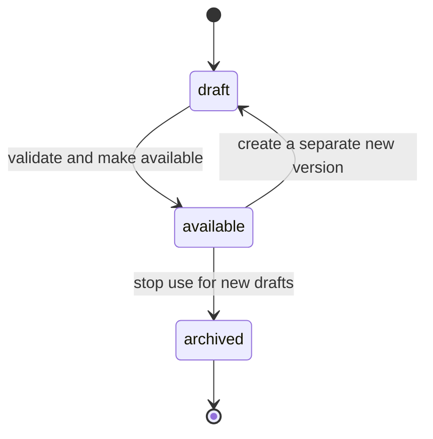

# Features of: Administrator

The administrator maintains the master data of the Laboratory module: test parameters, parameter groups, sample types, testing fields and methods, measurement units, regulations, quality registration dossiers, machines, chemicals and subcontractors. Quotations, the customer portal and testing all read the same master data. Prices, service packages and other commercial data are added by the E-commerce module; see the [E-commerce administrator](../../ecommerce_module/features/admin.md). The tables are drawn in [laboratory.prisma](../../../infrastructure/database/laboratory/laboratory.prisma).

## I. User stories

### Catalog

- **US-AD01** As an administrator, I want to maintain measurement units, sample types, parameter groups, test parameters, testing fields and testing methods, so that quotations and testing use one shared catalog.
- **US-AD02** As an administrator, I want to organise parameter groups into sub-groups, such as Organophosphates under Pesticides, so that choosing parameters from hundreds is not a flat list.
- **US-AD03** As an administrator, I want to organise sample types under broader types, such as Cabbage under Vegetables, so that filtering by a broad type also finds the parameters of its narrower types.
- **US-AD04** As an administrator, I want to define how each parameter is tested, with its method, department or subcontractor and its unit and detection limits for each sample type, so that every test is done and reported the same way.
- **US-AD05** As an administrator, I want codes to be generated in a format I configure, so that codes are consistent and readable without typing them.
- **US-AD06** As an administrator, I want to delete master data that nothing refers to and archive master data that only finished documents still use, so that selection lists stay short while past quotations and results keep their references.
- **US-AD07** As an administrator, I want to maintain regulations with their limits per parameter and sample type, so that results can be compared with the limit that applies to the sample.
- **US-AD08** As an administrator, I want to maintain quality registration dossiers and the ways of testing they cover, so that reports print the right mark and the laboratory knows when a registration expires.
- **US-AD26** As an administrator, I want to define the steps of a testing method, each with its number, how long it takes, what to do and a note, so that everyone in the laboratory follows the same procedure.
- **US-AD27** As an administrator, I want to define the locations of the company's premises as a tree with a code and name, optionally belonging to a department and bookable, so that the laboratory can name every place where work is done.
- **US-AD28** As an administrator, I want to record the ISO 17025 accreditation certificates of the laboratory and create the testing methods they list in one go, so that the methods of an accreditation scope are entered once instead of one by one.

### Machines and chemicals

- **US-AD09** As an administrator, I want to maintain machines with their location, status, calibration and maintenance, so that tests only run on machines that are fit to use.
- **US-AD10** As an administrator, I want to record which testing methods each machine can run, with how long a booking on it takes and how many samples it holds at once, so that a test is planned on a suitable machine.
- **US-AD11** As an administrator, I want to maintain chemicals with their identity, storage conditions and the methods that use them, so that the laboratory knows what each method needs.

### Subcontractors

- **US-AD12** As an administrator, I want to maintain subcontractors with their accreditation, contract and contact person, so that the laboratory only sends work to subcontractors it may use.

### People and signing

- **US-AD13** As an administrator, I want to maintain departments, their teams and people with their contact details, login account, department and team, so that everyone who works for the laboratory is recorded in one place.
- **US-AD14** As an administrator, I want to maintain the approval chain of each document type, for signing it and for change requests on it, so that every document is signed by the right roles in the right order.
- **US-AD15** As an administrator, I want to group permissions into roles, assign roles to people and give a person extra permissions, so that everyone can do exactly their part of the work.
- **US-AD16** As an administrator, I want to choose where the tasks of each task type go and their default deadline, so that work reaches the right people automatically.

### Laboratory files

- **US-AD29** As an administrator, I want to see every device signed in to the laboratory folders and revoke one, so that a lost or shared computer stops syncing at once.
- **US-AD30** As an administrator, I want to turn a folder off, change its owner and members, and archive it with its retention date, so that folders follow the laboratory's rules.
- **US-AD31** As an administrator, I want to release a lock someone left, so that work on the file can go on.

### Report templates

- **US-AD36** As an administrator, I want to edit and version report templates in ONLYOFFICE and choose which versions are available, so that reports use approved layouts while issued files remain unchanged.

## II. Feature details

### 1. Catalog (US-AD01 to US-AD08, US-AD26 to US-AD28)

| Rule                 | Description                                                                                                                                      |
| -------------------- | ------------------------------------------------------------------------------------------------------------------------------------------------ |
| Many links           | A test parameter can belong to several parameter groups and be tested on several sample types.                                                 |
| Lowest groups        | Parameters belong only to groups that have no sub-groups. A group that has parameters cannot be given sub-groups.                               |
| Main group           | Every parameter has one main group, which must be one of its groups. Reports per parameter group, such as revenue in E-commerce, count the parameter under its main group only. |
| Group tree           | A parameter group can have a parent group. Filtering by a group also finds the parameters of all its sub-groups. A group cannot be its own ancestor. |
| Sample type tree | Sample types form a tree of any depth. Filtering by a broad type also finds parameters explicitly offered on its narrower types. A type cannot be its own ancestor. Use narrower types when the material or form needs different technical settings; there is no separate matrix dimension. Parameter offerings, ways of testing, defaults, units, LOD and LOQ are configured explicitly for each type and are not inherited from its parent. |
| Way of testing | A way of testing combines one parameter, one testing method and the performing party: an in-house department or a subcontractor. Its applicability to each sample type holds the result unit, optional LOD and LOQ, and display precision. A way states whether its results may be negative, off by default. Every parameter and sample type still offered has exactly one default way. Methods and ways may exist outside the accreditation scope. |
| Offered ways | Offer only active ways explicitly applicable to the selected sample type. An in-house way needs at least one person authorized for its parameter and, when it requires a machine, a suitable machine in use with valid calibration. A no-machine way does not need a machine. A subcontracted way needs an active subcontractor whose accreditation has not expired. |
| Unavailable default | For a new order or an unaccepted quotation, show why its default is unavailable and list viable alternatives for the customer or Sales to choose explicitly. With no alternative, that parameter and sample type cannot be ordered. Never substitute silently. After acceptance, a different way requires a revised quotation and customer agreement. |
| Testing method | The code is the standard reference as printed in the scope, without surrounding parentheses, such as TCVN 6187-1:2009. A method has a title in each language and an optional reference or equivalent standard. A new edition is a new method, not a version of the old method. Testing fields use the VILAS names Sinh, Hóa and Dược. |
| Method steps         | A testing method has an ordered list of steps. A step has a number, how long it takes in minutes, what to do, an optional location where it is done and an optional note. Step numbers are unique within a method. The steps belong to the method, so every department and subcontractor way of testing that uses the method shows the same steps. |
| Location             | A location is any place in the company's premises, such as a floor, a working room, a manager's office, a meeting room, a bench, an area or a sampling point, with a unique code, a name in each language and an optional image. It can have a parent location, so locations form a tree of any depth, such as building, floor, room and bench, and can name the department that uses it. A location can be marked bookable, so people can book it on their calendar ([SH-11](../../shared.md#sh-11-schedules-and-reminders)). The administrator defines the layout; the system ships none. A location is not tied to a machine: it names any place work is done, such as a fume hood, a water point or a preparation room; stores and the locations inside them are Inventory stock locations. A location with an image is a map: each location inside it can be placed at a point on that image. The map shows the locations inside it at their points. |
| Accreditation certificate | A certificate has a number, issuing body, validity dates and scope lines. Each scope line names a testing method, its parameters and its sample types. A method may appear on several certificates. |
| Import from certificate | The administrator imports the scope lines with the standard code, optional title, parameters and sample types, choosing a testing field. An existing code links the existing method unchanged; a new code creates a method without steps. An omitted title defaults to the code, and other languages can be added later. A row without a code refuses the whole import. |
| Department           | An in-house pair of parameter and method names the department that tests it. Departments are maintained by the administrator (US-AD13). |
| Accreditation | Accreditation is determined on each sample test. Its way must be in-house, and a line of an active certificate valid that day must cover its method, parameter and the sample type or one of its ancestors. Validity is evaluated in the company time zone, including the last valid day; omitted date bounds are unbounded. Certificate changes and a daily job update the determination. An archived certificate accredits nothing; a subcontracted test is not within the laboratory's accreditation scope. Accreditation scope inheritance does not create technical applicability for a child sample type. |
| Detection limits | LOD and LOQ belong to the way of testing's applicability for one sample type, in that applicability's unit. Either or both may be absent; absence is not zero. A supplied value must be non-negative and LOD must not exceed LOQ when both are supplied. Invalid settings cannot be saved. Creating a result copies its unit, LOD and LOQ. Once used, an applicability's unit is locked; a different unit needs a replacement applicability configuration, not a different method or way. Changes are audited and never rewrite earlier result snapshots. |
| Codes                | Parameters, groups, sample types, dossiers, subcontractors, customers, test requests and subcontract dispatches get a code from a sequence when none is typed, such as `CT.0001` for parameters, `NCT.0001` for groups, `LM.0001` for sample types, `HS.0001` for dossiers, `TP.0001` for subcontractors, `KH.0001` for customers and `YC.2026.0001` for test requests, numbered again each year. Samples get their lab code from a sequence, such as `PTN.2026.0001`. The administrator can change the prefix and length; existing codes keep their value. A typed code must still be unique. |
| Sampling and storage | A sample type carries how to collect it, its minimum amount, storage conditions, whether and for how many days it is kept after testing, and how it is disposed of. A sample type without instructions has none; it does not use its parent's. |
| Sampling requirements | Each testing method defines, for each sample type, the amount, container type and preservation condition needed. Container type is an attribute, not a stock item. The expected-sample calculation groups compatible methods as described in [Reception](../overview.md#reception). |
| Unit conversion | Each unit has a category and a factor to its reference unit. The system ships common units and suggests a new unit's category and factor for the administrator to confirm. Automatic conversion is only within one category. Once a unit is used on a result, its factor is locked; a changed factor requires a replacement unit. |
| Converted values | Within a category, conversion for comparison is suggested for the tester to confirm or edit. Across categories there is no automatic conversion: the tester enters the compared value, comparison unit and basis or reason. Keep the original measurement and audit the comparison and its changes. |
| Regulations | A regulation, such as QCVN 6-1:2010/BYT, has validity dates and applies to named sample types and their descendants. New selections must be active, in force and applicable; the last valid day is included. Existing samples keep their reference and copied limits when it expires, with a warning. A limit is unique per regulation, parameter and sample type: numeric minimum, maximum or both with a unit, or text such as "Not detected". Zero is allowed and a numeric limit needs at least one bound. Scope inherits; limit values do not. A child type without an explicit limit shows missing configuration, never a limit from another type. |
| Populate regulation rows | In a regulation form, select applicable sample types and add their explicitly offered parameters from the catalog in one action. Prepare one missing limit row per parameter and sample type; repeating the action adds no duplicate and preserves existing rows and limits. Suggest the unit from the catalog for the administrator to confirm. Leave numeric bounds and text limits for the administrator to enter; the action never infers regulatory limits. Rows remain form edits until saved, and incomplete limits cannot be saved. |
| Quality registration | A dossier is registered with an authority, has validity dates and covers parameter and method pairs. Its mark is printed after the name of each covered parameter on the report. A dossier counts as expired after its last valid day, and its mark is no longer printed. |
| Expiry warning       | Administrators are warned a number of days before a dossier expires and on the day it expires, its last valid day. The number of days is a system setting the administrator configures, 30 by default. A daily scheduled job sends the warnings through the mandatory `quality_registration.expiry` notification event, once before and once on that day; a renewed dossier is warned again before its new last valid day. |
| Default replacement | Before archiving a default way, choose an active replacement for every parameter and sample type still offered. If no replacement exists, stop offering that pair first. Restoring a way never makes it the default automatically. |
| Permissions          | Creating, editing, archiving and deleting master data are permissions the administrator holds and can give to other roles and people. Everyone who works for the laboratory reads it. |
| Archiving            | Follows [Archiving and deleting](../../../business/archiving-and-deleting.md). Test parameters, parameter and method pairs and subcontractors are archived, never deleted. The Ways of Testing list on the parameter form archives and restores a pair with its Active toggle. Once a pair is archived, a new pair for the same parameter, method and subcontractor is allowed. |
| Deleting             | Units, unit categories, testing fields, testing methods, parameter groups, sample types, regulations, quality registration dossiers, accreditation certificates, locations, machines and chemicals can also be deleted when nothing refers to them, such as a sample type no parameter, sample or regulation names. |

Acceptance criteria:

- Creating a group, sample type, parameter, dossier, subcontractor or customer without a code fills the code from its sequence.
- Saving a code that already exists is refused with a message.
- A parameter in the sub-group Organophosphates appears when filtering by its parent group Pesticides.
- A parameter assigned to Cabbage appears when filtering by Vegetables.
- Making a group or sample type the parent of itself or of one of its ancestors is refused with a message.
- Adding a parameter to a group that has sub-groups, or a sub-group to a group that has parameters, is refused with a message.
- A parameter can be saved with several methods, groups and sample types, and the form shows them all.
- Saving a parameter whose main group is not one of its groups is refused with a message.
- A method can be saved with several steps, and the form lists them by step number.
- Saving two steps of one method with the same number, or a step without a number, how long or what to do, is refused with a message.
- Importing a list of 30 methods creates the ones that do not exist, links all 30 to the certificate, and leaves the 5 that already existed unchanged.
- Importing a row without a code creates nothing; omitting only the title uses the code as its title.
- A sample test is accredited only when a valid scope line covers its method, parameter and sample type or ancestor; a method match alone is insufficient.
- A subcontracted sample test is not in the laboratory's accreditation scope, even when its method is on a valid certificate.
- A negative result is refused unless its way of testing allows negative results.
- Expiring or archiving a certificate removes its contribution to sample-test accreditation; restoring a valid certificate recomputes it against the scope lines.
- A certificate can be saved with several methods, and a method with several certificates.
- A location placed on its parent's image shows as a point on the parent's map.
- A location can be saved under a parent location, with or without a department and an image, and marked bookable or not.
- A location that a step, a sample, a machine, a booking or another module refers to cannot be deleted, only archived.
- A location cannot be its own ancestor, and two locations cannot share a code; both are refused with a message.
- A regulation can give the same parameter different limits on two sample types, but cannot give that parameter and one type two limits.
- Adding parameters for selected applicable sample types prepares all missing parameter and sample-type rows in one action, with units for confirmation and limits left for entry.
- Repeating the action creates no duplicate and does not overwrite a limit already entered.
- A generated row without a valid numeric or text limit is refused on save, as a manually added row is.
- A child type without explicit technical applicability cannot be offered by inheriting its parent's way or default.
- A child type in a regulation's scope but without its own limit shows missing configuration.
- Negative LOD or LOQ, or LOD greater than LOQ, is refused; either limit may be absent.
- Changing catalog LOD or LOQ does not alter existing results; changing a used applicability's unit or a used conversion factor is refused.
- Archiving a default requires replacement for every active offering; restoring it does not reclaim any default.
- An archived record no longer appears when choosing records on a quotation or a parameter.
- A unit used by an active sample-type applicability cannot be archived or deleted; the message lists those configurations.
- A sample type that only finished samples use can be archived but not deleted.
- Saving an in-house pair without a department is refused.
- Saving the same parameter, method and subcontractor as a pair that is still active is refused. Once that pair is archived, the same combination can be saved again.
- A test parameter, a parameter and method pair or a subcontractor cannot be deleted, only archived, not even when nothing refers to it.
- The Ways of Testing list on the parameter form does not offer deleting a pair; a pair that is no longer used is archived with its Active toggle and can be restored the same way.

### 2. Machines and chemicals (US-AD09 to US-AD11)

| Rule            | Description                                                                                                                                   |
| --------------- | --------------------------------------------------------------------------------------------------------------------------------------------- |
| Machine         | A machine has a code, name, model, manufacturer, serial number, location and status: in use, under repair or retired. The location is chosen from the locations, such as the bench the machine stands on. Returning a machine to in use after a repair requires a calibration or maintenance record dated after the repair. |
| Service history | Each calibration, maintenance or repair is recorded with its date, who did it, its certificate or report number and when the next one is due. A record can be edited, and the changes are kept in the audit trail. |
| Calibration | New bookings require a currently valid calibration, and a booking cannot end after the calibration validity. A machine never calibrated, or whose calibration has expired, cannot be booked until valid calibration is recorded. |
| Maintenance | A maintenance interval in days determines the next due date from completed maintenance. Planned maintenance reserves an unavailable time interval on the machine schedule. Once maintenance is overdue, new bookings are blocked until completion is recorded. |
| Machine use | Each link of a machine and a testing method gives the booking duration on that machine, covering preparation, measurement and time to repeat a failed measurement, and its capacity in samples, 1 by default. A way of testing needs a machine when its method is linked to at least one machine. Bookings whose ways use the same method share the machine only for exactly the same interval, up to that capacity; several parameters of one sample measured together take one place. For example, an ICP-MS linked to a metals method with capacity 20 measures Pb, Cd and As on 20 samples in one shared interval. A way that needs no machine has its own duration and capacity, with capacity 1 by default; its bookings still reserve the tester and required locations. |
| Chemical        | A chemical has a code, name, CAS number, formula, grade, storage conditions and the testing methods that use it. Stock, expiry, suppliers and how much of a chemical one test uses belong to the [Inventory module](../../../business/module-boundaries.md). |

Acceptance criteria:

- A machine with no current valid calibration, including one never calibrated, cannot be booked.
- A booking cannot overlap planned maintenance; overdue maintenance blocks new bookings until completed.
- Recording valid calibration clears its calibration block; booking still requires every maintenance and availability condition to hold.
- A machine that is under repair or retired cannot be chosen to run a test.
- Setting a repaired machine back to in use without a calibration or maintenance record dated after the repair is refused.
- A machine can be linked to a testing method only once; the link's duration is at least one minute and its capacity at least one sample.
- A testing method shows the chemicals it uses, and a chemical shows the methods that use it.
- A machine with a queued, scheduled or running booking cannot be archived; once its bookings are done or cancelled, it can be archived.
- A machine that is in use, has any booking or service record, or is linked to a testing method cannot be deleted.
- A chemical cannot be deleted while a testing method uses it.

### 3. Subcontractors (US-AD12)

A subcontractor is a company contact with the details the laboratory needs to send it work. Its name, address and people come from the contact.

| Rule                  | Description                                                                                       |
| --------------------- | ------------------------------------------------------------------------------------------------- |
| Expired accreditation | A subcontractor whose accreditation expiry date is in the past cannot be chosen on a parameter and method pair until the date is renewed. The selection list offers only subcontractors that can be chosen, and saving a pair with one that cannot is refused with a message naming it, so the API follows the same rule as the interface. |
| Kept after expiry     | The rule applies when a subcontractor is chosen. A pair saved while its subcontractor was valid keeps it after the accreditation expires. |
| No expiry date        | A subcontractor with no accreditation expiry date can be chosen.                                  |
| Contact person        | A subcontractor has a default contact person, usually one of its people; any person contact is allowed. |
| Choosing the tester | The customer chooses a way of testing, or Sales chooses it before quotation acceptance; otherwise its sample type's default is used. Once accepted, changing the way or subcontractor requires a revised quotation and customer agreement. Scheduling chooses resources for the agreed way. |

Acceptance criteria:

- A subcontractor with an accreditation expiry date in the past cannot be chosen on a parameter and method pair; saving the pair is refused with a message naming the subcontractor.
- A subcontractor with no expiry date, or whose expiry date is today or later, can be chosen.
- A subcontractor whose expiry date is renewed can be chosen again.
- A pair keeps its subcontractor after the accreditation expires, and its other fields can still be edited.
- An archived subcontractor does not appear in selection lists, and saving a pair with one is refused with a message naming it.

### 4. People and signing (US-AD13 to US-AD16)

Follows [Approval and signing chain](../../../business/approval-and-signing-chain.md).

| Rule              | Description                                                                                                                       |
| ----------------- | --------------------------------------------------------------------------------------------------------------------------------- |
| Departments       | The administrator creates the laboratory's departments and puts people in them. Departments are Odoo's employee departments, and the head of a department is its manager. |
| Teams             | A department can be split into teams (tổ), each with its team lead. A team is a department under its department, and its manager is its team lead. A person can belong to one team of their department. |
| Person            | Each person has an Odoo employee. Their details are the employee's work contact. A person who signs in is linked to their Odoo user, which holds only the login. Internal users are created only through people; the administrator sees the internal users that no person links to, and links each one to a person or archives it. |
| Permissions       | A permission is an action on a document type: read, create, edit, archive, delete or sign. Each covers every record, only those of the person's department or only those of the person's team. |
| Roles             | A role is a set of permissions. The administrator assigns roles to people and can give a person extra permissions directly. A role can be given until a date, such as to a backup signer while no holder of an approval chain's top level is available; it is removed when that date ends, and both changes are recorded in the audit trail. |
| Approval chain    | Each document type has one chain for signing it and one for change requests on it.                                               |
| Levels            | A chain has levels signed in order. Each level names one of the roles that signs it, whether the signer must belong to the department that did the work, and whether it can reject. A person signs at most one level of a document version; the only exception is a Head of Department approving a result they entered. A document keeps the chain levels it had when its signing process started; a changed chain applies only to signing processes started afterwards. |
| Task types        | Task types come with the modules, each with its trigger and the document and action its tasks open. The administrator chooses where new tasks go, a department queue, the holders of a role or a person, and the default deadline. See [SH-10](../../shared.md#sh-10-tasks-and-to-do-list). |
| Archiving         | Follows [Archiving and deleting](../../../business/archiving-and-deleting.md). Roles are never archived. |
| Deleting          | The administrator can delete a department, team, person, role or approval chain when nothing refers to it: a department with no teams, people, parameter and method pairs or tasks; a team with no people; a person with no tasks, bookings or signatures; a role that no person holds and no approval level or task type names; a chain none of whose levels has been signed. Deleting a person also removes their roles, a role its permissions, and a chain its levels. |

Acceptance criteria:

- A department created by the administrator can be named on a parameter and method pair.
- A document type cannot have two chains for the same purpose.
- A chain cannot have two levels in the same position.
- A person without a permission for an action, through a role or directly, cannot take it and does not see it in the interface.
- A permission given to a person directly adds to the permissions of their roles.
- A permission limited to the person's department hides the records of other departments.
- A permission limited to the person's team hides the records of other teams.
- A person's team must belong to their department.
- An internal user that no person links to is listed for the administrator, who links it to a person or archives it.
- A role given until a date is removed when that date ends, and both changes are in the audit trail.
- Changing a chain leaves the levels of a document whose signing has started unchanged.
- A department, person, role or approval chain that nothing refers to can be deleted.
- Deleting a department that has people, parameter and method pairs or tasks, or a role that a person holds or an approval level or task type names, is refused with a message listing them.
- A role cannot be archived; it is removed from people, approval levels and task types, then deleted.
- A person who has signed a document, or a chain with a signed level, cannot be deleted; the message lists the signatures.
- A task type cannot be created, archived or deleted on the screen; only its route, role and default deadline change.

### 5. Laboratory files (US-AD29 to US-AD31)

Follows [Laboratory files](../overview.md#laboratory-files).

| Rule        | Description |
| ----------- | ----------- |
| Devices     | Revoking a device stops its key at once; the person's folder memberships and other devices are kept. |
| Turning off | A folder that is turned off refuses uploads from everyone and still lets its members read and download. |
| Ownership   | Changing a folder's owner keeps the previous owner as a member. |
| Retention   | Archiving a folder sets its retention date from the retention period system parameter and keeps every version. |
| File signing | Versions of laboratory files are signed through the chain for signing laboratory file versions, which the administrator sets up with its levels before anyone signs a version; until then signing one is refused. |

Acceptance criteria:

- A revoked device cannot upload, download or list folders, and the person's other devices keep working.
- A turned-off folder refuses every upload and still lets its members download its files.
- Changing a folder's owner keeps the previous owner as a member.
- Archiving a folder sets its retention date and keeps every version.
- Releasing a lock lets others upload the file again and is recorded in the audit trail.

### 6. Report templates (US-AD36)

| Rule | Description |
| --- | --- |
| Template | Maintain DOCX templates for Vietnamese, English and bilingual reports. Edit, comment, co-edit and preview them in ONLYOFFICE. Template administration is a permission held by the administrator and assignable through roles. |
| Version | Save a draft, validate its required business-data bindings and preview it before making the version available. An available version is immutable; editing creates a new draft version. |
| Use | New reports use an available version matching their language. Archiving stops its use for new drafts. Existing reports keep the exact template version and business data used for them. |
| History | Keep previous template versions and the reports that use them. A template change never regenerates an issued report. |

Acceptance criteria:

- An administrator can edit and preview a template in the browser and make a saved, valid version available.
- A template missing required data bindings cannot be made available.
- Editing an available version creates another version and leaves reports using the earlier one unchanged.
- An archived version cannot be selected for a new draft, and its earlier reports remain readable.
- A person without template administration permission cannot change a template or its availability.

## III. Related documents

- [Laboratory overview](../overview.md)
- [E-commerce administrator](../../ecommerce_module/features/admin.md)
- [Approval and signing chain](../../../business/approval-and-signing-chain.md)
- [Module boundaries](../../../business/module-boundaries.md)
- [Database diagram](../../../infrastructure/database/laboratory/laboratory.prisma)
- [Glossaries](../../../glossaries.md)
- [Test reports](../../../specs/test-reports.md)
