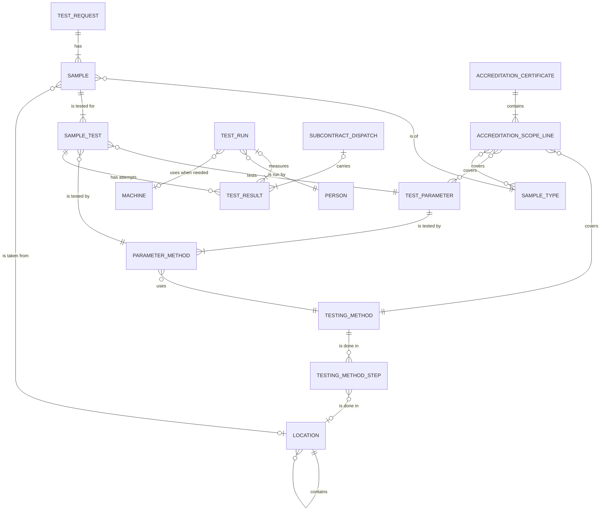
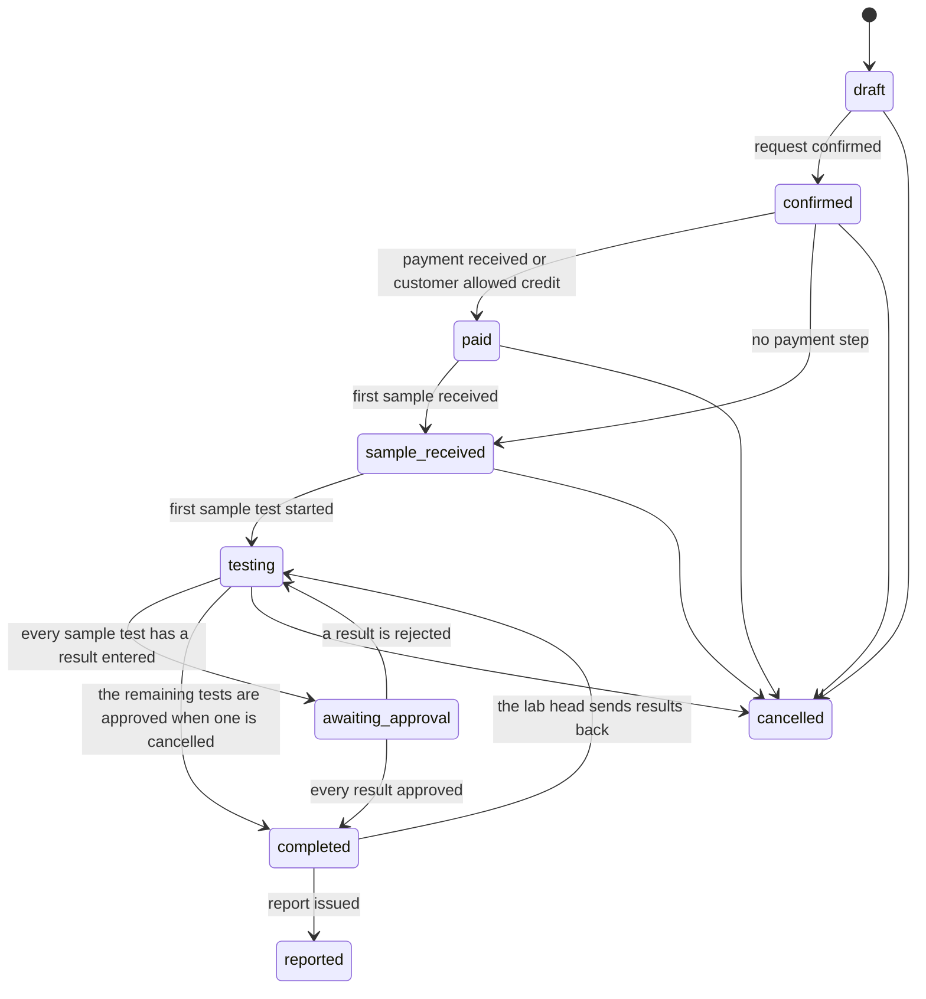
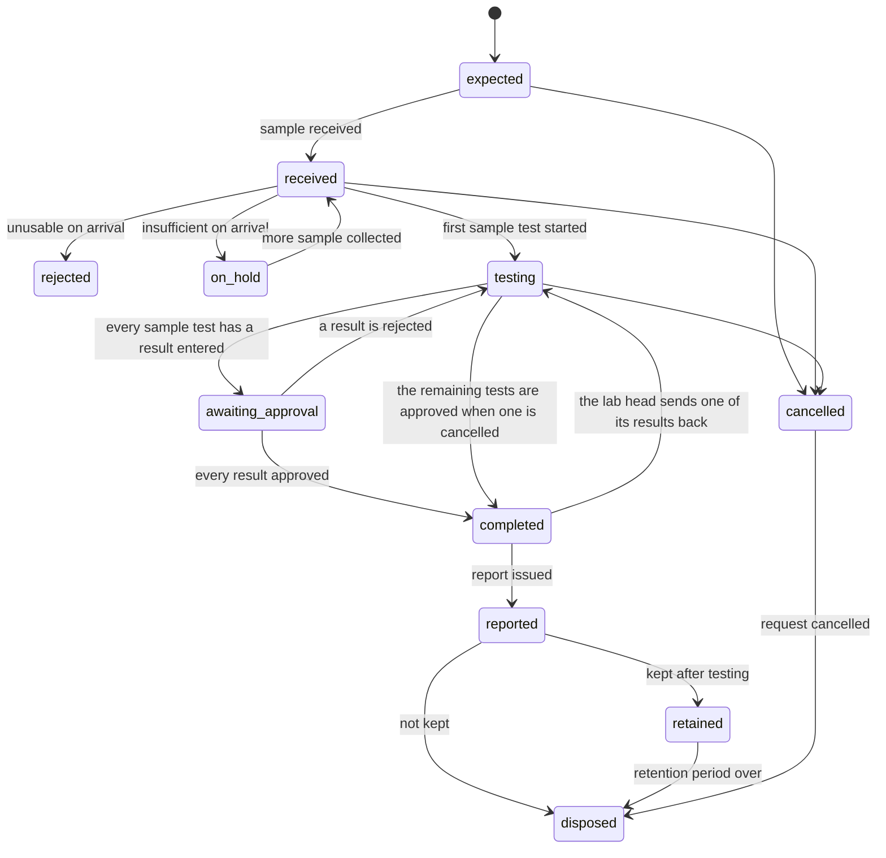
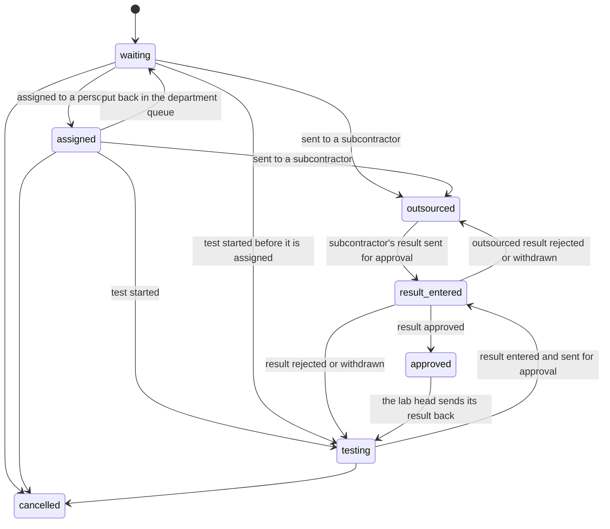
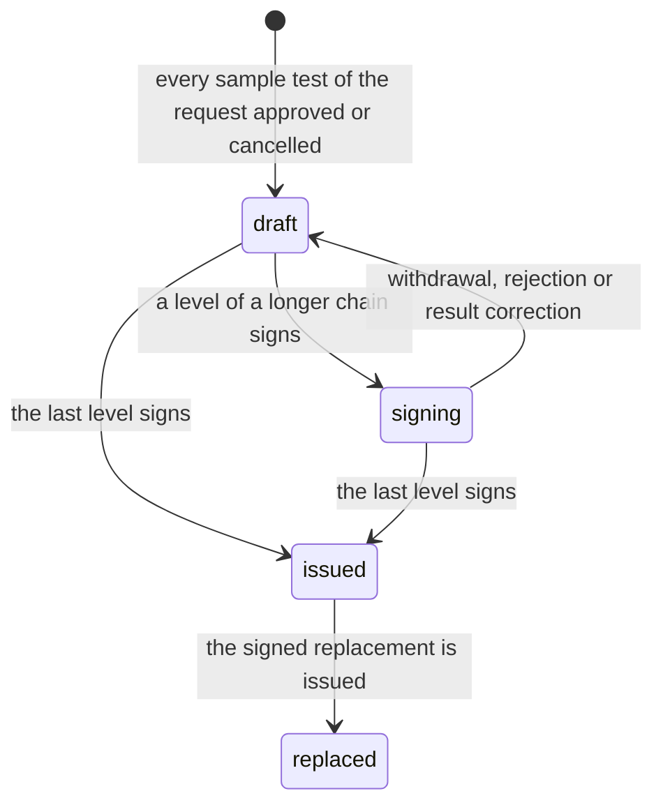
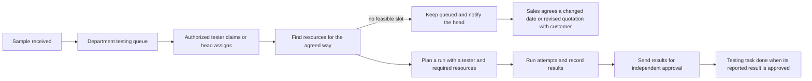
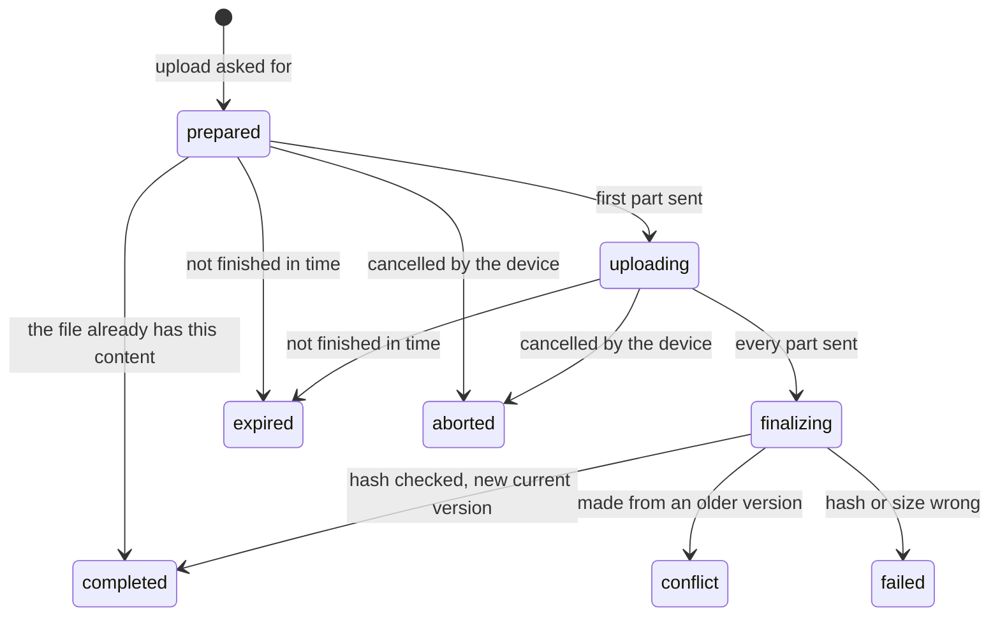
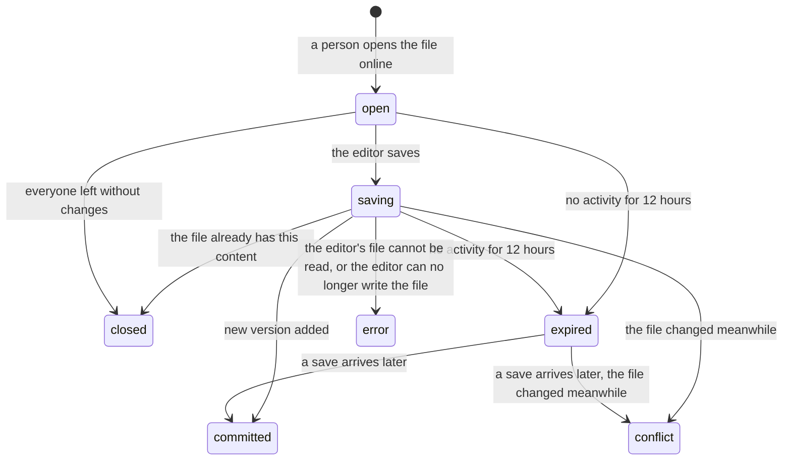
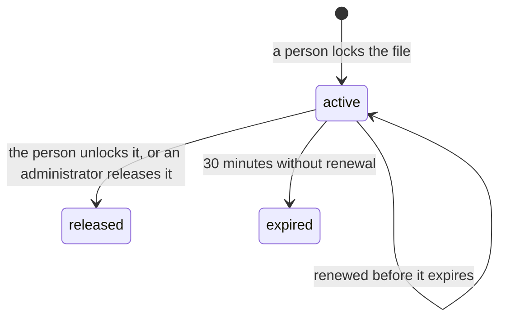

# Laboratory Module Overview

The Laboratory module is the core of MediLab. It holds the master data, the test requests, the samples and their results, and the signing that approves them. E-commerce and Inventory depend on it; it depends on no other MediLab module. It builds on Odoo's Employees, Calendar, Discuss and portal, as listed in [Module boundaries](../../business/module-boundaries.md#odoo-apps). The tables are drawn in [laboratory.prisma](../../infrastructure/database/laboratory/laboratory.prisma).

## Core entities

The module is built around two entities:

- **Sample**: the material someone holds in their hand. A sample has a sample type (nền mẫu).
- **Test parameter**: what the laboratory does to the sample. A parameter belongs to parameter groups (nhóm chỉ tiêu).

A parameter has N testing methods, and a sample has N parameters.

## Test requests and samples

| Rule              | Description                                                                                                                                  |
| ----------------- | -------------------------------------------------------------------------------------------------------------------------------------------- |
| Customer          | A customer is a company or an individual. Their details are their contact; a company's people are the contact's people. A customer has a code from a sequence, the tax ID on its contact, and a citizen ID for an individual, which is masked in the audit trail. People who use the customer portal sign in with Odoo users linked to those contacts. Sales maintains customers. |
| Test request | A test request groups at least one sample of one customer, each with at least one sample test. Confirming an order creates the request and its expected samples and sample tests from the accepted selections and sampling requirements. Sample delivery staff adjust them to the actual collection. Without E-commerce they create the request, samples and selected ways directly. |
| Lab code          | Each sample gets a unique lab code (mã PTN) from a sequence, such as PTN.2026.0001, numbered again each year. Testers see only the lab code, never the customer or the customer's name for the sample: only people who can read test requests see those. |
| Sample details    | A sample has the customer's name for it, its sample type, its physical state (solid, liquid, gas or semi-solid), and its form and container as text. It can name the [location](features/admin.md#1-catalog-us-ad01-to-us-ad08-us-ad26-to-us-ad28) it was taken from, such as a sampling point. |
| Regulation | Comparison with a regulation such as QCVN is optional. The main flow tests by the selected method, such as a TCVN, and returns measured results. A regulation defines comparison requirements and may refer to several testing standards; it is not a testing method. Only the parameters for which comparison is requested are assessed. |
| Sample test | One way of testing applied to one sample, with quantity and due date. The way is required from creation and determines the parameter. The customer or Sales selects it before quotation acceptance, otherwise the default for that parameter and sample type is used. Accepted selections change only through a revised quotation and customer agreement. |

## Lifecycles

Each document keeps its own status. Tasks keep their own generic lifecycle ([SH-10](../shared.md#sh-10-tasks-and-to-do-list)).

### Test request

- Only the request of an order goes through the paid step, which E-commerce sets. A request sample delivery staff create goes straight from confirmed to sample received.

### Sample

### Sample test

### Test report

- A rejected report stays in draft until the results sent back are approved again; the lab head then gets a new signing task. This also applies to replacement reports whose request is already reported.

## Reception

| Rule            | Description                                                                                                                          |
| --------------- | ------------------------------------------------------------------------------------------------------------------------------------ |
| Receipt         | When a sample arrives, the laboratory records when and by whom it was received, the amount received, its condition (good, damaged or insufficient) with a note, and where it is stored. |
| Label           | Each sample has a label printed by sample delivery staff, showing its lab code, its test request's code, the date results are due and a QR code of the lab code. It never shows the customer or the customer's name for the sample. |
| Photos | Sample delivery staff attach sample photos when collecting or receiving it through the web interface. Photos are shown only wherever the customer's sample name is shown, so testers never see them. |
| Handover record | Each collection or handover records the staff member, appointment, collection time, actual samples and amounts, conditions, differences from the order and the customer's confirmation signature. A request may have several collections. The signed PDF is emailed to the customer. A signed record is never edited; a correction is a new record and the old one is kept. |
| Expected samples | For each sample type, the number of objects is the largest quantity of its order lines. Testing methods with the same container type and preservation condition form one sampling group and their required amounts add. Expected samples equal objects times sampling groups. Show the expected count, container and amount when ordering. The customer does not declare physical samples; collection staff adjust the expected samples to the actual handover for customer confirmation. |
| Collection differences | When fewer samples arrive, Sales waits for another collection or cancels the missing part. Extra samples are received and held pending, and are tested only after the customer agrees to a revised quotation. |
| Rejection       | A sample that cannot be tested on arrival is rejected with its condition note.                                                         |
| Insufficient    | A sample that arrives insufficient is put on hold and reported to the head of department, who asks for it to be collected again. The request schedules a sample collection task for sample delivery staff. The sample goes back to received when more sample arrives. |
| Retention       | A sample kept after testing is retained until the report date plus its sample type's retention days. |
| Disposal        | A tester disposes of a sample that is not kept, whose retention period is over, or whose request was cancelled. Disposal records when, by whom and how; the method is the one entered on the sample, or else its sample type's disposal method, and is required. Disposal cannot be undone. Every day, testers get a to-do listing the samples whose retention ends within the reminder days, a system parameter (7 by default), or has ended, and that are not disposed of yet. |
| Handover | A received sample is handed to each department that tests it. A person of that department records receipt time and recipient by scanning the label through the web interface; a person outside the department is refused. |

## Results

| Rule            | Description                                                                                                                       |
| --------------- | --------------------------------------------------------------------------------------------------------------------------------- |
| Attempts | Each result is one attempt, measured in exactly one test run or one subcontract dispatch. A retest creates a new attempt in a new run, preserving earlier attempts. One result per sample test is reported: the latest entered, and only it is sent for approval. A new attempt may be entered for a received sample while its test waits, is assigned or is testing, not while its reported result awaits approval. |
| Value | An attempt copies the result unit, LOD and LOQ from the way's configuration for the sample type when created. A value is an exact decimal number with the configured display precision, or text. Later catalog edits do not change the snapshot. Below LOD or LOQ, suggest text for the tester to confirm, print the actual threshold and unit, such as "<0.05 mg/L", and state whether it is below LOD or LOQ. Retain the raw number if available; never substitute zero or infer a pass. |
| Limit copy | For requested comparison, copy the regulation reference, limit and unit for the exact parameter and sample type when the result is created. Missing limits remain visibly missing. Later catalog edits do not change snapshots. Comparison-unit conversion follows [Catalog](features/admin.md#1-catalog-us-ad01-to-us-ad08-us-ad26-to-us-ad28) and retains the original measurement. |
| Versions        | A change request on a result whose process is completed creates a new version that replaces it. The signed version stays unchanged and is marked as replaced. |
| Measurement | The test run supplies the performing person, time and machine when required. An outsourced attempt belongs to its dispatch and retains the subcontractor's report. Completing an attempt does not finish the other attempts in a shared run. A result never belongs to both a run and a dispatch. |
| Entered by      | Each result records who entered it. The results of an outsourced test are entered by the subcontractor, whose people sign in to the system, or by a lab QA, once its dispatch is sent. A lab QA sends them for approval like their own. |
| Sanity check    | Before a numeric result is sent for approval, it is compared with the approved results of the same parameter, way of testing and sample type, whoever the customer. When there are enough of them, 10 by default, and the value is more than 3 standard deviations from their mean, or the value is within 10% of the regulation limit, the tester is warned with the reason and may still send it. The warning is kept on the result and shown to the approver. The minimum count, the spread and the margin are [system parameters](../shared.md#sh-03-configuration-through-settings-and-system-parameters). A text result is not checked. |
| Conclusion | Without a requested regulation comparison, no pass/fail conclusion is required. For each comparison the tester assesses pass, fail or insufficient basis, including text and below-LOD/LOQ results. Any assessed failure makes the sample fail within the assessed scope. It passes within the requested scope only when all required comparisons are complete and pass. With no failure but a missing limit or unresolved assessment, the conclusion is insufficient basis. Parameters outside the requested comparison scope do not need a conclusion. |
| Result approval | The Head of Department approves the department's results and may approve results they entered, including when they are its only result signer. Other entrants cannot approve their own results. Approval is an explicit signing action, not an effect of entering a result. The Lab Head reviews the approved results when signing the report. |
| Final decision | The tester may withdraw a sent result until its approver acts. Approval or rejection by the Head of Department completes its process and cannot be withdrawn. A rejected result stays on record; a retest adds a new attempt. Rejection tells the entrant why. The Lab Head's report rejection can send approved results back. |
| Progress        | Entering the first result, or starting a booking, starts the test, its sample and its test request; outsourcing a test starts its sample and its test request. A sample waits for approval once each of its remaining tests has its reported result sent, and is completed once each is approved; its test request follows its samples the same way. Cancelled tests, and cancelled or rejected samples, do not count. |
| Cancelling      | The head of department can cancel a sample test of their department that has no approved result, with a reason, such as the parameter cannot be tested on the sample: a person of the department of the test's testing task who may edit sample tests. Only a waiting, assigned or testing test can be cancelled. Cancel its testing task and its own planned work without cancelling other sample tests or releasing reservations still needed by their shared run. A cancelled test is left out of the report; its reason stays on the test request. |
| No deletion     | A result cannot be deleted, and neither can the sample test, sample or test request it belongs to. |

## Reports and change requests

| Rule            | Description                                                                                                                       |
| --------------- | --------------------------------------------------------------------------------------------------------------------------------- |
| Test report     | A test request has one test report covering all its samples, issued in Vietnamese, English or both side by side. Samples have no sign-off of their own: once a sample's results are approved, the next signature is the lab head's on the report. It is signed through its approval chain and issued with a report number from a sequence and the digitally signed PDF ([SH-04](../shared.md#sh-04-signatures-and-digital-signing)). |
| Draft           | When every sample test of a request is approved or cancelled, the system creates the draft report and a signing task for the lab head. |
| Content | The report identifies the customer, request, receipt and issue dates, report number, samples and lab codes, and prints parameter, measured result, unit and method. Comparison limits and conclusions appear only for the requested regulation scope, with wording limited to that scope and insufficient basis where applicable. Below-LOD/LOQ text prints the snapshot threshold and unit. Print the actual result approvers and the report signer; tester signatures stay internal. Cancelled tests are excluded. |
| Rejection       | The lab head can reject a report with a reason, naming the results to check again. Those results go back to the queue of their head of department, unassigned and unsigned: their signatures are withdrawn, their sample tests, samples and request go back to testing, and a new testing task with the reason waits unassigned in the queue of the department that tested them. The report waits until they are approved again; the lab head then gets a new signing task. |
| Delivery        | The test request records the report language (Vietnamese, English or bilingual, bilingual by default), how the report is delivered (in person by default, by post, by email or another way with a note) and the contact who receives it. Sample delivery staff deliver the issued report that way and record when it was delivered and by whom; recording an email delivery emails the PDF to the recipient. When digital signing is on, an issued report's PDF is the digitally signed one, so it is delivered, downloaded and announced once Viettel Sign has signed it. Customers are notified when a report's PDF is ready, on the order and to its contact when the request came from an order, and issued reports can always be downloaded from the customer portal. |
| Change request  | A change to a document whose process is completed is a change request: what to change, why, who asked and when. Anyone who can edit that type of document can raise one, on an approved result or an issued report. A rejected result is corrected by a retest, and a rejected correction by another change request, since a reported sample takes no retest. A version has one open change request at a time. It is signed through the change-request chain of the document's type ([SH-07](../shared.md#sh-07-signed-documents-are-locked)); approval or rejection is final, and the requester is notified of either. |
| New version | Approving a result change request creates a new unsigned result version, preserves the previous signed version and queues correction and approval in its department. A report correction creates a replacement draft only after its required approvals and all corrected results are approved. The Lab Head signs it through a new signing task before it is issued with a new number. Only then is the old report marked replaced; its original file and history remain available, and the portal offers the replacement. |
| Linked result correction | A correction to a result included in an issued report automatically creates or links that report's change request, reusing an open request for the version. Approving the result alone never issues a report. Notify the customer once the signed replacement PDF is ready. |
| Correction during signing | A result correction may be proposed while its report waits for signature. Before applying it, stop pending signing and return the report to draft, withdrawing signatures in the permitted order. Approved results still require their own change request. After every corrected result is approved, rebuild the draft and create a new Lab Head signing task for both initial and replacement reports. An old signing task cannot sign stale content. |
| Regulation validity | Check the selected regulation at sample receipt and before report issue. Expiry during testing does not stop testing or silently switch the regulation. Before issuing a report with a regulation conclusion, the Lab Head confirms its applicable basis. Sales obtains customer agreement if the agreed comparison scope must change. |
| Changing the regulation | An explicit change of the sample's regulation re-evaluates the affected results. On unsigned results, confirm copying the new applicable limits and clear previous conclusions and comparison conversions. Withdraw signatures first where permitted; a completed result or issued report requires change requests and new versions. Keep raw measurements, way of testing and LOD/LOQ snapshots. The change alone never starts a retest; professional assessment determines whether one is needed. |

## Signing

Signing follows [Approval and signing chain](../../business/approval-and-signing-chain.md) and [SH-04](../shared.md#sh-04-signatures-and-digital-signing).

| Rule            | Description                                                                                                                       |
| --------------- | --------------------------------------------------------------------------------------------------------------------------------- |
| Approval chain  | Each document type, such as test result, has one chain of levels for signing it and one for change requests on it, each signed in order. Each level names the role that signs it, whether the signer must belong to the department that did the work, and whether the level can reject. |
| Signature       | A signature records the document and its version, the level, the signer and, as they were at signing, the signer's name, role and level name. A rejection records its reason. |
| Withdrawal      | A withdrawn signature is kept with the time it was withdrawn; signature records are never deleted.                               |
| People          | A person is someone who works for the laboratory, maintained by the administrator. Their details are their contact; if they sign in, they have an Odoo user. |
| Permissions     | A permission is an action on a document type (read, create, edit, archive, delete or sign) on every record, only those of the person's department or only those of the person's team. |
| Roles           | A role is a set of permissions the administrator defines. A person holds roles and can also be given permissions directly; they have every permission of their roles plus their own. |
| Enforcement     | Permissions are enforced in the API and in the interface: a person does not see menus, records, fields or buttons for what they are not allowed to do. |
| Global rules    | Some rules hold for everyone whatever their permissions, such as a signed document not being edited, archived or deleted. See [Security](../../security/readme.md). |
| Signing levels  | Each approval level names the role that signs it. |

## Testing work and scheduling

Testing work follows [SH-10](../shared.md#sh-10-tasks-and-to-do-list) tasks and [SH-11](../shared.md#sh-11-schedules-and-reminders) schedules.

| Rule               | Description                                                                                                                                     |
| ------------------ | ----------------------------------------------------------------------------------------------------------------------------------------------- |
| Testing tasks      | When a sample is received, the system creates a testing task for each sample test and puts it in the queue of the department that does the work. |
| Assignment | Testing tasks queue by department, not by team. The Head of Department assigns a single task or all of a sample's tasks in that department to an authorized tester; authorized testers may claim unassigned tasks. Lab Head maintains the person-to-parameter authorization list, without start or end dates. Reassignment needs a reason. Scheduling checks membership of this list. |
| Due date | The customer's expected return date belongs to the test request. Each sample test defaults to the end of the company-local day, a configurable safety margin before it (2 days by default). A margin change does not rewrite existing due dates. A test is urgent within a configurable threshold of 24 hours, or when its tester or Head of Department marks it urgent with a reason. |
| Method steps       | The person running a test sees the steps of the testing method of its way of testing, each with its number, how long it takes, what to do and its note. The steps are the same for the whole laboratory. |
| Recommendation | Recommend a tester, slot and required resources for the agreed way of testing and explicit sample-type applicability. Scheduling does not choose another way. A test run uses one way, one person and one interval; it may combine attempts from different samples, customers and requests without exceeding capacity. |
| Run time and slots | For a machine run, duration and capacity come from the machine and way link. A way needing no machine has its own duration and capacity, default capacity 1. Reserve the tester and required locations in either case, with duration rounded up to 15-minute slots. A machine booking reserves a run, not a single sample test. |
| Machine queue      | Tests waiting for a machine join its queue. The scheduler gives each the next free slot: urgent tests first, then in the order they joined the queue. |
| No overlap | A tester, machine or bookable location cannot have overlapping reservations or unavailable intervals. A machine needs valid calibration and must be in use; never-calibrated, expired-calibration, under-repair and retired machines get no bookings. Planned maintenance reserves machine time; overdue maintenance blocks new bookings until completed. |
| Suggest outsourcing | When no feasible resource slot can meet the due date, show subcontracted alternatives with their turnaround. An alternative that changes the agreed way or performing party requires Sales to obtain customer agreement through a revised quotation. Never substitute a method or subcontractor silently. |
| Machine unavailable | Not-started bookings affected by machine downtime or lost calibration validity return to the queue and are replanned on another machine for the same way. If none is available they remain queued, and the tester and Head of Department are notified. For a run interrupted by a fault, retain all data; the head assesses each attempt as usable, needing a retest or needing more sample. A retest has a new attempt and run linked to the interrupted run. |
| Locations          | A step of a testing method can name the [location](features/admin.md#1-catalog-us-ad01-to-us-ad08-us-ad26-to-us-ad28) where it is done, such as a fume hood or a water point. A sample can name the location it was taken from. The person running a test sees the locations of its steps and of its sample, on the testing task, the schedule, the to-do list and the timeline of their day, and opens it on its parent location's map. A bookable location, such as a shared room, is booked on the calendar ([SH-11](../shared.md#sh-11-schedules-and-reminders)), by people or by the scheduler for a step done in it. |
| Rooms | Reserve every bookable step location for its rounded step interval, in step order from the run start, alongside the tester and a machine only when needed. A run is planned only when all required resources are available. Moving or cancelling the run moves or cancels its location reservations. A location may have unavailable intervals: reject overlapping new bookings, replan affected not-started bookings and notify the responsible people. |
| Approved leave | Read shifts and approved leave from the HR people source. Approved leave returns overlapping work that has not started to the department queue and notifies its head. The head reassigns it or an authorized tester claims it; the system does not pick another person automatically. |
| Planned overtime | The Head of Department may book outside normal working hours directly with a reason; a pre-created HR overtime shift is not required. Store OverTime linked to the tester, the outside-hours interval, work, reason and assigner. If normal hours end at 17:00 and work runs 16:00–19:00, record 17:00–19:00. Only planned overtime is recorded; actual-hours confirmation and payroll are outside scope. |
| Customer date change | When the promised return date cannot be met, propose the earliest feasible replacement. Sales obtains customer agreement before changing it and records old date, new date and confirmation. If declined, Sales handles a cancellation request for the unfulfillable part; do not cancel automatically or change the method. |
| Adjusting          | The person running a test, and the head of their department, can move or cancel its booking; the slot goes back to the queue.                 |
| Bumping | With a reason, the Head of Department may move an urgent run ahead of not-started bookings, which return to the queue for replanning and notify their people. Never interrupt a running booking. Before proceeding, show affected deadlines; the head chooses to accept lateness, pursue an agreed outsourcing alternative or cancel the bump. This is an explicit action, never a side effect of checking a due date. |
| Changing a due date | Only the Head of Department changes the internal due date manually, with a reason. Preserve this override when the customer's expected date changes; recalculate only dates still automatic and warn when the two dates conflict. An internal-only date change does not notify the customer. Sales informs the customer when the promised return date is affected or at risk. |
| Return estimate | Simulate the earliest finish of each in-house branch using authorized people, required locations and machines when needed. Each subcontracted way has an end-to-end turnaround including transport and processing. The latest branch finish plus the safety margin gives the return estimate. A missing subcontract turnaround means no complete estimate can be given. An estimate reserves or moves nothing. |
| Priority request   | When the customer asks for results earlier than the estimate, the scheduler checks the requested date as if its tests were urgent, with the due date check below. It answers that the date can be met, can be met only by outsourcing named parameters, or cannot be met, with the earliest date it can. An accepted priority request marks the tests of its test request urgent when they are created. |
| Due date check | Use the company working calendar, public holidays, staff shifts and approved leave. Simulate available resources and possible moves; show feasibility, reasons and the earliest feasible date. Never move bookings during the check. The Head of Department may retain an infeasible internal due date with a reason and visible risk flag. |
| Deadline risk | Flag a test whose bookings cannot finish by its internal due date or whose planned measurement ended without a result. Notify its responsible tester and Head of Department initially, then include unresolved risks in a daily consolidated summary until resolved. Recheck on schedule changes and through a scheduled job. Sales tells the customer when the promised return date changes or is at risk. |
| Machine heads-up | Use three independent system settings, each defaulting to 7 days: before calibration, before maintenance and after a recorded repair. Warn when planning or starting within the applicable window. Warnings do not override blocked calibration, maintenance or unavailable-resource conditions. |
| Bookings as tasks  | A scheduled booking appears on the person's schedule and in their to-do list as part of their testing task, due at its start.                |
| Outsourcing | The Head of Department organizes dispatches for the selected subcontracted way, including an agreed revision when replacing an accepted way. A dispatch records subcontractor, sending date, due date, attempts sent, carrier and subcontractor report. It is draft, sent, received or cancelled. A sample test has one non-cancelled dispatch; cancelling leaves its tests available for another dispatch, and a dispatch with results cannot be cancelled. |

## Laboratory files

Laboratory files are the files the testing work produces and uses outside MediLab's forms: raw data from instruments, working spreadsheets, result files and report drafts. The Laboratory module keeps them the way an object store does: folders of files, each file a series of versions, with the bytes in an S3 bucket and only their description in the database. People work on the files in their own programs on the laboratory's computers through [Medilab Sync](applications/medilab-sync.md), browse and download them in the Documents menu of the back office, and edit Office documents together in the browser. Medilab Sync reaches the module through its REST API.

| Rule            | Description |
| --------------- | ----------- |
| Folder          | A folder holds files under paths relative to it, such as `HPLC/run-01.csv`. It has an owner, a name unique for that owner, and members. It never stores where it lives on anyone's computer. |
| Sample folders  | A folder can belong to a sample, with a category: raw data, working documents, results or reports. The head of department creates a sample's folders from the sample; a person needs both the folder and the sample to use it, so testers still see only the lab code. |
| Members         | The owner and the people they add can read and write the folder: see, download and upload its files and restore their versions. There is no read-only member. The owner and administrators add and remove members; only administrators change the owner, and the previous owner stays a member. |
| Sync rules      | A folder can limit which files are synced by name prefix, name pattern with `*`, or extension, with or without subfolders. With no rule every file is synced. |
| Versions        | Saving a changed file adds a version: a number that never changes, who saved it, from which device, when, its size and SHA-256 hash, and how it was made: synced, restored, edited online, or kept from a conflict. A version is never edited or deleted. The file's current version is the one people get. Two versions with the same content share the stored bytes. |
| Uploads         | A file is uploaded straight to the bucket in parts through short-lived signed addresses, never through Odoo, up to 5 GiB in parts of 16 MiB. The server checks the hash and size of the stored bytes before the version counts. An upload left unfinished expires and its parts are removed. |
| Conflicts       | An upload made from a version that is no longer the current one is kept as a conflict version, never written over the current one. The person chooses to keep their own file or take the server's; both versions stay in the history. |
| Restore         | Restoring an earlier version adds a new current version with its content; history is never rewritten. |
| Raw data        | Raw-data files are evidence: each save adds a version, they are not edited online and they are not locked. |
| Online editing  | Word, Excel and PowerPoint result and working files are edited together in the browser through ONLYOFFICE. One editing session is open per file; saving it adds a version. When the editing service is down, sync, download, history and restore keep working. |
| Locks           | A working, result or uncategorized file that is not an Office document can be locked by one person while they edit it, for 30 minutes unless renewed; the duration is a system parameter. Others cannot upload it meanwhile; an administrator can release a lock someone left. |
| Signing         | A version of a result file is approved by signing it through the approval chain of laboratory files ([SH-04](../shared.md#sh-04-signatures-and-digital-signing)). The signature belongs to that version and its hash; a newer version needs its own. |
| Devices         | Each computer signs in once with the person's MediLab login and gets its own key; the password is never stored on it. An administrator sees every device and revokes one, which stops it at once without removing the person's folder memberships. |
| Turning off     | An administrator can turn a folder off: nobody can upload to it, and its files can still be read and downloaded. |
| Archiving       | An archived folder keeps its files and versions until its retention date, worked out from a retention period that is a system parameter. |
| Changes         | The API gives each device the changes to the current versions of a folder since the last change it saw, so every computer gets other people's new versions. Renaming and deleting are not passed between computers. |
| Audit           | Signing in and out of a device, uploads, conflicts, restores, downloads, online editing, locks, signatures, member changes and archiving are recorded in the [audit trail](../shared.md#sh-05-audit-trail). |

### Upload

### Online editing session

### Lock

## Actors

- [Administrator](features/admin.md): master data, people, roles, approval chains and task types
- [Sample delivery staff](features/sample-delivery-staff.md): collect, receive and hand over samples, and carry outsourced samples to subcontractors
- [Tester](features/tester.md): schedules and runs tests, enters and signs results
- [Head of department](features/head-of-department.md): assigns testing work, manages the department's schedule, approves results
- [Lab head](features/lab-head.md): configures parameter authorizations, reviews results when signing reports and reviews laboratory-wide testing figures
- [Subcontractor](features/subcontractor.md): sees the tests sent to it and enters their results

## Related documents

- [Overview](../index.md)
- [Administrator](features/admin.md)
- [Approval and signing chain](../../business/approval-and-signing-chain.md)
- [Shared technical features](../shared.md)
- [Database diagram](../../infrastructure/database/laboratory/laboratory.prisma)
