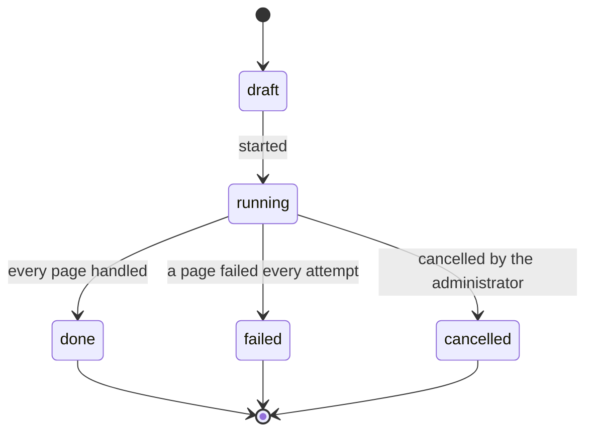
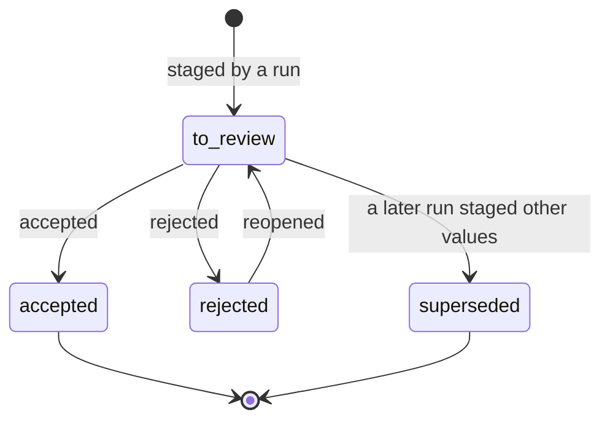

# Features of: Administrator

The administrator fills the Laboratory master data from trusted public sources: chooses the sources, picks the laboratory's organisation and sectors, runs collections and reviews what they stage. The tables are drawn in [onboarding.prisma](../../../infrastructure/database/onboarding/onboarding.prisma).

## I. User stories

- **US-AD32** As an administrator, I want to choose the trusted sources the system may collect master data from, so that nothing is read from a site the laboratory has not approved.
- **US-AD33** As an administrator, I want to pick my laboratory from the organisations a source lists, with the system suggesting it from the company's details, so that the laboratory's own accreditation scope is collected without typing it.
- **US-AD34** As an administrator, I want to choose the sectors the laboratory tests in, such as food, and have the system collect the testing methods, parameters and sample types the sources list for them, so that the catalog starts from what such laboratories test.
- **US-AD35** As an administrator, I want to review the collected records, edit them, and accept or reject them, so that only checked data becomes master data.
- **US-AD36** As an administrator, I want to see each collection run with what it fetched and staged, and where each accepted record came from, so that collected master data can be traced to its source.

## II. Feature details

### 1. Trusted sources (US-AD32)

| Rule          | Description                                                                                                                                                                                  |
| ------------- | -------------------------------------------------------------------------------------------------------------------------------------------------------------------------------------------- |
| Adapter       | Each source is read by an adapter that knows its pages. Adapters are shipped in code; the administrator adds and configures sources only for a shipped adapter. The module ships the BoA source, turned off. |
| Host          | A source names its host. Its runs read only from that host, over HTTPS with a verified certificate. A redirect to another host is not followed.                                                |
| Public data   | Sources are read without logging in. A source never holds a password, token or cookie.                                                                                                       |
| Pace          | A source has a delay between two requests, 2 seconds by default, and a page limit per run, 500 by default. Its runs follow the host's `robots.txt` and never fetch a path it disallows.         |
| Turned on     | A source is turned off until the administrator turns it on. A run cannot start on a source that is turned off.                                                                               |
| Archiving     | A source that has runs is archived, never deleted, so its staged records keep their origin.                                                                                                   |

Acceptance criteria:

- Starting a run on a source that is turned off is refused with a message.
- A page that redirects to another host is not fetched, and the run log names it.
- A path that the host's `robots.txt` disallows is not fetched, and the run log names it.
- Two requests of a run are never closer than the source's delay.
- A run stops at the source's page limit and its log says so.
- A source with runs cannot be deleted, only archived.

### 2. Collecting (US-AD33, US-AD34, US-AD36)

| Rule            | Description                                                                                                                                                                                       |
| --------------- | ------------------------------------------------------------------------------------------------------------------------------------------------------------------------------------------------- |
| Organisations   | A [scheduled job](../../shared.md#sh-09-scheduled-tasks) refreshes the organisations each turned-on source lists, weekly by default, and the administrator can refresh them by hand. Picking an organisation searches this list, never the source's site. |
| Suggestion      | Picking an organisation suggests first the one whose tax ID is the company's, then those whose names are closest to the company's name. The administrator can pick any listed organisation or none. |
| Sectors         | The administrator picks one or more of the sectors the system serves: food, cosmetics, pharmaceuticals and environment.                                                                          |
| What a run reads | A run has an organisation, sectors or both. For the organisation, it stages its accreditation certificates with their scope. For the sectors, it stages what the source lists for them. |
| Background      | A run works through a scheduled job, one item per page, so the administrator can leave the screen. The administrator who started it is notified when it ends.                                      |
| One at a time   | A source has at most one running run. Starting another on it is refused until the first ends.                                                                                                      |
| Snapshot        | Every document a run fetches is kept unchanged with its address, the time and its checksum. Every staged record names the snapshot it came from.                                                  |
| Seen before     | A record the source gives with the same values as a staged record still to review, accepted or rejected is not staged again. With other values, it is staged again as an update, and an older one still to review is superseded. |
| Run report      | A run shows the pages it fetched and skipped with the reason, the records it staged per kind and its errors.                                                                                      |
| Cancelling      | The administrator can cancel a running run. It fetches nothing more, and what it already staged stays to review.                                                                                   |

Acceptance criteria:

- With the company's tax ID equal to a listed organisation's, that organisation is the first suggestion.
- A run for the food sector stages only what the source lists for food.
- Running the same collection twice on an unchanged source stages nothing the second time.
- When the source changes a method's title, the next run stages an update, and the earlier record of that method still to review becomes superseded.
- A page that fails every attempt ends the run as failed, names the page in the log, and keeps what the run staged.
- A cancelled run fetches no more pages and keeps what it staged.
- Starting a second run on a source with a running run is refused with a message.
- Each staged record opens the snapshot it came from with its address and time.

### 3. Reviewing staged records (US-AD35, US-AD36)

| Rule              | Description                                                                                                                                                                                                            |
| ----------------- | ---------------------------------------------------------------------------------------------------------------------------------------------------------------------------------------------------------------------- |
| Proposed action   | A staged record proposes to create a record when it matches none, to link an existing record that it matches with the same values, or to update a record it matches with other values.                                  |
| Matching          | A certificate matches by its number and a testing method by its standard code, both ignoring case and spaces. A testing field, a sample type and a test parameter match by name in the source's language; a name match is a suggestion the administrator confirms. |
| Editing           | Before accepting, the administrator can edit the values and the match. The values the source gave are kept unchanged next to the edited ones.                                                                           |
| Accepting         | Accepting creates, links or updates the Laboratory record by the rules of the [Catalog](../../laboratory_module/features/admin.md#1-catalog-us-ad01-to-us-ad08-us-ad26-to-us-ad28). When Laboratory refuses it, such as for a duplicate code, the record stays to review with the message. |
| Needed first      | Accepting a record also accepts the staged records it needs: a way of testing its parameter and method, a certificate the methods of its scope, a method its testing field. What Laboratory requires and the source does not give, such as the department of an in-house way of testing, is asked when accepting. |
| Updates           | Accepting an update shows the current and the new values side by side and changes only the fields that differ. It does not restore an archived record.                                                                  |
| Many at once      | The administrator can accept or reject many staged records at once. The result lists each one that was refused with its message; those stay to review.                                                               |
| Rejecting         | A rejected record has an optional reason. Later runs do not stage it again while the source keeps the same values. The administrator can reopen it.                                                                    |
| Nothing automatic | No staged record becomes master data without an administrator accepting it.                                                                                                                                          |
| Origin            | A Laboratory record created, linked or updated by accepting shows its origin: the staged records, their snapshots and sources.                                                                                          |
| Permissions       | Reading sources, runs and staged records, starting runs, and accepting and rejecting are permissions the administrator holds and can give to other roles and people. Accepting also needs the permission to create or edit the master data it changes. |

Acceptance criteria:

- A staged method whose standard code exists, written with other case or spaces, proposes to link that method.
- A staged certificate accepted with 30 methods, 5 of them already existing, creates 25 methods, links all 30 and leaves the 5 unchanged.
- Accepting a way of testing whose parameter and method are staged accepts them first.
- Accepting an in-house way of testing without a department asks for one, and nothing is saved until it is given.
- Accepting a record that Laboratory refuses leaves it to review with the message, and accepts nothing else for it.
- Accepting 20 records at once of which 2 are refused accepts 18 and lists the 2 with their messages.
- Accepting an update changes only the fields that differ.
- Editing a staged value keeps the source's value, and the accepted record has the edited one.
- A rejected record is not staged again by a run on the unchanged source, and can be reopened.
- A testing method created by accepting shows its origin with the source and the address of its snapshot.
- Someone without the permission to accept staged records does not see the Accept button, and the API refuses it.

## III. Related documents

- [Onboarding overview](../overview.md)
- [Onboarding crawler](../../../specs/onboarding-crawler.md)
- [Laboratory administrator](../../laboratory_module/features/admin.md)
- [Shared technical features](../../shared.md)
