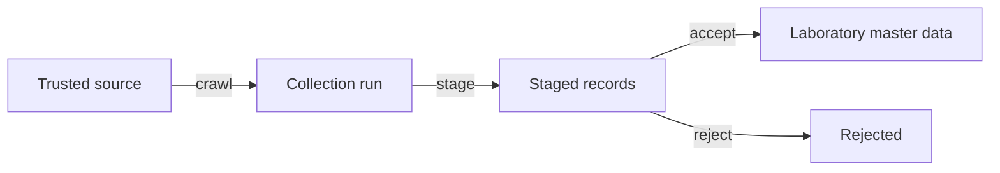
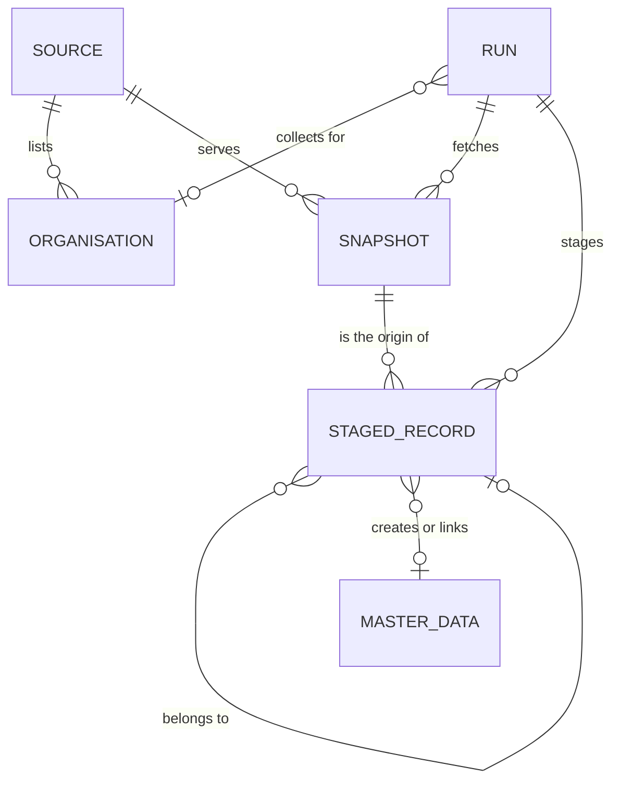

# Onboarding Module Overview

The Onboarding module (`sol_onboarding`) fills the Laboratory master data of a new installation from public data that trusted sources publish, such as the organisation search of the Bureau of Accreditation (BoA, [boa.gov.vn](https://www.boa.gov.vn/vi/timkiem/tochuc)). It only serves master data: it never touches test requests, samples, results or any other document. The tables are drawn in [onboarding.prisma](../../infrastructure/database/onboarding/onboarding.prisma), and [Onboarding crawler](../../specs/onboarding-crawler.md) specifies how it collects.

The module is optional. It depends on Laboratory, only the demo data module (`sol_demo`) depends on it, and uninstalling it leaves the master data it created in Laboratory.

## How it works

The input is raw public data that the module collects from trusted sources. The developers choose and configure the sources and ship them with the module; administrators do not see them. The output is staged records: proposed master data that waits in the module until an administrator accepts it. Only an accepted staged record becomes Laboratory master data.

1. The administrator picks the laboratory's own organisation from those the sources list; the system suggests it from the company's tax ID and name (US-AD32).
2. The administrator chooses the sectors the laboratory tests in, such as food (US-AD33).
3. A collection run reads the organisation's accreditation scope and what the sources list for the sectors, and stages what it finds (US-AD35).
4. The administrator reviews the staged records, edits them, and accepts or rejects them (US-AD34).

## Core entities

| Entity        | Description                                                                                                                                     |
| ------------- | ----------------------------------------------------------------------------------------------------------------------------------------------- |
| Source        | A site the developers trust and ship with the module, read by an adapter that knows its pages, such as the BoA adapter. Administrators do not see it. |
| Organisation  | An organisation a source lists, such as an accredited laboratory with its accreditation number. It is what the administrator picks the laboratory from. |
| Run           | One collection from the sources, for an organisation, sectors or both.                                                                          |
| Snapshot      | One document a run fetched, kept unchanged, so every staged record can be traced to the page it came from.                                       |
| Staged record | One proposed master data record, such as a testing method or an accreditation certificate, with the values the source gives and what accepting it does. |

## Staged master data

A staged record is one of these kinds. Accepting it follows the rules of the Laboratory master data it becomes ([Catalog](../laboratory_module/features/admin.md#1-catalog-us-ad01-to-us-ad08-us-ad26-to-us-ad28)).

| Kind                      | Becomes                                                                                       |
| ------------------------- | --------------------------------------------------------------------------------------------- |
| Accreditation certificate | An accreditation certificate with its number, issuing body, validity dates and the methods of its scope |
| Testing field             | A testing field, such as Chemistry or Microbiology                                            |
| Testing method            | A testing method with its standard code and title                                             |
| Sample type               | A sample type, such as the material or product a test is done on                              |
| Test parameter            | A test parameter                                                                              |
| Way of testing            | A parameter and method pair of a staged or existing parameter and method                     |

## Related documents

- [Administrator features](features/admin.md)
- [Onboarding crawler](../../specs/onboarding-crawler.md)
- [Laboratory overview](../laboratory_module/overview.md)
- [Module boundaries](../../business/module-boundaries.md)
- [Overview](../index.md)
