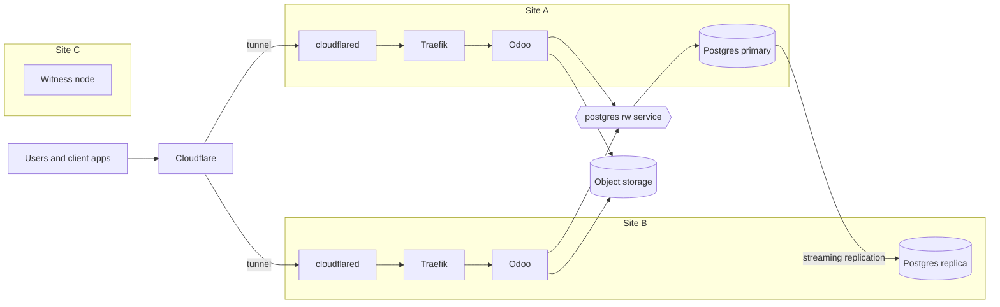

# Architecture

How MediLab runs in production: two servers in two locations, each holding the database, so that losing either location keeps the system online.

## Overview



## Nodes

| Node    | Location | Runs                                         |
| ------- | -------- | -------------------------------------------- |
| Server A | Site A  | Workloads and a database instance            |
| Server B | Site B  | Workloads and a database instance            |
| Witness  | Site C  | Cluster quorum only; tainted `NoSchedule`    |

- The three nodes form one k3s cluster, each a k3s server with embedded etcd.
- Every decision to promote a site needs a majority of three votes. With the witness in a third location, losing either data site leaves two of three votes, so the surviving site takes over. Two nodes alone cannot form a majority after a loss.
- Nodes reach each other over WireGuard (`--flannel-backend=wireguard-native`).

## Database

- CloudNativePG runs one Postgres `Cluster` with two instances, one per data site, each on the local storage of its node.
- Odoo connects to the cluster's `-rw` service, which always points at the primary.
- Replication uses `dataDurability: preferred`: writes wait for both sites while both are up, and continue on one site while the other is down.
- **Switchover:** `kubectl cnpg promote <cluster> <instance>` moves the primary to the other site without losing data.
- **Failover:** when the primary's site is lost, the replica is promoted automatically. The last writes not yet replicated can be lost.
- A returning instance resynchronises and rejoins as a replica.

## Ingress

- Cloudflare Tunnel is the only way in. `cloudflared` runs two replicas of the same tunnel, one per data site, and connects outbound, so no site needs a public IP.
- Cloudflare routes requests to connected replicas, so a lost site stops receiving traffic.
- DNS records are proxied CNAMEs to `<tunnel-id>.cfargotunnel.com`; Cloudflare terminates TLS and `cloudflared` reaches Traefik over plain HTTP.

## Odoo

- Two replicas, kept on different data sites by pod anti-affinity.
- Attachments are stored in object storage outside both servers, so either replica serves every file.
- Sessions are stored on each replica's local disk; users log in again after a failover.
- Module installs and upgrades run in a one-off Job per release, never at pod start.
- Scheduled actions run on both replicas; Odoo locks each job so it runs once.

## Failover timing

k3s waits five minutes by default before moving pods off an unreachable node. Every k3s server sets:

```text
--kube-apiserver-arg=default-unreachable-toleration-seconds=20
--kube-apiserver-arg=default-not-ready-toleration-seconds=20
--kube-controller-manager-arg=node-monitor-grace-period=20s
```

- CoreDNS, Traefik and `cloudflared` run two replicas each, one per data site.
- The CloudNativePG operator tolerates the witness taint, so it keeps running when a data site is lost.
- A lost site recovers in about 30 to 60 seconds.

## Related documents

- [Pipelines](pipelines.md)
- [Secrets](secrets.md)
- [Terraform conventions](../conventions/terraform.md)
