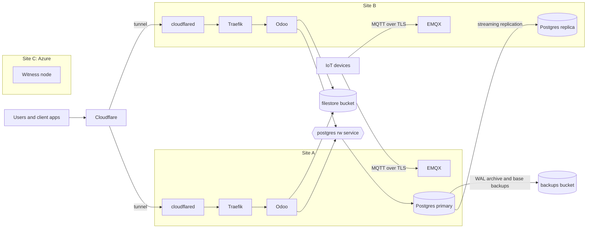

# Architecture

How MediLab runs in production: two servers in two locations, each holding the database, so that losing either location keeps the system online.

## Overview



## Nodes

| Node     | Location | Host                                                     | Runs                                      |
| -------- | -------- | -------------------------------------------------------- | ----------------------------------------- |
| Server A | Site A   | VPS SSD LINUX 8 `soltune-xoha`: 12 cores, 24 GiB, 120 GB | Workloads and a database instance         |
| Server B | Site B   | VPS SSD LINUX 2 `soltune-xxex`: 2 cores, 4 GiB, 40 GB    | Workloads and a database instance         |
| Witness  | Site C   | Azure VM in Southeast Asia, Azure for Students account   | Cluster quorum only; tainted `NoSchedule` |

- The three nodes form one k3s cluster, each a k3s server with embedded etcd.
- Every decision to promote a site needs a majority of three votes. With the witness in a third location, losing either data site leaves two of three votes, so the surviving site takes over. Two nodes alone cannot form a majority after a loss.
- Nodes reach each other over WireGuard (`--flannel-backend=wireguard-native`).
- Any Linux machine with a public IP can take a node's place; [Moving a node](../workflows/moving-node.md) replaces one without stopping the system.
- The two VPSes are rented by hand; Terraform does not create them. Their public IPs are Terraform variables, used for the MQTT DNS records.
- Ansible in `infra/ansible/` installs k3s and Argo CD on every node; see [Provisioning](provisioning.md).

## Single node

Until Server B and the witness join, the cluster runs on Server A alone:

- Server A is the only k3s server; it started the cluster with embedded etcd, so the other nodes join it later without moving any data.
- The database `Cluster` has one instance, and Odoo, Traefik, `cloudflared` and EMQX one replica each.
- Losing Server A stops the system. It is restored from the `medilab-backups` bucket: the etcd snapshots for the cluster, the WAL archive and base backups for the database.
- `mqtt.soltunemontepre.tech` has a single A record.

Server B and the witness join with [Moving a node](../workflows/moving-node.md); the instance and replica counts then become those of the sections below.

## Witness

- The witness is an Azure VM in the Southeast Asia region, created by the `witness` module in `infra/` with the `azurerm` provider. Its region and VM size are variables of the module.
- It runs only k3s and WireGuard. Its disk holds a copy of etcd and no business data.
- Without a witness the cluster keeps serving, but a lost data site is not failed over: the surviving site alone holds no majority, so the Kubernetes API stops and the replica is not promoted. A new witness restores failover by joining the cluster.

## Deployment

- Argo CD runs in the cluster and syncs the manifests in `infra/cluster/` on `main`; [Cluster](cluster.md) describes what they deploy.
- `cd-core` publishes an image for every change to `main`, and releases it at once or in a maintenance window, as configured, by committing its SHA tag to `infra/cluster/`; Argo CD then rolls it out. When the release does not become healthy, `cd-core` rolls back to the previous image and keeps the changes on a branch with a draft pull request; see [Pipelines](pipelines.md#cd-core).
- A change to the cluster is a change to `infra/cluster/`, never a `kubectl` edit; Argo CD reverts edits made by hand.

## Database

- CloudNativePG runs one Postgres `Cluster` with two instances, one per data site, each on the local storage of its node.
- Odoo connects to the cluster's `-rw` service, which always points at the primary.
- Replication uses `dataDurability: preferred`: writes wait for both sites while both are up, and continue on one site while the other is down.
- **Switchover:** `kubectl cnpg promote <cluster> <instance>` moves the primary to the other site without losing data.
- **Failover:** when the primary's site is lost, the replica is promoted automatically. The last writes not yet replicated can be lost.
- A returning instance resynchronises and rejoins as a replica.

## Object storage

Two buckets, one per Object Storage Lite plan, with the same provider as the VPSes:

| Bucket              | Holds                                 |
| ------------------- | ------------------------------------- |
| `medilab-filestore` | Laboratory files and Odoo attachments |
| `medilab-backups`   | Postgres WAL archive and base backups |

## Backups

- k3s snapshots etcd every six hours to the `medilab-backups` bucket; see [Provisioning](provisioning.md#k3s).
- CloudNativePG archives WAL continuously and takes a scheduled base backup to the `medilab-backups` bucket through the Barman Cloud plugin.
- The base backup schedule and the retention period are set in `infra/cluster/database/`: a base backup daily at 02:00 Asia/Ho_Chi_Minh, and backups kept for 30 days.
- Every release takes an on-demand base backup before its module upgrade Job; see [Pipelines](pipelines.md#cd-core).
- A restore creates a new cluster from the bucket, to any point in time the archive covers.

## Ingress

- Web traffic comes in only through Cloudflare Tunnel. `cloudflared` runs two replicas of the same tunnel, one per data site, and connects outbound.
- Cloudflare routes requests to connected replicas, so a lost site stops receiving traffic.
- Web DNS records in the `soltunemontepre.tech` zone, such as `lims.soltunemontepre.tech`, are proxied CNAMEs to `<tunnel-id>.cfargotunnel.com`; Cloudflare terminates TLS and `cloudflared` reaches Traefik over plain HTTP.
- `argocd.soltunemontepre.tech` serves the Argo CD server `mail.soltunemontepre.tech` the Mailpit web UI and `cloudbeaver.soltunemontepre.tech` CloudBeaver through the same tunnel.
- Traefik's service is `ClusterIP` and ServiceLB is turned off, so no node opens ports 80 or 443.
- Network policies let only `cloudflared` reach Traefik and only Traefik reach Odoo, so the client address Cloudflare sends in `Cf-Connecting-IP` can be trusted. Traefik limits signing in and the webhooks per client address by that header; see [Cluster](cluster.md#ingress).

## MQTT

- IoT devices, such as the SIM7600 environment monitors, publish over MQTT with TLS on port 8883, which Cloudflare Tunnel cannot carry.
- EMQX runs one replica per data site, clustered, each listening on its node's public IP.
- `mqtt.soltunemontepre.tech` is a DNS-only record with one A record per data site, so devices are spread across both sites. A device that loses its broker reconnects with backoff and resolves the name again.
- The broker presents a Cloudflare Origin CA certificate for `mqtt.soltunemontepre.tech`, created by Terraform.

## Odoo

- Two replicas, spread over the data sites by preferred pod anti-affinity.
- A release rolls out one replica at a time (`maxSurge: 1`, `maxUnavailable: 0`): a new replica must be ready before an old one stops, so users are not interrupted. The anti-affinity is preferred rather than required so that the extra replica can be placed during a rollout.
- Attachments are stored in the `medilab-filestore` bucket through the laboratory bucket service (`BUCKET_FILESTORE=1`) and cached on each replica's local disk, so either replica serves every file; see [Laboratory files](../specs/laboratory-files.md#filestore).
- Sessions are stored on each replica's local disk; users log in again after a failover.
- Module installs and upgrades run in a one-off Job per release, never at pod start.
- Scheduled actions run on both replicas; Odoo locks each job so it runs once.

## Failover timing

k3s waits five minutes by default before moving pods off an unreachable node. Every k3s server sets:

```text
--kube-apiserver-arg=default-unreachable-toleration-seconds=20
--kube-apiserver-arg=default-not-ready-toleration-seconds=20
--kube-controller-manager-arg=node-monitor-grace-period=20s
```

- CoreDNS, Traefik, `cloudflared` and EMQX run two replicas each, one per data site.
- The CloudNativePG operator tolerates the witness taint, so it keeps running when a data site is lost.
- A lost site recovers in about 30 to 60 seconds.

## Related documents

- [Provisioning](provisioning.md)
- [Cluster](cluster.md)
- [Moving a node](../workflows/moving-node.md)
- [Pipelines](pipelines.md)
- [Secrets](secrets.md)
- [Terraform conventions](../conventions/terraform.md)
