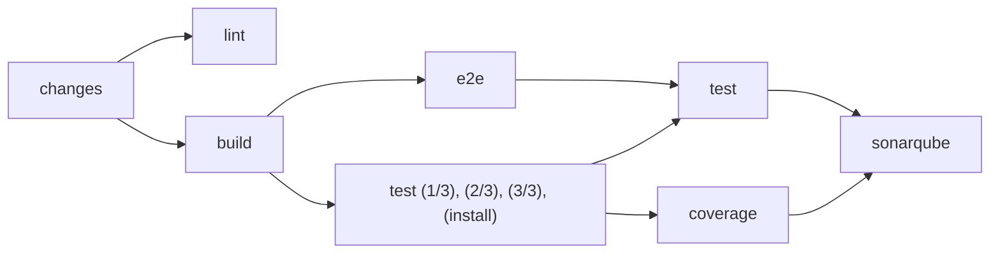
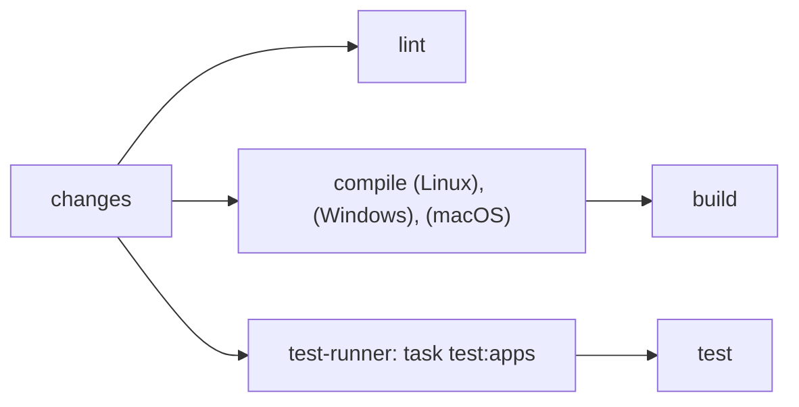
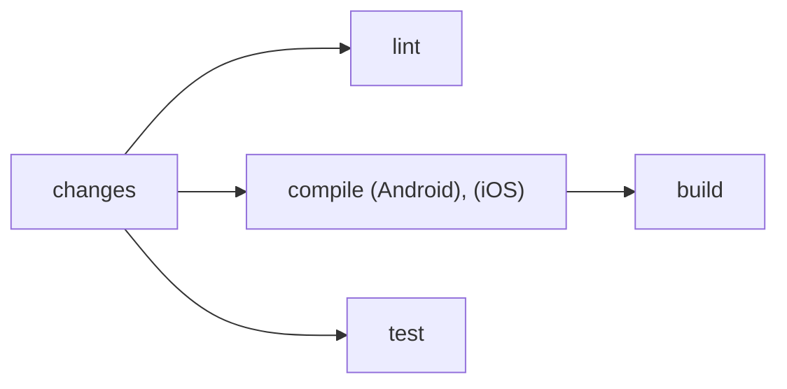
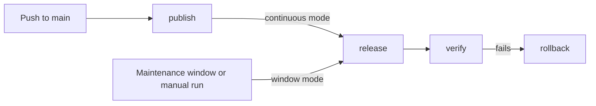

# Pipelines

What each GitHub Actions workflow in `.github/workflows/` does. How workflows are written is in [Pipelines](../conventions/pipeline.md).

## Workflows

| Workflow        | Runs on                                                                                 | Does                                                                                                                 |
| --------------- | --------------------------------------------------------------------------------------- | -------------------------------------------------------------------------------------------------------------------- |
| `ci-core`       | every pull request and every push to `main`                                             | Lints, builds and tests the Odoo modules, runs the browser tests, then SonarQube Cloud.                              |
| `ci-infra`      | every pull request                                                                      | Runs `terraform fmt`, `validate` and `plan` when `infra/` changes, Ansible lint and origin isolation regression tests when their code changes, and ONLYOFFICE configuration/schema/Compose contracts when those paths change. |
| `ci-tools`      | every pull request                                                                      | Runs the AI tooling tests, Ruff and the typecheck tooling tests when that tooling changes.                           |
| `ci-sync-app`   | every pull request                                                                      | Checks the format, lints, tests and builds the sync app when it changes.                                             |
| `ci-mobile-app` | every pull request                                                                      | Type-checks, lints and tests the mobile app, and builds it for Android and iOS, when it changes.                     |
| `cd-core`       | a push to `main` that changes `src/core` or the Dockerfile, and hourly in `window` mode | Publishes the image, releases it through Argo CD at once or in the maintenance window, and rolls back if it fails.   |
| `cd-infra`      | a push to `main` that changes `infra/`                                                  | Runs `terraform apply`.                                                                                              |
| `cd-ansible`    | a manual run on `main`                                                                  | Runs the Ansible playbooks against the nodes: `ping`, `inspect`, `check` or `apply`.                                 |
| `cd-sync-app`   | a `filesync-v*` tag                                                                     | Builds the sync app's Windows, macOS and Linux packages and publishes them as a GitHub release.                      |
| `cd-cleanup`    | a closed pull request, merged or not, or a finished `cd-core`                           | Deletes the branch, artifacts and build caches of closed pull requests, and old images.                              |

Every workflow can also be started by hand.

## ci-core

- `changes` decides whether the pull request touches the core: `src/core` except Markdown, the Dockerfile, `pyrightconfig.json`, `tools/typecheck`, the dev and test taskfiles, `tools/scripts`, the Docker Compose file and the Garage setup of `tools/infrastructure/garage`, the lint action or the workflow. It also decides whether to scan: on core changes, or on changes to `tools/odoo-intelligence`, the AI taskfile or `ci-tools`. The browser tests run on core changes and on changes to `src/tests`.
- A push to `main` skips `lint` and `e2e`, which already passed on the pull request. When the merge changes anything SonarQube scans, it runs `build`, the test runners, `coverage` and `sonarqube`, so SonarQube Cloud analyses all of `main` with full coverage after each merge; otherwise it runs nothing. That analysis is the project's overall view: its issues, coverage and quality gate on `main`, against which pull requests are compared.
- A manual run ignores what `changes` decides and runs every job.
- `lint` runs `task typecheck` and `task test:typecheck`, then `task test:openapi`, then pylint-odoo inside the Odoo image. A type error fails it; see [Python](../conventions/python.md#type-checking).
- `task test:openapi` lints the OpenAPI document of the laboratory files API with `openapi-spec-validator`, then compares it with the document on `main` with oasdiff, in its image pinned by digest. A change that breaks the document, such as removing a field or a route, fails unless it gives the document a new `info.version`. The tests of the routes check their answers against the same document; see [Testing](../conventions/testing.md#odoo-module-tests).
- The test runners and `e2e` reach the laboratory files bucket of the Garage server that Docker Compose starts; `garage-setup` sets it up once per run, before the modules install. It also adds `laboratory-files-other`, which Odoo's key may not reach, and `laboratory-files-reconcile`, which only the reconciliation tests use and empty, since the shards share one server. Production has neither ([#202](https://github.com/SoltuneMontepre/medilab/issues/202)).
- `build` builds the production image into the GitHub Actions build cache and does not push it.
- Four test runners each build the image again from that cache and load it as `medilab-odoo:ci`, so the tests run on the image that ships, with its Python requirements. Each runs its own copy of the test database per shard, four shards at once, one per runner CPU, and uploads its raw coverage data as a `coverage-data-<n>` artifact. The runners skip when the change is not relevant.
  - `test (1/3)` to `test (3/3)` install every module except `sol_demo`, without coverage, and each run four of the twelve shards: `task test:core RUNNER=<n> RUNNERS=3 EXCLUDE=sol_demo INSTALL_COVERAGE=false`. No other module's tests use the demo data, and coverage makes the install about 60% slower.
  - `test (install)` installs every module with coverage and runs the `sol_demo` tests: `task test:core TEST_MODULES=sol_demo`. It records the code that only runs while the modules install and checks that the demo data loads, alongside the other runners.
- `e2e` builds the image from the same cache, installs every module with the demo data and starts Odoo with `task test:e2e:app`, then runs the Cypress browser tests with `task test:e2e`. When a step fails it prints the Odoo log.
- `test` is the required check for the tests: it fails unless every runner and `e2e` passed.
- `coverage` combines the coverage data of the four runners with `task test:core:coverage` and uploads the report as the `coverage` artifact.
- `sonarqube` downloads the coverage report, scans with SonarQube Cloud and waits for the quality gate. A failed gate, including on coverage, fails the pipeline. A pull request that changes only the AI tooling skips `lint`, `build`, the test runners and `coverage`; `sonarqube` then scans without a coverage report, which is enough because `tools/**` is excluded from coverage.
- A pull request from a fork cannot read secrets, so `sonarqube` fails on it with a message. Contributors push a branch to the repository instead.
- Static assets, the applications, the tests, the tools, module manifests and migration scripts are excluded from SonarQube coverage in `sonar-project.properties`, because no coverage report exists for them; Odoo reads manifests as data, and the tests install the modules fresh, so they never run the lines of either. SonarQube's coverage figure therefore does not include the typecheck scripts in `tools/typecheck`; `task test:typecheck` tests them in `lint`, and SonarQube still reports issues and security hotspots in `tools/`.

## ci-tools

Checks the developer tooling. `tools` is its required check: it fails unless `ai` and both `typecheck` jobs passed.

- The `ai` job detects whether the pull request touches `tools/odoo-intelligence`, the AI or dev taskfile, `infra/terraform.tf`, `odools.toml`, the coding client configs (`.mcp.json`, `.cursor/mcp.json`, `.codex/config.toml`, `.serena/project.yml`, `.claude/settings.json`) or the workflow. The dev taskfile and `infra/terraform.tf` hold the Odoo and Terraform pins that the tooling must match.
- It runs `task ai:test`: the unit tests, the client config checks and Ruff. It uses no secrets, database or Doppler.
- It does not install OdooLS, so the live OdooLS tests report skips and `task ai:verify` does not run; run both locally after `task ai:setup`.
- `typecheck (Linux)` and `typecheck (Windows)` run the addon link safety and Pyright report tests of `tools/typecheck`, only when it or the workflow changes. Windows uses real directory junctions to verify that cleanup preserves unmanaged links and target files.

## ci-infra and cd-infra

- Both read the `dev` Doppler config through the `DOPPLER_TOKEN` Actions secret; see [Secrets](secrets.md).
- Both authenticate to HCP Terraform with the `TF_API_TOKEN` Actions secret.
- The `ansible` job of `ci-infra` runs `ansible-lint` with the `production` profile inside the Ansible image and the origin isolation script's syntax and regression tests, when `infra/ansible/`, `tools/ansible/`, the script or its tests change. It uses no secrets and never reaches a node.
- The `onlyoffice` job validates Kustomize candidates, core Kubernetes and pinned upstream CRD schemas, JWT/secret/network/storage contracts, native-worker policy drift, sender signing boundaries and the isolated Compose merge. It downloads checksum-verified validators and CRDs, uses no production credentials, and never reaches a cluster. The inherited Odoo Backup resource stays under its existing validation scope. These checks do not establish pinned-service or staging acceptance; see [ONLYOFFICE](onlyoffice.md).
- `infrastructure` is the required check of `ci-infra`: it fails unless `terraform`, `ansible` and `onlyoffice` passed.

## cd-ansible

`cd-ansible` is the control node of [Provisioning](provisioning.md): it runs the same container and commands as the `task ansible:*` tasks.

- It starts only by hand, from the Actions page, with three inputs:
  - `action`: `ping` runs `ansible all -m ansible.builtin.ping --become`, `inspect` runs `inspect.yml`, `check` runs `site.yml --check --diff`, and `apply` runs `site.yml --diff`.
  - `limit`: the nodes or groups to run on, passed to `--limit`. Empty runs on every node.
  - `verbosity`: from 0 to 4, passed to Ansible as `-v` to `-vvvv`.
- It builds the Ansible image from `tools/ansible/ansible.dockerfile`, then runs it through `doppler run` with the `DOPPLER_INFRA_TOKEN` environment secret, a Doppler service token that reads only the `infra` config. Every value of `infra` is masked in the log before Ansible starts.
- The job runs in a GitHub environment that only `main` may deploy from, so a run from any other branch gets no secret and fails before it starts:

  | Environment     | Used by                    | Protection                                       |
  | --------------- | -------------------------- | ------------------------------------------------ |
  | `ansible`       | `ping`, `inspect`, `check` | `main` only                                      |
  | `ansible-apply` | `apply`                    | `main` only, and approval by a required reviewer |

- Terraform creates both environments, their branch policy, their reviewers from the `ansible_apply_reviewers` variable in `infra/`, and their `DOPPLER_INFRA_TOKEN` secret; change them there and apply, not in GitHub.
- No pull request trigger starts it, so a pull request never reaches the nodes or the `infra` secrets.
- The kubeconfig is never printed in its log; see [Provisioning a node](../workflows/provisioning-node.md).

## ci-sync-app and cd-sync-app

The sync app is the Tauri desktop client in `src/applications/medilab-sync`.

When the Sync app, Mobile app, shared device OpenAPI document, application test tooling or workflow changes, its jobs run after `changes`:

`lint`, `build` and `test` are the required checks, the same names as in `ci-core`. When nothing relevant changed, they pass at once.

- `lint` runs `cargo fmt --check`, the frontend type check with `tsc`, and Clippy with warnings as errors.
- `compile` builds the frontend and then the app on Linux, Windows and macOS, so the code that compiles only on one platform, such as the keyring and autostart, is checked on each. The application test job also builds the frontend. `build` fails unless every `compile` passed.
- `test-runner` installs Bun, Rust, Task and Linux Tauri libraries, builds the frontend, verifies Cargo availability and runs `task test:apps` from the repository root. This includes Sync frontend tests, locked Rust tests and Mobile tests. `test` fails unless this job passes.
- The app embeds the built frontend when it compiles, so `lint` compiles against an empty stand-in `dist/index.html`; compilation and application tests use the built frontend.
- A release starts by pushing a tag `filesync-v<version>`, such as `filesync-v1.2.3`. `cd-sync-app` writes that version into `package.json`, `tauri.conf.json` and `Cargo.toml` for the build only, so the repository keeps its own versions.
- `package` builds on three runners at once: an NSIS installer on Windows, a DMG for Apple silicon on macOS, and deb and rpm packages on Linux. One failure stops the others.
- `release` publishes the packages as a GitHub release for the tag, with notes generated from the merged pull requests. A version with a suffix, such as `1.2.3-rc.1`, is a pre-release.
- The production Odoo address is built into the app from the `MEDILAB_SYNC_ODOO_URL` Actions variable. A tag build fails when it is not set or does not start with `https://`.
- A manual run builds the packages without releasing them, to check a build before tagging.
- The packages are not signed for automatic updates and are not uploaded to a bucket: the app checks the public Odoo updater, whose release catalog must be supplied only after artifact/signing-trust verification. See [Sync updates](../specs/sync-updates.md).

## ci-mobile-app

The mobile app is the Expo app in `src/applications/medilab-mobile`.

When the app or the workflow changes, its jobs run at once after `changes`:

`lint`, `build` and `test` are the required checks, the same names as in `ci-core`. When nothing relevant changed, they pass at once.

- `lint` runs the type check with `tsc` and ESLint with Expo's rules.
- `compile` builds the development build of each platform, so a native dependency or a config plugin that breaks one platform fails here: it bundles the JavaScript with `expo export`, generates the native project with `expo prebuild`, then compiles it. Android builds a debug APK with Gradle and Java 17 on Ubuntu, for `arm64-v8a` only; iOS builds for the simulator with `xcodebuild` on `macos-26`, without signing. `build` fails unless both passed.
- `test` runs the Jest tests.
- Each job sets up Node 24, which Expo needs, and Bun, which installs the dependencies.
- When any job fails, its last step cancels the whole run, as in `ci-core`.

## cd-core

`cd-core` publishes an image for every change and releases it in one of two modes, chosen by the `RELEASE_MODE` Actions variable:

| Mode         | Releases                                                                                   |
| ------------ | ------------------------------------------------------------------------------------------ |
| `continuous` | Right after `publish`, on every push to `main` that changes the core. This is the default. |
| `window`     | Only inside the maintenance window, with every change merged since the previous release.   |

- `publish` runs on every push to `main` that changes the core. It builds and pushes the image, tagged with the commit SHA.
- In `window` mode, a `schedule` trigger starts `cd-core` every hour, and `release` runs only when the time in Asia/Ho_Chi_Minh is inside the window set by two Actions variables:
  - `RELEASE_DAYS`: the days of the week, such as `Mon-Sun` or `Sat,Sun`. Default `Mon-Sun`.
  - `RELEASE_HOURS`: the start and end hour, such as `23-5`, which crosses midnight. Default `23-5`.
- A manual run with the `release` input releases at once in either mode, such as for a hotfix.
- `release` takes the image of the newest of the last 50 commits on `main` that has one. When that is the image already released, or while a pull request labelled `release-blocked` is open, it stops. Otherwise it commits the SHA tag to `newTag` in `infra/cluster/odoo/kustomization.yaml` on `main`, titled `[chore] Release <short SHA>`. The logic is in `tools/scripts/cd_core_release.sh`.
- Argo CD syncs the release: a pre-sync hook takes an on-demand CloudNativePG backup, then the module upgrade Job runs, then the Odoo replicas roll out one at a time; see [Cluster](cluster.md#odoo).
- The Actions variables are set by Terraform from the `release` variable in `infra/`; change them there and apply, not in GitHub.
- `verify` reads the `odoo` application every 15 seconds, for up to 15 minutes, until it has synced a revision that contains the release commit and is healthy; `tools/scripts/cd_core_verify.sh`. It fails at once when that sync fails or the application is degraded. Because the rollout is rolling, the old replicas keep serving while it runs, so `/web/health` answers 200 even when the release fails; `verify` relies on Argo CD instead. Argo CD reports the release as failed when the upgrade Job fails, or as degraded when a new replica is not ready within the Deployment's `progressDeadlineSeconds` of 10 minutes.
- `rollback` runs only when `verify` fails:
  1. Commits one `[fix] Roll back release <short SHA>` commit to `main` that sets the image tag in `infra/cluster/` back to the previous release and reverts the commits of the release, which are the commits since the previous release that changed `src/core` or `tools/dockerfiles`: one in `continuous` mode and every such change in `window` mode, so `main` again matches what runs. Argo CD returns to the previous image. When the revert conflicts with a commit merged after the release, the commit only sets the tag back, and the draft pull request below is also labelled `release-blocked`, so `release` stops until it is merged or closed.
  2. Creates the branch `fix/redeploy-<short SHA>` from the new `main` and cherry-picks the commits of the release onto it, so the changes are kept.
  3. Opens a draft pull request from that branch, titled `[fix] Redeploy release <short SHA>`, assigned to the authors of the commits and labelled `failed-release`. Its body lists the commits, links the failed run, and holds the Argo CD status, the last 100 lines of each container of the `odoo-upgrade` Job and the last 30 lines of the Odoo replicas, each line cut to 250 characters so that the body fits a pull request.
  4. Fails the run, so the failure shows on the release commit.
- The release and rollback commits on `main` carry `[skip ci]`, so they start no workflow and the rollback does not start `cd-core` again. The redeploy pull request's pipelines run as for any pull request.
- A rollback does not restore the database. When the upgrade Job failed, Odoo rolled back its own transaction and the schema is unchanged. When the upgrade succeeded and the replicas then failed, the previous image runs on the newer schema; the pre-sync backup is there to restore by hand.
- `release` and `rollback` act as the release GitHub App, through a token that `actions/create-github-app-token` makes from the `RELEASE_APP_ID` and `RELEASE_APP_PRIVATE_KEY` Actions secrets. The app commits as its bot user, pushes to `main`, which the `main` ruleset lets it bypass, and opens the redeploy pull request. It is installed on this repository only, with Contents and Pull requests read and write.
- `verify` and `rollback` reach Argo CD at the `ARGOCD_SERVER` Actions variable and read it with `ARGOCD_AUTH_TOKEN`, a token of the `release` account, which can only read the `odoo` application and its logs. The argocd CLI they install matches the Argo CD version of the `argocd` role.
- A failed `publish` stops the run; a `schedule` run skips `publish` and only releases.

## Images

- `cd-core` publishes `ghcr.io/soltunemontepre/medilab`, tagged with the full commit SHA and `latest`, and releases it as described in [cd-core](#cd-core).
- Local, CI and production images build on the same Odoo, pinned by tag and digest in `ODOO_IMAGE` of `tools/dockerfiles/prod.dockerfile`, and `lint` runs `odoo-lint` on that image. `ODOO_SOURCE_REVISION` in `tools/taskfiles/dev.taskfile.yml` is the commit of 20.0 that nightly is built from. Odoo is upgraded by changing `ODOO_IMAGE`, `ODOO_SOURCE_REVISION` and `odoo_revision` in `tools/odoo-intelligence/odoo_intelligence/release.json` together.
- Pull request images are never pushed to a registry.
- After every `cd-core` run, `cd-cleanup` keeps the five newest tagged images and the images of the current and previous release, and deletes the other images and every untagged image.

## Artifacts and caches

- Artifacts are kept for one day. Image builds do not upload build records.
- `cd-cleanup` deletes the artifacts of every branch that is not `main` or an open pull request, and the build caches of every pull request that is not open. Caches from `main` are kept, so pull requests build from them.

## Branches

- `cd-cleanup` deletes the branch of a pull request when it is closed, merged or not, unless another open pull request uses it. Branches of fork pull requests are left alone.

## Related documents

- [Pipelines conventions](../conventions/pipeline.md)
- [Cluster](cluster.md)
- [Secrets](secrets.md)
- [Testing](../conventions/testing.md)
