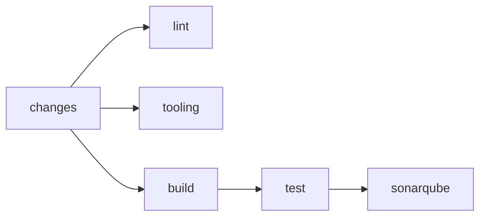

# Pipelines

What each GitHub Actions workflow in `.github/workflows/` does. How workflows are written is in [Pipelines](../conventions/pipeline.md).

## Workflows

| Workflow     | Runs on                                                       | Does                                                                                    |
| ------------ | ------------------------------------------------------------- | --------------------------------------------------------------------------------------- |
| `ci-core`    | every pull request                                            | Lints, builds and tests the Odoo modules, then runs SonarQube Cloud.                    |
| `ci-infra`   | every pull request                                            | Runs `terraform fmt`, `validate` and `plan` when `infra/` changes.                      |
| `ci-ai`      | every pull request                                            | Runs the AI tooling tests and Ruff when the AI tooling or a client config changes.      |
| `cd-core`    | a push to `main` that changes `src/core` or the Dockerfile    | Publishes the release image.                                                            |
| `cd-infra`   | a push to `main` that changes `infra/`                        | Runs `terraform apply`.                                                                 |
| `cd-cleanup` | a closed pull request, merged or not, or a finished `cd-core` | Deletes the branch, artifacts and build caches of closed pull requests, and old images. |

Every workflow can also be started by hand.

## ci-core

- `changes` decides whether the pull request touches the core: `src/core` except Markdown, the Dockerfile, `pyrightconfig.json`, `tools/typecheck`, the dev and test taskfiles, the lint action or the workflow. It also decides whether to scan: on core changes, or on changes to `tools/odoo-intelligence`, the AI taskfile or `ci-ai`.
- `lint` runs `task typecheck` and `task test:typecheck`, then pylint-odoo inside the Odoo image. A type error fails it; see [Python](../conventions/python.md#type-checking).
- `tooling` runs addon link safety and Pyright report tests on Linux and Windows. Windows uses real directory junctions to verify that cleanup preserves unmanaged links and target files.
- `build` builds the production image into the GitHub Actions build cache and does not push it.
- `test` builds the image again from that cache, loads it as `medilab-odoo:ci` and runs `task test:core` on it, so the tests run on the image that ships, with its Python requirements. `task test:core` runs the tests in four shards at once, one per runner CPU, each in its own copy of the test database. It uploads the combined coverage report as the `coverage` artifact.
- `sonarqube` downloads the coverage report, scans with SonarQube Cloud and waits for the quality gate. A failed gate, including on coverage, fails the pipeline. A pull request that changes only the AI tooling skips `lint`, `build` and `test`; `sonarqube` then scans without a coverage report, which is enough because `tools/**` is excluded from coverage.
- A pull request from a fork cannot read secrets, so `sonarqube` fails on it with a message. Contributors push a branch to the repository instead.
- Static assets, the applications, the tests, the tools, module manifests and migration scripts are excluded from SonarQube coverage in `sonar-project.properties`, because no coverage report exists for them; Odoo reads manifests as data, and the tests install the modules fresh, so they never run the lines of either. SonarQube's coverage figure therefore does not include the typecheck scripts in `tools/typecheck`; `task test:typecheck` tests them in `lint`, and SonarQube still reports issues and security hotspots in `tools/`. Browser tests do not run in the pipeline.

## ci-ai

- The `test` job detects whether the pull request touches `tools/odoo-intelligence`, the AI or dev taskfile, `infra/terraform.tf`, `odools.toml`, the coding client configs (`.mcp.json`, `.cursor/mcp.json`, `.codex/config.toml`, `.serena/project.yml`, `.claude/settings.json`) or the workflow. The dev taskfile and `infra/terraform.tf` hold the Odoo and Terraform pins that the tooling must match.
- It runs `task ai:test`: the unit tests, the client config checks and Ruff. It uses no secrets, database or Doppler.
- It does not install OdooLS, so the live OdooLS tests report skips and `task ai:verify` does not run; run both locally after `task ai:setup`.

## ci-infra and cd-infra

- Both read the `dev` Doppler config through the `DOPPLER_TOKEN` Actions secret; see [Secrets](secrets.md).
- Both authenticate to HCP Terraform with the `TF_API_TOKEN` Actions secret.

## Images

- `cd-core` publishes `ghcr.io/soltunemontepre/medilab`, tagged with the full commit SHA and `latest`. Deploy and roll back by the SHA tag.
- Pull request images are never pushed to a registry.
- After every `cd-core` run, `cd-cleanup` keeps the five newest tagged images and deletes the older ones and every untagged image.

## Artifacts and caches

- Artifacts are kept for one day. Image builds do not upload build records.
- `cd-cleanup` deletes the artifacts of every branch that is not `main` or an open pull request, and the build caches of every pull request that is not open. Caches from `main` are kept, so pull requests build from them.

## Branches

- `cd-cleanup` deletes the branch of a pull request when it is closed, merged or not, unless another open pull request uses it. Branches of fork pull requests are left alone.

## Related documents

- [Pipelines conventions](../conventions/pipeline.md)
- [Secrets](secrets.md)
- [Testing](../conventions/testing.md)
