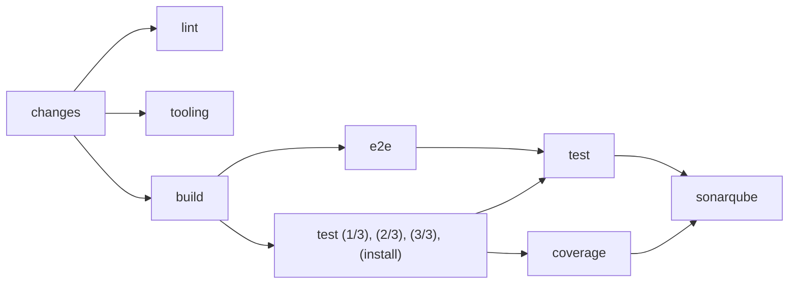
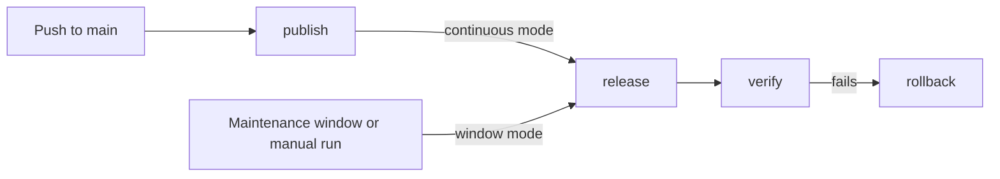

# Pipelines

What each GitHub Actions workflow in `.github/workflows/` does. How workflows are written is in [Pipelines](../conventions/pipeline.md).

## Workflows

| Workflow      | Runs on                                                                                 | Does                                                                                                               |
| ------------- | --------------------------------------------------------------------------------------- | ------------------------------------------------------------------------------------------------------------------ |
| `ci-core`     | every pull request and every push to `main`                                             | Lints, builds and tests the Odoo modules, runs the browser tests, then SonarQube Cloud.                            |
| `ci-infra`    | every pull request                                                                      | Runs `terraform fmt`, `validate` and `plan` when `infra/` changes.                                                 |
| `ci-ai`       | every pull request                                                                      | Runs the AI tooling tests and Ruff when the AI tooling or a client config changes.                                 |
| `ci-sync-app` | every pull request                                                                      | Checks the format, lints, tests and builds the sync app when it changes.                                           |
| `cd-core`     | a push to `main` that changes `src/core` or the Dockerfile, and hourly in `window` mode | Publishes the image, releases it through Argo CD at once or in the maintenance window, and rolls back if it fails. |
| `cd-infra`    | a push to `main` that changes `infra/`                                                  | Runs `terraform apply`.                                                                                            |
| `cd-sync-app` | a `filesync-v*` tag                                                                     | Builds the sync app's Windows, macOS and Linux packages and publishes them as a GitHub release.                    |
| `cd-cleanup`  | a closed pull request, merged or not, or a finished `cd-core`                           | Deletes the branch, artifacts and build caches of closed pull requests, and old images.                            |

Every workflow can also be started by hand.

## ci-core

- `changes` decides whether the pull request touches the core: `src/core` except Markdown, the Dockerfile, `pyrightconfig.json`, `tools/typecheck`, the dev and test taskfiles, `tools/scripts`, the Docker Compose file, the lint action or the workflow. It also decides whether to scan: on core changes, or on changes to `tools/odoo-intelligence`, the AI taskfile or `ci-ai`. The browser tests run on core changes and on changes to `src/tests`.
- A push to `main` and a manual run ignore what `changes` decides and run every job, so SonarQube Cloud analyses all of `main` with full coverage after each merge. That analysis is the project's overall view: its issues, coverage and quality gate on `main`, against which pull requests are compared.
- `lint` runs `task typecheck` and `task test:typecheck`, then pylint-odoo inside the Odoo image. A type error fails it; see [Python](../conventions/python.md#type-checking).
- `tooling` runs addon link safety and Pyright report tests on Linux and Windows, only when `tools/typecheck` or the workflow changes. Windows uses real directory junctions to verify that cleanup preserves unmanaged links and target files.
- `build` builds the production image into the GitHub Actions build cache and does not push it.
- Four test runners each build the image again from that cache and load it as `medilab-odoo:ci`, so the tests run on the image that ships, with its Python requirements. Each runs its own copy of the test database per shard, four shards at once, one per runner CPU, and uploads its raw coverage data as a `coverage-data-<n>` artifact. The runners skip when the change is not relevant.
  - `test (1/3)` to `test (3/3)` install every module except `sol_demo`, without coverage, and each run four of the twelve shards: `task test:core RUNNER=<n> RUNNERS=3 EXCLUDE=sol_demo INSTALL_COVERAGE=false`. No other module's tests use the demo data, and coverage makes the install about 60% slower.
  - `test (install)` installs every module with coverage and runs the `sol_demo` tests: `task test:core TEST_MODULES=sol_demo`. It records the code that only runs while the modules install and checks that the demo data loads, alongside the other runners.
- `e2e` builds the image from the same cache, installs every module with the demo data and starts Odoo with `task test:e2e:app`, then runs the Cypress browser tests with `task test:e2e`. When a step fails it prints the Odoo log.
- `test` is the required check for the tests: it fails unless every runner and `e2e` passed.
- `coverage` combines the coverage data of the four runners with `task test:core:coverage` and uploads the report as the `coverage` artifact.
- `sonarqube` downloads the coverage report, scans with SonarQube Cloud and waits for the quality gate. A failed gate, including on coverage, fails the pipeline. A pull request that changes only the AI tooling skips `lint`, `build`, the test runners and `coverage`; `sonarqube` then scans without a coverage report, which is enough because `tools/**` is excluded from coverage.
- A pull request from a fork cannot read secrets, so `sonarqube` fails on it with a message. Contributors push a branch to the repository instead.
- Static assets, the applications, the tests, the tools, module manifests and migration scripts are excluded from SonarQube coverage in `sonar-project.properties`, because no coverage report exists for them; Odoo reads manifests as data, and the tests install the modules fresh, so they never run the lines of either. SonarQube's coverage figure therefore does not include the typecheck scripts in `tools/typecheck`; `task test:typecheck` tests them in `lint`, and SonarQube still reports issues and security hotspots in `tools/`.

## ci-ai

- The `test` job detects whether the pull request touches `tools/odoo-intelligence`, the AI or dev taskfile, `infra/terraform.tf`, `odools.toml`, the coding client configs (`.mcp.json`, `.cursor/mcp.json`, `.codex/config.toml`, `.serena/project.yml`, `.claude/settings.json`) or the workflow. The dev taskfile and `infra/terraform.tf` hold the Odoo and Terraform pins that the tooling must match.
- It runs `task ai:test`: the unit tests, the client config checks and Ruff. It uses no secrets, database or Doppler.
- It does not install OdooLS, so the live OdooLS tests report skips and `task ai:verify` does not run; run both locally after `task ai:setup`.

## ci-infra and cd-infra

- Both read the `dev` Doppler config through the `DOPPLER_TOKEN` Actions secret; see [Secrets](secrets.md).
- Both authenticate to HCP Terraform with the `TF_API_TOKEN` Actions secret.

## ci-sync-app and cd-sync-app

The sync app is the Tauri desktop client in `src/applications/medilab-sync`.

- `sync-app` is the required check of `ci-sync-app`. When the app or the workflow changes, it runs `cargo fmt --check`, `bun test`, the frontend build, Clippy with warnings as errors, and `cargo test`, on Linux.
- A release starts by pushing a tag `filesync-v<version>`, such as `filesync-v1.2.3`. `cd-sync-app` writes that version into `package.json`, `tauri.conf.json` and `Cargo.toml` for the build only, so the repository keeps its own versions.
- `package` builds on three runners at once: an NSIS installer on Windows, a DMG for Apple silicon on macOS, and deb and rpm packages on Linux. One failure stops the others.
- `release` publishes the packages as a GitHub release for the tag, with notes generated from the merged pull requests. A version with a suffix, such as `1.2.3-rc.1`, is a pre-release.
- The production Odoo address is built into the app from the `MEDILAB_SYNC_ODOO_URL` Actions variable. A tag build fails when it is not set or does not start with `https://`.
- A manual run builds the packages without releasing them, to check a build before tagging.
- The packages are not signed for automatic updates and are not uploaded to a bucket: the app checks for updates through an Odoo endpoint that does not exist yet.

## cd-core

`cd-core` publishes an image for every change and releases it in one of two modes, chosen by the `RELEASE_MODE` Actions variable:

| Mode         | Releases                                                                                   |
| ------------ | ------------------------------------------------------------------------------------------ |
| `continuous` | Right after `publish`, on every push to `main` that changes the core. This is the default. |
| `window`     | Only inside the maintenance window, with every change merged since the previous release.   |

- `publish` runs on every push to `main` that changes the core. It builds and pushes the image, tagged with the commit SHA.
- In `window` mode, a `schedule` trigger starts `cd-core` every hour, and `release` runs only when the time in Asia/Ho_Chi_Minh is inside the window set by two Actions variables:
  - `RELEASE_DAYS`: the days of the week, such as `Mon-Sun` or `Sat,Sun`. Default `Mon-Sun`.
  - `RELEASE_HOURS`: the start and end hour, such as `23-5`, which crosses midnight. Default `23-5`.
- A manual run with the `release` input releases at once in either mode, such as for a hotfix.
- `release` takes the image of the newest commit on `main` that has one. When that is the image already released, it stops. Otherwise it commits the SHA tag to `infra/cluster/` on `main`, titled `[chore] Release <short SHA>`.
- Argo CD syncs the release: a pre-sync hook takes an on-demand CloudNativePG backup, then the module upgrade Job runs, then the Odoo replicas roll out one at a time.
- The Actions variables are set by Terraform from the `release` variable in `infra/`; change them there and apply, not in GitHub.
- `verify` waits up to 15 minutes with `argocd app wait --sync --health` for the application to reach the release commit and become healthy. Because the rollout is rolling, the old replicas keep serving while it runs, so `/web/health` answers 200 even when the release fails; `verify` relies on Argo CD instead. Argo CD reports the release as failed when the upgrade Job fails, or as degraded when a new replica is not ready within the Deployment's `progressDeadlineSeconds` of 10 minutes.
- `rollback` runs only when `verify` fails:
  1. Commits one `[fix] Roll back release <short SHA>` commit to `main` that sets the image tag in `infra/cluster/` back to the previous release and reverts the commits of the release, one in `continuous` mode and every change since the previous release in `window` mode, so `main` again matches what runs. Argo CD returns to the previous image. When the revert conflicts with a commit merged after the release, the commit only sets the tag back, and `release` stops until the draft pull request below is merged or closed.
  2. Creates the branch `fix/redeploy-<short SHA>` from the new `main` and cherry-picks the commits of the release onto it, so the changes are kept.
  3. Opens a draft pull request from that branch, titled `[fix] Redeploy release <short SHA>`, assigned to the authors of the commits and labelled `failed-release`. Its body lists the commits, links the failed run, and holds the Argo CD status and the logs of the failed pods.
  4. Fails the run, so the failure shows on the release commit.
- Commits and pull requests made with `GITHUB_TOKEN` start no workflows, so the rollback commit does not start `cd-core` again. The pipelines of the redeploy pull request run once someone pushes a fix to it.
- A rollback does not restore the database. When the upgrade Job failed, Odoo rolled back its own transaction and the schema is unchanged. When the upgrade succeeded and the replicas then failed, the previous image runs on the newer schema; the pre-sync backup is there to restore by hand.
- `release` and `rollback` push to `main` as `github-actions[bot]`, which the `main` ruleset lets bypass pull requests. Terraform allows GitHub Actions to create pull requests on the repository.
- `verify` reads Argo CD with the `ARGOCD_AUTH_TOKEN` Actions secret, a token of an Argo CD account that can only read the `medilab` application.

## Images

- `cd-core` publishes `ghcr.io/soltunemontepre/medilab`, tagged with the full commit SHA and `latest`, and releases it as described in [cd-core](#cd-core).
- Pull request images are never pushed to a registry.
- After every `cd-core` run, `cd-cleanup` keeps the five newest tagged images and the images of the current and previous release, and deletes the other images and every untagged image.

## Artifacts and caches

- Artifacts are kept for one day. Image builds do not upload build records.
- `cd-cleanup` deletes the artifacts of every branch that is not `main` or an open pull request, and the build caches of every pull request that is not open. Caches from `main` are kept, so pull requests build from them.

## Branches

- `cd-cleanup` deletes the branch of a pull request when it is closed, merged or not, unless another open pull request uses it. Branches of fork pull requests are left alone.

## Related documents

- [Pipelines conventions](../conventions/pipeline.md)
- [Secrets](secrets.md)
- [Testing](../conventions/testing.md)
