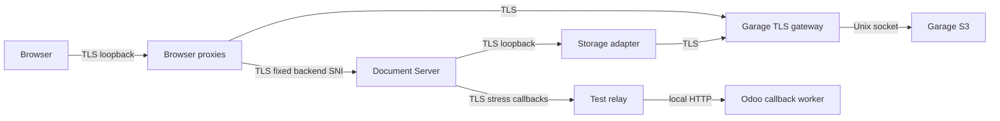

# Sonar cleanup of PR #292

## Latest analyzed source and follow-up

Sonar analysis of `7cca1f6bb6f07daf712e5ba096a26bc0b04b4401` confirms **zero OPEN smells, three OPEN vulnerabilities and zero bugs**. All **58 original smells** and **six original HTTP findings** are automatically CLOSED/FIXED: **64 of the original 65-key inventory**. The new String.raw finding `AaF-agX1LPRtorYA4vck` is also CLOSED/FIXED. Two new transport-pattern findings remain alongside the original RFC 6455 hash, each with individually documented proposed False Positive evidence and **PENDING OWNER APPROVAL**. [Exact analyzed issues, support-key history, gate and check matrix](evidence/171-203-230-206/sonar-tls/analysis-7cca1f6.json); [current four-key action/status matrix](evidence/171-203-230-206/sonar-tls/final-issue-matrix.json). Both formal governance roles remain TBD. No finding was administratively Accepted/False positive and no rule, exclusion or threshold changed.

Quality Gate **ERROR** fails only Security **D**. Maintainability/reliability are **A**, new coverage **86.10%**, duplication **0.05%**. Exact-code checks: **35 PASS, three FAIL, two SKIPPED**. All functional core build/lint/install/three native shards/e2e/coverage and Sync/Mobile/Tools/Infra jobs PASS. The failed contexts are ci-core/sonarqube, SonarCloud and historical GitGuardian incident 39039733. Hosted Cypress is **97 PASS / eight PENDING**, zero failures; optional Mobile native compilation and Draft CodeRabbit review are SKIPPED. Sonar security-owner decisions, GitGuardian authorized review and approving code review remain merge prerequisites. Latest containing pushed SHA and its exact live checks are maintained in the [delivery record](https://github.com/SoltuneMontepre/medilab/pull/292#issuecomment-6431682516).

Fresh final-source verification passes **1,870 native tests, zero failures/errors**; **four actual page/coediting cases**; and an additional real save/download observed by the **actual Rust ApiClient** with verified HTTPS and matching SHA-256. The earlier hardened four-callback cohort at `7e211a2` passes 27 editors, duplicate idempotency, fresh-JWT 503 and actual expiry/retry; its signing/worker implementation is unchanged by the subsequent multipart-header/test-literal correction. The actual coverage task passes 39 infrastructure Python, 64 harness Python, 9 HTTPS/WebSocket, 6 gateway, 2 lifecycle, 2 diagnostics, 4 retention and 8 signer cases. Eight local Cypress cases and Rust 213/default18-ignored, strict Clippy/formatting and OpenAPI results keep their exact tested-source attribution. Native subsets overlap and are not summed as distinct tests. [Native receipt](evidence/171-203-230-206/sonar-tls/final-native.json); [all final results and retained failures/limits](evidence/171-203-230-206/sonar-tls/final-results.json).

Fresh controlled ingress/egress proof passes outside/same-bridge positive controls, blocked cross-bridge traffic, all loopback-only TLS listeners, one owned network per peer, no published ports/default IPv4 routes, disabled IPv6, no mounted CA signing key, and the gateway's read-only rootfs/zero effective capabilities/no-new-privileges. [Actual boundary proof](evidence/171-203-230-206/sonar-tls/final-boundary.json). All new owned services stopped normally; all volumes, databases, failed containers and private evidence remain retained, with unrelated services unchanged. [Cleanup](evidence/171-203-230-206/sonar-tls/final-cleanup.json). Release installers/trust inventory, staging/external logging, older browser binaries, full native Sync UI and seven elapsed days remain separately BLOCKED/NOT RUN. PR remains Draft; no merge, deployment, production credential operation or published-history rewrite occurred.

## Baseline

The fresh read-only SonarCloud inventory matches pushed source `0d0cd6d0f3980663419b8fc00afff34453c1bce5`: **65 OPEN findings: 58 code smells and seven vulnerabilities; zero bugs**. Security D, maintainability A and Quality Gate ERROR; new coverage 85.7% and duplication 0.1% pass. [Complete baseline issue keys, severities, source ranges and resolved history](evidence/171-203-230-206/sonar-cleanup/baseline.json).

All 58 smell keys were already present in the earlier complete `2709021` inventory. Its former `AaF0aaGPIES1tmkRONqR` is now CLOSED/FIXED and is outside this 65-finding baseline. The seven baseline security keys match the earlier owner dossier. No administrative status transition is performed.

## Issue matrix

Original locations belong to the 65-key baseline. [Verified analysis of `7cca1f6`](evidence/171-203-230-206/sonar-tls/analysis-7cca1f6.json) automatically closes **64 original findings, including all 58 smells and six HTTP findings**. Only the required RFC 6455 hash remains OPEN from that inventory. Newly introduced support-code findings are recorded separately below; no issue is administratively classified.

| Sonar Issue Key | Rule | File | Original Status | Action | Tests | Final Status |
| --- | --- | --- | --- | --- | --- | --- |
| `AaF0FHqevCiqu-XFDLCu` | `python:S5713` | `infra/cluster/onlyoffice-monitor/probe.py:26` | OPEN | Retain covering base exception without redundant subclasses | Monitor tests and native malformed callback/updater HTTP refusals | FIXED — CLOSED/FIXED at `7cca1f6` |
| `AaF0FHqevCiqu-XFDLCv` | `python:S5713` | `infra/cluster/onlyoffice-monitor/probe.py:34` | OPEN | Retain covering base exception without redundant subclasses | Monitor tests and native malformed callback/updater HTTP refusals | FIXED — CLOSED/FIXED at `7cca1f6` |
| `AaF0FHqTvCiqu-XFDLCf` | `javascript:S7772` | `infra/cluster/onlyoffice/callback-signing.cjs:3` | OPEN | Explicit node: built-in imports | Node syntax, signer contracts, native pkg workers and retention | FIXED — CLOSED/FIXED at `7cca1f6` |
| `AaF0FHqavCiqu-XFDLCo` | `shelldre:S7688` | `infra/cluster/onlyoffice/healthcheck.sh:10` | OPEN | Bash-native [[ tests; retain service-account sudo test commands | bash -n, real TLS readiness/drift/shutdown/restart/recreation | FIXED — CLOSED/FIXED at `7cca1f6` |
| `AaF0FHqZvCiqu-XFDLCn` | `python:S7494` | `infra/cluster/onlyoffice/inspect_config.py:69` | OPEN | Direct environment comprehension preserving first equals separator | Inspector fixture tests and actual supervised worker attestation | FIXED — CLOSED/FIXED at `7cca1f6` |
| `AaF0FHqXvCiqu-XFDLCm` | `shelldre:S7688` | `infra/cluster/onlyoffice/shutdown.sh:6` | OPEN | Bash-native [[ tests; retain service-account sudo test commands | bash -n, real TLS readiness/drift/shutdown/restart/recreation | FIXED — CLOSED/FIXED at `7cca1f6` |
| `AaF0FHqbvCiqu-XFDLCp` | `shelldre:S7688` | `infra/cluster/onlyoffice/start.sh:15` | OPEN | Bash-native [[ tests; retain service-account sudo test commands | bash -n, real TLS readiness/drift/shutdown/restart/recreation | FIXED — CLOSED/FIXED at `7cca1f6` |
| `AaF0FHqbvCiqu-XFDLCq` | `shelldre:S7688` | `infra/cluster/onlyoffice/start.sh:16` | OPEN | Bash-native [[ tests; retain service-account sudo test commands | bash -n, real TLS readiness/drift/shutdown/restart/recreation | FIXED — CLOSED/FIXED at `7cca1f6` |
| `AaF0FHqbvCiqu-XFDLCr` | `shelldre:S7688` | `infra/cluster/onlyoffice/start.sh:17` | OPEN | Bash-native [[ tests; retain service-account sudo test commands | bash -n, real TLS readiness/drift/shutdown/restart/recreation | FIXED — CLOSED/FIXED at `7cca1f6` |
| `AaF0FHqbvCiqu-XFDLCs` | `shelldre:S7688` | `infra/cluster/onlyoffice/start.sh:35` | OPEN | Bash-native [[ tests; retain service-account sudo test commands | bash -n, real TLS readiness/drift/shutdown/restart/recreation | FIXED — CLOSED/FIXED at `7cca1f6` |
| `AaF0FHqbvCiqu-XFDLCt` | `shelldre:S7688` | `infra/cluster/onlyoffice/start.sh:38` | OPEN | Bash-native [[ tests; retain service-account sudo test commands | bash -n, real TLS readiness/drift/shutdown/restart/recreation | FIXED — CLOSED/FIXED at `7cca1f6` |
| `AaF0FHqWvCiqu-XFDLCi` | `javascript:S7772` | `infra/cluster/onlyoffice/worker-bootstrap.cjs:4` | OPEN | Explicit node: built-in imports | Node syntax, signer contracts, native pkg workers and retention | FIXED — CLOSED/FIXED at `7cca1f6` |
| `AaF0FHqWvCiqu-XFDLCj` | `javascript:S7772` | `infra/cluster/onlyoffice/worker-bootstrap.cjs:5` | OPEN | Explicit node: built-in imports | Node syntax, signer contracts, native pkg workers and retention | FIXED — CLOSED/FIXED at `7cca1f6` |
| `AaF0FHqWvCiqu-XFDLCk` | `javascript:S7772` | `infra/cluster/onlyoffice/worker-bootstrap.cjs:6` | OPEN | Explicit node: built-in imports | Node syntax, signer contracts, native pkg workers and retention | FIXED — CLOSED/FIXED at `7cca1f6` |
| `AaF0FHqWvCiqu-XFDLCl` | `javascript:S7772` | `infra/cluster/onlyoffice/worker-bootstrap.cjs:7` | OPEN | Explicit node: built-in imports | Node syntax, signer contracts, native pkg workers and retention | FIXED — CLOSED/FIXED at `7cca1f6` |
| `AaF0FHqUvCiqu-XFDLCg` | `shelldre:S7688` | `infra/cluster/onlyoffice/worker.sh:4` | OPEN | Bash-native [[ tests; retain service-account sudo test commands | bash -n, real TLS readiness/drift/shutdown/restart/recreation | FIXED — CLOSED/FIXED at `7cca1f6` |
| `AaF0FHqUvCiqu-XFDLCh` | `shelldre:S7688` | `infra/cluster/onlyoffice/worker.sh:5` | OPEN | Bash-native [[ tests; retain service-account sudo test commands | bash -n, real TLS readiness/drift/shutdown/restart/recreation | FIXED — CLOSED/FIXED at `7cca1f6` |
| `AaF0FHhPvCiqu-XFDLCI` | `python:S3516` | `src/core/modules/sol_laboratory/services/editing_callback_logging.py:51` | OPEN | Delegate emission to logging.Filter after sanitization | 53 native logging/editor/origin/JWT | FIXED — CLOSED/FIXED at `7cca1f6` |
| `AaF0FHcEvCiqu-XFDLCB` | `python:S5713` | `src/core/modules/sol_laboratory/services/laboratory_editing_callback.py:59` | OPEN | Retain covering base exception without redundant subclasses | Monitor tests and native malformed callback/updater HTTP refusals | FIXED — CLOSED/FIXED at `7cca1f6` |
| `AaF0FHcEvCiqu-XFDLCC` | `python:S3358` | `src/core/modules/sol_laboratory/services/laboratory_editing_callback.py:108` | OPEN | Explicit outcome branches/status lookup with unchanged response mapping | Native callback/editor status and transaction tests | FIXED — CLOSED/FIXED at `7cca1f6` |
| `AaF0FHhTvCiqu-XFDLCN` | `python:S6353` | `src/core/modules/sol_laboratory/services/laboratory_editor_logging.py:12` | OPEN | Scoped ASCII decimal shorthand; Unicode whitespace unchanged | 53 native; exhaustive Unicode decimal/whitespace equivalence | FIXED — CLOSED/FIXED at `7cca1f6` |
| `AaF0FHhTvCiqu-XFDLCO` | `python:S3516` | `src/core/modules/sol_laboratory/services/laboratory_editor_logging.py:28` | OPEN | Delegate emission to logging.Filter after sanitization | 53 native logging/editor/origin/JWT | FIXED — CLOSED/FIXED at `7cca1f6` |
| `AaF0FHhNvCiqu-XFDLCE` | `python:S6353` | `src/core/modules/sol_laboratory/services/laboratory_editor_page.py:29` | OPEN | Scoped ASCII decimal shorthand; route capture unchanged | 53 native including Unicode HTTP refusal | FIXED — CLOSED/FIXED at `7cca1f6` |
| `AaF0FHhNvCiqu-XFDLCF` | `python:S3776` | `src/core/modules/sol_laboratory/services/laboratory_editor_page.py:33` | OPEN | Extract cohesive validation, orchestration and evidence responsibilities | 12 harness safety tests; full native, CRD, real save/page/desktop cohorts | FIXED — CLOSED/FIXED at `7cca1f6` |
| `AaF0FHhNvCiqu-XFDLCD` | `python:S1192` | `src/core/modules/sol_laboratory/services/laboratory_editor_page.py:36` | OPEN | Named constant with unchanged error string | Native origin/updater request and response contracts | FIXED — CLOSED/FIXED at `7cca1f6` |
| `AaF0FHhNvCiqu-XFDLCG` | `python:S6353` | `src/core/modules/sol_laboratory/services/laboratory_editor_page.py:57` | OPEN | Scoped ASCII decimal shorthand; ambiguous host refusal unchanged | 53 native including origin validation | FIXED — CLOSED/FIXED at `7cca1f6` |
| `AaF0FHhNvCiqu-XFDLCH` | `python:S3358` | `src/core/modules/sol_laboratory/services/laboratory_editor_page.py:142` | OPEN | Explicit outcome branches/status lookup with unchanged response mapping | Native callback/editor status and transaction tests | FIXED — CLOSED/FIXED at `7cca1f6` |
| `AaF0FHhSvCiqu-XFDLCL` | `python:S3776` | `src/core/modules/sol_laboratory/services/sync_releases.py:63` | OPEN | Extract cohesive validation, orchestration and evidence responsibilities | 12 harness safety tests; full native, CRD, real save/page/desktop cohorts | FIXED — CLOSED/FIXED at `7cca1f6` |
| `AaF0FHhSvCiqu-XFDLCM` | `python:S5713` | `src/core/modules/sol_laboratory/services/sync_releases.py:91` | OPEN | Retain covering base exception without redundant subclasses | Monitor tests and native malformed callback/updater HTTP refusals | FIXED — CLOSED/FIXED at `7cca1f6` |
| `AaF0FHhQvCiqu-XFDLCJ` | `python:S1192` | `src/core/modules/sol_laboratory/services/sync_update_http.py:23` | OPEN | Named constant with unchanged error string | Native origin/updater request and response contracts | FIXED — CLOSED/FIXED at `7cca1f6` |
| `AaF0FHhQvCiqu-XFDLCK` | `python:S5713` | `src/core/modules/sol_laboratory/services/sync_update_http.py:67` | OPEN | Retain covering base exception without redundant subclasses | Monitor tests and native malformed callback/updater HTTP refusals | FIXED — CLOSED/FIXED at `7cca1f6` |
| `AaF0FHhVvCiqu-XFDLCP` | `css:S9423` | `src/core/modules/sol_laboratory/static/src/laboratory_files/editor/editor.css:11` | OPEN | Scoped editor hidden selectors outrank flex/link rules without !important | EN/VI narrow/wide Cypress visibility checks and real editor pages | FIXED — CLOSED/FIXED at `7cca1f6` |
| `AaF0FHhWvCiqu-XFDLCQ` | `javascript:S6582` | `src/core/modules/sol_laboratory/static/src/laboratory_files/editor/editor.js:5` | OPEN | Equivalent optional chaining on the DOM lookup | Cypress initialization, timeout/error and dirty-state cases | FIXED — CLOSED/FIXED at `7cca1f6` |
| `AaF0FHhWvCiqu-XFDLCR` | `javascript:S1874` | `src/core/modules/sol_laboratory/static/src/laboratory_files/editor/editor.js:28` | OPEN | Standard onbeforeunload handler with preventDefault plus legacy truthy return | 8 fresh Cypress cases; 4 real page/coediting cases | FIXED — CLOSED/FIXED at `7cca1f6` |
| `AaF0FHrNvCiqu-XFDLDh` | `javascript:S7772` | `tools/infrastructure/onlyoffice/retention_probe.cjs:3` | OPEN | Explicit node: built-in imports | Node syntax, signer contracts, native pkg workers and retention | FIXED — CLOSED/FIXED at `7cca1f6` |
| `AaF0FHrNvCiqu-XFDLDi` | `javascript:S7772` | `tools/infrastructure/onlyoffice/retention_probe.cjs:4` | OPEN | Explicit node: built-in imports | Node syntax, signer contracts, native pkg workers and retention | FIXED — CLOSED/FIXED at `7cca1f6` |
| `AaF0FHrNvCiqu-XFDLDj` | `javascript:S7772` | `tools/infrastructure/onlyoffice/retention_probe.cjs:5` | OPEN | Explicit node: built-in imports | Node syntax, signer contracts, native pkg workers and retention | FIXED — CLOSED/FIXED at `7cca1f6` |
| `AaF0FHrNvCiqu-XFDLDk` | `javascript:S9382` | `tools/infrastructure/onlyoffice/retention_probe.cjs:62` | OPEN | Extract complete aged-fixture lifecycle; explicit serial young/expired cases | 4 helper cases; native GC; TLS worker drift | FIXED — CLOSED/FIXED at `7cca1f6` |
| `AaF0FHrNvCiqu-XFDLDl` | `javascript:S9382` | `tools/infrastructure/onlyoffice/retention_probe.cjs:63` | OPEN | Extract complete aged-fixture lifecycle; clock restored on every exit | 4 helper cases; native GC; TLS worker drift | FIXED — CLOSED/FIXED at `7cca1f6` |
| `AaF0FHrNvCiqu-XFDLDm` | `javascript:S9382` | `tools/infrastructure/onlyoffice/retention_probe.cjs:67` | OPEN | Read timestamp after clock restoration inside fixture lifecycle | 4 helper cases; native GC | FIXED — CLOSED/FIXED at `7cca1f6` |
| `AaF0FHrNvCiqu-XFDLDn` | `javascript:S9382` | `tools/infrastructure/onlyoffice/retention_probe.cjs:70` | OPEN | Finish storage write before next explicit fixture case | 4 helper cases; native GC | FIXED — CLOSED/FIXED at `7cca1f6` |
| `AaF0FHq8vCiqu-XFDLDI` | `javascript:S7784` | `tools/infrastructure/onlyoffice/test_callback_signing.cjs:47` | OPEN | structuredClone for plain JSON signing fixtures | Seven signing-module regressions and real callback saves | FIXED — CLOSED/FIXED at `7cca1f6` |
| `AaF0FHq8vCiqu-XFDLDJ` | `javascript:S7784` | `tools/infrastructure/onlyoffice/test_callback_signing.cjs:63` | OPEN | structuredClone for plain JSON signing fixtures | Seven signing-module regressions and real callback saves | FIXED — CLOSED/FIXED at `7cca1f6` |
| `AaF0FHq8vCiqu-XFDLDL` | `javascript:S7723` | `tools/infrastructure/onlyoffice/test_callback_signing.cjs:140` | OPEN | Explicit new Array construction | Signer large-history boundary and 27-editor regression | FIXED — CLOSED/FIXED at `7cca1f6` |
| `AaF0FHq8vCiqu-XFDLDM` | `javascript:S9382` | `tools/infrastructure/onlyoffice/test_callback_signing.cjs:170` | OPEN | Independent parameterized tests, each with fresh hook/counters | 8 signer tests; 2 real callback cases including 27 editors | FIXED — CLOSED/FIXED at `7cca1f6` |
| `AaF0FHrRvCiqu-XFDLDq` | `python:S3776` | `tools/infrastructure/onlyoffice/validate_crds.py:14` | OPEN | Extract cohesive validation, orchestration and evidence responsibilities | 12 harness safety tests; full native, CRD, real save/page/desktop cohorts | FIXED — CLOSED/FIXED at `7cca1f6` |
| `AaF0FHqsvCiqu-XFDLC7` | `javascript:S9382` | `tools/onlyoffice_integration/browser.cjs:64` | OPEN | Explicit bounded serial editor promise chain; keeper and shared history preserved | 2 lifecycle unit cases; actual 27-editor JWT regression | FIXED — CLOSED/FIXED at `7cca1f6` |
| `AaF0FHqtvCiqu-XFDLC8` | `javascript:S9382` | `tools/onlyoffice_integration/browser.cjs:65` | OPEN | Serial destroy step completes before page closure or next participant | 2 lifecycle unit cases; actual 27-editor JWT regression | FIXED — CLOSED/FIXED at `7cca1f6` |
| `AaF0FHqtvCiqu-XFDLC9` | `javascript:S9382` | `tools/onlyoffice_integration/browser.cjs:66` | OPEN | Serial page close completes before next participant | 2 lifecycle unit cases; actual 27-editor JWT regression | FIXED — CLOSED/FIXED at `7cca1f6` |
| `AaF2G1TlIES1tmkRiAIM` | `javascript:S5332` | `tools/onlyoffice_integration/loopback_proxy.cjs:7` | OPEN | Verified HTTPS to canonical TLS Document Server, backend SNI fixed independently of forwarded Host | 9 strict-role HTTPS/WebSocket cases; 4 real page/coediting saves; 5 real callback cases | FIXED — CLOSED/FIXED at `7cca1f6` |
| `AaF2G1TlIES1tmkRiAIN` | `javascript:S5332` | `tools/onlyoffice_integration/loopback_proxy.cjs:8` | OPEN | Verified HTTPS to fixed Garage gateway; local Unix socket forwarding without plaintext S3 TCP hop | 2 gateway/SigV4-host cases; native1857; 4 real page saves; actual Rust HTTPS download | FIXED — CLOSED/FIXED at `7cca1f6` |
| `AaF2G1TlIES1tmkRiAIQ` | `javascript:S4790` | `tools/onlyoffice_integration/loopback_proxy.cjs:155` | OPEN | Required RFC6455 public nonce + fixed GUID SHA1; no password/key/document protection use | Strict real WSS handshake acceptance/refusal and actual coediting saves | OPEN — PENDING OWNER APPROVAL; current line 158 |
| `AaF0FHq1vCiqu-XFDLDC` | `python:S5332` | `tools/onlyoffice_integration/loopback_storage_proxy.py:84` | OPEN | TLS loopback listener and verified HTTPS upstream; minimum TLS1.2; no verification bypass | Python real TLS listener/CA cases; 4 real page saves; actual Rust HTTPS download | FIXED — CLOSED/FIXED at `7cca1f6` |
| `AaF0FHqhvCiqu-XFDLCw` | `javascript:S3776` | `tools/onlyoffice_integration/page_browser.cjs:59` | OPEN | Extract cohesive validation, orchestration and evidence responsibilities | 12 harness safety tests; full native, CRD, real save/page/desktop cohorts | FIXED — CLOSED/FIXED at `7cca1f6` |
| `AaF0FHqhvCiqu-XFDLCx` | `javascript:S6353` | `tools/onlyoffice_integration/page_browser.cjs:77` | OPEN | JavaScript ASCII-equivalent \d character class | ASCII/non-ASCII equivalence check and real page admission | FIXED — CLOSED/FIXED at `7cca1f6` |
| `AaF0FHqhvCiqu-XFDLCz` | `javascript:S9382` | `tools/onlyoffice_integration/page_browser.cjs:118-119` | OPEN | Parallel independent read-only frame queries; ordered results; await all before cleanup | 2 diagnostic tests; 4 real page/coediting saves | FIXED — CLOSED/FIXED at `7cca1f6` |
| `AaF0FHqzvCiqu-XFDLC_` | `python:S3776` | `tools/onlyoffice_integration/page_sync.py:15` | OPEN | Extract cohesive validation, orchestration and evidence responsibilities | 12 harness safety tests; full native, CRD, real save/page/desktop cohorts | FIXED — CLOSED/FIXED at `7cca1f6` |
| `AaF0FHqwvCiqu-XFDLC-` | `python:S3776` | `tools/onlyoffice_integration/run.py:333` | OPEN | Extract cohesive validation, orchestration and evidence responsibilities | 12 harness safety tests; full native, CRD, real save/page/desktop cohorts | FIXED — CLOSED/FIXED at `7cca1f6` |
| `AaF0FHqrvCiqu-XFDLC3` | `python:S5778` | `tools/onlyoffice_integration/test_contract.py:172` | OPEN | Prepare signed inputs before the one expected failing invocation | JWT contract suite and native JWT regressions | FIXED — CLOSED/FIXED at `7cca1f6` |
| `AaF0FHqrvCiqu-XFDLC4` | `python:S5906` | `tools/onlyoffice_integration/test_contract.py:221` | OPEN | assertNotIn with fixed diagnostics that cannot echo capabilities | Raw, encoded and malformed redaction contracts | FIXED — CLOSED/FIXED at `7cca1f6` |
| `AaF0FHqrvCiqu-XFDLC5` | `python:S5906` | `tools/onlyoffice_integration/test_contract.py:238-240` | OPEN | assertNotIn with fixed diagnostics that cannot echo capabilities | Raw, encoded and malformed redaction contracts | FIXED — CLOSED/FIXED at `7cca1f6` |
| `AaF0FHqrvCiqu-XFDLC6` | `python:S5906` | `tools/onlyoffice_integration/test_contract.py:241` | OPEN | assertNotIn with fixed diagnostics that cannot echo capabilities | Raw, encoded and malformed redaction contracts | FIXED — CLOSED/FIXED at `7cca1f6` |
| `AaF2G1X8IES1tmkRiAIS` | `javascript:S5332` | `tools/onlyoffice_integration/test_loopback_proxy.cjs:16` | OPEN | Expected Garage HTTPS authority now corresponds to actual verified TLS transport | 9 actual HTTPS/WebSocket forwarding/refusal cases | FIXED — CLOSED/FIXED at `7cca1f6` |
| `AaF2G1X8IES1tmkRiAIT` | `javascript:S5332` | `tools/onlyoffice_integration/test_loopback_proxy.cjs:18` | OPEN | Expected Document Server HTTPS authority now corresponds to actual verified TLS transport | 9 actual HTTPS/WebSocket forwarding/refusal cases | FIXED — CLOSED/FIXED at `7cca1f6` |
| `AaF2G1X8IES1tmkRiAIV` | `javascript:S5332` | `tools/onlyoffice_integration/test_loopback_proxy.cjs:76` | OPEN | HTTPS forwarding fixture uses a real TLS server and separate backend/loopback certificates | CA/name refusals send zero application requests; valid tunnel preserves exact bytes | FIXED — CLOSED/FIXED at `7cca1f6` |

## Sonar before and after

| Metric | Baseline `0d0cd6d` | Verified source `800652b` |
| --- | --- | --- |
| OPEN code smells | 58 | 15 |
| OPEN vulnerabilities | 7 | 7 |
| Bugs | 0 | 0 |
| Security Rating | D | D |
| Maintainability / Reliability | A / A | A / A |
| Quality Gate | ERROR | ERROR — security-owner gate only |
| New coverage | 85.7% | 85.8% |
| New duplication | 0.1% | 0.1% |
| Newly introduced findings | — | 0 |

All six original cognitive-complexity issues are CLOSED/FIXED, including the complexity-36 runner. No safe style/complexity correction from the original inventory is deferred. The remaining 15 code-smell findings preserve intentional ordering, logging emission, ASCII validation and browser compatibility; their statuses are not administratively changed.

## Hosted source checkpoint

All results below are for `800652b`; [final containing-document SHA and latest checks](https://github.com/SoltuneMontepre/medilab/pull/292#issuecomment-6422726597) are recorded separately.

| Workflow / check | Result |
| --- | --- |
| [ci-core](https://github.com/SoltuneMontepre/medilab/actions/runs/40362588543) | FAIL — only Sonar security-owner gate; all implementation jobs PASS |
| [ci-infra](https://github.com/SoltuneMontepre/medilab/actions/runs/40362588501) | PASS |
| [ci-mobile-app](https://github.com/SoltuneMontepre/medilab/actions/runs/40362588359) | PASS; native compilation filter-SKIPPED |
| [ci-sync-app](https://github.com/SoltuneMontepre/medilab/actions/runs/40362588275) | PASS |
| [ci-tools](https://github.com/SoltuneMontepre/medilab/actions/runs/40362588489) | PASS |
| GitGuardian | FAIL — incident 39039733 pending authorized false-positive review |
| SonarCloud Code Analysis | FAIL — same seven OPEN security findings |
| Branch and PR naming | PASS |

CodeRabbit remains skipped for Draft PRs; its success context is not an approving review. No independently fixable implementation failure remains.

## Behavior-sensitive decisions

The nine sequential-await findings retain ordering: retention changes a process-global clock and reads back each write; the signer test shares counters; the large-history browser churn keeps a keeper alive and tears down each participant before the next; page diagnostics finish before browser cleanup. Parallel execution would change the exercised lifecycle.

Both logging filters mutate every sensitive representation and return True so sanitized records still reach handlers. Returning False drops required diagnostics. [Python 3.12 logging.Filter contract](https://docs.python.org/3.12/library/logging.html#logging.Filter.filter). The three Python numeric patterns remain ASCII-only; Python \d also matches Unicode decimal digits. The JavaScript numeric pattern uses equivalent ASCII \d semantics.

The editor retains preventDefault plus the legacy returnValue assignment. [Browser compatibility contract](https://developer.mozilla.org/en-US/docs/Web/API/Window/beforeunload_event). Cypress checks dirty, clean and handoff events as well as hidden messages/retry controls at narrow/wide sizes in English and Vietnamese. The selector change is scoped to the editor root and its descendants.

## Verification and delivery

Source checkpoint: `800652b1a614254967772429605645f9ec0b01f9`. The [source manifest](evidence/171-203-230-206/sonar-cleanup/source-manifest.json) identifies the same mounted source contents tested before committing. Final pushed SHA and completed checks: [verified delivery status](https://github.com/SoltuneMontepre/medilab/pull/292#issuecomment-6422726597). The final containing documentation commit and latest hosted SHA are recorded there; this report does not attribute older analyses to a later commit.

| Commit | Verified scope |
| --- | --- |
| `e9cdac7` | Bash-native tests, explicit Node built-ins and plain-JSON fixture cloning. |
| `52c8a85` | Covering exception classes, environment construction, stable error constants and precise redaction assertions. |
| `af8a62b` | Separate native evidence classification from engine orchestration; twelve lifecycle/reporting regressions. |
| `5218bb2` | Extract cohesive origin, catalog, CRD, page input and desktop observation responsibilities. |
| `800652b` | Editor selector specificity, equivalent optional chaining and unload/visibility regression coverage. |

[Sanitized local results](evidence/171-203-230-206/sonar-cleanup/local-results.json) distinguish passing repeats from retained fixture failures. Full Laboratory/Commerce/Inventory: **1,846 tests, zero failures/errors**; targeted callback/JWT/logging/editor/updater: **87 passed**. Six actual callback cases cover DOCX/XLSX/PPTX, duplicate idempotency, 27-editor history and fresh-JWT redelivery, including a 370-second expiry case. Four actual released-page/coediting cases and one actual Rust desktop observation pass. All nine additional real-service cases also pass, including the 650-second callback, real bucket-failure recovery, captured-delivery authentication controls, concurrent-version preservation, untrusted TLS refusal, finite retry exhaustion, history compatibility and two authorized editors. Together the two nonoverlapping cohorts execute all 15 real-service cases.

Cypress: **eight passed, zero pending/skipped**, including EN/VI at 390/1440 pixels and dirty/clean/handoff warnings. Runtime contracts: 39 infrastructure Python, 60 integration Python, seven proxy Node and seven signing Node cases pass. Rust: **213 passed / 18 ignored** by default; the separately selected live updater signature/data-preservation case and live desktop observer each pass. Bun: **53 passed**; Mobile: **four passed**. Strict Clippy, Rust formatting, frontend production build, OpenAPI, nine Taskfile checks and typechecking pass; typechecking reports zero errors and 6,364 warnings in 713 files.

The real TLS wrapper passes readiness and native worker drift refusal. Graceful stops exit zero without OOM; restart and recreation preserve synthetic volume markers. Native GC retains a two-day object and removes an eight-day object under the unchanged 604800-second policy; this is not seven elapsed days. Pinned manifests validate 14 resources and 18 custom resources; kubeconform's 16 custom-resource skips remain separately stated. The final live fixture inventory verifies strict internal isolation, project-owned peers, one network per peer and no published ports. A different peer cannot reach the Document Server's loopback storage listener.

Full `task lint` retains exactly E8102 at Commerce `portal.py:64` and W8163 at `product_template.py:108,109`. No related business behavior or rule changes. Initial missing-bucket, absent-loopback-adapter and updater network-variable failures are retained with corrected passing repeats; a zero-test setup failure is never acceptance. Raw logs, JWTs, capabilities, environment values and signing material are absent from shared evidence.

The seven security findings retain four proposed False Positives and three proposed scoped ACCEPT decisions. GitGuardian incident 39039733 retains its separate commit-ID false-positive investigation and pending authorized review. No exclusions, rules, thresholds, credentials, signing keys or isolation controls change. The three Commerce lint decisions remain unchanged. PR #292 remains Draft; no merge or deployment is authorized.

## Technical finalization of the remaining 22 findings

The fresh read-only baseline matches `4a1ad89`: 15 OPEN code smells, seven OPEN vulnerabilities and zero bugs. [Exact keys, severity and source ranges](evidence/171-203-230-206/sonar-finalization/baseline.json). The original 43 automatic fixes are preserved and are not repeated. Every remaining finding was reviewed individually; no status, rule, exclusion or threshold was changed.

Three defects were independently reproduced and corrected in `c485c1c`: editor references present only in a cached `colored_message` escaped redaction after the request ended; Werkzeug's Unicode integer converter admitted routes outside the existing ASCII log/error boundary; and an empty legacy `beforeunload.returnValue` did not request a warning. The fixes include that cached representation, refuse non-ASCII routes before session work and set a nonempty legacy value alongside `preventDefault`. The associated Sonar rules still describe intentional return values, ASCII syntax and deprecated compatibility behavior; correcting these defects does not itself establish any Sonar issue as FIXED.

The logging regression first failed on the cached colored representation, then all nine logging/origin tests passed. Native HTTP first returned 200 for a Unicode file ID, then the exact regression returned 404 with no session. Full native Laboratory/Commerce/Inventory completed **1,855 tests, zero failures/errors**, including all affected HTTP, JWT, authorization, transaction and logging paths. Eight editor Cypress cases pass on locked Cypress 16.2.0/Electron 41.7.0, including modern and emulated legacy-only dirty warnings and clean/handoff behavior; no older browser binary was executed. [Python logging filter contract](https://docs.python.org/3.12/library/logging.html#logging.Filter.filter), [legacy warning guidance](https://developer.mozilla.org/en-US/docs/Web/API/Window/beforeunload_event#examples).

All rows below were OPEN at the exact baseline locations. All remain **INTENTIONAL / OWNER REVIEW** unless a later exact-head Sonar analysis explicitly reports otherwise. [Individual machine-readable review](evidence/171-203-230-206/sonar-finalization/maintainability-review.json). Current final-head statuses and the containing-document SHA are recorded in the [delivery/owner request](https://github.com/SoltuneMontepre/medilab/pull/292#issuecomment-6431682516).

| Sonar key / rule | Baseline source | Individual correctness decision | Fresh verification |
| --- | --- | --- | --- |
| `AaF0FHhPvCiqu-XFDLCI` / `python:S3516` | `src/core/modules/sol_laboratory/services/editing_callback_logging.py:51` | Retain True: sanitize and emit callback LogRecords; False drops required diagnostics/audit context. | Native callback logging/full 1855; JWT/logging contracts |
| `AaF0FHhTvCiqu-XFDLCN` / `python:S6353` | `src/core/modules/sol_laboratory/services/laboratory_editor_logging.py:12` | Keep ASCII reference IDs aligned with guarded editor URLs; Python Unicode decimal matching would widen detection. | Arabic/fullwidth/mixed identifiers; native before200/after404 with zero sessions |
| `AaF0FHhTvCiqu-XFDLCO` / `python:S3516` | `src/core/modules/sol_laboratory/services/laboratory_editor_logging.py:28` | Retain True: sanitize and emit editor records. Fixed independently reproduced colored_message detection gap, keeping return contract. | Native before failure/after9; handler emission, nested URL, cached exception, normal attribution; full1855 |
| `AaF0FHhNvCiqu-XFDLCE` / `python:S6353` | `src/core/modules/sol_laboratory/services/laboratory_editor_page.py:29` | Keep ASCII path IDs. Fixed router admission mismatch: Werkzeug int matched Unicode while this security/error/log boundary did not. | Native exact route before/after, ASCII HTTP open/authorization/full1855 |
| `AaF0FHhNvCiqu-XFDLCG` / `python:S6353` | `src/core/modules/sol_laboratory/services/laboratory_editor_page.py:43` | Keep ASCII decimal host suffix check after ASCII hostname validation; Unicode names remain rejected, numeric suffix ambiguity order unchanged. | Native Arabic/fullwidth/hex-lookalike/numeric suffix origin cases |
| `AaF0FHhWvCiqu-XFDLCR` / `javascript:S1874` | `src/core/modules/sol_laboratory/static/src/laboratory_files/editor/editor.js:28` | Retain deprecated fallback for legacy browsers, correcting empty assignment to true/nonempty DOMString; modern preventDefault remains. | Failing legacy-only production-source probe before; passing after and Cypress16 eight cases |
| `AaF0FHrNvCiqu-XFDLDk` / `javascript:S9382` | `tools/infrastructure/onlyoffice/retention_probe.cjs:62` | Await absence check before upsert while process-global Date has this record age; concurrent mutation invalidates refusal and timestamps. | Fresh empty no-network pinned native GC, unchanged604800 policy |
| `AaF0FHrNvCiqu-XFDLDl` / `javascript:S9382` | `tools/infrastructure/onlyoffice/retention_probe.cjs:63` | Await native upsert before finally restores global Date; no other age iteration may replace the shared clock. | Fresh native GC two-day retained/eight-day removed and cleanup |
| `AaF0FHrNvCiqu-XFDLDm` / `javascript:S9382` | `tools/infrastructure/onlyoffice/retention_probe.cjs:67` | Read back persisted age before next global Date override; verify row creation before bytes and GC. | Fresh native GC validates native stored timestamps |
| `AaF0FHrNvCiqu-XFDLDn` / `javascript:S9382` | `tools/infrastructure/onlyoffice/retention_probe.cjs:70` | Finish each object write before advancing age-dependent fixture creation and the eventual sweep; require complete input set. | Fresh native GC hashes retained bytes, refuses expired bytes, cleans owned rows |
| `AaF0FHq8vCiqu-XFDLDM` / `javascript:S9382` | `tools/infrastructure/onlyoffice/test_callback_signing.cjs:170` | Keep ordinary-send then no-check mode on one installed hook/counter fixture; assert each completed payload before the next call. No useful concurrency benefit. | Seven actual signer Node tests and real27-editor/fresh-JWT cases |
| `AaF0FHqsvCiqu-XFDLC7` / `javascript:S9382` | `tools/onlyoffice_integration/browser.cjs:64` | Open one editor at a time with keeper alive; shared current-page/stage diagnostics and ordered native history are intentional. | Fresh actual27-session churn yields27 editorSessions and immutable save |
| `AaF0FHqtvCiqu-XFDLC8` / `javascript:S9382` | `tools/onlyoffice_integration/browser.cjs:65` | Destroy each participant editor before closing its page; native leave events must precede next participant. | Fresh actual27-editor signed-history regression |
| `AaF0FHqtvCiqu-XFDLC9` / `javascript:S9382` | `tools/onlyoffice_integration/browser.cjs:66` | Finish page close before next participant; bounds resource usage and models ordered session churn with keeper alive. | Fresh actual27-editor signed-history regression |
| `AaF0FHqhvCiqu-XFDLCz` / `javascript:S9382` | `tools/onlyoffice_integration/page_browser.cjs:123` | DOM results have no inter-frame data dependency; one-at-a-time evaluation intentionally bounds IPC during browser failure and settles before finally closes browser. | Manual catch/finally lifecycle review; page/browser live positive and negative contracts; historical diagnostic evidence retained |

Fresh actual Document Server tests pass for 27 editors, concurrent duplicate callbacks, fresh-JWT 503 retry and the 370-second expiry/retry cycle; four actual released-page/coediting DOCX/XLSX/PPTX cases pass. The real Rust API client observes and downloads one further page save. The pinned native retention probe retains a two-day fixture, removes an eight-day fixture and cleans owned rows under the unchanged 604800-second policy. TLS startup/readiness/effective-policy drift refusal passes in a separate no-network fixture. Runtime contracts pass: 39 infrastructure Python, 60 harness Python, seven proxy/WebSocket and seven signer Node tests. Sync has 213 Rust passes and 18 default ignored tests, strict Clippy passes, and its live observer is separately selected. Main's five Taskfile/browser-tooling cohorts pass (9/9/2/16/3); CloudBeaver runtime and storage unit cohorts each pass six. [Local outcomes and limitations](evidence/171-203-230-206/sonar-finalization/local-results.json).

The full `task lint` result still contains only the three documented Commerce decisions: E8102 `portal.py:64`, W8163 `product_template.py:108,109`; Ruff and changed-file formatting pass. Other historical callback cases, the 650-second case, Bun/Mobile/build/OpenAPI results and lifecycle evidence remain dated at their earlier source; they are not represented as freshly executed here. Continuous seven elapsed days, staging/CNI and native installed-release verification remain NOT RUN. Initial zero-test bucket setup and Cypress cache-permission failures are retained separately from corrected passing repeats.

Main advanced from `029b979` to `079de04`; normal merge `3f367ec` resolved only `docs/readme.md`, keeping Integration and main's Reports index. A further one-file CloudBeaver hold at `06c340f` was normally merged as `960e0c9`, without conflicts. No reviewed ONLYOFFICE, Laboratory or Sync implementation was replaced by either merge. A further normal merge incorporates `0cdb503`, the reviewed four-line removal of the CloudBeaver replica hold, without conflicts or changes to reviewed application source. The final delivery record states the last fetched main and mergeability rather than assuming main stays fixed. No rebase or force push occurred.

The [seven-key owner dossier](../security/pr-292-sonar-disposition-review.md) is revalidated against fresh bidirectional canary controls, fixed-destination DNS, live credential/mount provenance and actual loopback listeners. Four False Positive recommendations and three narrowly scoped Accept proposals remain pending; no identity is inferred from authorship. GitGuardian 39039733 retains its separate pending Git-object false-positive review.

## Related documents

- [Integration acceptance](171-203-230-206-acceptance.md)
- [Sonar owner dossier](../security/pr-292-sonar-disposition-review.md)
- [GitGuardian review](../security/pr-292-gitguardian-review.md)
- [Real callback receipts: six cases](evidence/171-203-230-206/sonar-cleanup/real-callbacks.json) and [nine additional cases](evidence/171-203-230-206/sonar-cleanup/real-callbacks-additional.json)
- [Real page receipts](evidence/171-203-230-206/sonar-cleanup/real-pages.json) and [desktop observer](evidence/171-203-230-206/sonar-cleanup/desktop-observer.json)
- [TLS lifecycle](evidence/171-203-230-206/sonar-cleanup/tls-lifecycle.json), [native retention](evidence/171-203-230-206/sonar-cleanup/retention.json) and [owned cleanup](evidence/171-203-230-206/sonar-cleanup/cleanup.json)
- [Harness and fixture ownership](../../tools/onlyoffice_integration/README.md)

## Behavior-preserving follow-up remediation

The follow-up starts from the exact `6cc655d` analysis (15 OPEN smells, seven OPEN vulnerabilities, zero bugs), after fast-forwarding to the already-pushed main synchronization. Two sanitizing logging filters now delegate emission eligibility to `logging.Filter.filter`; default unnamed filters still emit every sanitized record, while explicitly named filters obey Python's namespace contract. Both sensitive and ordinary representations retain their redaction/attribution behavior. Three decimal patterns use scoped ASCII `(?a:\d+)`: non-ASCII identifiers remain refused, and Unicode whitespace following an editor reference remains recognized for redaction.

Fresh native Odoo verification on `medilab171remediationnative` passes **53 tests**, including both logging classes, native editor HTTP/ASCII boundary, origin validation and JWT contracts. The earlier 1,855-test and released-service evidence retains its original source attribution. Sonar confirms these five issue implementations CLOSED/FIXED; no issue status, exclusion or threshold has been changed. The required WebSocket SHA-1, controlled HTTP fixture topology and legacy unload warning remain subject to the documented protocol/owner boundaries.

The harness batch extracts the cohesive native aged-fixture operation and calls the young/expired cases explicitly in order. Its process-local clock always restores in `finally`, including failed select/upsert and storage failure tests; the production duration and native GC are unchanged. Callback variants now have independent fixtures/counters. Read-only frame diagnostics use ordered `Promise.all` results, handle detached frames individually, and finish before browser cleanup. Four real released-page/coediting cases pass. This supersedes the earlier blanket decision to retain every loop await: editor lifecycle awaits still require sequencing; independent diagnostics do not.

| Sonar issue key | Rule | Baseline location | Action and regression | Current disposition |
| --- | --- | --- | --- | --- |
| `AaF0FHhPvCiqu-XFDLCI` | `python:S3516` | `src/core/modules/sol_laboratory/services/editing_callback_logging.py:51` | Delegate emission to logging.Filter after sanitization. 53 native logging/editor/origin/JWT. | CLOSED / FIXED — verified Sonar 42ff654 |
| `AaF0FHhTvCiqu-XFDLCN` | `python:S6353` | `src/core/modules/sol_laboratory/services/laboratory_editor_logging.py:12` | Scoped ASCII decimal shorthand; Unicode whitespace unchanged. 53 native; exhaustive Unicode decimal/whitespace equivalence. | CLOSED / FIXED — verified Sonar 42ff654 |
| `AaF0FHhTvCiqu-XFDLCO` | `python:S3516` | `src/core/modules/sol_laboratory/services/laboratory_editor_logging.py:28` | Delegate emission to logging.Filter after sanitization. 53 native logging/editor/origin/JWT. | CLOSED / FIXED — verified Sonar 42ff654 |
| `AaF0FHhNvCiqu-XFDLCE` | `python:S6353` | `src/core/modules/sol_laboratory/services/laboratory_editor_page.py:29` | Scoped ASCII decimal shorthand; route capture unchanged. 53 native including Unicode HTTP refusal. | CLOSED / FIXED — verified Sonar 42ff654 |
| `AaF0FHhNvCiqu-XFDLCG` | `python:S6353` | `src/core/modules/sol_laboratory/services/laboratory_editor_page.py:43` | Scoped ASCII decimal shorthand; ambiguous host refusal unchanged. 53 native including origin validation. | CLOSED / FIXED — verified Sonar 42ff654 |
| `AaF0FHhWvCiqu-XFDLCR` | `javascript:S1874` | `src/core/modules/sol_laboratory/static/src/laboratory_files/editor/editor.js:28` | Legacy unsaved-edit compatibility; preventDefault alone has not been approved for all supported browsers. Fresh 27-editor real-service regression; prior unload/browser receipts remain dated. | INTENTIONAL / OWNER REVIEW |
| `AaF0FHrNvCiqu-XFDLDk` | `javascript:S9382` | `tools/infrastructure/onlyoffice/retention_probe.cjs:62` | Extract complete aged-fixture lifecycle; explicit serial young/expired cases. 4 helper cases; native GC; TLS worker drift. | CLOSED / FIXED — verified Sonar 42ff654 |
| `AaF0FHrNvCiqu-XFDLDl` | `javascript:S9382` | `tools/infrastructure/onlyoffice/retention_probe.cjs:63` | Extract complete aged-fixture lifecycle; clock restored on every exit. 4 helper cases; native GC; TLS worker drift. | CLOSED / FIXED — verified Sonar 42ff654 |
| `AaF0FHrNvCiqu-XFDLDm` | `javascript:S9382` | `tools/infrastructure/onlyoffice/retention_probe.cjs:67` | Read timestamp after clock restoration inside fixture lifecycle. 4 helper cases; native GC. | CLOSED / FIXED — verified Sonar 42ff654 |
| `AaF0FHrNvCiqu-XFDLDn` | `javascript:S9382` | `tools/infrastructure/onlyoffice/retention_probe.cjs:70` | Finish storage write before next explicit fixture case. 4 helper cases; native GC. | CLOSED / FIXED — verified Sonar 42ff654 |
| `AaF0FHq8vCiqu-XFDLDM` | `javascript:S9382` | `tools/infrastructure/onlyoffice/test_callback_signing.cjs:170` | Independent parameterized tests, each with fresh hook/counters. 8 signer tests; 2 real callback cases including 27 editors. | CLOSED / FIXED — verified Sonar 42ff654 |
| `AaF0FHqsvCiqu-XFDLC7` | `javascript:S9382` | `tools/onlyoffice_integration/browser.cjs:64` | Open one participant after prior destruction/close; shared keeper, page and history state. Fresh 27-editor real-service regression; prior unload/browser receipts remain dated. | INTENTIONAL / OWNER REVIEW |
| `AaF0FHqtvCiqu-XFDLC8` | `javascript:S9382` | `tools/onlyoffice_integration/browser.cjs:65` | Destroy the participant before closing its page and opening another. Fresh 27-editor real-service regression; prior unload/browser receipts remain dated. | INTENTIONAL / OWNER REVIEW |
| `AaF0FHqtvCiqu-XFDLC9` | `javascript:S9382` | `tools/onlyoffice_integration/browser.cjs:66` | Await page closure before next participant to preserve bounded sequential session churn. Fresh 27-editor real-service regression; prior unload/browser receipts remain dated. | INTENTIONAL / OWNER REVIEW |
| `AaF2G1TlIES1tmkRiAIM` | `javascript:S5332` | `tools/onlyoffice_integration/loopback_proxy.cjs:7` | Individual protocol/fixture security evidence retained in security dossier. 7 real HTTP/WebSocket proxy contracts; 2 real callbacks; 4 real page/coediting saves. | PENDING OWNER APPROVAL |
| `AaF2G1TlIES1tmkRiAIN` | `javascript:S5332` | `tools/onlyoffice_integration/loopback_proxy.cjs:8` | Individual protocol/fixture security evidence retained in security dossier. 7 real HTTP/WebSocket proxy contracts; 2 real callbacks; 4 real page/coediting saves. | PENDING OWNER APPROVAL |
| `AaF2G1TlIES1tmkRiAIQ` | `javascript:S4790` | `tools/onlyoffice_integration/loopback_proxy.cjs:155` | Individual protocol/fixture security evidence retained in security dossier. 7 real HTTP/WebSocket proxy contracts; 2 real callbacks; 4 real page/coediting saves. | PENDING OWNER APPROVAL |
| `AaF0FHq1vCiqu-XFDLDC` | `python:S5332` | `tools/onlyoffice_integration/loopback_storage_proxy.py:84` | Individual protocol/fixture security evidence retained in security dossier. 7 real HTTP/WebSocket proxy contracts; 2 real callbacks; 4 real page/coediting saves. | PENDING OWNER APPROVAL |
| `AaF0FHqhvCiqu-XFDLCz` | `javascript:S9382` | `tools/onlyoffice_integration/page_browser.cjs:123` | Parallel independent read-only frame queries; ordered results; await all before cleanup. 2 diagnostic tests; 4 real page/coediting saves. | CLOSED / FIXED — verified Sonar 42ff654 |
| `AaF2G1X8IES1tmkRiAIS` | `javascript:S5332` | `tools/onlyoffice_integration/test_loopback_proxy.cjs:16` | Individual protocol/fixture security evidence retained in security dossier. 7 real HTTP/WebSocket proxy contracts; 2 real callbacks; 4 real page/coediting saves. | PENDING OWNER APPROVAL |
| `AaF2G1X8IES1tmkRiAIT` | `javascript:S5332` | `tools/onlyoffice_integration/test_loopback_proxy.cjs:18` | Individual protocol/fixture security evidence retained in security dossier. 7 real HTTP/WebSocket proxy contracts; 2 real callbacks; 4 real page/coediting saves. | PENDING OWNER APPROVAL |
| `AaF2G1X8IES1tmkRiAIV` | `javascript:S5332` | `tools/onlyoffice_integration/test_loopback_proxy.cjs:76` | Individual protocol/fixture security evidence retained in security dossier. 7 real HTTP/WebSocket proxy contracts; 2 real callbacks; 4 real page/coediting saves. | PENDING OWNER APPROVAL |

[Fresh baseline](evidence/171-203-230-206/sonar-followup/baseline.json), [machine-readable issue matrix](evidence/171-203-230-206/sonar-followup/issue-matrix.json), [local outcomes and explicit setup failures/NOT RUN selections](evidence/171-203-230-206/sonar-followup/local-results.json), [native retention](evidence/171-203-230-206/sonar-followup/retention.json), [strict bridge inspection](evidence/171-203-230-206/sonar-followup/isolation.json), [separate no-network TLS worker](evidence/171-203-230-206/sonar-followup/tls-worker.json), and [tested source hashes](evidence/171-203-230-206/sonar-followup/source-manifest.json) contain no raw logs, signed URLs or authentication values. Native GC ages synthetic records; it does not establish seven elapsed days. The new fresh results are 53 native tests, two actual callbacks (including 27 editors), four real page/coediting saves, 39 infrastructure and 60 harness Python cases, 7 proxy, 8 signer, 4 clock-restoration and 2 diagnostics Node cases, plus 9 Taskfile cases. Ruff/format/syntax and the actual coverage task pass.

[Sonar analysis of `42ff654`](evidence/171-203-230-206/sonar-followup/analysis-42ff654.json) confirms **eleven original findings CLOSED/FIXED, four OPEN smells, seven OPEN vulnerabilities, zero bugs and no new keys**. Across the original 65-finding inventory, 54 are now automatically FIXED and eleven remain OPEN. Security D is the only failing gate condition; maintainability/reliability remain A. The four remaining smells preserve ordered editor sessions and legacy unload compatibility. The seven security findings retain their existing individual PENDING OWNER APPROVAL state and no administrative changes: required RFC 6455 SHA-1 and three literal origin assertions have false-positive proposals; three actual HTTP fixture findings retain scoped risk proposals. Garage's S3 API requires a TLS reverse proxy ([official configuration](https://garagehq.deuxfleurs.fr/documentation/reference-manual/configuration/#api_bind_addr)); changing literals alone would break the native fixture and would not secure its server/listener. No fictitious TLS fix, taint-analysis evasion or accepted risk is claimed. The exact containing pushed SHA and final hosted results are maintained in the [delivery/owner record](https://github.com/SoltuneMontepre/medilab/pull/292#issuecomment-6431682516).

The hosted code-checkpoint analysis reports new coverage **86.10%**, duplication **0.05%**, and Quality Gate **ERROR**. This snapshot belongs to `42ff6544694745d82fc6cc24d57ed6759dac38a6`; containing-document HEAD and exact final CI/Sonar results are verified separately in the linked delivery record. [Owned graceful cleanup](evidence/171-203-230-206/sonar-followup/cleanup.json) retains all volumes/databases and unrelated services. Fresh typechecking passes with zero errors (the repository's dynamic Odoo warnings remain warnings).

## Remaining browser and TLS remediation

The editor now registers an `onbeforeunload` handler that calls `preventDefault()` and returns a nonempty value for legacy browsers, preserving dirty/clean handoff behavior without writing the deprecated event property. Eight fresh Cypress adapter cases pass on the owned TLS-backed demo. Sonar confirms `AaF0FHhWvCiqu-XFDLCR` CLOSED/FIXED at `78f1db1`. The earlier four-smell/seven-vulnerability result belongs to the recorded `42ff654` checkpoint.

The remaining transport/lifecycle batch implements ten of the eleven findings for hosted verification. Document Server and the loopback proxies use real TLS with separate backend and loopback identities. Backend SNI comes from the fixed destination, independently of the preserved HTTP Host required by SigV4/public-origin behavior. The Garage gateway accepts HTTPS and forwards locally over a shared Unix socket; the native Garage S3 TCP listener is absent. The callback/plugin relay also uses TLS with a unique runner identity, keeping mixed content out of HTTPS editor frames. Private CA signing keys stay on the host, leaf keys use mode 0600, and browser NSS trust is initialized inside owned containers. `.local` is excluded from container build context. No certificate, hostname, JWT or callback authorization check is bypassed.

Native Odoo HTTP and test-control endpoints remain isolated synthetic fixtures; the diagram describes the changed storage/editor/stress-relay paths. This does not establish production ingress, universal encryption of every control hop or staging acceptance. The serial editor helper uses a bounded promise chain with one active participant; destruction and closure finish before the next editor opens. Its failure propagation and the real 27-editor history remain covered. Fixed-stage page diagnostics retain the actual failing page without exposing native error messages, then restore the primary page for coeditor cleanup.

| Sonar issue key | Rule | Implemented action / technical boundary | Verification |
| --- | --- | --- | --- |
| `AaF0FHhWvCiqu-XFDLCR` | `javascript:S1874` | Standard onbeforeunload handler with preventDefault plus legacy truthy return. 8 fresh Cypress cases; 4 real page/coediting cases. | CLOSED / FIXED — verified Sonar 78f1db1 |
| `AaF0FHqsvCiqu-XFDLC7` | `javascript:S9382` | Explicit bounded serial editor promise chain; keeper and shared history preserved. 2 lifecycle unit cases; actual 27-editor JWT regression. | CLOSED / FIXED — verified Sonar 78f1db1 |
| `AaF0FHqtvCiqu-XFDLC8` | `javascript:S9382` | Serial destroy step completes before page closure or next participant. 2 lifecycle unit cases; actual 27-editor JWT regression. | CLOSED / FIXED — verified Sonar 78f1db1 |
| `AaF0FHqtvCiqu-XFDLC9` | `javascript:S9382` | Serial page close completes before next participant. 2 lifecycle unit cases; actual 27-editor JWT regression. | CLOSED / FIXED — verified Sonar 78f1db1 |
| `AaF2G1TlIES1tmkRiAIM` | `javascript:S5332` | Verified HTTPS to canonical TLS Document Server, backend SNI fixed independently of forwarded Host. 9 strict-role HTTPS/WebSocket cases; 4 real page/coediting saves; 5 real callback cases. | CLOSED / FIXED — verified Sonar 78f1db1 |
| `AaF2G1TlIES1tmkRiAIN` | `javascript:S5332` | Verified HTTPS to fixed Garage gateway; local Unix socket forwarding without plaintext S3 TCP hop. 2 gateway/SigV4-host cases; native1857; 4 real page saves; actual Rust HTTPS download. | CLOSED / FIXED — verified Sonar 78f1db1 |
| `AaF2G1TlIES1tmkRiAIQ` | `javascript:S4790` | Required RFC6455 public nonce + fixed GUID SHA1; no password/key/document protection use. Strict real WSS handshake acceptance/refusal and actual coediting saves. | PENDING OWNER APPROVAL — proposed FALSE POSITIVE |
| `AaF0FHq1vCiqu-XFDLDC` | `python:S5332` | TLS loopback listener and verified HTTPS upstream; minimum TLS1.2; no verification bypass. Python real TLS listener/CA cases; 4 real page saves; actual Rust HTTPS download. | CLOSED / FIXED — verified Sonar 78f1db1 |
| `AaF2G1X8IES1tmkRiAIS` | `javascript:S5332` | Expected Garage HTTPS authority now corresponds to actual verified TLS transport. 9 actual HTTPS/WebSocket forwarding/refusal cases. | CLOSED / FIXED — verified Sonar 78f1db1 |
| `AaF2G1X8IES1tmkRiAIT` | `javascript:S5332` | Expected Document Server HTTPS authority now corresponds to actual verified TLS transport. 9 actual HTTPS/WebSocket forwarding/refusal cases. | CLOSED / FIXED — verified Sonar 78f1db1 |
| `AaF2G1X8IES1tmkRiAIV` | `javascript:S5332` | HTTPS forwarding fixture uses a real TLS server and separate backend/loopback certificates. CA/name refusals send zero application requests; valid tunnel preserves exact bytes. | CLOSED / FIXED — verified Sonar 78f1db1 |

[Exact eleven-finding baseline](evidence/171-203-230-206/sonar-tls/baseline.json), [issue matrix](evidence/171-203-230-206/sonar-tls/issue-matrix.json), [executed outcomes and retained failures](evidence/171-203-230-206/sonar-tls/local-results.json), [live isolation proof](evidence/171-203-230-206/sonar-tls/boundary.json), [provenance/listener/CA custody proof](evidence/171-203-230-206/sonar-tls/provenance.json), [effective canonical worker policy](evidence/171-203-230-206/sonar-tls/effective-runtime.json), [four real callback outcomes](evidence/171-203-230-206/sonar-tls/real4.json), [actual foreign-certificate refusal](evidence/171-203-230-206/sonar-tls/negative.json), [source hashes](evidence/171-203-230-206/sonar-tls/source-manifest.json) and [graceful owned cleanup](evidence/171-203-230-206/sonar-tls/cleanup.json) contain no private keys, JWTs, signed URLs, scanner tokens or fixture secret values.

Fresh passing evidence: **1,857 native Laboratory/Commerce/Inventory tests**, 53 focused logging/editor/origin/JWT and 27 native callback transaction cases, **four real TLS callback cases** including 27 editors and actual 370-second expiry/retry, one actual foreign self-signed source refusal, **four real page/coediting saves**, a further real page save observed/downloaded by the actual Rust ApiClient, and **eight Cypress cases**. Selected native cohorts overlap the full suite and must not be summed as distinct tests. The Rust observer adds an explicit fixture CA only inside its ignored `cfg(test)` case for `https://localhost:3900`; production client trust policy is unchanged. It checks history/source/SHA-256 and revokes its synthetic device.

The actual coverage task passes 39 infrastructure Python, 64 harness Python, 9 HTTPS/WebSocket, 2 gateway, 2 ordered-lifecycle, 2 frame-diagnostic, 4 retention-helper and 8 signer cases. Rust passes **213 tests with 18 default ignored**, strict Clippy and formatting; the live observer is explicitly selected separately. OpenAPI and nine Taskfile contracts pass; typechecking reports zero errors. Canonical worker policy and actual ingress/egress/route/port ownership checks pass. Local full Cypress/Bun/Mobile, old browser binaries, released native installers, staging/CNI/external logging and seven elapsed days are **NOT RUN** for this phase; dated earlier receipts remain separate and final hosted jobs are inspected independently. The three retained Commerce lint decisions are unchanged.

The initial broad run's fourteen callback failures exposed signed ephemeral Host handling in the new gateway; the corrected fresh 1,857-test repeat passes. Mixed-content relay, runner account/data-directory setup, backend TLS name and diagnostic cleanup failures are retained with their corrected repeats. No failed cohort is relabeled as passing. All new active services stopped gracefully; volumes, databases, failed browser containers and private logs remain retained. No unrelated service, production key, scanner setting, quality threshold or issue classification changed.

The RFC 6455 SHA-1 operation remains exclusively a validated public nonce plus the fixed protocol GUID. It has no password/key/document-integrity role and requires the pending individual security-owner decision; the algorithm is not replaced. Both formal governance roles remain TBD. All seven original security keys retain their earlier source/approval history; six now have genuine TLS implementations pending automatic Sonar verification. No proposed acceptance or false-positive classification is performed administratively. Latest containing pushed SHA and exact hosted results are recorded in the linked delivery record after actual analysis.

## TLS hardening verification

The first TLS analysis at `78f1db1dce2e1f984bf33e0ae0523871c389d375` automatically closes **ten of the eleven requested findings**: all four remaining smells and all six reported HTTP findings. Across the original 65-key inventory, **64 are FIXED**, including all 58 smells; the only original OPEN key is the required RFC 6455 hash. That analysis also introduces **eight findings** in new support code: two smells and six security findings. Actual totals are **two OPEN smells, seven OPEN vulnerabilities, zero bugs**, Security **E**, maintainability/reliability A, coverage **86.10%**, duplication **0.05%**, Quality Gate **ERROR**. [Exact analyzed issues/checks](evidence/171-203-230-206/sonar-tls/analysis-78f1db1.json); [all eight flows and source locations](evidence/171-203-230-206/sonar-tls/hardening-baseline.json). No new finding is concealed or administratively classified.

The follow-up hardens the actual TLS gateway: fixed S3 request/response header allowlists use null-prototype maps; redirects are refused; only owned origin-relative bucket paths and allowed methods are accepted. The upstream stays a fixed Unix socket, and signed Host/path/query/body bytes remain unchanged. S3 encoding/checksum headers are retained. The image defaults to pwuser; owned Compose explicitly performs private-key/NSS initialization before dropping browser privilege. The gateway's explicit root process retains all capabilities dropped, no-new-privileges and a read-only root filesystem. No network isolation or production worker/JWT policy is weakened. Consecutive build layers and optional-argument order are corrected; OpenSSL test execution uses the supported Linux absolute path and ignores a hostile caller PATH.

Seventeen Node cases pass, including actual TLS/Unix forwarding, malformed targets, compromised response headers/redirects, hostile PATH and ordered lifecycle. Eleven Python storage/certificate cases pass on current strict Python, including plaintext and foreign-CA refusal. The actual coverage task passes. An initial strict-Python run exposed missing CA signing Key Usage; new disposable CAs now explicitly declare critical CA basic constraints and certificate/CRL-signing Key Usage. An initial new gateway image missed its shared helper; the corrected image includes it. Both failures remain retained and are not relabeled as passes. A new owned fixture runs the affected real-service cohorts; results are recorded only on completion.

The Python HTTP warning is on construction of a server whose listening socket is already wrapped in a TLS server context; plaintext cannot reach the handler. The new Unix-forwarding warning likewise requires review of the fixed socket boundary after the validation change. These are evidence-backed review candidates, with no administrative False positive/Accepted action. [Eight-key action matrix](evidence/171-203-230-206/sonar-tls/hardening-issue-matrix.json); [hardened tested source hashes](evidence/171-203-230-206/sonar-tls/hardening-source-manifest.json). Hosted statuses remain pending for the follow-up until its actual source analysis.

Fresh **1,870 native tests** pass on the pre-hardening merged `78f1db1` source, zero failures/errors, incorporating main `fd7198d`; [exact receipt](evidence/171-203-230-206/sonar-tls/postmerge-native.json). All functional hosted jobs at that SHA pass, including core build/lint/install/three shards/e2e/coverage, Sync, Mobile, infrastructure and tooling. Core's only failed job is Sonar; GitGuardian reports only historical incident 39039733. New native compilation is skipped in Mobile and Draft review is skipped; Rust retains 18 default ignored cases and hosted Cypress eight pending cases. This is a checkpoint, not a claim that the subsequent hardening source was analyzed or that historical real-service receipts were rerun.
