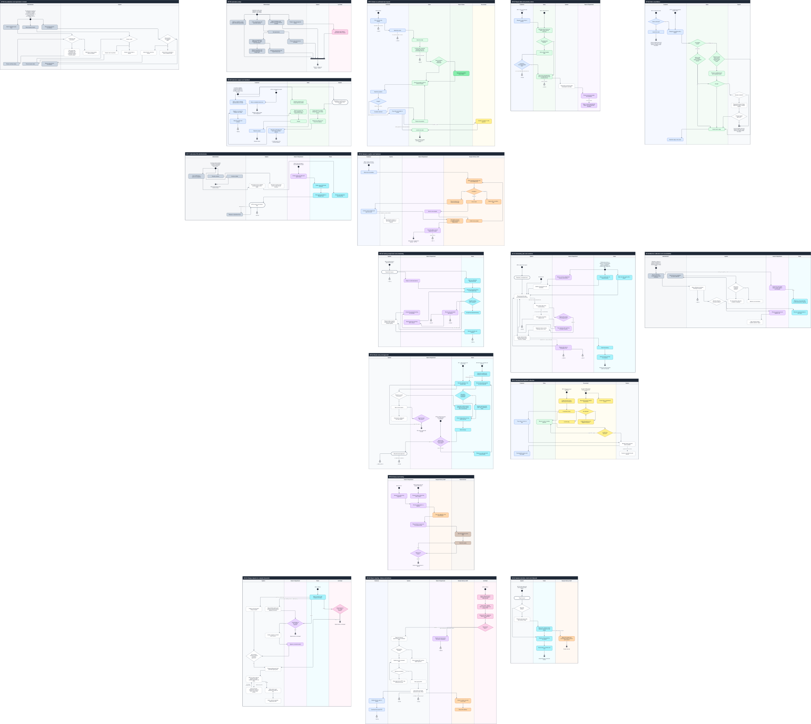
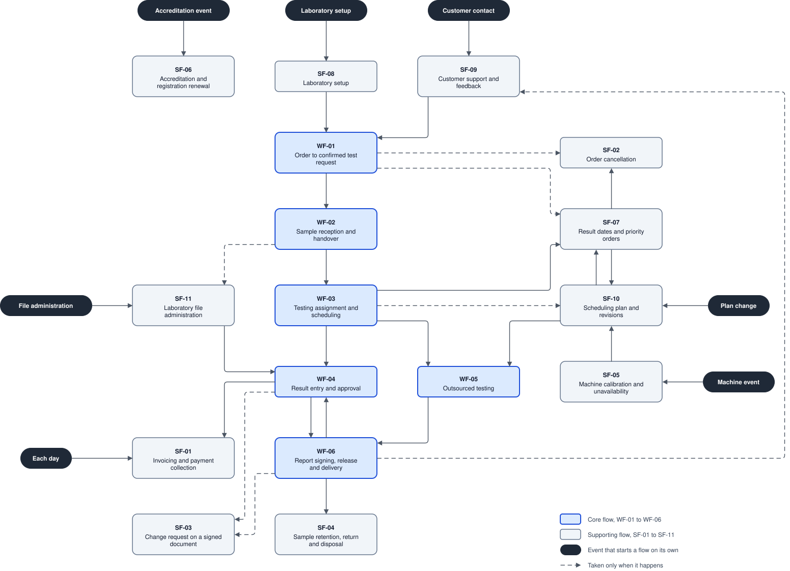

# System activity diagram

All 17 business flows of [Business flows](../../functional/business-flows.md), WF-01 to WF-06 and SF-01 to SF-11, on one sheet. Each flow is a frame of its own: an activity with its steps, decisions and lanes as business-flows.md draws them. [activity_diagram.py](activity_diagram.py) reads those Mermaid diagrams and draws this one, so a change to a flow is made in business-flows.md and the diagram is generated again. It is drawn with draw.io, not Mermaid, because Mermaid cannot keep the lanes of 17 frames in one order without crossing lines.



## Files

- [system-activity-diagram.drawio](system-activity-diagram.drawio): the sheet and the system activity map, generated by the script
- [system-activity-diagram.svg](system-activity-diagram.svg), [system-activity-map.svg](system-activity-map.svg) and [system-activity-diagram.pdf](system-activity-diagram.pdf): their exports
- [flows](#flows): each frame of the sheet as a diagram of its own, split from the sheet by the script
- [activity_diagram.py](activity_diagram.py): reads business-flows.md, writes the diagram, this document and the exports

After changing a flow in business-flows.md, regenerate everything with:

```bash
python docs/reports/activity-diagram/activity_diagram.py
```

The script exports with draw.io desktop when it finds it. It stops with an error, after writing the files, when a line crosses another line, runs along another line or cuts a shape; a correct diagram has none. After editing the sheet by hand, split it into the flow files again without redrawing it:

```bash
python docs/reports/activity-diagram/activity_diagram.py --split
```

## Flows

| Flow | SVG | draw.io |
| --- | --- | --- |
| WF-01 Order to confirmed test request | [wf-01.svg](flows/wf-01.svg) | [wf-01.drawio](flows/wf-01.drawio) |
| WF-02 Sample reception and handover | [wf-02.svg](flows/wf-02.svg) | [wf-02.drawio](flows/wf-02.drawio) |
| WF-03 Testing assignment and scheduling | [wf-03.svg](flows/wf-03.svg) | [wf-03.drawio](flows/wf-03.drawio) |
| WF-04 Result entry and approval | [wf-04.svg](flows/wf-04.svg) | [wf-04.drawio](flows/wf-04.drawio) |
| WF-05 Outsourced testing | [wf-05.svg](flows/wf-05.svg) | [wf-05.drawio](flows/wf-05.drawio) |
| WF-06 Report signing, release and delivery | [wf-06.svg](flows/wf-06.svg) | [wf-06.drawio](flows/wf-06.drawio) |
| SF-01 Invoicing and payment collection | [sf-01.svg](flows/sf-01.svg) | [sf-01.drawio](flows/sf-01.drawio) |
| SF-02 Order cancellation | [sf-02.svg](flows/sf-02.svg) | [sf-02.drawio](flows/sf-02.drawio) |
| SF-03 Change request on a signed document | [sf-03.svg](flows/sf-03.svg) | [sf-03.drawio](flows/sf-03.drawio) |
| SF-04 Sample retention, return and disposal | [sf-04.svg](flows/sf-04.svg) | [sf-04.drawio](flows/sf-04.drawio) |
| SF-05 Machine calibration and unavailability | [sf-05.svg](flows/sf-05.svg) | [sf-05.drawio](flows/sf-05.drawio) |
| SF-06 Accreditation and registration renewal | [sf-06.svg](flows/sf-06.svg) | [sf-06.drawio](flows/sf-06.drawio) |
| SF-07 Result dates and priority orders | [sf-07.svg](flows/sf-07.svg) | [sf-07.drawio](flows/sf-07.drawio) |
| SF-08 Laboratory setup | [sf-08.svg](flows/sf-08.svg) | [sf-08.drawio](flows/sf-08.drawio) |
| SF-09 Customer support and feedback | [sf-09.svg](flows/sf-09.svg) | [sf-09.drawio](flows/sf-09.drawio) |
| SF-10 Scheduling plan and revisions | [sf-10.svg](flows/sf-10.svg) | [sf-10.drawio](flows/sf-10.drawio) |
| SF-11 Laboratory file administration | [sf-11.svg](flows/sf-11.svg) | [sf-11.drawio](flows/sf-11.drawio) |

## Reading the diagram

- A frame is one flow and one activity. Its title is the flow's ID and name in business-flows.md.
- A frame has a lane for each actor it uses, always in this order: Customer, Sales, Head of Sales, Accountant, Administrator, System, Head of Department, Tester, Sample Delivery Staff, Lab Head, Subcontractor. The actors are those of the [use case diagram](../use-case-diagram/readme.md). System holds the steps the software takes, which business-flows.md draws outside every lane.
- A rounded box is an action; a dashed one is an action of the system. A box with a bold border is a state the flow passes. A diamond is a decision, its outgoing lines labelled with its outcomes.
- Words in square brackets at the start of an action are its condition, such as [folder owner] or [report edit permission].
- An initial node (●) starts the flow. Its label is the flow's trigger, or the flows and steps whose work it takes. An initial node has no line coming in, so no line runs from one frame to another.
- A flow final (⊗) ends one path and names the flows that take the work over. An activity final (◉) ends the flow with its outcome, followed by the flows that take the work over, if any.
- A dashed line is a path that happens only when its label says so, or a dashed line of business-flows.md.

## System activity map

How the flows connect, without their steps:

- A box is a flow: blue for the core flows WF-01 to WF-06, grey for the supporting flows.
- A dark event starts a flow that also starts on its own, beside the flows that lead to it. It is named after the flow's trigger in business-flows.md.
- An arrow joins two flows that a join below connects. It is dashed when every such join is dashed.



## Joins between flows

Each join is drawn as a flow final or activity final in the first flow and an initial node in the second.

| From | To | Why |
| --- | --- | --- |
| SF-08: Ready for testing and reports | WF-01: Fill a cart from the catalog | WF-01 starts from a catalog with priced parameters and packages. |
| SF-09: Keep the profile and contacts | WF-01: Fill a cart from the catalog | WF-01 trigger: a customer submits a cart on the portal. |
| WF-01: Fill a cart from the catalog | SF-07: Request a return date or priority | SF-07 trigger: a customer asks for earlier results; US-C22 asks while ordering. |
| WF-01: Confirm ways, expected samples, price and percentage discount | SF-07: Estimate every branch plus safety margin without reserving | SF-07 main path: Sales checks the estimated return date while quoting. |
| WF-01: Submit the order | SF-02: Order confirmed? | SF-02 trigger: a customer wants to cancel an order; it starts from orders in each status. |
| SF-07: SF-02 cancellation request for unfulfillable part | SF-02: Request cancellation with a reason | SF-07-E1: Sales handles a cancellation request for the unfulfillable part. |
| WF-01: Order confirmed; sample collection can start | WF-02: Hand over the samples | WF-02 starts from a confirmed order whose test request is paid. |
| WF-02: Testing tasks in department queues | WF-03: Department queue | WF-02 result: testing tasks wait in each department's queue; WF-03 trigger: a testing task enters the queue. |
| WF-02: Scan the label to record department receipt | SF-11: Create sample raw-data and result folders | SF-11 trigger: a sample needs its folders; the head of department creates them. |
| WF-03: Department queue | SF-10: Received, not-started work | SF-10 trigger: testing work arrives. |
| WF-03: WF-04 Result entry and approval | WF-04: Follow the method and measure in the booking | WF-04 trigger: a booked test starts. |
| WF-03: SF-07 agrees a feasible customer date | SF-07: Estimate every branch plus safety margin without reserving | WF-03-E2: SF-07 handles the committed return date. |
| SF-10: SF-07 Sales asks the customer for a new date | SF-07: Estimate every branch plus safety margin without reserving | SF-10-E2: Sales records the customer's agreement to a new date. |
| WF-03: WF-05 outsources to a subcontractor with the same method | WF-05: Review the outsourcing suggestion | WF-03-E2: WF-05 handles an agreed subcontracted alternative. |
| WF-03: WF-05 outsources to a subcontractor with the same method | WF-05: Propose urgent outsourcing with a reason | WF-05-A3: the head initiates an urgent outsourcing proposal. |
| SF-10: WF-05 handles outsourcing | WF-05: Review the outsourcing suggestion | SF-10-E2: a proposed different way follows WF-05. |
| SF-07: SF-10 schedules urgent tests | SF-10: Place by priority class, committed date and arrival | SF-07-A1: accepted priority makes tests urgent; SF-10 owns priority order. |
| SF-05: Return affected not-started bookings to the plan | SF-10: Place by priority class, committed date and arrival | SF-05: SF-10 owns queue order and rescheduling. |
| SF-11: WF-04 saves and versions files | WF-04: Save the result file in the sample folder | SF-11: WF-04 owns saving and versioning result files. |
| WF-04: WF-06 when every test is approved or cancelled | WF-06: [report edit permission] Edit the DOCX draft in ONLYOFFICE | WF-06 trigger: every sample test of a test request is approved or cancelled. |
| WF-05: Outsourced test approved | WF-06: [report edit permission] Edit the DOCX draft in ONLYOFFICE | WF-05 result: the subcontractor's result is approved like any other result. |
| WF-04: WF-06 when every test is approved or cancelled | SF-01: Create the final invoice: total minus the advance | SF-01 starts from orders with a paid advance whose testing is completed. |
| WF-06: WF-04 approves them again | WF-04: Approve the result, including own entry? | WF-06-E2: the results go back to the head of department and are approved again. |
| WF-06: Issue report and make reserved number official | SF-04: Report issued | SF-04 trigger: the report of a sample's test request is issued. |
| WF-04: Reported result approved | SF-03: Raise correction with changes and reason | SF-03 trigger: a person who can edit a result finds a mistake once its process is completed. |
| WF-06: Issue report and make reserved number official | SF-03: Raise correction with changes and reason | SF-03 trigger: a person who can edit a report finds a mistake in an issued one. |
| WF-06: Download the issued PDF | SF-09: Rate a completed order once | SF-09-A4: the customer rates a completed order; the order completes on issue. |

## Differences from business-flows.md

- A node that only names another flow, such as "WF-04 Result entry and approval", is a flow final.
- A state that ends a path is an activity final with the state as its label. A final reached from several lanes is drawn once in each of them.
- The steps that all lead to "Ready for testing and reports" in SF-08 meet at a join bar first, since that outcome needs all of them.
- The initial nodes are added: one for each trigger and one for each step another flow leads to.
- Two nodes that name another flow but lead on stay as steps: "WF-06: review, approve, digitally sign when enabled, store PDF and issue" in SF-03 and "WF-04 saves and versions files" in SF-11.

## Related documents

- [Business flows](../../functional/business-flows.md)
- [Use case diagram](../use-case-diagram/readme.md)
- [Reports](../readme.md)
