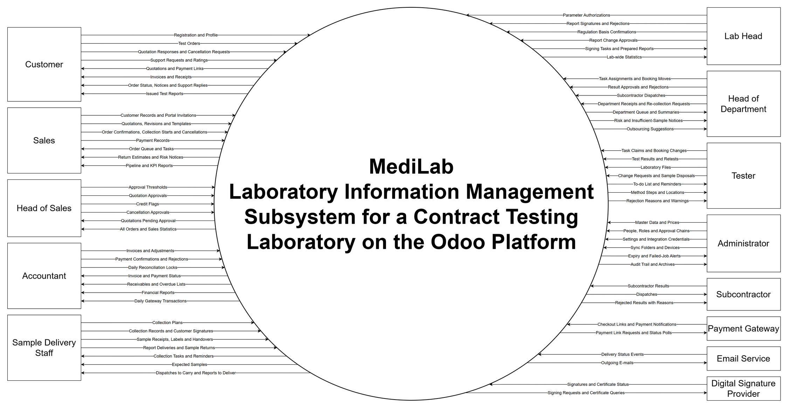

# Context diagram

The context diagram (DFD level 0) of the MediLab subsystem: the subsystem is one process, and every person and system outside it that sends or receives data is an entity. It covers the E-commerce and Laboratory Testing modules, including Medilab Sync. The functional documents are its source, and the capstone proposal binds its scope; where they differ, [Deviations from the proposal](#deviations-from-the-proposal) lists it. The diagram is drawn with draw.io, not Mermaid, because Mermaid cannot run every flow as a straight line between an entity and one central process.



## Files

- [medilab-context.drawio](medilab-context.drawio): the diagram, generated by the script
- [medilab-context.svg](medilab-context.svg), [medilab-context.png](medilab-context.png) and [medilab-context.pdf](medilab-context.pdf): its exports
- [context_diagram.py](context_diagram.py): holds the entities and flows of [Entities and flows](#entities-and-flows) and writes the diagram

After changing the entities or flows in the script and in this document, regenerate the diagram and export it with draw.io desktop:

```bash
python docs/reports/context-diagram/context_diagram.py
drawio -x -f svg -e -b 20 -o docs/reports/context-diagram/medilab-context.svg docs/reports/context-diagram/medilab-context.drawio
drawio -x -f png -e -b 20 -o docs/reports/context-diagram/medilab-context.png docs/reports/context-diagram/medilab-context.drawio
drawio -x -f pdf -e -b 20 --crop -o docs/reports/context-diagram/medilab-context.pdf docs/reports/context-diagram/medilab-context.drawio
```

## Reading the diagram

- The circle is the subsystem; each rectangle is an entity.
- Each arrow is one data flow, named by the data it carries, and points the way the data moves.
- Within an entity, the flows into the subsystem come first, then the flows out of it.
- An entity is a role or an outside system, never a named person. Outside systems are named by what they do; the provider in use is in the source.

## Entities and flows

| Entity                     | Into the subsystem                                                                                                                                    | Out of the subsystem                                                                                                     | Source                                                                                                                                                                                                                                                                                         |
| -------------------------- | ----------------------------------------------------------------------------------------------------------------------------------------------------- | ------------------------------------------------------------------------------------------------------------------------ | ---------------------------------------------------------------------------------------------------------------------------------------------------------------------------------------------------------------------------------------------------------------------------------------------- |
| Customer                   | Registration and Profile · Test Orders · Quotation Responses and Cancellation Requests · Support Requests and Ratings                                  | Quotations and Payment Links · Invoices and Receipts · Order Status, Notices and Support Replies · Issued Test Reports    | [Customer](../../functional/ecommerce_module/features/customer.md)                                                                                                                                                                                                                             |
| Sales                      | Customer Records and Portal Invitations · Quotations, Revisions and Templates · Order Confirmations, Collection Starts and Cancellations · Payment Records | Order Queue and Tasks · Return Estimates and Risk Notices · Pipeline and KPI Reports                                     | [Sales](../../functional/ecommerce_module/features/sales.md)                                                                                                                                                                                                                                   |
| Head of Sales              | Approval Thresholds · Quotation Approvals · Credit Flags · Cancellation Approvals                                                                      | Quotations Pending Approval · All Orders and Sales Statistics                                                               | [E-commerce actors](../../functional/ecommerce_module/overview.md#actors), [Sales quotation](../../functional/ecommerce_module/features/sales.md#2-quotation-us-s05-to-us-s10-us-s21-us-s22), [confirmation](../../functional/ecommerce_module/features/sales.md#4-confirmation-us-s12-us-s15) and [cancellation](../../functional/ecommerce_module/features/sales.md#5-cancellation-us-s16-us-s17) |
| Accountant                 | Invoices and Adjustments · Payment Confirmations and Rejections · Daily Reconciliation Locks                                                           | Invoice and Payment Status · Receivables and Overdue Lists · Financial Reports · Daily Gateway Transactions              | [Accountant](../../functional/ecommerce_module/features/accountant.md)                                                                                                                                                                                                                         |
| Sample Delivery Staff      | Collection Plans · Collection Records and Customer Signatures · Sample Receipts, Labels and Handovers · Report Deliveries and Sample Returns            | Collection Tasks and Reminders · Expected Samples · Dispatches to Carry and Reports to Deliver                            | [Sample delivery staff](../../functional/laboratory_module/features/sample-delivery-staff.md)                                                                                                                                                                                                  |
| Lab Head                   | Parameter Authorizations · Report Signatures and Rejections · Regulation Basis Confirmations · Report Change Approvals                                  | Signing Tasks and Prepared Reports · Lab-wide Statistics                                                                    | [Lab head](../../functional/laboratory_module/features/lab-head.md)                                                                                                                                                                                                                            |
| Head of Department         | Task Assignments and Booking Moves · Result Approvals and Rejections · Subcontractor Dispatches · Department Receipts and Re-collection Requests        | Department Queue and Summaries · Risk and Insufficient-Sample Notices · Outsourcing Suggestions                           | [Head of department](../../functional/laboratory_module/features/head-of-department.md)                                                                                                                                                                                                        |
| Tester                     | Task Claims and Booking Changes · Test Results and Retests · Laboratory Files · Change Requests and Sample Disposals                                    | To-do List and Reminders · Method Steps and Locations · Rejection Reasons and Warnings                                   | [Tester](../../functional/laboratory_module/features/tester.md)                                                                                                                                                                                                                                |
| Administrator              | Master Data and Prices · People, Roles and Approval Chains · Settings and Integration Credentials · Sync Folders and Devices                            | Expiry and Failed-Job Alerts · Audit Trail and Archives                                                                  | [E-commerce administrator](../../functional/ecommerce_module/features/admin.md), [Laboratory administrator](../../functional/laboratory_module/features/admin.md), [Medilab Sync](../../functional/laboratory_module/applications/medilab-sync.md)                                              |
| Subcontractor              | Subcontractor Results                                                                                                                                 | Dispatches · Rejected Results with Reasons                                                                               | [Subcontractor](../../functional/laboratory_module/features/subcontractor.md)                                                                                                                                                                                                                  |
| Payment Gateway            | Checkout Links and Payment Notifications                                                                                                              | Payment Link Requests and Status Polls                                                                                   | [PayOS](../../functional/shared.md#2-payos-payments), [PayOS spec](../../specs/payos.md)                                                                                                                                                                                                       |
| Email Service              | Delivery Status Events                                                                                                                                | Outgoing E-mails                                                                                                         | [Brevo](../../functional/shared.md#1-brevo-email)                                                                                                                                                                                                                                              |
| Digital Signature Provider | Signatures and Certificate Status                                                                                                                     | Signing Requests and Certificate Queries                                                                                 | [Viettel Sign](../../functional/shared.md#3-viettel-sign-digital-signature), [Digital signing](../../specs/digital-signing.md)                                                                                                                                                                  |

## Role names

The proposal names the roles differently from the functional documents. The diagram uses the names of the functional documents.

| Proposal role (section c)      | Entity                                                                                                                            |
| ------------------------------ | --------------------------------------------------------------------------------------------------------------------------------- |
| 1. Administrator               | Administrator                                                                                                                     |
| 2. Sales                       | Sales                                                                                                                             |
| 3. Finance                     | Accountant                                                                                                                        |
| 4. Sampling and Reception      | Sample Delivery Staff                                                                                                             |
| 5. Tester (Lab QA)             | Tester                                                                                                                            |
| 6. Department Head             | Head of Department                                                                                                                |
| 7. Lab Head                    | Lab Head                                                                                                                          |
| 8. Subcontractor               | Subcontractor                                                                                                                     |
| 9. Customer                    | Customer                                                                                                                          |
| 10. Authorized Internal Users  | No entity: its features are shared by every internal role ([SH-10 to SH-12](../../functional/shared.md#sh-10-tasks-and-to-do-list)) |
| None                           | Head of Sales                                                                                                                     |

## Deviations from the proposal

Each row quotes the proposal word for word with its section, so it can be found in the [proposal](../proposal/FA26SE294_DESIGN_AND_DEVELOPMENT_OF_A_LABORATORY_I_hoangnt2.docx) by searching for the quote.

| Topic                                      | Proposal                                                                                                                                         | Functional documents                                                                                                                                                                                                                                                                                                       |
| ------------------------------------------ | ------------------------------------------------------------------------------------------------------------------------------------------------ | -------------------------------------------------------------------------------------------------------------------------------------------------------------------------------------------------------------------------------------------------------------------------------------------------------------------------- |
| Tester signature                           | c) 5. Tester (Lab QA), Testing & Result Entry: "Submit completed results for review and apply the tester-level digital signature."               | The tester signs the result in its approval chain. Only the test report is digitally signed ([Tester results](../../functional/laboratory_module/features/tester.md#2-results-us-t05-to-us-t09-us-t17-us-t18-us-t22), [SH-04](../../functional/shared.md#sh-04-signatures-and-digital-signing)).                       |
| Head of department signature               | c) 6. Department Head, Result Review & Approval: "Review tester results and either approve them with a digital signature or reject/return them for revision." | The head approves the result in its approval chain. Only the test report is digitally signed ([SH-04](../../functional/shared.md#sh-04-signatures-and-digital-signing)).                                                                                                                                                 |
| Signing identities                         | c) 1. Administrator, System Configuration: "Manage digital-signature identities and integrations."                                               | One laboratory certificate, read from Viettel Sign, signs every digitally signed document, whoever approved it ([SH-04](../../functional/shared.md#sh-04-signatures-and-digital-signing), [Certificate](../../specs/digital-signing.md#certificate)).                                                                    |
| Test requests at reception                 | c) 4. Sampling and Reception, Sample Reception: "Create test requests at reception."                                                             | A test request comes only from an order Sales confirmed, so sample delivery staff create none ([Sales confirmation](../../functional/ecommerce_module/features/sales.md#4-confirmation-us-s12-us-s15), [Sample delivery staff](../../functional/laboratory_module/features/sample-delivery-staff.md)).                  |
| Retained samples                           | c) 4. Sampling and Reception, Sample Retention: "Register retained samples, track retention periods, and record disposal after expiry."          | Whether a sample is retained, and for how long, follows its sample type. A tester records the disposal ([Reception](../../functional/laboratory_module/overview.md#reception)).                                                                                                                                          |
| Discounts                                  | c) 3. Finance, Accounting & Receivables: "Generate receipts, discounts, invoices."                                                               | Only Sales gives discounts, as percentages on a line or on the whole quotation; the accountant gives none ([Sales quotation](../../functional/ecommerce_module/features/sales.md#2-quotation-us-s05-to-us-s10-us-s21-us-s22), [Accountant](../../functional/ecommerce_module/features/accountant.md)).                     |
| Quotation templates                        | c) 2. Sales, Quotation & Order Management: "Manage quotation templates."                                                                         | There are order templates, without prices, and no quotation templates ([Order templates](../../functional/ecommerce_module/features/sales.md#order-templates-us-s09), [Sales order and customer order](../../business/sales-order-and-customer-order.md)).                                                                 |
| Authorized internal users and Head of Sales | c) 10. Authorized Internal Users is a role; the proposal has no Head of Sales.                                                                   | Authorized internal users are not a role: their features are shared ([SH-10 to SH-12](../../functional/shared.md#sh-10-tasks-and-to-do-list)). Head of Sales is a role, and its feature document is not written yet ([E-commerce actors](../../functional/ecommerce_module/overview.md#actors)).                         |
| Handover between departments               | c) 4. Sampling and Reception, Sample Coding & Routing: "Confirm sample handover between departments by QR scanning."                             | A received sample is handed over to each department that tests it; there is no handover from one department to another ([Reception](../../functional/laboratory_module/overview.md#reception)).                                                                                                                        |

## Related documents

- [Reports](../readme.md)
- [Capstone proposal](../proposal/FA26SE294_DESIGN_AND_DEVELOPMENT_OF_A_LABORATORY_I_hoangnt2.docx)
- [Functional documents](../../functional/index.md)
- [Shared requirements](../../functional/shared.md)
- [Glossaries](../../glossaries.md)
