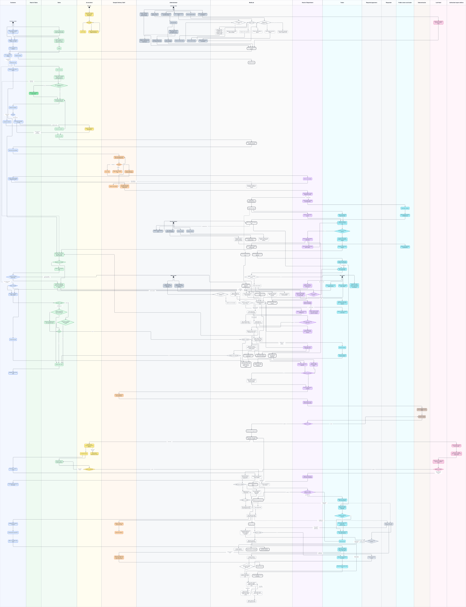
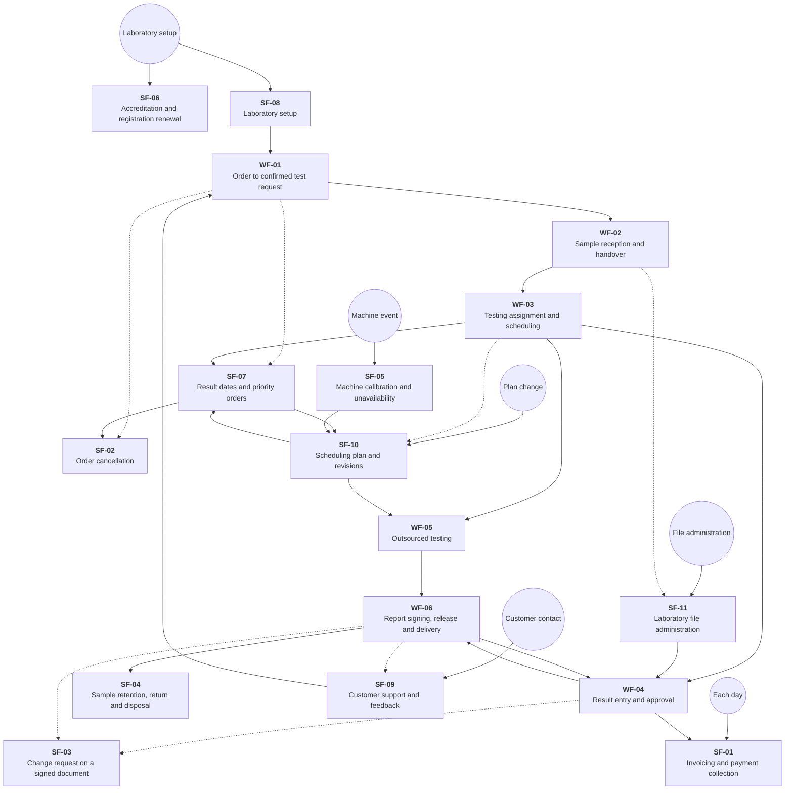

# System activity diagram

All 17 activity diagrams of [Business flows](../../functional/business-flows.md), WF-01 to WF-06 and SF-01 to SF-11, merged into one diagram. Every step, decision, lane and arrow is copied from those diagrams with its wording. The additions are the arrows that join one flow to another where business-flows.md names the connection, the initial nodes of the flows an event starts, and two vendor names replaced by generic words; the tables below list each of them.

- One swimlane per lane of the source diagrams. The MediLab lane holds the steps, states and decisions the source draws outside every lane.
- A rounded box with a bold border is a state or an outcome; a diamond is a decision, labelled with its outcomes.
- A filled circle with a name is an event that starts flows. A dashed arrow is dashed in the source or joins a flow that an event starts.



The image draws the nodes and edges of the Mermaid source below in swimlanes; the [PDF](system-activity-diagram.pdf) keeps it sharp at any zoom.

## Flow map

How the 17 flows connect: one box per flow and one arrow per pair of flows that a join below connects, dashed when every such join is dashed. A dark node is an event that starts flows.



## Joins between flows

| From                                                                 | To                                                                | Why                                                                                                                                                      |
| -------------------------------------------------------------------- | ----------------------------------------------------------------- | -------------------------------------------------------------------------------------------------------------------------------------------------------- |
| SF-08: Ready for testing and reports                                 | WF-01: Fill a cart from the catalog                               | WF-01 starts from a catalog with priced parameters and packages.                                                                                         |
| SF-09: Keep the profile and contacts                                 | WF-01: Fill a cart from the catalog                               | WF-01 trigger: a customer submits a cart on the portal.                                                                                                  |
| WF-01: Fill a cart from the catalog                                  | SF-07: Request a return date or priority                          | SF-07 trigger: Sales prepares a quotation, or a customer asks for earlier results (US-C22 asks while ordering).                                          |
| WF-01: Confirm ways, expected samples, price and percentage discount | SF-07: Estimate every branch plus safety margin without reserving | SF-07 main path: Sales checks the estimated return date while quoting.                                                                                   |
| WF-01: Submit the order                                              | SF-02: Order confirmed?                                           | SF-02 trigger: a customer wants to cancel an order; it starts from orders in each status.                                                                |
| SF-07: SF-02 cancellation request for unfulfillable part             | SF-02: Request cancellation with a reason                         | SF-07 node: SF-02 cancellation request for unfulfillable part.                                                                                           |
| WF-01: Order confirmed; sample collection can start                  | WF-02: Hand over the samples                                      | WF-02 starts from a confirmed order whose test request is paid.                                                                                          |
| WF-02: Testing tasks in department queues                            | WF-03: Department queue                                           | WF-02 result: testing tasks wait in the queue of each department; WF-03 trigger: a testing task enters the queue of its department.                      |
| WF-02: Scan the label to record department receipt                   | SF-11: Create sample raw-data and result folders                  | SF-11 trigger: a sample needs its folders; the head of department creates them.                                                                          |
| WF-03: Department queue                                              | SF-10: Received, not-started work                                 | SF-10 trigger: testing work arrives.                                                                                                                     |
| WF-03: WF-04 Result entry and approval                               | WF-04: Follow the method and measure in the booking               | WF-03 node: WF-04 Result entry and approval.                                                                                                             |
| WF-03: SF-07 agrees a feasible customer date                         | SF-07: Estimate every branch plus safety margin without reserving | WF-03 node: SF-07 agrees a feasible customer date.                                                                                                       |
| SF-10: SF-07 Sales asks the customer for a new date                  | SF-07: Estimate every branch plus safety margin without reserving | SF-10 node: SF-07 Sales asks the customer for a new date.                                                                                                |
| WF-03: WF-05 agrees any subcontracted alternative                    | WF-05: Review the outsourcing suggestion                          | WF-03 node: WF-05 agrees any subcontracted alternative.                                                                                                  |
| WF-03: WF-05 agrees any subcontracted alternative                    | WF-05: Propose urgent outsourcing with a reason                   | WF-05-A3: the head initiates an urgent outsourcing proposal.                                                                                             |
| SF-10: WF-05 handles agreed outsourcing                              | WF-05: Review the outsourcing suggestion                          | SF-10 node: WF-05 handles agreed outsourcing.                                                                                                            |
| SF-07: SF-10 schedules urgent tests                                  | SF-10: Place by priority class, committed date and arrival        | SF-07 node: SF-10 schedules urgent tests.                                                                                                                |
| SF-05: Return affected not-started bookings to the plan              | SF-10: Place by priority class, committed date and arrival        | SF-05: SF-10 owns queue order and rescheduling.                                                                                                          |
| SF-11: WF-04 saves and versions files                                | WF-04: Save the result file in the sample folder                  | SF-11 node: WF-04 saves and versions files.                                                                                                              |
| WF-05: Outsourced test approved                                      | WF-04: WF-06 when every test is approved or cancelled             | WF-05 result: the subcontractor's result is approved like any other result; WF-06 trigger: every sample test of a test request is approved or cancelled. |
| WF-04: WF-06 when every test is approved or cancelled                | WF-06: Edit the DOCX draft in the online editor                   | WF-04 node: WF-06 when every test is approved or cancelled.                                                                                              |
| WF-04: WF-06 when every test is approved or cancelled                | SF-01: Create the final invoice: total minus the advance          | SF-01 starts from orders with a paid advance whose testing is completed.                                                                                 |
| WF-06: WF-04 approves them again                                     | WF-04: Approve the result, including own entry?                   | WF-06 node: WF-04 approves them again.                                                                                                                   |
| WF-06: Issue report and make reserved number official                | SF-04: Report issued                                              | SF-04 trigger: the report of a sample's test request is issued.                                                                                          |
| WF-04: Reported result approved                                      | SF-03: Raise correction with changes and reason                   | SF-03 trigger: a person who can edit a type of document finds a mistake in one whose process is completed, such as a result or a report.                 |
| WF-06: Issue report and make reserved number official                | SF-03: Raise correction with changes and reason                   | SF-03 trigger, as above.                                                                                                                                 |
| WF-06: Download the issued PDF                                       | SF-09: Rate a completed order once                                | SF-09: a completed order can be rated; the order completes on issue.                                                                                     |
| SF-01: Create the final invoice: total minus the advance             | SF-01: Correct with an adjustment invoice                         | SF-01-A3: an adjustment invoice lowers or raises what is owed; the original invoice is unchanged.                                                        |

## Initial nodes

| Initial node        | Leads to                                                                                                                                                                                                                                                                  | Trigger                                                                                                                                                                       |
| ------------------- | ------------------------------------------------------------------------------------------------------------------------------------------------------------------------------------------------------------------------------------------------------------------------- | ----------------------------------------------------------------------------------------------------------------------------------------------------------------------------- |
| Laboratory setup    | SF-08: Units, sample types and parameter groups; SF-08: People, roles and approval chains; SF-08: Settings: deadlines, travel buffer and warning windows; SF-06: Import certificate scope lines; SF-06: Record quality dossier; SF-06: Record subcontractor accreditation | SF-08: a laboratory starts using MediLab, or its catalog, people or rules change. SF-06: the laboratory receives an accreditation certificate or registers a quality dossier. |
| Customer contact    | SF-09: Invite the customer and merge duplicate profiles; SF-09: Register, or accept the invitation from sales; SF-09: Open a support request, optionally about an order                                                                                                   | SF-09: a customer registers, or contacts the laboratory through the portal.                                                                                                   |
| Machine event       | SF-05: Record calibration, maintenance or repair availability; SF-05: Record service completion and valid calibration                                                                                                                                                     | SF-05: calibration is absent or expired, maintenance is planned or overdue, or a machine breaks or enters repair.                                                             |
| Plan change         | SF-10: Move or cancel own not-started booking; SF-10: Mark own test urgent with a reason; SF-10: Move or cancel a department booking, which pins it                                                                                                                       | SF-10: urgency, a booking change, a result, a cancellation, resource availability or a customer date changes the plan.                                                        |
| Each day            | SF-01: Reconcile the day's online payment transactions                                                                                                                                                                                                                    | SF-01: each day's online payments match the payment transactions and are locked.                                                                                              |
| File administration | SF-11: Release an abandoned lock; SF-11: Revoke a device; SF-11: Turn a folder off or restore its availability; SF-11: Archive a folder                                                                                                                                   | SF-11: a folder, membership, device or lock needs administration.                                                                                                             |

## Wording changes

| Flow  | business-flows.md                      | Diagram                                         |
| ----- | -------------------------------------- | ----------------------------------------------- |
| WF-06 | Edit the DOCX draft in ONLYOFFICE      | Edit the DOCX draft in the online editor        |
| SF-01 | Reconcile the day's PayOS transactions | Reconcile the day's online payment transactions |

## Source

```mermaid
flowchart TB
    wf01_c1["<b>Customer</b><br/>Fill a cart from the catalog"]
    wf01_c2["<b>Customer</b><br/>Submit the order"]
    wf01_c3["<b>Customer</b><br/>Read the quotation"]
    wf01_c4{"<b>Customer</b><br/>Accept?"}
    wf01_c5["<b>Customer</b><br/>Pay online, by transfer or in cash"]
    wf01_c6["<b>Customer</b><br/>Quotation declined"]
    wf01_s1["<b>Sales</b><br/>Claim the order"]
    wf01_s2["<b>Sales</b><br/>Confirm ways, expected samples, price and percentage discount"]
    wf01_gate{"<b>Sales</b><br/>Above quotation approval thresholds?"}
    wf01_s3["<b>Sales</b><br/>Send the quotation with the advance request"]
    wf01_s4["<b>Sales</b><br/>Confirm the order"]
    wf01_s6["<b>Sales</b><br/>Revise the quotation"]
    wf01_a1["<b>Accountant</b><br/>Confirm a transfer or cash payment"]
    wf01_h0["<b>Head of Sales</b><br/>Approve the quotation before Send"]
    wf01_done(["Order confirmed; sample collection can start"])
    wf02_c1["<b>Customer</b><br/>Hand over the samples"]
    wf02_c2["<b>Customer</b><br/>Confirm actual samples and sign the record"]
    wf02_d1["<b>Sample Delivery Staff</b><br/>Adjust expected samples and record differences"]
    wf02_d2{"<b>Sample Delivery Staff</b><br/>Condition?"}
    wf02_d3["<b>Sample Delivery Staff</b><br/>Record receipt, time, amount and storage"]
    wf02_d6["<b>Sample Delivery Staff</b><br/>Reject with a condition note"]
    wf02_d7["<b>Sample Delivery Staff</b><br/>Put on hold"]
    wf02_d4["<b>Sample Delivery Staff</b><br/>Print label and hand accepted samples to departments"]
    wf02_d8["<b>Sample Delivery Staff</b><br/>Collect more sample"]
    wf02_h1["<b>Head of Department</b><br/>Ask for more sample"]
    wf02_h2["<b>Head of Department</b><br/>Scan the label to record department receipt"]
    wf02_done(["Testing tasks in department queues"])
    wf02_keep["<b>MediLab</b><br/>Kept with the sample, no test added; returned on request"]
    wf03_h1["<b>Head of Department</b><br/>Assign an authorized person"]
    wf03_h2["<b>Head of Department</b><br/>Review risk and feasible alternatives"]
    wf03_h3["<b>Head of Department</b><br/>Record planned OverTime with a reason"]
    wf03_t1["<b>Tester</b><br/>Claim an authorized department task"]
    wf03_t2["<b>Tester</b><br/>View the proposed booking for the agreed way"]
    wf03_t3{"<b>Tester</b><br/>Feasible booking within capacity?"}
    wf03_t4["<b>Tester</b><br/>Accept: reserve tester, locations and machine if needed"]
    wf03_t5["<b>Tester</b><br/>Receive reminder and measure"]
    wf03_queue(["Department queue"])
    wf03_dates(["SF-07 agrees a feasible customer date"])
    wf03_outsource(["WF-05 agrees any subcontracted alternative"])
    wf03_wf04(["WF-04 Result entry and approval"])
    wf04_t1["<b>Tester</b><br/>Follow the method and measure in the booking"]
    wf04_t2["<b>Tester</b><br/>Record value with snapshot unit and LOD/LOQ"]
    wf04_q{"<b>Tester</b><br/>Regulation comparison requested?"}
    wf04_t3["<b>Tester</b><br/>Assess exact type limit: pass, fail or insufficient basis"]
    wf04_t4["<b>Tester</b><br/>Check measurement and any sanity warning"]
    wf04_t5["<b>Tester</b><br/>Send and sign"]
    wf04_t6["<b>Tester</b><br/>Retest as a new result with a new booking"]
    wf04_f1["<b>Tester</b><br/>Save the result file in the sample folder"]
    wf04_f2["<b>Tester</b><br/>Keep both conflict versions and take the server version with a local backup"]
    wf04_h1{"<b>Head of Department</b><br/>Approve the result, including own entry?"}
    wf04_h2{"<b>Head of Department</b><br/>Sign the result-file version?"}
    wf04_current{"<b>MediLab</b><br/>Based on current file version?"}
    wf04_version["<b>MediLab</b><br/>New current version"]
    wf04_others["<b>MediLab</b><br/>Download to colleagues' two-way folders"]
    wf04_signedfile(["File version signed with its hash"])
    wf04_done(["Reported result approved"])
    wf04_wf06(["WF-06 when every test is approved or cancelled"])
    wf05_h1["<b>Head of Department</b><br/>Review the outsourcing suggestion"]
    wf05_agreed{"<b>Head of Department</b><br/>Already the agreed way?"}
    wf05_h0["<b>Head of Department</b><br/>Propose urgent outsourcing with a reason"]
    wf05_h2["<b>Head of Department</b><br/>Put the sample tests in a dispatch"]
    wf05_h3["<b>Head of Department</b><br/>Record when it is sent and the expected date"]
    wf05_h4{"<b>Head of Department</b><br/>Approve the result?"}
    wf05_d1["<b>Sample Delivery Staff</b><br/>Carry the dispatch to the subcontractor"]
    wf05_s1["<b>Subcontractor</b><br/>See the dispatch and its tests"]
    wf05_s2["<b>Subcontractor</b><br/>Enter the results"]
    wf05_revise["<b>MediLab</b><br/>Sales obtains customer agreement through a revised quotation"]
    wf05_done(["Outsourced test approved"])
    wf06_p1["<b>Authorized report editors</b><br/>Edit the DOCX draft in the online editor"]
    wf06_p2["<b>Authorized report editors</b><br/>Finish saves, validate data, reserve number and prepare PDF"]
    wf06_l1["<b>Lab Head</b><br/>Review the PDF, approved results and regulation basis"]
    wf06_l2{"<b>Lab Head</b><br/>Approve the report?"}
    wf06_h1["<b>Head of Department</b><br/>Results sent back wait in the queue unassigned"]
    wf06_d1["<b>Sample Delivery Staff</b><br/>Deliver in person, by post or by e-mail"]
    wf06_d2["<b>Sample Delivery Staff</b><br/>Record the delivery"]
    wf06_c1["<b>Customer</b><br/>Notified that the report is issued"]
    wf06_c2["<b>Customer</b><br/>Download the issued PDF"]
    wf06_wf04(["WF-04 approves them again"])
    wf06_approved["<b>MediLab</b><br/>Keep final internal approval bound to reviewed PDF"]
    wf06_enabled{"<b>MediLab</b><br/>Digital signing enabled?"}
    wf06_digital["<b>MediLab</b><br/>Digitally sign the reviewed PDF"]
    wf06_success{"<b>MediLab</b><br/>Signing succeeded?"}
    wf06_retry["<b>MediLab</b><br/>Keep approval and PDF; stay unissued and retry"]
    wf06_stored["<b>MediLab</b><br/>Store signed PDF"]
    wf06_plain["<b>MediLab</b><br/>Store reviewed PDF without digital signature"]
    wf06_issued["<b>MediLab</b><br/>Issue report and make reserved number official"]
    sf01_a1["<b>Accountant</b><br/>Create the final invoice: total minus the advance"]
    sf01_a2["<b>Accountant</b><br/>E-mail the invoice"]
    sf01_a3{"<b>Accountant</b><br/>Confirm the payment?"}
    sf01_a4["<b>Accountant</b><br/>Reconcile the day's online payment transactions"]
    sf01_a5{"<b>Accountant</b><br/>All matched?"}
    sf01_a6["<b>Accountant</b><br/>Lock the day"]
    sf01_a7["<b>Accountant</b><br/>Create the payment of a flagged transaction"]
    sf01_a8["<b>Accountant</b><br/>Correct with an adjustment invoice"]
    sf01_s1["<b>Sales</b><br/>Record a cash or transfer payment"]
    sf01_c1["<b>Customer</b><br/>Pay online, in full or in part"]
    sf01_c2["<b>Customer</b><br/>Download the invoice and the receipt"]
    sf01_r["<b>MediLab</b><br/>Receipt issued; payment status updated"]
    sf01_reminder["<b>MediLab</b><br/>Customer reminded at each interval"]
    sf02_c1{"<b>Customer</b><br/>Order confirmed?"}
    sf02_c2["<b>Customer</b><br/>Cancel the order"]
    sf02_c3["<b>Customer</b><br/>Request cancellation with a reason"]
    sf02_c4["<b>Customer</b><br/>Read the reply on the order"]
    sf02_scope{"<b>Sales</b><br/>Cancellation scope?"}
    sf02_s1{"<b>Sales</b><br/>Whole-order cancellation affects completed testing?"}
    sf02_partial{"<b>Sales</b><br/>Affected sample tests may be cancelled under their current rules?"}
    sf02_s2["<b>Sales</b><br/>Decline with a reply"]
    sf02_preserve["<b>Sales</b><br/>Preserve unaffected work and completed results"]
    sf02_s3{"<b>Sales</b><br/>Accept?"}
    sf02_collected{"<b>MediLab</b><br/>Samples collected?"}
    sf02_approval["<b>MediLab</b><br/>Request the Head of Sales approval through a change request"]
    sf02_decision{"<b>MediLab</b><br/>Change request approved?"}
    sf02_cancel(["Cancel accepted scope and preserve other work; a paid advance is settled outside the system"])
    sf03_r1["<b>Requester</b><br/>Raise correction with changes and reason"]
    sf03_s1{"<b>Required approvers</b><br/>Approve the change request?"}
    sf03_s2["<b>Required approvers</b><br/>Approve corrected results"]
    sf03_link["<b>MediLab</b><br/>Create or link the report change request"]
    sf03_stop["<b>MediLab</b><br/>Stop pending signing and withdraw signatures before applying correction"]
    sf03_kept(["Signed version unchanged"])
    sf03_result["<b>MediLab</b><br/>Create unsigned corrected result version"]
    sf03_ready{"<b>MediLab</b><br/>All corrected results and report correction approved?"}
    sf03_draft["<b>MediLab</b><br/>Prepare replacement draft and fresh signing task"]
    sf03_release["<b>MediLab</b><br/>WF-06: review, approve, digitally sign when enabled, store PDF and issue"]
    sf03_pending["<b>MediLab</b><br/>Approval stands; replacement unissued; earlier report stays current"]
    sf03_issued["<b>MediLab</b><br/>Mark earlier report replaced and retain its file"]
    sf03_notice["<b>MediLab</b><br/>Notify customer and offer replacement PDF"]
    sf04_t1["<b>Tester</b><br/>Daily to-do: samples whose retention ends soon or has ended"]
    sf04_t2["<b>Tester</b><br/>Dispose of the sample by its method"]
    sf04_t3["<b>Tester</b><br/>Record when, by whom and how"]
    sf04_d1["<b>Sample Delivery Staff</b><br/>Return the sample and record what, when, by whom and to whom"]
    sf04_start(["Report issued"])
    sf04_keep{"<b>MediLab</b><br/>Kept after testing?"}
    sf04_retained["<b>MediLab</b><br/>Retained until report date plus retention days"]
    sf04_returned(["Sample returned"])
    sf04_done(["Sample disposed; cannot be undone"])
    sf05_a1["<b>Administrator</b><br/>Record calibration, maintenance or repair availability"]
    sf05_a2["<b>Administrator</b><br/>Record service completion and valid calibration"]
    sf05_h1["<b>Head of Department</b><br/>Assess the interrupted result: usable, retest or more sample"]
    sf05_h2["<b>Head of Department</b><br/>Review queued work and deadline risk"]
    sf05_t1["<b>Tester</b><br/>Receive revised schedule or risk notice"]
    sf05_t2["<b>Tester</b><br/>Retest as a new result with a new booking when required"]
    sf05_q["<b>MediLab</b><br/>Return affected not-started bookings to the plan"]
    sf05_other{"<b>MediLab</b><br/>Machine linked to the same method?"}
    sf05_wait["<b>MediLab</b><br/>Stay unplaced; Sales handles customer impact"]
    sf05_fit{"<b>MediLab</b><br/>All booking conditions satisfied?"}
    sf05_available["<b>MediLab</b><br/>Machine can be booked"]
    sf06_a1["<b>Administrator</b><br/>Import certificate scope lines"]
    sf06_a2["<b>Administrator</b><br/>Record quality dossier"]
    sf06_a3["<b>Administrator</b><br/>Record subcontractor accreditation"]
    sf06_r1["<b>Administrator</b><br/>Renew certificate dates"]
    sf06_r2["<b>Administrator</b><br/>Renew dossier dates"]
    sf06_r3["<b>Administrator</b><br/>Renew subcontractor accreditation"]
    sf06_c{"<b>MediLab</b><br/>Certificate valid and active?"}
    sf06_acc["<b>MediLab</b><br/>Matching in-house sample tests accredited"]
    sf06_noacc["<b>MediLab</b><br/>Recompute test accreditation from remaining valid certificates; method remains usable"]
    sf06_d{"<b>MediLab</b><br/>Dossier valid?"}
    sf06_mark["<b>MediLab</b><br/>Dossier mark printed on reports"]
    sf06_nomark["<b>MediLab</b><br/>Dossier mark not printed"]
    sf06_s{"<b>MediLab</b><br/>Subcontractor accreditation valid?"}
    sf06_selectable["<b>MediLab</b><br/>Subcontractor selectable if other conditions hold"]
    sf06_blocked["<b>MediLab</b><br/>Subcontractor cannot be chosen"]
    sf07_c1["<b>Customer</b><br/>Request a return date or priority"]
    sf07_c2{"<b>Customer</b><br/>Accept the proposed feasible date?"}
    sf07_s1["<b>Sales</b><br/>Estimate every branch plus safety margin without reserving"]
    sf07_s2{"<b>Sales</b><br/>Requested date feasible?"}
    sf07_s3["<b>Sales</b><br/>Offer earliest feasible date"]
    sf07_s4["<b>Sales</b><br/>Record the requested date, the committed date and any accepted priority"]
    sf07_h1["<b>Head of Department</b><br/>Review internal due dates and feasibility"]
    sf07_h2["<b>Head of Department</b><br/>Keep a manual override with reason and risk flag when infeasible"]
    sf07_cancel(["SF-02 cancellation request for unfulfillable part"])
    sf07_dates["<b>MediLab</b><br/>Recalculate automatic dates and preserve overrides"]
    sf07_urgent(["SF-10 schedules urgent tests"])
    sf08_a1["<b>Administrator</b><br/>Units, sample types and parameter groups"]
    sf08_a2["<b>Administrator</b><br/>Test parameters"]
    sf08_a3["<b>Administrator</b><br/>Ways and explicit type applicability: unit, LOD, LOQ and default"]
    sf08_a4["<b>Administrator</b><br/>Sampling requirements and required resources"]
    sf08_a5["<b>Administrator</b><br/>Prices, taxes and service packages"]
    sf08_optional["<b>Administrator</b><br/>Optional regulations and limits per parameter and sample type"]
    sf08_a6["<b>Administrator</b><br/>People, roles and approval chains"]
    sf08_a9["<b>Administrator</b><br/>Settings: deadlines, travel buffer and warning windows"]
    sf08_l1["<b>Lab Head</b><br/>Authorize each tester's parameters without expiry"]
    sf08_ready(["Ready for testing and reports"])
    sf09_c1["<b>Customer</b><br/>Register, or accept the invitation from sales"]
    sf09_c2["<b>Customer</b><br/>Keep the profile and contacts"]
    sf09_c3["<b>Customer</b><br/>Open a support request, optionally about an order"]
    sf09_c4["<b>Customer</b><br/>Read the answer"]
    sf09_c5["<b>Customer</b><br/>Rate a completed order once"]
    sf09_s1["<b>Sales</b><br/>Invite the customer and merge duplicate profiles"]
    sf09_s2["<b>Sales</b><br/>Take the request: the order's salesperson, or anyone for no order"]
    sf09_s3["<b>Sales</b><br/>Answer"]
    sf09_closed(["Request closed"])
    sf09_rated(["Feedback visible to sales and management"])
    sf10_t1["<b>Tester</b><br/>Start the booking"]
    sf10_t2["<b>Tester</b><br/>Enter the result and free the machine"]
    sf10_t3["<b>Tester</b><br/>Move or cancel own not-started booking"]
    sf10_t4["<b>Tester</b><br/>Mark own test urgent with a reason"]
    sf10_h1["<b>Head of Department</b><br/>Move or cancel a department booking, which pins it"]
    sf10_h2{"<b>Head of Department</b><br/>Approve the moves of the department?"}
    sf10_h4["<b>Head of Department</b><br/>Assess risk, leave or unavailable room"]
    sf10_h5["<b>Head of Department</b><br/>Free capacity with OverTime or another machine"]
    sf10_q(["Received, not-started work"])
    sf10_slot["<b>MediLab</b><br/>Place by priority class, committed date and arrival"]
    sf10_schedule["<b>MediLab</b><br/>Accept: reserve tester, required locations and machine if needed"]
    sf10_done(["Booking and result progress under their lifecycles"])
    sf10_sync["<b>MediLab</b><br/>Update all reservations and reminders"]
    sf10_revision["<b>MediLab</b><br/>Plan revision lists every moved booking"]
    sf10_apply["<b>MediLab</b><br/>Apply the moves; running bookings never move"]
    sf10_held["<b>MediLab</b><br/>Hold it back; its booking keeps its slot"]
    sf10_date(["SF-07 Sales asks the customer for a new date"])
    sf10_outsource(["WF-05 handles agreed outsourcing"])
    sf11_h1["<b>Head of Department</b><br/>Create sample raw-data and result folders"]
    sf11_t1["<b>Folder owner and tester</b><br/>Add folder members"]
    sf11_t2["<b>Folder owner and tester</b><br/>Bind authorized folders in Medilab Sync"]
    sf11_t3["<b>Folder owner and tester</b><br/>Browse and download permitted files"]
    sf11_a1["<b>Administrator</b><br/>Release an abandoned lock"]
    sf11_a2["<b>Administrator</b><br/>Revoke a device"]
    sf11_a3["<b>Administrator</b><br/>Turn a folder off or restore its availability"]
    sf11_a4["<b>Administrator</b><br/>Archive a folder"]
    sf11_work(["WF-04 saves and versions files"])
    sf11_revoked["<b>MediLab</b><br/>Revoked computer stops syncing; other devices continue"]
    sf11_downloads["<b>MediLab</b><br/>Downloads remain available; uploads require active folder"]
    sf11_retained(["Keep stored versions and retention history"])
    start_setup(("Laboratory setup"))
    start_customer(("Customer contact"))
    start_machine(("Machine event"))
    start_plan(("Plan change"))
    start_daily(("Each day"))
    start_files(("File administration"))
    wf01_c1 --> wf01_c2
    wf01_c3 --> wf01_c4
    wf01_c4 -->|pay the advance| wf01_c5
    wf01_c4 -->|decline with a reason| wf01_c6
    wf01_s1 --> wf01_s2
    wf01_s2 --> wf01_gate
    wf01_gate -->|no| wf01_s3
    wf01_c2 --> wf01_s1
    wf01_gate -->|yes| wf01_h0
    wf01_h0 --> wf01_s3
    wf01_s3 --> wf01_c3
    wf01_c5 -->|online payment is matched automatically| wf01_s4
    wf01_c5 -->|transfer or cash| wf01_a1
    wf01_a1 --> wf01_s4
    wf01_c6 --> wf01_s6
    wf01_s6 --> wf01_s3
    wf01_s4 --> wf01_done
    wf02_d1 --> wf02_d2
    wf02_d2 -->|good| wf02_d3
    wf02_d2 -->|unusable| wf02_d6
    wf02_d2 -->|insufficient| wf02_d7
    wf02_c1 --> wf02_d1
    wf02_d3 --> wf02_c2
    wf02_c2 --> wf02_d4
    wf02_d4 --> wf02_h2
    wf02_h2 --> wf02_done
    wf02_c2 -.->|extra samples or excess material| wf02_keep
    wf02_d7 --> wf02_h1
    wf02_h1 --> wf02_d8
    wf02_d8 --> wf02_d1
    wf03_t2 --> wf03_t3
    wf03_t3 -->|yes| wf03_t4
    wf03_t4 --> wf03_t5
    wf03_queue --> wf03_h1
    wf03_h1 --> wf03_t2
    wf03_queue --> wf03_t1
    wf03_t1 --> wf03_t2
    wf03_t3 -->|no| wf03_h2
    wf03_h2 --> wf03_h3
    wf03_h3 --> wf03_t2
    wf03_h2 --> wf03_dates
    wf03_h2 --> wf03_outsource
    wf03_t5 --> wf03_wf04
    wf04_t1 --> wf04_t2
    wf04_t2 --> wf04_q
    wf04_q -->|yes| wf04_t3
    wf04_q -->|no| wf04_t4
    wf04_t3 --> wf04_t4
    wf04_t4 --> wf04_t5
    wf04_t1 -.->|testing produces files| wf04_f1
    wf04_f1 --> wf04_current
    wf04_current -->|yes| wf04_version
    wf04_current -->|no| wf04_f2
    wf04_version --> wf04_others
    wf04_version --> wf04_h2
    wf04_h2 -->|reject with reason| wf04_f1
    wf04_h2 -->|sign| wf04_signedfile
    wf04_t5 --> wf04_h1
    wf04_h1 -->|reject with reason| wf04_t6
    wf04_t6 --> wf04_t2
    wf04_h1 -->|approve| wf04_done
    wf04_done --> wf04_wf06
    wf05_h1 --> wf05_agreed
    wf05_h0 --> wf05_agreed
    wf05_s1 --> wf05_s2
    wf05_agreed -->|yes| wf05_h2
    wf05_agreed -->|no| wf05_revise
    wf05_revise --> wf05_h2
    wf05_h2 --> wf05_d1
    wf05_d1 --> wf05_h3
    wf05_h3 --> wf05_s1
    wf05_s2 --> wf05_h4
    wf05_h4 -->|reject| wf05_s2
    wf05_h4 -->|approve| wf05_done
    wf06_p1 --> wf06_p2
    wf06_l1 --> wf06_l2
    wf06_d1 --> wf06_d2
    wf06_c1 --> wf06_c2
    wf06_p2 --> wf06_l1
    wf06_l2 -->|reject naming the results and the reason| wf06_h1
    wf06_h1 --> wf06_wf04
    wf06_l2 -->|approve| wf06_approved
    wf06_approved --> wf06_enabled
    wf06_enabled -->|yes| wf06_digital
    wf06_digital --> wf06_success
    wf06_success -->|no| wf06_retry
    wf06_retry --> wf06_digital
    wf06_success -->|yes| wf06_stored
    wf06_enabled -->|no| wf06_plain
    wf06_stored --> wf06_issued
    wf06_plain --> wf06_issued
    wf06_issued --> wf06_d1
    wf06_issued --> wf06_c1
    sf01_a1 --> sf01_a2
    sf01_a4 --> sf01_a5
    sf01_a5 -->|yes| sf01_a6
    sf01_a5 -->|no| sf01_a7
    sf01_a2 --> sf01_c1
    sf01_a2 --> sf01_s1
    sf01_s1 --> sf01_a3
    sf01_a3 -->|reject with a reason| sf01_s1
    sf01_a3 -->|confirm| sf01_r
    sf01_r --> sf01_c2
    sf01_c1 --> sf01_r
    sf01_a7 --> sf01_a5
    sf01_r -.->|unpaid after the due date| sf01_reminder
    sf02_c1 -->|no| sf02_c2
    sf02_c1 -->|yes| sf02_c3
    sf02_scope -->|whole order| sf02_s1
    sf02_scope -->|unfulfillable part| sf02_partial
    sf02_partial -->|no| sf02_s2
    sf02_partial -->|yes| sf02_preserve
    sf02_preserve --> sf02_s3
    sf02_s1 -->|yes| sf02_s2
    sf02_s1 -->|no| sf02_s3
    sf02_s3 -->|no| sf02_s2
    sf02_c3 --> sf02_scope
    sf02_s2 --> sf02_c4
    sf02_s3 -->|yes| sf02_collected
    sf02_collected -->|yes| sf02_approval
    sf02_approval --> sf02_decision
    sf02_decision -->|no| sf02_s2
    sf02_decision -->|yes| sf02_cancel
    sf02_collected -->|no| sf02_cancel
    sf02_c2 --> sf02_cancel
    sf03_r1 --> sf03_s1
    sf03_r1 -->|result in an issued report| sf03_link
    sf03_r1 -->|report awaiting internal or digital signing| sf03_stop
    sf03_s1 -->|reject| sf03_kept
    sf03_s1 -->|approve result correction| sf03_result
    sf03_result --> sf03_s2
    sf03_stop --> sf03_s1
    sf03_s2 --> sf03_ready
    sf03_link --> sf03_ready
    sf03_ready -->|yes| sf03_draft
    sf03_s1 -->|approve report-only correction| sf03_draft
    sf03_draft --> sf03_release
    sf03_release -.->|digital signing fails| sf03_pending
    sf03_pending -->|retry same reviewed PDF| sf03_release
    sf03_release -->|issued| sf03_issued
    sf03_issued --> sf03_notice
    sf04_start --> sf04_keep
    sf04_keep -->|yes| sf04_retained
    sf04_retained --> sf04_t1
    sf04_t1 --> sf04_t2
    sf04_t1 -->|customer asks for it back| sf04_d1
    sf04_d1 --> sf04_returned
    sf04_keep -->|no| sf04_t2
    sf04_t2 --> sf04_t3
    sf04_t3 --> sf04_done
    sf05_a1 --> sf05_q
    sf05_a1 -->|booking interrupted by a fault| sf05_h1
    sf05_h1 -->|retest| sf05_t2
    sf05_q --> sf05_other
    sf05_other -->|yes| sf05_t1
    sf05_other -->|no| sf05_h2
    sf05_h2 --> sf05_wait
    sf05_a2 --> sf05_fit
    sf05_fit -->|yes| sf05_available
    sf06_a1 --> sf06_c
    sf06_c -->|yes| sf06_acc
    sf06_c -->|no| sf06_noacc
    sf06_noacc --> sf06_r1
    sf06_r1 --> sf06_c
    sf06_a2 --> sf06_d
    sf06_d -->|yes| sf06_mark
    sf06_d -->|no| sf06_nomark
    sf06_nomark --> sf06_r2
    sf06_r2 --> sf06_d
    sf06_a3 --> sf06_s
    sf06_s -->|yes| sf06_selectable
    sf06_s -->|no| sf06_blocked
    sf06_blocked --> sf06_r3
    sf06_r3 --> sf06_s
    sf07_c1 --> sf07_s1
    sf07_s1 --> sf07_s2
    sf07_s2 -->|yes| sf07_s4
    sf07_s2 -->|no| sf07_s3
    sf07_s3 --> sf07_c2
    sf07_c2 -->|yes| sf07_s4
    sf07_c2 -->|no, the committed date cannot be met| sf07_cancel
    sf07_s4 --> sf07_dates
    sf07_dates --> sf07_h1
    sf07_h1 -->|override needed| sf07_h2
    sf07_s4 -->|priority accepted| sf07_urgent
    sf08_a1 --> sf08_a2
    sf08_a2 --> sf08_a3
    sf08_a3 --> sf08_a4
    sf08_a2 --> sf08_a5
    sf08_a3 -.-> sf08_optional
    sf08_a6 --> sf08_l1
    sf08_a4 --> sf08_ready
    sf08_a5 --> sf08_ready
    sf08_l1 --> sf08_ready
    sf08_a9 --> sf08_ready
    sf09_c1 --> sf09_c2
    sf09_s1 --> sf09_c1
    sf09_c3 --> sf09_s2
    sf09_s2 --> sf09_s3
    sf09_s3 --> sf09_c4
    sf09_c4 --> sf09_closed
    sf09_c5 --> sf09_rated
    sf10_t1 --> sf10_t2
    sf10_q --> sf10_slot
    sf10_slot --> sf10_schedule
    sf10_schedule --> sf10_t1
    sf10_t2 --> sf10_done
    sf10_t3 --> sf10_sync
    sf10_sync --> sf10_slot
    sf10_h1 --> sf10_sync
    sf10_t4 --> sf10_slot
    sf10_slot -->|urgent work needs scheduled slots| sf10_revision
    sf10_revision --> sf10_h2
    sf10_h2 -->|approve| sf10_apply
    sf10_apply --> sf10_schedule
    sf10_revision -->|a move would miss a committed date| sf10_held
    sf10_held --> sf10_date
    sf10_held --> sf10_h5
    sf10_h5 --> sf10_slot
    sf10_schedule -.->|deadline risk or resource disruption| sf10_h4
    sf10_h4 --> sf10_slot
    sf10_h4 --> sf10_date
    sf10_h4 --> sf10_outsource
    sf11_t1 --> sf11_t2
    sf11_h1 --> sf11_t1
    sf11_t2 --> sf11_work
    sf11_work -.->|abandoned lock| sf11_a1
    sf11_a1 --> sf11_work
    sf11_a2 --> sf11_revoked
    sf11_a3 --> sf11_downloads
    sf11_downloads --> sf11_t3
    sf11_a4 --> sf11_retained
    start_setup --> sf08_a1
    start_setup --> sf08_a6
    start_setup --> sf08_a9
    start_setup --> sf06_a1
    start_setup --> sf06_a2
    start_setup --> sf06_a3
    start_customer --> sf09_s1
    start_customer --> sf09_c1
    start_customer --> sf09_c3
    start_machine --> sf05_a1
    start_machine --> sf05_a2
    start_plan --> sf10_t3
    start_plan --> sf10_t4
    start_plan --> sf10_h1
    start_daily --> sf01_a4
    start_files --> sf11_a1
    start_files --> sf11_a2
    start_files --> sf11_a3
    start_files --> sf11_a4
    sf08_ready --> wf01_c1
    sf09_c2 --> wf01_c1
    wf01_c1 -.->|requested date or priority| sf07_c1
    wf01_s2 -.->|estimate the return date| sf07_s1
    wf01_c2 -.->|the customer wants to cancel| sf02_c1
    sf07_cancel --> sf02_c3
    wf01_done --> wf02_c1
    wf02_done --> wf03_queue
    wf02_h2 -.->|sample folders| sf11_h1
    wf03_queue -.-> sf10_q
    wf03_wf04 --> wf04_t1
    wf03_dates --> sf07_s1
    sf10_date --> sf07_s1
    wf03_outsource --> wf05_h1
    wf03_outsource --> wf05_h0
    sf10_outsource --> wf05_h1
    sf07_urgent --> sf10_slot
    sf05_q --> sf10_slot
    sf11_work --> wf04_f1
    wf05_done --> wf04_wf06
    wf04_wf06 --> wf06_p1
    wf04_wf06 -->|final invoice| sf01_a1
    wf06_wf04 --> wf04_h1
    wf06_issued --> sf04_start
    wf04_done -.->|a mistake after completion| sf03_r1
    wf06_issued -.->|a mistake in the issued report| sf03_r1
    wf06_c2 -.-> sf09_c5
    sf01_a1 -.->|what is owed changes| sf01_a8
    classDef cust fill:#DBEAFE,stroke:#1D4ED8,color:#0f172a
    classDef sales fill:#DCFCE7,stroke:#15803D,color:#0f172a
    classDef hos fill:#86EFAC,stroke:#166534,color:#0f172a
    classDef acc fill:#FEF08A,stroke:#A16207,color:#0f172a
    classDef sds fill:#FED7AA,stroke:#C2410C,color:#0f172a
    classDef hod fill:#E9D5FF,stroke:#7E22CE,color:#0f172a
    classDef sys fill:#FFFFFF,stroke:#475569,color:#0f172a,stroke-dasharray:5 3
    classDef tes fill:#A5F3FC,stroke:#0E7490,color:#0f172a
    classDef sub fill:#D6C4B8,stroke:#5D4037,color:#0f172a
    classDef fot fill:#A5F3FC,stroke:#0E7490,color:#0f172a
    classDef ed fill:#FBCFE8,stroke:#BE185D,color:#0f172a
    classDef lh fill:#FBCFE8,stroke:#BE185D,color:#0f172a
    classDef req fill:#E2E8F0,stroke:#475569,color:#0f172a
    classDef appr fill:#E2E8F0,stroke:#475569,color:#0f172a
    classDef adm fill:#CBD5E1,stroke:#334155,color:#0f172a
    class wf01_c1,wf01_c2,wf01_c3,wf01_c4,wf01_c5,wf01_c6,wf02_c1,wf02_c2,wf06_c1,wf06_c2,sf01_c1,sf01_c2,sf02_c1,sf02_c2,sf02_c3,sf02_c4,sf07_c1,sf07_c2,sf09_c1,sf09_c2,sf09_c3,sf09_c4,sf09_c5 cust
    class wf01_s1,wf01_s2,wf01_gate,wf01_s3,wf01_s4,wf01_s6,sf01_s1,sf02_scope,sf02_s1,sf02_partial,sf02_s2,sf02_preserve,sf02_s3,sf07_s1,sf07_s2,sf07_s3,sf07_s4,sf09_s1,sf09_s2,sf09_s3 sales
    class wf01_h0 hos
    class wf01_a1,sf01_a1,sf01_a2,sf01_a3,sf01_a4,sf01_a5,sf01_a6,sf01_a7,sf01_a8 acc
    class wf02_d1,wf02_d2,wf02_d3,wf02_d6,wf02_d7,wf02_d4,wf02_d8,wf05_d1,wf06_d1,wf06_d2,sf04_d1 sds
    class wf02_h1,wf02_h2,wf03_h1,wf03_h2,wf03_h3,wf04_h1,wf04_h2,wf05_h1,wf05_agreed,wf05_h0,wf05_h2,wf05_h3,wf05_h4,wf06_h1,sf05_h1,sf05_h2,sf07_h1,sf07_h2,sf10_h1,sf10_h2,sf10_h4,sf10_h5,sf11_h1 hod
    class wf02_keep,wf04_current,wf04_version,wf04_others,wf05_revise,wf06_approved,wf06_enabled,wf06_digital,wf06_success,wf06_retry,wf06_stored,wf06_plain,wf06_issued,sf01_r,sf01_reminder,sf02_collected,sf02_approval,sf02_decision,sf03_link,sf03_stop,sf03_result,sf03_ready,sf03_draft,sf03_release,sf03_pending,sf03_issued,sf03_notice,sf04_keep,sf04_retained,sf05_q,sf05_other,sf05_wait,sf05_fit,sf05_available,sf06_c,sf06_acc,sf06_noacc,sf06_d,sf06_mark,sf06_nomark,sf06_s,sf06_selectable,sf06_blocked,sf07_dates,sf10_slot,sf10_schedule,sf10_sync,sf10_revision,sf10_apply,sf10_held,sf11_revoked,sf11_downloads sys
    class wf03_t1,wf03_t2,wf03_t3,wf03_t4,wf03_t5,wf04_t1,wf04_t2,wf04_q,wf04_t3,wf04_t4,wf04_t5,wf04_t6,wf04_f1,wf04_f2,sf04_t1,sf04_t2,sf04_t3,sf05_t1,sf05_t2,sf10_t1,sf10_t2,sf10_t3,sf10_t4 tes
    class wf05_s1,wf05_s2 sub
    class sf11_t1,sf11_t2,sf11_t3 fot
    class wf06_p1,wf06_p2 ed
    class wf06_l1,wf06_l2,sf08_l1 lh
    class sf03_r1 req
    class sf03_s1,sf03_s2 appr
    class sf05_a1,sf05_a2,sf06_a1,sf06_a2,sf06_a3,sf06_r1,sf06_r2,sf06_r3,sf08_a1,sf08_a2,sf08_a3,sf08_a4,sf08_a5,sf08_optional,sf08_a6,sf08_a9,sf11_a1,sf11_a2,sf11_a3,sf11_a4 adm
```

## Related documents

- [Business flows](../../functional/business-flows.md)
- [Review 2 diagrams](readme.md)
