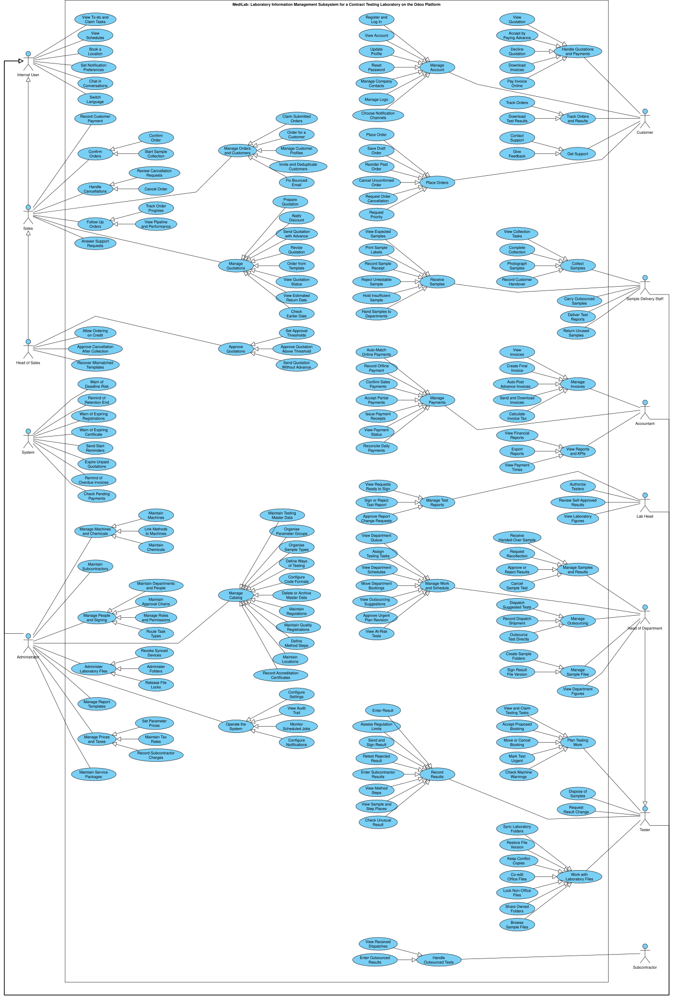

# Use case diagram

The use cases of the Laboratory and E-commerce modules in one diagram, traced to the user stories of the [functional documents](../../functional/index.md). The tables of this document are the model: [use_case_diagram.py](use_case_diagram.py) reads them and draws the diagram. The diagram is drawn with draw.io, not Mermaid, because Mermaid cannot lay out a use case diagram of this size.



## Files

- [medilab-use-case.drawio](medilab-use-case.drawio): the diagram, generated from this document
- [medilab-use-case.svg](medilab-use-case.svg), [medilab-use-case.png](medilab-use-case.png) and
  [medilab-use-case.pdf](medilab-use-case.pdf): its exports
- [use_case_diagram.py](use_case_diagram.py): reads the tables of this document and writes the diagram

After changing a table, regenerate the diagram and export it with draw.io desktop:

```bash
python docs/reports/use-case-diagram/use_case_diagram.py
drawio -x -f svg -o docs/reports/use-case-diagram/medilab-use-case.svg docs/reports/use-case-diagram/medilab-use-case.drawio
drawio -x -f png -o docs/reports/use-case-diagram/medilab-use-case.png docs/reports/use-case-diagram/medilab-use-case.drawio
drawio -x -f pdf --crop -o docs/reports/use-case-diagram/medilab-use-case.pdf docs/reports/use-case-diagram/medilab-use-case.drawio
```

The script stops without writing when the tables are inconsistent. It prints the lines that cut a use case, cut a fan of generalizations or cross another line; a correct diagram has none.

## Reading the diagram

- An actor is joined only to its root use cases. A root use case with children is a feature of the actor's document, and each child is one user story of that feature, with a generalization arrow to it.
- A feature with one story is drawn as that story alone, and a story is drawn once.
- An actor inherits the use cases of the actor its arrow points to. The Administrator holds every permission; that is not drawn.
- Actors on the left edge, top to bottom: Internal User, Sales, Head of Sales, System, Administrator. On the right edge: Customer, Sample Delivery Staff, Accountant, Lab Head, Head of Department, Tester, Subcontractor.

## Scope

- The Laboratory and E-commerce modules, and the shared requirements their actors use.
- The stories of Medilab Mobile (US-T30, US-HD17, US-S23) are left out, as Medilab Mobile is deferred.
- The external systems are not drawn as actors; [External systems](#external-systems) lists the use cases that use them.

## Actors

| Actor | Inherits from | Role | Source |
| --- | --- | --- | --- |
| Internal User |  | Every employee with a login to the back office | [Authorized Internal Users](../proposal/FA26SE294_DESIGN_AND_DEVELOPMENT_OF_A_LABORATORY_I_hoangnt2.docx), SH-08, SH-10 to SH-12 |
| Sales | Internal User | Turns orders into quotations, collects the advance and confirms orders | [Sales](../../functional/ecommerce_module/features/sales.md) |
| Head of Sales | Sales | Approves quotations above the thresholds, allows ordering on credit and approves cancellations after collection | [E-commerce overview](../../functional/ecommerce_module/overview.md) |
| System |  | Runs the scheduled jobs | [SH-09](../../functional/shared.md#sh-09-scheduled-tasks) |
| Administrator | Internal User | Maintains master data, people, roles and settings; holds every permission | [Laboratory](../../functional/laboratory_module/features/admin.md), [E-commerce](../../functional/ecommerce_module/features/admin.md) |
| Customer |  | Orders tests on the portal, pays and downloads results; includes a visitor who has not logged in and the contacts the laboratory notifies | [Customer](../../functional/ecommerce_module/features/customer.md) |
| Sample Delivery Staff | Internal User | Collect, receive, carry and return samples and deliver reports | [Sample Delivery Staff](../../functional/laboratory_module/features/sample-delivery-staff.md) |
| Accountant | Internal User | Manages invoices, payments and financial reports | [Accountant](../../functional/ecommerce_module/features/accountant.md) |
| Lab Head | Internal User | Signs test reports and authorizes testers | [Lab Head](../../functional/laboratory_module/features/lab-head.md) |
| Head of Department | Tester | Assigns a department's testing work and approves its results | [Head of Department](../../functional/laboratory_module/features/head-of-department.md) |
| Tester | Internal User | Plans and performs tests and enters results | [Tester](../../functional/laboratory_module/features/tester.md) |
| Subcontractor |  | Tests outsourced samples and enters their results | [Subcontractor](../../functional/laboratory_module/features/subcontractor.md) |

## Use cases

### Internal User

| Use case | Part of | Stories | Source |
| --- | --- | --- | --- |
| View To-do and Claim Tasks |  |  | [SH-10](../../functional/shared.md#sh-10-tasks-and-to-do-list) |
| View Schedules |  |  | [SH-11](../../functional/shared.md#sh-11-schedules-and-reminders) |
| Book a Location |  |  | [SH-11](../../functional/shared.md#sh-11-schedules-and-reminders) |
| Set Notification Preferences |  |  | [SH-11](../../functional/shared.md#sh-11-schedules-and-reminders) |
| Chat in Conversations |  |  | [SH-12](../../functional/shared.md#sh-12-conversations) |
| Switch Language |  |  | [SH-08](../../functional/shared.md#sh-08-multiple-languages) |

### Sales

| Use case | Part of | Stories | Source |
| --- | --- | --- | --- |
| Manage Orders and Customers |  |  | [Sales §1](../../functional/ecommerce_module/features/sales.md#1-orders-and-customers-us-s01-to-us-s04-us-s24) |
| Claim Submitted Orders | Manage Orders and Customers | US-S01 |  |
| Order for a Customer | Manage Orders and Customers | US-S02 |  |
| Manage Customer Profiles | Manage Orders and Customers | US-S03 |  |
| Invite and Deduplicate Customers | Manage Orders and Customers | US-S04 |  |
| Fix Bounced Email | Manage Orders and Customers | US-S24 |  |
| Manage Quotations |  |  | [Sales §2](../../functional/ecommerce_module/features/sales.md#2-quotation-us-s05-to-us-s10-us-s21-us-s22) |
| Prepare Quotation | Manage Quotations | US-S05 |  |
| Apply Discount | Manage Quotations | US-S06 |  |
| Send Quotation with Advance | Manage Quotations | US-S07 |  |
| Revise Quotation | Manage Quotations | US-S08 |  |
| Order from Template | Manage Quotations | US-S09 |  |
| View Quotation Status | Manage Quotations | US-S10 |  |
| View Estimated Return Date | Manage Quotations | US-S21 |  |
| Check Earlier Date | Manage Quotations | US-S22 |  |
| Collect Payments |  |  | [Sales §3](../../functional/ecommerce_module/features/sales.md#3-payment-collection-us-s11-us-s25) |
| Record Customer Payment | Collect Payments | US-S11 |  |
| Create Invoice from Order | Collect Payments | US-S25 |  |
| Confirm Orders |  |  | [Sales §4](../../functional/ecommerce_module/features/sales.md#4-confirmation-us-s12-us-s15) |
| Confirm Order | Confirm Orders | US-S12 |  |
| Start Sample Collection | Confirm Orders | US-S15 |  |
| Handle Cancellations |  |  | [Sales §5](../../functional/ecommerce_module/features/sales.md#5-cancellation-us-s16-us-s17) |
| Review Cancellation Requests | Handle Cancellations | US-S16 |  |
| Cancel Order | Handle Cancellations | US-S17 |  |
| Follow Up Orders |  |  | [Sales §6](../../functional/ecommerce_module/features/sales.md#6-follow-up-and-analytics-us-s18-us-s19) |
| Track Order Progress | Follow Up Orders | US-S18 |  |
| View Pipeline and Performance | Follow Up Orders | US-S19 |  |
| Answer Support Requests |  | US-S20 | [Sales §7](../../functional/ecommerce_module/features/sales.md#7-support-us-s20-us-s23) |

### Head of Sales

The Head of Sales has no user stories yet; each use case names the rule it comes from. Administrators can also recover mismatched templates.

| Use case | Part of | Stories | Source |
| --- | --- | --- | --- |
| Approve Quotations |  |  | [Sales §2](../../functional/ecommerce_module/features/sales.md#2-quotation-us-s05-to-us-s10-us-s21-us-s22) |
| Set Approval Thresholds | Approve Quotations |  | [Sales §2](../../functional/ecommerce_module/features/sales.md#2-quotation-us-s05-to-us-s10-us-s21-us-s22) |
| Approve Quotation Above Threshold | Approve Quotations |  | [Sales §2](../../functional/ecommerce_module/features/sales.md#2-quotation-us-s05-to-us-s10-us-s21-us-s22) |
| Send Quotation Without Advance | Approve Quotations |  | [Sales §2](../../functional/ecommerce_module/features/sales.md#2-quotation-us-s05-to-us-s10-us-s21-us-s22) |
| Allow Ordering on Credit |  |  | [Sales §4](../../functional/ecommerce_module/features/sales.md#4-confirmation-us-s12-us-s15) |
| Approve Cancellation After Collection |  |  | [Sales §5](../../functional/ecommerce_module/features/sales.md#5-cancellation-us-s16-us-s17) |
| Recover Mismatched Templates |  |  | [Sales §2](../../functional/ecommerce_module/features/sales.md#2-quotation-us-s05-to-us-s10-us-s21-us-s22), [E-commerce Administrator §3](../../functional/ecommerce_module/features/admin.md#3-order-templates) |

### System

Each use case is a scheduled job (SH-09). A story that describes a job is drawn here instead of under its actor.

| Use case | Part of | Stories | Source |
| --- | --- | --- | --- |
| Warn of Deadline Risk |  | US-T20 | [Tester §1](../../functional/laboratory_module/features/tester.md#1-planning-us-t01-to-us-t04-us-t19-to-us-t21) |
| Remind of Retention End |  |  | [Tester §3](../../functional/laboratory_module/features/tester.md#3-samples-us-t10) |
| Warn of Expiring Registrations |  |  | [Laboratory Administrator §1](../../functional/laboratory_module/features/admin.md#1-catalog-us-ad01-to-us-ad08-us-ad26-to-us-ad28) |
| Warn of Expiring Certificate |  |  | [3. Viettel Sign (digital signature)](../../functional/shared.md#3-viettel-sign-digital-signature) |
| Send Start Reminders |  | US-T04, US-SD02 | [SH-11](../../functional/shared.md#sh-11-schedules-and-reminders) |
| Expire Unpaid Quotations |  |  | [Sales §2](../../functional/ecommerce_module/features/sales.md#2-quotation-us-s05-to-us-s10-us-s21-us-s22) |
| Remind of Overdue Invoices |  | US-A12 | [Accountant §2](../../functional/ecommerce_module/features/accountant.md#2-payments-us-a06-to-us-a13) |
| Check Pending Payments |  |  | [2. PayOS (payments)](../../functional/shared.md#2-payos-payments) |

### Administrator

The Laboratory and E-commerce features of the administrator share one actor. Operate the System comes from the shared requirements.

| Use case | Part of | Stories | Source |
| --- | --- | --- | --- |
| Manage Catalog |  |  | [Laboratory Administrator §1](../../functional/laboratory_module/features/admin.md#1-catalog-us-ad01-to-us-ad08-us-ad26-to-us-ad28) |
| Maintain Testing Master Data | Manage Catalog | US-AD01 |  |
| Organise Parameter Groups | Manage Catalog | US-AD02 |  |
| Organise Sample Types | Manage Catalog | US-AD03 |  |
| Define Ways of Testing | Manage Catalog | US-AD04 |  |
| Configure Code Formats | Manage Catalog | US-AD05 |  |
| Delete or Archive Master Data | Manage Catalog | US-AD06 |  |
| Maintain Regulations | Manage Catalog | US-AD07 |  |
| Maintain Quality Registrations | Manage Catalog | US-AD08 |  |
| Define Method Steps | Manage Catalog | US-AD26 |  |
| Maintain Locations | Manage Catalog | US-AD27 |  |
| Record Accreditation Certificates | Manage Catalog | US-AD28 |  |
| Manage Machines and Chemicals |  |  | [Laboratory Administrator §2](../../functional/laboratory_module/features/admin.md#2-machines-and-chemicals-us-ad09-to-us-ad11) |
| Maintain Machines | Manage Machines and Chemicals | US-AD09 |  |
| Link Methods to Machines | Manage Machines and Chemicals | US-AD10 |  |
| Maintain Chemicals | Manage Machines and Chemicals | US-AD11 |  |
| Maintain Subcontractors |  | US-AD12 | [Laboratory Administrator §3](../../functional/laboratory_module/features/admin.md#3-subcontractors-us-ad12) |
| Manage People and Signing |  |  | [Laboratory Administrator §4](../../functional/laboratory_module/features/admin.md#4-people-and-signing-us-ad13-to-us-ad16) |
| Maintain Departments and People | Manage People and Signing | US-AD13 |  |
| Maintain Approval Chains | Manage People and Signing | US-AD14 |  |
| Manage Roles and Permissions | Manage People and Signing | US-AD15 |  |
| Route Task Types | Manage People and Signing | US-AD16 |  |
| Administer Laboratory Files |  |  | [Laboratory Administrator §5](../../functional/laboratory_module/features/admin.md#5-laboratory-files-us-ad29-to-us-ad31) |
| Revoke Synced Devices | Administer Laboratory Files | US-AD29 |  |
| Administer Folders | Administer Laboratory Files | US-AD30 |  |
| Release File Locks | Administer Laboratory Files | US-AD31 |  |
| Manage Report Templates |  | US-AD36 | [Laboratory Administrator §6](../../functional/laboratory_module/features/admin.md#6-report-templates-us-ad36) |
| Manage Prices and Taxes |  |  | [E-commerce Administrator §1](../../functional/ecommerce_module/features/admin.md#1-prices-and-taxes-us-ad17-to-us-ad19) |
| Set Parameter Prices | Manage Prices and Taxes | US-AD17 |  |
| Maintain Tax Rates | Manage Prices and Taxes | US-AD18 |  |
| Record Subcontractor Charges | Manage Prices and Taxes | US-AD19 |  |
| Maintain Service Packages |  | US-AD20 | [E-commerce Administrator §2](../../functional/ecommerce_module/features/admin.md#2-service-packages-us-ad20) |
| Operate the System |  |  |  |
| Configure Settings | Operate the System |  | [SH-03](../../functional/shared.md#sh-03-configuration-through-settings-and-system-parameters) |
| View Audit Trail | Operate the System |  | [SH-05](../../functional/shared.md#sh-05-audit-trail) |
| Monitor Scheduled Jobs | Operate the System |  | [SH-09](../../functional/shared.md#sh-09-scheduled-tasks) |
| Configure Notifications | Operate the System |  | [SH-11](../../functional/shared.md#sh-11-schedules-and-reminders) |

### Customer

Notifications (US-C07, US-C18) repeats stories of Account and profile and of Tracking and results, so it is not drawn.

| Use case | Part of | Stories | Source |
| --- | --- | --- | --- |
| Manage Account |  |  | [Customer §1](../../functional/ecommerce_module/features/customer.md#1-account-and-profile-us-c01-to-us-c07) |
| Register and Log In | Manage Account | US-C01 |  |
| View Account | Manage Account | US-C02 |  |
| Update Profile | Manage Account | US-C03 |  |
| Reset Password | Manage Account | US-C04 |  |
| Manage Company Contacts | Manage Account | US-C05 |  |
| Manage Logo | Manage Account | US-C06 |  |
| Choose Notification Channels | Manage Account | US-C07 |  |
| Place Orders |  |  | [Customer §2](../../functional/ecommerce_module/features/customer.md#2-placing-an-order-us-c08-to-us-c12-us-c22) |
| Place Order | Place Orders | US-C08 |  |
| Save Draft Order | Place Orders | US-C09 |  |
| Reorder Past Order | Place Orders | US-C10 |  |
| Cancel Unconfirmed Order | Place Orders | US-C11 |  |
| Request Order Cancellation | Place Orders | US-C12 |  |
| Request Priority | Place Orders | US-C22 |  |
| Handle Quotations and Payments |  |  | [Customer §3](../../functional/ecommerce_module/features/customer.md#3-quotation-acceptance-and-payment-us-c13-to-us-c17) |
| View Quotation | Handle Quotations and Payments | US-C13 |  |
| Accept by Paying Advance | Handle Quotations and Payments | US-C14 |  |
| Decline Quotation | Handle Quotations and Payments | US-C15 |  |
| Download Invoices | Handle Quotations and Payments | US-C16 |  |
| Pay Invoice Online | Handle Quotations and Payments | US-C17 |  |
| Track Orders and Results |  |  | [Customer §4](../../functional/ecommerce_module/features/customer.md#4-tracking-and-results-us-c18-us-c19) |
| Track Orders | Track Orders and Results | US-C18 |  |
| Download Test Results | Track Orders and Results | US-C19 |  |
| Get Support |  |  | [Customer §6](../../functional/ecommerce_module/features/customer.md#6-support-and-feedback-us-c20-us-c21) |
| Contact Support | Get Support | US-C20 |  |
| Give Feedback | Get Support | US-C21 |  |

### Sample Delivery Staff

| Use case | Part of | Stories | Source |
| --- | --- | --- | --- |
| Collect Samples |  |  | [Sample Delivery Staff §1](../../functional/laboratory_module/features/sample-delivery-staff.md#1-collecting-samples-us-sd01-to-us-sd05) |
| View Collection Tasks | Collect Samples | US-SD01 |  |
| Complete Collection | Collect Samples | US-SD03 |  |
| Photograph Samples | Collect Samples | US-SD04 |  |
| Record Customer Handover | Collect Samples | US-SD05 |  |
| Receive Samples |  |  | [Sample Delivery Staff §2](../../functional/laboratory_module/features/sample-delivery-staff.md#2-receiving-samples-us-sd07-to-us-sd12) |
| View Expected Samples | Receive Samples | US-SD07 |  |
| Print Sample Labels | Receive Samples | US-SD08 |  |
| Record Sample Receipt | Receive Samples | US-SD09 |  |
| Reject Untestable Sample | Receive Samples | US-SD10 |  |
| Hold Insufficient Sample | Receive Samples | US-SD11 |  |
| Hand Samples to Departments | Receive Samples | US-SD12 |  |
| Carry Outsourced Samples |  | US-SD13 | [Sample Delivery Staff §3](../../functional/laboratory_module/features/sample-delivery-staff.md#3-carrying-outsourced-samples-us-sd13) |
| Deliver Test Reports |  | US-SD14 | [Sample Delivery Staff §4](../../functional/laboratory_module/features/sample-delivery-staff.md#4-delivering-reports-us-sd14) |
| Return Unused Samples |  | US-SD15 | [Sample Delivery Staff §5](../../functional/laboratory_module/features/sample-delivery-staff.md#5-returning-samples-us-sd15) |

### Accountant

| Use case | Part of | Stories | Source |
| --- | --- | --- | --- |
| Manage Invoices |  |  | [Accountant §1](../../functional/ecommerce_module/features/accountant.md#1-invoices-us-a01-to-us-a05) |
| View Invoices | Manage Invoices | US-A01 |  |
| Create Final Invoice | Manage Invoices | US-A02 |  |
| Auto-Post Advance Invoices | Manage Invoices | US-A03 |  |
| Send and Download Invoices | Manage Invoices | US-A04 |  |
| Calculate Invoice Tax | Manage Invoices | US-A05 |  |
| Manage Payments |  |  | [Accountant §2](../../functional/ecommerce_module/features/accountant.md#2-payments-us-a06-to-us-a13) |
| Auto-Match Online Payments | Manage Payments | US-A06 |  |
| Record Offline Payment | Manage Payments | US-A07 |  |
| Confirm Sales Payments | Manage Payments | US-A08 |  |
| Accept Partial Payments | Manage Payments | US-A09 |  |
| Issue Payment Receipts | Manage Payments | US-A10 |  |
| View Payment Status | Manage Payments | US-A11 |  |
| Reconcile Daily Payments | Manage Payments | US-A13 |  |
| View Reports and KPIs |  |  | [Accountant §3](../../functional/ecommerce_module/features/accountant.md#3-reports-and-kpis-us-a14-to-us-a16) |
| View Financial Reports | View Reports and KPIs | US-A14 |  |
| Export Reports | View Reports and KPIs | US-A15 |  |
| View Payment Times | View Reports and KPIs | US-A16 |  |

### Lab Head

| Use case | Part of | Stories | Source |
| --- | --- | --- | --- |
| Manage Test Reports |  |  | [Lab Head §1](../../functional/laboratory_module/features/lab-head.md#1-test-reports-us-lh01-to-us-lh03) |
| View Requests Ready to Sign | Manage Test Reports | US-LH01 |  |
| Sign or Reject Test Report | Manage Test Reports | US-LH02 |  |
| Approve Report Change Requests | Manage Test Reports | US-LH03 |  |
| Authorize Testers |  | US-LH04 | [Lab Head §2](../../functional/laboratory_module/features/lab-head.md#2-parameter-authorization-us-lh04) |
| Review Self-Approved Results |  | US-LH05 | [Lab Head §3](../../functional/laboratory_module/features/lab-head.md#3-final-review-of-self-approved-results-us-lh05) |
| View Laboratory Statistics |  | US-LH06 | [Lab Head §4](../../functional/laboratory_module/features/lab-head.md#4-testing-statistics-us-lh06) |

### Head of Department

| Use case | Part of | Stories | Source |
| --- | --- | --- | --- |
| Manage Work and Schedule |  |  | [Head of Department §1](../../functional/laboratory_module/features/head-of-department.md#1-work-and-schedule-us-hd01-to-us-hd05-us-hd12-us-hd14) |
| View Department Queue | Manage Work and Schedule | US-HD01 |  |
| Assign Testing Tasks | Manage Work and Schedule | US-HD02 |  |
| View Department Schedules | Manage Work and Schedule | US-HD03 |  |
| Move Department Bookings | Manage Work and Schedule | US-HD04 |  |
| View Outsourcing Suggestions | Manage Work and Schedule | US-HD05 |  |
| Approve Urgent Plan Revision | Manage Work and Schedule | US-HD12 |  |
| View At-Risk Tests | Manage Work and Schedule | US-HD14 |  |
| Manage Samples and Results |  |  | [Head of Department §2](../../functional/laboratory_module/features/head-of-department.md#2-samples-and-results-us-hd06-to-us-hd09) |
| Receive Handed-Over Sample | Manage Samples and Results | US-HD06 |  |
| Request Recollection | Manage Samples and Results | US-HD07 |  |
| Approve or Reject Results | Manage Samples and Results | US-HD08 |  |
| Cancel Sample Test | Manage Samples and Results | US-HD09 |  |
| Manage Outsourcing |  |  | [Head of Department §3](../../functional/laboratory_module/features/head-of-department.md#3-outsourcing-us-hd10-us-hd11-us-hd13) |
| Dispatch Suggested Tests | Manage Outsourcing | US-HD10 |  |
| Record Dispatch Shipment | Manage Outsourcing | US-HD11 |  |
| Outsource Test Directly | Manage Outsourcing | US-HD13 |  |
| Manage Sample Files |  |  | [Head of Department §4](../../functional/laboratory_module/features/head-of-department.md#4-laboratory-files-us-hd15-us-hd16) |
| Create Sample Folders | Manage Sample Files | US-HD15 |  |
| Sign Result File Version | Manage Sample Files | US-HD16 |  |
| View Department Statistics |  | US-HD18 | [Head of Department §6](../../functional/laboratory_module/features/head-of-department.md#6-testing-statistics-us-hd18) |

### Tester

| Use case | Part of | Stories | Source |
| --- | --- | --- | --- |
| Plan Testing Work |  |  | [Tester §1](../../functional/laboratory_module/features/tester.md#1-planning-us-t01-to-us-t04-us-t19-to-us-t21) |
| View and Claim Testing Tasks | Plan Testing Work | US-T01 |  |
| Accept Proposed Booking | Plan Testing Work | US-T02 |  |
| Move or Cancel Booking | Plan Testing Work | US-T03 |  |
| Mark Test Urgent | Plan Testing Work | US-T19 |  |
| Check Machine Warnings | Plan Testing Work | US-T21 |  |
| Record Results |  |  | [Tester §2](../../functional/laboratory_module/features/tester.md#2-results-us-t05-to-us-t09-us-t17-us-t18-us-t22) |
| Enter Result | Record Results | US-T05 |  |
| Assess Regulation Limits | Record Results | US-T06 |  |
| Send and Sign Result | Record Results | US-T07 |  |
| Retest Rejected Result | Record Results | US-T08 |  |
| Enter Subcontractor Results | Record Results | US-T09 |  |
| View Method Steps | Record Results | US-T17 |  |
| View Sample and Step Places | Record Results | US-T18 |  |
| Check Unusual Result | Record Results | US-T22 |  |
| Dispose of Samples |  | US-T10 | [Tester §3](../../functional/laboratory_module/features/tester.md#3-samples-us-t10) |
| Request Result Change |  | US-T11 | [Tester §4](../../functional/laboratory_module/features/tester.md#4-corrections-us-t11) |
| Work with Laboratory Files |  |  | [Tester §5](../../functional/laboratory_module/features/tester.md#5-laboratory-files-us-t23-to-us-t29) |
| Sync Laboratory Folders | Work with Laboratory Files | US-T23 |  |
| Restore File Version | Work with Laboratory Files | US-T24 |  |
| Keep Conflict Copies | Work with Laboratory Files | US-T25 |  |
| Co-edit Office Files | Work with Laboratory Files | US-T26 |  |
| Lock Non-Office Files | Work with Laboratory Files | US-T27 |  |
| Share Owned Folders | Work with Laboratory Files | US-T28 |  |
| Browse Sample Files | Work with Laboratory Files | US-T29 |  |

### Subcontractor

| Use case | Part of | Stories | Source |
| --- | --- | --- | --- |
| Handle Outsourced Tests |  |  | [Subcontractor §1](../../functional/laboratory_module/features/subcontractor.md#1-outsourced-tests-us-sub01-us-sub02) |
| View Received Dispatches | Handle Outsourced Tests | US-SUB01 |  |
| Enter Outsourced Results | Handle Outsourced Tests | US-SUB02 |  |

## External systems

| System | Used by | Source |
| --- | --- | --- |
| Payment Gateway | Accept by Paying Advance, Pay Invoice Online, Auto-Match Online Payments, Reconcile Daily Payments, Check Pending Payments | [2. PayOS (payments)](../../functional/shared.md#2-payos-payments): PayOS |
| Email Service | Every email the system sends, such as Send Quotation with Advance, Send and Download Invoices, Send Start Reminders and Remind of Overdue Invoices; Fix Bounced Email reacts to its delivery status | [1. Brevo (email)](../../functional/shared.md#1-brevo-email): Brevo |
| Digital Signature Provider | Sign or Reject Test Report and every other fully signed document printed or exported; Warn of Expiring Certificate | [3. Viettel Sign (digital signature)](../../functional/shared.md#3-viettel-sign-digital-signature): Viettel Sign |

## Deviations from the proposal

The [capstone proposal](../proposal/FA26SE294_DESIGN_AND_DEVELOPMENT_OF_A_LABORATORY_I_hoangnt2.docx) binds the scope; the functional documents are the requirements. Where they differ, the diagram follows the documents:

- **Actor names.** The actors follow the [glossary](../../glossaries.md): the proposal's Finance is the Accountant, Sampling and Reception is Sample Delivery Staff, Tester (Lab QA) is the Tester, Department Head is the Head of Department and Authorized Internal Users is the Internal User.
- **Head of Sales.** The proposal does not list this actor. The E-commerce documents give it quotation approval above the thresholds, sending without an advance, ordering on credit and cancellation after collection, but no user stories yet.
- **System.** The proposal does not list an actor for scheduled jobs. The diagram adds one so that reminders and expiries have an actor.
- **Mobile access.** The proposal gives internal users QR scanning and field signing on a phone. The documents defer Medilab Mobile, so these use cases and US-T30, US-HD17 and US-S23 are not drawn.
- **Test requests at reception.** The proposal lets Sampling and Reception create test requests. In the documents a test request comes only from a confirmed order, so Sample Delivery Staff have no such use case.
- **Sample retention.** The proposal gives retention and disposal to Sampling and Reception. In the documents the Tester records the disposal (US-T10) and the System sends the retention reminder.
- **Tasks created by hand.** The proposal lets every internal user create scheduled activities and reminders. In the documents only people with the task permission create tasks by hand ([SH-10](../../functional/shared.md#sh-10-tasks-and-to-do-list)), so the Internal User has no such use case.

## Related documents

- [Functional documents](../../functional/index.md)
- [Shared requirements](../../functional/shared.md)
- [Business flows](../../functional/business-flows.md)
- [Glossary](../../glossaries.md)
- [Reports](../readme.md)
