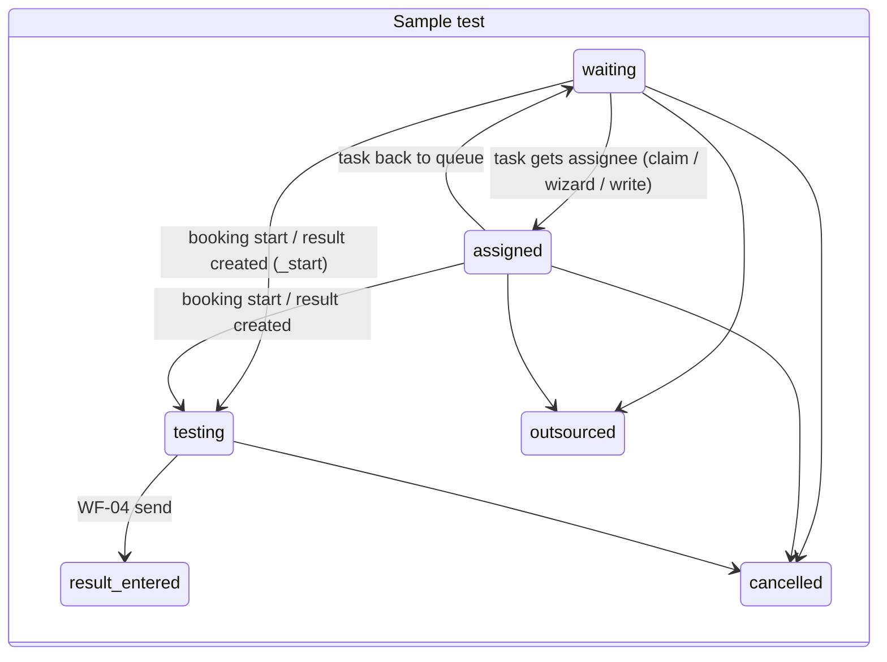
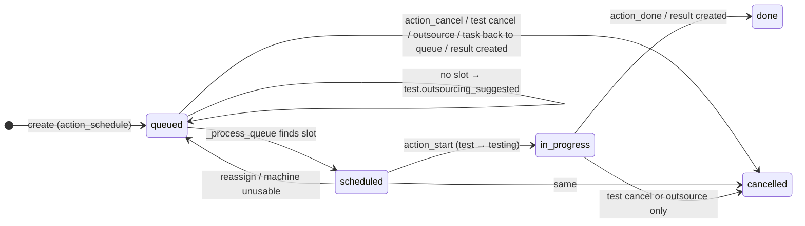
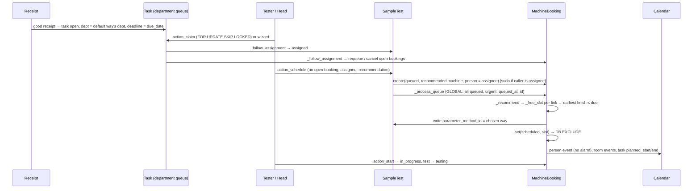

# WF-03 Testing Assignment and Scheduling: Test Plan and Coverage Analysis

## 0. Context

This is the test plan for WF-03, built from the repository's evidence: code, documents, git history and GitHub issues. Sections 10 to 12 trace every scenario to its tests.

- **Evidence base:** Odoo 20.0, `main` at 5649d9b8. Line references were checked against it.
- **Overlapping open work:** pull request #373 (`fix/315-move-own-booking`) lets a tester move their own booking and keeps a moved task open for its head. It changes `machine_booking.py`, `task.py` and the booking access rules, so line references there shift when it merges. Rows that depend on it are in group D.
- **Paths:** relative to `src/core/modules/sol_laboratory/` unless they start with `docs/`, `src/` or `tools/`.

**Planning decisions confirmed by the owner:**
- Open questions stay in this plan, not in `questions/`.
- Property tests use a seeded generator with no new dependency.
- Performance and load tests are opt-in and outside default CI.
- No invented SLOs.
- No TARGET feature from epic #405 is implemented by these tests.
- A confirmed defect's reproduction stays out of the passing suite until its fix is approved.

**Two schedulers.**
- **AS-IS (code):** a machine queue. A booking goes `queued → scheduled → in_progress → done`, or to `cancelled`. One booking per machine interval. There is no capacity sharing, parameter authorization, pinning, OverTime or at-risk flag.
- **TARGET (spec):** `docs/specs/scheduling.md` and `docs/business/testing-schedule.md`. A booking goes `proposed → scheduled → in progress → done`, with a department plan, capacity sharing, authorization, OverTime, pinning and revisions. These are planned in epic #405 (#419 to #427, #179, #433). All of those issues are open and none has a pull request.

### 0.1 How each scenario is classified

Every scenario carries one **group** and one or more **kinds**.

| Group | Meaning | May be implemented now? |
|---|---|---|
| **A** Immediately testable | Verified rule (code, plus spec where they agree); stable expected result; no business decision needed | Yes, after approval |
| **B** Defect confirmation | Suspected security, data-integrity or concurrency defect against a documented or code-level contract | Reproduce locally and collect evidence only. If confirmed, report it as a bug. The test lands with the fix as a failing-first test |
| **C** Business decision required | The expected result depends on Q2–Q17 or another open question | Only the decision-neutral part (no partial state, no traceback). The disputed outcome is asserted after the decision |
| **D** TARGET blocked | Needs an unimplemented #405 feature or a pending PR (#373) | No. These become the acceptance tests of their issue |

| Kind | Meaning | Rule |
|---|---|---|
| **CT** contract | Expected behaviour supported by code **and** requirements, or by code where requirements are silent and no conflict exists | Becomes a regression test |
| **CH** characterization | What the code does today where it is undecided or conflicts with the spec | **Never committed as a regression expectation.** Run as a probe outside the suite, as evidence for the decision |
| **DF** defect reproduction | Shows a suspected violation of a CT or spec rule | Evidence for a bug report. Never committed asserting the defect, and never as `expectedFailure` |
| **TG** target acceptance | Expected behaviour of #405 | Written with its issue |

An existing test that asserts a CH outcome is listed under "Impact on existing tests" in Section 4. One example is `tests/test_sample_test_due_date.py:24`, which asserts that an override is overwritten.

---

## 1. Risk assessment

**Overall risk is high.** It comes from what nobody has asserted, not from weak existing tests.
- The existing suite has a real-thread race harness, an HTTP rollback test in a separate process, refusal tests that check the message and an unchanged state, and DB exclusion constraints.
- The new risks are:
  - double-booking of testers;
  - direct writes that bypass the state machine;
  - write-skew races, where a machine change and scheduling share no row;
  - time-zone boundaries;
  - claims refused while nobody has claimed (SKIP LOCKED);
  - a spec that has moved ahead of the code.

**Verified facts behind the fixtures and expected results:**

| Item | Fact |
|---|---|
| F0 company calendar | Odoo 20's "40 hours/week" is duration-based: 8 hours a day centred on noon, 08:00–16:00 in the person's time zone (`resource/models/resource_calendar.py:318-330`). F0 days end at 16:00 |
| Midnight | Odoo ends a 24:00 attendance at 23:59:59.999999 and never joins it to the next day's 00:00, so a +7 calendar cannot reach local midnight. F3-UTC-evening (Section 10.1) reaches it instead |
| Office hours in +7 | 08:00–17:00 local ends at 10:00 UTC, before a local end-of-day due date binds (TIM-007a) |
| Calibration cutoff | A machine is usable until `D+1 00:00` company-local of its calibration date D (`models/sample_collection/sample.py:427-429`, `models/master_data/machine.py:95`). The slot end is inclusive (`start + length <= limit`, `models/testing/machine_booking.py:415,432`); a requeue uses `ends_at > limit` (`:340`) |
| Urgency | With urgency 0, only tests already due are urgent (`<=`, `models/testing/sample_test.py:159`) |
| After a result | The test stays `testing`. `result_entered` comes from WF-04 sending (`tests/test_test_result_entry.py:81`) |
| Archiving a machine | Refused while any booking (any status) or active way link refers to the machine (`models/mixins/archive_mixin.py:72-79`), so the requeue-on-archive branch is unreachable for linked machines (SCH-034) |
| Moving one's own booking | A tester cannot today (#315, PR #373), so SCH-026's runner cell is group D |
| Foreign queued bookings | Every replan rewrites the test of a queued booking no machine can place, so two schedules conflict on it (Section 8.1, rule 2) |
| Mixed-method lock races | The claim-against-claim handshake does not fit a claim against a wizard (Section 8.1, rule 3) |
| AS-IS defect outcomes | Outcomes that contradict the spec are CH or DF (SCH-006/012, STA-006, ASG-012/013, SCH-017/024, DAT-005, TXN-004), never committed as regressions |

**Inventory:** 135 scenarios. Section 11 counts them by coverage, group and priority. These are counts of scenarios, not code coverage.

---

## 2. AS-IS WF-03 workflow

### 2.1 Entities

| Entity (model) | Role | Key fields and constraints |
|---|---|---|
| Sample test `medilab.sample.test` (`models/testing/sample_test.py:39`) | The work | `status`: waiting / assigned / testing / outsourced / result_entered / approved / cancelled. `due_date` (stored compute, editable). `parameter_method_id` (way, empty until chosen). `outsourcing_suggested`. Non-stored `recommended_*` |
| Task `medilab.task` (`models/tasks/task.py:36`) | Queue item | `status`: open / assigned / in_progress / done / cancelled. `department_id`, `assignee_id`, `assigned_by_id`, `reassign_reason`, `planned_start/end`, `linked_by_system` |
| Reassign wizard `medilab.task.reassign` (`models/tasks/task_reassign.py`) | Head assigns or moves | Reason when the person or department changes. Assignee must be in the department (`:49`) |
| Machine booking `medilab.machine.booking` (`models/testing/machine_booking.py:68`) | Reservation | `status`: queued / scheduled / in_progress / done / cancelled. `EXCLUDE gist(machine_id =, tsrange &&) WHERE status IN (scheduled, in_progress)` (`:124-128`). `CHECK(ends_at > starts_at)`, which passes on NULL. `UNIQUE(calendar_event_id)` |
| Way-machine link (`models/master_data/parameter_method_machine.py`) | Eligibility, duration | `run_minutes > 0`, `UNIQUE(way, machine)`. No capacity field. `_in_use_domain` = way active |
| Machine (`models/master_data/machine.py`) | Resource | `status`: in_use / under_repair / retired. `active`, `next_calibration_date`, `_usable_until()` (`:85-95`). Archive mixin |
| Calendar event (`models/tasks/calendar_event.py`) | Person and room reservations | `machine_booking_id`, `step_id`, `location_id`. `EXCLUDE (location_id, tsrange, id <>) WHERE location_id NOT NULL AND active` (`:47-51`). Token-guarded links |

### 2.2 State transitions (code)





### 2.3 Main path



### 2.4 Dependencies

- **Task creation:** the testing task is created only on `good` receipt (`models/sample_collection/sample.py:228-229`), or on `action_receive_more` for a sample on hold (`:250`).
- **Department and way:** the department comes from the parameter's default way (`sample.py:386-397`). The scheduler may then choose any way of that department (`machine_booking.py:383-392`). No way is copied from the order.
- **Calendar sync:** needs `person.user_id` (`machine_booking.py:229-236`).
- **Working time:** comes from the employee's resource calendar, or else the company calendar, using `_work_intervals_batch` (`machine_booking.py:459-474`).
  - The attendances are placed in the **resource's** time zone. The laboratory's time zone only converts the requested window, and places the hours when there is no resource (Q25).
  - An employee always has a calendar: `hr_version.resource_calendar_id` is NOT NULL, so the company-calendar fallback is unreachable through an employee.
  - The demo company calendar gives 08:00–16:00 (F0). An attendance ending at 24:00 ends at 23:59:59.999999 (DC-12).
  - Leaves come only from `resource.calendar.leaves`; `hr_holidays` is not a dependency (`__manifest__.py:9`).
- **Global replan:** the queue is replanned globally by every create, cancel, move, requeue, reassignment, test cancel, outsourcing, result entry (`models/testing/test_result.py:237-246`) and machine status, active or calibration change (`models/master_data/machine_service.py:54-77`).
- **No scheduling HTTP controller, and no scheduling cron.**

---

## 3. Business rule inventory

### 3.1 Verified (code)

| ID | Rule | Evidence |
|---|---|---|
| R01 | A good receipt opens one testing task in the default way's department, with deadline = due date | `sample.py:350-367`, `sample_test.py:226-236` |
| R02 | Due date = 23:59:59 company-local on (expected date − margin, default 2), stored as naive UTC. A margin change keeps stored dates. An expected-date change recomputes them, including manual values | `sample_test.py:142-154` |
| R03 | Claim: open, unassigned, own department or role. The row is locked with SKIP LOCKED; a skipped row gives "already claimed" | `task.py:258-275`; Odoo `orm/models.py:5084` |
| R04 | A move of person or department needs a non-blank reason. Done or cancelled tasks cannot be moved. The wizard refuses an assignee outside the department and writes `status` assigned or open | `task.py:248-256`, `task_reassign.py:49-69` |
| R05 | The test follows its task (waiting ↔ assigned) only from waiting or assigned. The first booking start or result moves it to testing | `sample_test.py:239-244, 387-389` |
| R06 | Schedule refuses an open booking, no assignee, or no recommendation. The assignee schedules with sudo; others need booking create permission | `sample_test.py:252-276` |
| R07 | Earliest **finish** ≤ due (or now + 30 days) among the department's ways and links. Strict `<`, so ties keep the first link (machine code order). A due date ≤ now gives none | `machine_booking.py:374-401`, `parameter_method_machine.py:20` |
| R08 | 15-minute boundaries. Length `ceil(run/15)*15`. Start ≥ now, rounded up. Inside **one** working interval. End ≤ min(due, usable_until), **inclusive**. No machine overlap. Each bookable and active step room free for its offset. The last room step ends ≤ due | `machine_booking.py:37-50, 297-307, 403-441` |
| R09 | Usable while `in_use` and active, until `D+1 00:00` company-local of the calibration due date D. No calibration record means no limit | `machine.py:85-95`, `sample.py:427-429` |
| R10 | DB refuses overlapping active machine bookings and active room events, using half-open ranges | `machine_booking.py:124-128`, `calendar_event.py:47-51` |
| R11 | Global queue: urgent (due ≤ now + `urgency_hours`, default 24), then `queued_at`, then id. A booking with no slot stays queued and sets `outsourcing_suggested` | `machine_booking.py:309-328`, `sample_test.py:156-159` |
| R12 | Start only from scheduled. Done only from in_progress. Cancel action only from queued or scheduled. Move only scheduled, to an exact free slot, keeping the length. Clearing the start is refused | `machine_booking.py:152-219` |
| R13 | The booking's person, or a holder of booking edit permission, adjusts it | `machine_booking.py:176-179` |
| R14 | On reassignment, a not-running booking is requeued for the new assignee. Back to the queue, it is cancelled. A running booking takes the new person (or none) | `machine_booking.py:346-372` |
| R15 | A machine that becomes unusable (status or calibration) requeues its **scheduled** bookings that end after `usable_until`. Running ones are untouched | `machine_booking.py:330-344`, `machine_service.py:51-77` |
| R16 | Cancelling or outsourcing a test cancels all its open bookings, including in_progress, and replans | `sample_test.py:368-380, 332-341` |
| R17 | Creating a result cancels queued bookings, marks active ones done and replans | `test_result.py:237-246` |
| R18 | An active booking has one person event with no alarm (when the person has a user), room events per bookable active step, and task planned = min/max. Links are token-guarded | `machine_booking.py:221-295`, `calendar_event.py:140-150` |
| R19 | A tester reads their own bookings, and their own or claimable tasks. A head reads and edits bookings and tasks of their department, and edits sample tests of **all** departments | `security/ir.access.csv:24-25,41`, `sol_demo/.../role.xml:121-171` |
| R20 | A machine cannot be archived while any booking (any status) or any active way link refers to it | `archive_mixin.py:10-13,72-79`, `parameter_method_machine.py:41` |

### 3.2 Inferred

| ID | Inference | Evidence |
|---|---|---|
| I-a | A tester can hold overlapping bookings on different machines | `_free_slot` ignores the person's bookings (`machine_booking.py:417-425`) |
| I-b | A run cannot span a working-time break | `machine_booking.py:430-440` |
| I-c | Ties go by machine code order | R07 |
| I-d | An assignment can exist without a booking; a booking may stay queued indefinitely | `sample_test.py:252`, `machine_booking.py:320` |
| I-e | Archived or unbookable step rooms are skipped | `machine_booking.py:304` |
| I-f | `action_done` frees the machine without replanning | `machine_booking.py:215` vs `test_result.py:244` |
| I-g | No start-time window | `machine_booking.py:208` |
| I-h | Readonly fields are writable over RPC by holders of edit permission | Odoo applies readonly only in field descriptions (`orm/models.py:2697`); no `write` guard |
| I-i | A slot-race loser gets an exclusion error, not a retry | `odoo/sql_db.py:87-91` retries only lock, serialization and deadlock errors |
| I-j | A booking and its sync are one ORM transaction | `_sync_schedule` runs inside create and write |
| I-k | A claim during any uncommitted write on the task row (planned times, a note, a booking insert holding a key-share lock) says "already claimed" | SKIP LOCKED with FOR UPDATE (`allow_referencing=False`) |
| I-l | Scheduling and a machine status or calibration change write no common row, so both can commit (write skew) | Writes in `machine.write` vs `action_schedule` |

### 3.3 TARGET rules (blocked)

| ID | Rule | Spec | Issue |
|---|---|---|---|
| T01 | Proposed plan; accepting is all-or-nothing | `scheduling.md:19-20,36-38` | #419, #422 |
| T02 | Capacity sharing | `scheduling.md:26-28` | #420 |
| T03 | Person-to-parameter authorization | `scheduling.md:21` | #421 |
| T04 | Priority classes, then committed date, then arrival | `scheduling.md:42-48` | #422 |
| T05 | Pinning, revisions, held-back moves | `scheduling.md:62-66` | #423 |
| T06 | Calibration including never-calibrated machines; maintenance; warning windows | `scheduling.md:22,88`, `business-flows.md:488-490` | #424 |
| T07 | Leave or room unavailability returns bookings; interrupted results | `scheduling.md:78-80` | #425 |
| T08 | OverTime | `scheduling.md:84` | #426 |
| T09 | A moved booking replaces its reminders | `testing-schedule.md` | #427 |
| T10 | At risk and its notifications | `scheduling.md:58` | #179 |
| T11 | Received by department, not held, not cancelled | `scheduling.md:21` | #421 |
| T12 | Agreed way never changed silently | `business-flows.md:135` | #419, #433 |

---

## 4. Business decision matrix (Q2–Q17)

Every recommendation is **provisional**, not a business approval. **All 16 rows still need owner approval.** Production behaviour does not change on the basis of this table.

| Q | Current implementation | TARGET (spec) | Requirement evidence | Provisional recommendation | Impact on existing tests | Scenarios |
|---|---|---|---|---|---|---|
| Q2 Tester overlap | Allowed: `_free_slot` checks machine and rooms only | A booking is for one tester; accepting reserves the tester | `scheduling.md:15,20`; `testing-schedule.md` ("reserves its tester") | No overlapping bookings for one tester unless the business model explicitly allows it. The fix needs a DB-level guard, because two transactions would otherwise write-skew (I-l) | None asserts overlap. Re-run `test_step_room_bookings.py:82`, `test_scheduling_concurrency.py:69` and the Cypress M/A2 after a fix | SCH-018, CON-014, invariant P1 |
| Q3 Slot-race loser | Depends on timing (Section 4.1): a deadlock is retried and places the loser in the next slot silently; an exclusion violation (23P01) is not retried and refuses with the constraint's message, which names the first constraint flushed (the room's for a machine-slot race) | Accept reserves all or nothing; silent on retry | `scheduling.md:20` | The contract in Section 4.1: every slot conflict replans within the retry budget, then ends in a business error, with nothing raw shown | `test_scheduling_concurrency.py:69`, CON-003 and CON-013 accept both outcomes, each with its full evidence (Section 12.2), so they stay valid | CON-003, CON-013, CON-015 |
| Q4 Direct state writes | Not guarded (suspected): readonly fields writable over RPC with edit permission; `create` accepts any times | States change by actions; only the scheduler places bookings | `scheduling.md:19-20`; `machine_booking.py:153` guards only times | Refuse external ORM/RPC writes and creates of state fields (booking status, machine, person, test, task; sample-test status; task status). Keep internal paths (`_set` with token, `env.su`) | Fixtures write status as superuser (`scheduling_case.py:63-64`, `scheduling_committed_case.py:185`) and stay valid under an `env.su` exemption. `test_machine_scheduling.py:59` uses `_set`, which is internal | STA-008/009, DAT-002, ASG-007 |
| Q5 Head scope on sample tests | `sample_test_edit_all` lets any head edit any department's tests. Department checks exist only in cancel and outsource | Head acts on own department | `head-of-department.md:68`, `overview.md:175`; `questions/security.md:81-82` open | Department-scoped head permissions unless explicitly authorized otherwise. Needs a department on the sample test (`permissions.md:49`), so it is a model change | Tests granting `sample_test.edit.all` to heads (cancellation and result cases) would need own-department grants | SEC-002, DAT-004 |
| Q6 Way of testing | The scheduler writes the way it found, overwriting a value set by hand. No agreed way from the order | Agreed way never silently changed | `business-flows.md:135`; `testing-schedule.md` | Never replace a way that is already set. Choosing one while none is set stays AS-IS until #419 copies the agreed way | `test_machine_scheduling.py:37` (empty way, so still valid) | SCH-006/007, DAT-004 |
| Q7 Calibration | No calibration record means usable for ever | No booking without valid calibration, including never-calibrated machines | `business-flows.md:488`, `scheduling.md:22` | Require valid calibration unless an explicit exception is authorized. Decide whether this lands before #424 | **High:** `SchedulingCase` machines have no calibration records, nor do several demo machines. Every scheduling test would need calibration fixtures first | SCH-012 |
| Q8 Tie-break | Machine code order | Deterministic and explainable | `scheduling.md:38` | Keep it deterministic and document it (finish, then start, then machine code) | None | SCH-004 |
| Q9 Breaks | A run must fit one working interval | Silent; OverTime extends availability | `scheduling.md:84` | Keep AS-IS until decided. Note that long methods may never be placed | None | SCH-020 |
| Q10 Move past due | Accepted silently (`until = start + length`) | At risk when planned finish is after the due date | `scheduling.md:58` | Allow the move but flag it at risk (TARGET #179). Until then, characterize only | None | SCH-024, DAT-005 |
| Q11 Early done | The machine is freed; the queue is not replanned | Held until result or measurement finished; plan recalculated when a booking changes | `scheduling.md:32,36` | Replan on done | None | STA-006 |
| Q12 Start window | Start at any time | Nothing joins after an interval starts; overrun rules | `scheduling.md:26,32` | Owner rule needed; no recommendation without a requirement | None | STA-011 |
| Q13 Running booking on reassignment | Wizard forces the task to `assigned`. Back to the queue: the running booking loses its person and calendar event | Running bookings are never moved; the system never reassigns by itself | `business-flows.md:686`; `scheduling.md:78` | Do not silently unassign or transfer an in-progress booking. Require a defined handover or a refusal | None directly. `test_task_reassigning.py:103` covers an unchanged wizard only | ASG-012/013, CON-016 |
| Q14 Unavailable room | Archived or unbookable step locations are skipped | An unavailable room blocks the booking | `tester.md:73`; T07 | An unbookable step location books nothing (keep `test_step_room_bookings.py:131`). An archived location named by a step blocks | `test_step_room_bookings.py:131` stays | SCH-017 |
| Q15 Archive a machine | Refused while any booking (even done or cancelled) or active link exists, so a machine with history can never be archived. The requeue-on-archive branch is unreachable | Cannot archive with queued, scheduled or running bookings | `business-flows.md:494` | Refuse only with open bookings; allow history. Verify against `docs/business/archiving-and-deleting.md` | None today (no archive test) | SCH-010, SCH-034 |
| Q16 Due-date override | Recomputed when the expected date changes | Override stays until cleared; conflicts are reported | `scheduling.md:56`; `testing-schedule.md` | Preserve overrides (SF-07 scope) | **`test_sample_test_due_date.py:24` asserts the overwrite** and must change with a fix | DAT-005 |
| Q17 Claim vs head assignment | Depends on order: (1) claim commits first: a wizard without a reason is refused, one with a reason overwrites the claim; (2) the wizard holds the row: the claim says "already claimed" even before the wizard commits | Only claim vs claim is specified ("second claimer is told it is already claimed") | `shared.md:218` | No assumption that the head wins. Candidate rule for the owner: the first committed assignment wins, and the later actor is refused with a clear message, unless the head deliberately reassigns with a reason under the normal reassign rule | None | CON-005, CON-019 |

### 4.1 Q3 conflict handling, characterized

Characterized on an isolated database with a probe outside the suite: the race harness with each order forced, 20 races per row, and a real HTTP request to the module's own server. Retry exhaustion was forced by committing a write of a queued test's row, as another department's replan does, before each of the first five replans of one schedule. Request retrying is Odoo's `odoo/http/retrying.py`: it retries `SerializationFailure`, `DeadlockDetected` and `LockNotAvailable` up to 5 attempts in all, waiting a random 0–2, 0–4, 0–8 and 0–16 seconds between them, and turns any `IntegrityError` into a `ValidationError` without retrying. Over JSON-RPC every error is answered with HTTP 200, `code` 0, "Odoo Server Error", and `data` with the exception's class, its message and, in `debug`, the server traceback (`odoo/http/dispatcher.py`, `serialize_exception`).

| Conflict | Exception, SQLSTATE | Retried | Another slot | What the user receives | Rolled back |
|---|---|---|---|---|---|
| Machine slot, both placing at once (unordered) | `DeadlockDetected`, 40P01: each exclusion check waits for the other's row | Yes, once | Yes, the next free slot | Nothing: the schedule succeeds later than recommended | The failed attempt fully |
| Machine slot, the other placement committed first | `ExclusionViolation`, 23P01, on the room's event (flushed before the booking's times) | No | No | `ValidationError` "The operation cannot be completed: … Scheduling room is already booked from … : Scheduling room: PTN.…: Scheduling parameter …" for a machine-slot race | Fully |
| Room slot, a person's room booking committed first | `ExclusionViolation`, 23P01 | No | No | `ValidationError` naming the other person's event | Fully |
| Room slot, a schedule committed first, then a person books the room | `ExclusionViolation`, 23P01 | No | – | `ValidationError` naming the booking's room event ("Scheduling room: PTN.…: Scheduling parameter …"). That person cannot read the machine booking but can read the event, as every internal user can | Fully |
| Same row written by another transaction (CON-006…009, CON-015) | `SerializationFailure`, 40001 | Yes | Replanned from scratch | Nothing, or the business refusal of the retry | The failed attempt fully |
| Retries exhausted (five conflicting commits in a row, forced) | `SerializationFailure`, 40001, raised raw | 4 times, then no | – | "Odoo Server Error" with `psycopg2.errors.SerializationFailure` "could not serialize access due to concurrent update", after 9 and 22 s of waiting in the two runs (up to 30 s) | Fully |
| Request sent again after it committed (CON-017) | `UserError` | No | – | "… is already waiting for or holding a machine." | Nothing to roll back; nothing changes |

Every error over JSON-RPC, a `UserError` included, carries the server traceback in `debug`, with server file paths; only `AccessDenied` conceals it. That is Odoo's standard behaviour, shown in the error dialog's details. It is not counted as a product vulnerability: no case showed data in it that the user could not already read.

**What a room-clash refusal discloses, under real record permissions.** `odoo/http/retrying.py` builds the message with the requesting user's environment, and `CalendarEvent._overlap_message` (`models/tasks/calendar_event.py`) reads the clashing event's location, times and `display_name` as that user, without `sudo`. A probe had one person book the room and another clash with it, for each event privacy, in a rolled-back cursor:

| Event privacy | Name in the refusal | Can the other person read the event? | Room in the refusal |
|---|---|---|---|
| Not set (public by default) | The event's name | Yes, with the same name | The room |
| Public | The event's name | Yes, with the same name | The room |
| Confidential (internal users) | The event's name | Yes, with the same name | The room |
| Private | "Busy" | Only as "Busy" | **"False"**: Odoo blanks a private event's other fields for others, so the message reads "False is already booked from … to …: Busy." (DC-13) |

So the refusal names nothing the person could not read in the calendar. The open question is whether scheduling's own room events, readable by every internal user and named after the sample code and parameter, should be (Q-room, Section 15).

**Options for Q3:**

| Option | Gives | Costs and risks |
|---|---|---|
| Refuse safely (today's exclusion path, with a business message) | No partial commit, a clear refusal | The person schedules again by hand; the outcome still depends on which transaction flushed first |
| Retry and replan within the request (treat 23P01 on a placement like 40001) | Both schedules succeed when another slot exists; one rule for every slot conflict | Needs a scheduler-side conversion, because Odoo retries no `IntegrityError`; shares the 5-attempt budget; a placement may land later than the slot the person saw |
| Serialize placements per machine (a materialized write on the machine row, see DC-07) | Conflicts become 40001, which Odoo already retries | More retries under load; deadlocks between replans that place on several machines, which Odoo retries too |
| Business message when retries run out | No raw "could not serialize access" text | A wrapper around the request's retrying, or a check in the scheduler; the user waits up to about 30 s first |
| Idempotent resend (return the existing booking instead of refusing) | A client retry after a lost answer succeeds | Hides a real duplicate attempt; needs a rule for when the existing booking differs |

**Minimum for correctness** (proposed for approval):
- no partial commit (holds);
- no booking that breaks P1–P9 (holds, except DC-07);
- no raw database error as the business answer, including after retries run out (fails today);
- no record named that the user cannot read (holds; DC-13 is a wrong label, not a disclosure);
- a predictable outcome once the budget is spent: a refusal that says to try again.

**Optional:** automatic replanning on a slot conflict, an idempotent resend, and fewer needless conflicts (point 5 below).

**Proposed contract (pending the owner's approval; no test asserts it yet):**
1. **One rule for every slot conflict.** A machine or room exclusion violation while placing a booking is treated like a serialization failure: the request is retried and replanned within the same budget, so the outcome no longer depends on which transaction flushed first.
2. **A business error at the end.** When the budget is spent, or no slot is left, the user gets a `UserError` that names the resource and the time ("The machine was booked by someone else while you scheduled; try again."), never a raw database error or a constraint message.
3. **No other records named beyond read access.** A refusal names only what the user may read (holds today, see above). Whether it should name another person's readable event at all is part of Q-room.
4. **All or nothing.** Every refused or failed request rolls back completely (holds today; keep asserting it, TXN-001/002/003).
5. **Fewer needless conflicts.** The global replan writes a queued test only when a value changes, so unrelated departments do not conflict through a booking no machine can place (CON-015, Section 12.3). Whether one department's replan may place another's bookings stays Q-scope.
6. **A resend is refused safely** (CON-017) and is not promised to be idempotent. A clearer message would say when the existing booking is.
7. Whether production conceals the traceback in `debug` is a deployment decision outside WF-03.

---

## 5. Defect candidates and reproduction strategy (group B, plus B/C overlap)

**Evidence standard for every candidate:**
1. A minimal deterministic reproduction, as a TransactionCase or the committed race harness.
2. The exception, or proof that none was raised.
3. A fresh-cursor before/after graph (`graph()` with `write_date`).
4. Output of the matching SQL invariant (Section 8).
5. For races: 20 local runs with the outcome distribution and attempt counts.
6. The commit it was reproduced on, on an isolated test database.

Evidence stays out of the repository; Section 5.1 writes out each confirmed defect's reproduction with the module's test helpers only. A confirmed candidate is reported **separately** as a bug through the repo's bug workflow (`docs/workflows/reporting-bug.md`) when authorized. Its test lands with the fix as a failing-first test. No test asserting the defective behaviour, and no `expectedFailure`, is committed.

| DC | Candidate | Contract violated | Reproduction | Confirmation threshold | Scenarios | Also needs |
|---|---|---|---|---|---|---|
| DC-01 | Tester double-booked | `scheduling.md:15,20` | F0: tests A (link `fast` only) and B (link `slow` only), both assigned to `tester`, scheduled in turn. Then concurrently on FC | Two active bookings of one person with overlapping `tsrange` | SCH-018, CON-014 | Q2 |
| DC-02 | State machine bypass by RPC `write` | R12, Q4 | `SchedulingHttpCase.call` as a head with booking edit: write `status`, `machine_id`, `person_id`, `ends_at`, `sample_test_id`. As a head: sample test `status`/`parameter_method_id`, task `status` | Write accepted; graph changed outside an action | STA-008 | Q4 |
| DC-03 | Booking `create` bypasses the scheduler | R06–R08 | Head RPC `create` with `status=scheduled` and times outside working hours, an unlinked machine, and a test that already has an open booking | Record created | STA-009 | Q4 |
| DC-04 | Active booking with NULL times blocks the machine for ever | R10 intent | Through DC-02: `status=scheduled` with no times; then schedule another test on the machine | Exclusion conflict against an unbounded range; SQL query (DAT-002) returns rows | DAT-002 | Q4 |
| DC-05 | Assignee outside the department by direct write | `task_reassign.py:49`, `task.py:245` | Head (own-department task edit) RPC `write({"assignee_id": microbiologist, "reassign_reason": "x"})` | Accepted | ASG-007 | – |
| DC-06 | Another department's head edits a test | `head-of-department.md:68` | F2 Microbiology head writes a Chemistry test's `due_date` and `parameter_method_id` | Accepted | SEC-002 | Q5 |
| DC-07 | Write skew: machine unusable vs scheduling | R15, SF-05, `admin.md:139` | FC race: `machine.write({"status":"under_repair"})` vs `action_schedule` onto it. Boundaries at `machine.write` entry, after the repair has read the machine, and `_set(status=scheduled)`; foreign queued bookings parked | **Confirmed.** 60 of 60 races commit a scheduled booking on the machine under repair; the calibration-record path (CON-012) also 60 of 60 | CON-011, CON-012 | – |
| DC-08 | False "already claimed" | R03 message, `shared.md:218,230` | FC: the head's note on the queued task is written (row held) and not yet committed; the tester claims | **Confirmed.** 40 of 40 races: the claim is refused "already claimed" and the task stays open and unassigned, whether the note commits or rolls back | CON-019 | – |
| DC-09 | Running booking loses person and event | Q13; R18 | Booking `in_progress`; wizard returns the task to the queue with a reason | `person_id` empty, event deleted, test `testing` | ASG-013 | Q13 |
| DC-10 | Never-calibrated machine bookable | SF-05-A1 | Machine with no calibration record | Recommended and booked | SCH-012 | Q7 / #424 |
| DC-11 | Override lost | `scheduling.md:56` | Manual due date, then the expected date changes | Recomputed | DAT-005 | Q16 |
| DC-12 | A slot ending at a working day's local midnight is never placed or accepted | R08 (end inclusive); `shared.md:250` | Lab and person in +7, Mon–Fri 22:00–24:00 local. Frozen 16:15 UTC (23:15 local), run 40 (45), `slow` under repair. Then move a 22:00 booking to 23:15 local | **Confirmed.** The slot goes to the next day, and the move is refused | – | – |
| DC-13 | A clash with a private room booking names the room "False" | The refusal names the location (`calendar_event.py`, `_overlap_message`) | A person books the room with a private event; another person books an overlapping time in the room | **Confirmed** (Section 4.1): "False is already booked from … to …: Busy." `_overlap_message` reads the location of an event whose fields Odoo blanks for others; the requester already knows the room, so the message can name it from the clashing values | – | Q3 |

### 5.1 Defect handoff

Each report below is complete on its own: the reproductions use only the module's test helpers. Line numbers refer to the evidence base (Section 0). No issue is published and no fix is made until the owner approves.

#### DC-07 with CON-012: a test stays booked on a machine that became unfit while it was being scheduled

**One defect, two paths.** Setting a machine under repair (or retired, or archived) and saving a calibration record that ends its fitness both fail the same way, for the same reason, and one fix covers both. Report them together.

- **Business impact (medium):** a test is run, or waits to run, on a machine under repair or past its calibration. Under ISO/IEC 17025 that puts the validity of its result in question. Nothing warns the tester or the head, and nothing finds the booking later; it stays until someone changes the machine again. It needs two people acting on the same machine at the same moment, so it is rare.
- **Rules:** SF-05 ("new bookings use fit machines; affected not-started work is replanned", `docs/functional/business-flows.md`); "A machine that is under repair or retired cannot be chosen to run a test" (`docs/functional/laboratory_module/features/admin.md`, machines); R15 (a running booking is kept).
- **Invariant:** P9, a scheduled booking ends no later than its machine's `_usable_until()`.
- **Expected:** after both saves, the new booking is not scheduled on the unfit machine: the schedule is refused, or the booking is back in the queue with no times (or on a fit machine). A running booking is unchanged.
- **Actual:** both saves commit on their first attempt, with no conflict and no retry, and the booking stays scheduled. 60 of 60 races per path (20 in each order), every one past the barrier. On the repair path the repair read the machine as `in_use`, and the new booking stayed scheduled on the machine under repair, whose `_usable_until()` is `datetime.min`; the running booking was unchanged (R15 holds). On the calibration path the booking stayed scheduled at 08:00 on 2 November while the machine was fit only until 17:00 UTC on 1 November.
- **Sequential controls (correct today):** schedule, then the change: the booking is requeued and its test suggested for outsourcing. The change, then schedule: refused with "No machine can finish … before its due date."
- **Minimal reproduction** (committed race harness; `ScheduleRaceCase` parks other tests' queued bookings so the two transactions meet only on the race's rows):

  ```python
  class MachineFitnessRace(ScheduleRaceCase):
      def setUp(self):
          super().setUp()
          self.committed(lambda env: (
              self.grant(env, 1, (*HEAD_PERMISSIONS, "machine_edit_all", "machine_service_create_all")),
              self.assign(env, 0),
          ))

      def repair(self, env):
          machine = env[MODEL_MACHINE].browse(self.machine_id).with_user(self.user_ids[1])
          machine.status  # the form reads the machine first: the snapshot is taken before the boundary
          machine.write({"status": "under_repair"})

      def test_repair(self):  # also with commits_first="first" and None
          self.race(self.schedule(0), self.repair, boundaries={
              "first": self.placing(0),
              "second": (MODEL_MACHINE, "write",
                         lambda machines, args: machines.ids == [self.machine_id]
                         and args[0].get("status") == "under_repair"),
          }, commits_first="second")
          self.committed(self.assert_committed_invariants)  # P9 fails today
  ```

  For the calibration path, read the first test's `recommended_start` S beforehand and pick the latest date D whose end of day in company time (`env[MODEL_SAMPLE]._company_datetime(D + 1 day, 0)`) is no later than S. The second action reads the machine, then creates `machine.service` `{"machine_id": machine, "kind": "calibration", "next_due_date": D}`, with its boundary at `machine.service.create` for that machine. R15 is shown by also scheduling and starting the second test before the repair race.
- **Source evidence:**
  - `src/core/modules/sol_laboratory/models/testing/sample_test.py:252-276`: `action_schedule` creates the queued booking and calls `_process_queue`.
  - `models/testing/machine_booking.py:310-329`: `_process_queue` places each queued booking with `_set` (`:326`) without locking or re-reading the machine; `_recommend` (`:375`) and `_free_slot` (`:404`) read `_usable_until()` once (`:414`).
  - `models/master_data/machine.py:79-83`: `write` calls `_requeue` after a status or `active` change; `:85-95`: `_usable_until`; `:64-77`: the stored `next_calibration_date` recompute.
  - `models/master_data/machine_service.py:51-77`: `create`, `write` and `unlink` of a calibration call `_requeue_bookings`.
  - `machine_booking.py:331-344`: `_requeue` finds the late bookings with a search, which under REPEATABLE READ sees only bookings committed before its snapshot.
  - The booking's foreign key takes `FOR KEY SHARE` on the machine row, which the status or calibration-date UPDATE (`FOR NO KEY UPDATE`) does not conflict with: write skew.
- **Failing-first regression cases** (land with the fix, in `tests/test_schedule_races.py` on `ScheduleRaceCase`), one method per order (`commits_first` "first", "second", unordered) for each path, six in all:
  - `test_a_machine_set_under_repair_while_a_test_is_scheduled_keeps_no_booking_on_it…`
  - `test_a_calibration_ending_before_the_slot_while_a_test_is_scheduled_keeps_no_booking_past_it…`

  Each asserts: both threads passed the barrier; the machine is under repair (or its calibration date is D); the new booking is queued with no times and no events, or the schedule was refused; for the repair path, the running booking is unchanged; `assert_committed_invariants` (P9). With a fix that makes the transactions conflict, `race_evidence` shows the loser's conflict and retry; the test should not fix which one loses.
- **Suggested fix scope (for the developer to choose):** make the two paths conflict on one row. Every fitness change already updates the machine row. If placing a booking also writes that row (for example a placement stamp on the machine), the later of the two transactions fails with a serialization failure, request retrying runs it again, and it then sees the other's commit and requeues or refuses. Running both paths under SERIALIZABLE is the alternative. **A row lock alone is not enough:** a lock taken mid-transaction does not refresh the REPEATABLE READ snapshot, so if the scheduler only locks the machine and commits first, the repair's `_requeue` search still misses the new booking.
- **Strategies compared** (Odoo cursors run REPEATABLE READ; the snapshot is taken by the request's first statement, long before the scheduler or the repair runs):

  | Strategy | Scheduler commits first | Repair or calibration commits first | Deadlocks | Throughput | Verdict |
  |---|---|---|---|---|---|
  | Scheduler takes `SELECT … FOR UPDATE` on the machine | The repair's UPDATE waits, then proceeds: a row only locked by a committed transaction is no conflict, and `_requeue` searches with its old snapshot and misses the booking | The lock raises 40001; the retry sees the repair and requeues | None new | Placements on one machine wait for each other | **Insufficient** |
  | The repair locks the machine's bookings | – | – | – | – | **Insufficient**: a lock cannot cover a booking not yet committed |
  | Advisory lock per machine, taken by both | As the row lock: taken mid-transaction, it does not refresh the snapshot | As the row lock | Possible if several machines are taken out of order | As the row lock | **Insufficient** |
  | Materialized conflict: placing a booking also UPDATEs its machine row (a dedicated column or a no-op `UPDATE … SET id = id` in SQL, outside the ORM and audit) | The repair's UPDATE raises 40001; Odoo retries it with a new snapshot, and `_requeue` finds the booking | The scheduler's UPDATE raises 40001; the retry sees the repair and requeues or refuses | Two replans placing on several machines in different orders can deadlock (40P01), and Odoo retries it; updating the machines in id order avoids it | Placements on one machine serialize, as the exclusion constraint already makes them; replans touching many machines conflict more often | **Recommended** |
  | SERIALIZABLE for both requests | One transaction fails with 40001 and is retried | Same | Rare | False positives from predicate locks; Odoo sets the isolation level per cursor, so per-request use needs a change to cursor creation | Correct, but costly to introduce |

  Every option relies on Odoo's 5-attempt retry, so under heavy contention a request can still exhaust it (Q3). The calibration path conflicts through the same machine row because creating a calibration record recomputes the stored `next_calibration_date`; the fix must confirm that every fitness change writes that row. Atomicity holds in every case, since a retry reruns the whole request.
- **Related:** #424 (machine conditions) builds on "unfit machines requeue their bookings"; #350 (closed, not planned) asked for tests of concurrent booking versus service changes.

#### DC-12: a booking can never end at a working day's end at local midnight

- **Business impact (low):** every person whose attendance ends at 24:00 in their time zone loses the last slot of each day. A booking that fits it is placed a day later, and a move into it is refused with a message that wrongly calls the machine busy. It never double-books.
- **Rule:** R08 (Section 3.1): a run fits inside one working interval and may end exactly at its end; it holds at 17:00 (TIM-007a). Working hours come from the person's working time (`docs/functional/shared.md:250`).
- **Invariant:** none of P1–P9 fails; the defect is a missed slot.
- **Expected:** a 45-minute slot from 23:15 to 24:00 local is offered and can be moved into.
- **Actual:** the slot goes to the next working day, and the move is refused with "… is not free for … at that time."
- **Minimal reproduction** (TransactionCase on `LabTimezoneCase`, laboratory time zone `Asia/Ho_Chi_Minh`, time frozen by the test):
  1. Give the tester a calendar Monday to Friday 22:00–24:00 and the time zone `Asia/Ho_Chi_Minh`; put `slow` under repair so `fast` is the only machine; give the lead link a 40-minute run (a 45-minute slot).
  2. Freeze time at Monday 2026-10-12 16:15 UTC (23:15 local). `_working_time(tester, 15:00, 19:00 UTC)` returns one interval ending 16:59:59.999999 UTC.
  3. Assign a received lead test to the tester. `_recommend` gives Tuesday 15:00 UTC (22:00 local), and `action_schedule` books it there. **Expected:** 16:15–17:00 UTC.
  4. Freeze time at 15:00 UTC, schedule the test (15:00–15:45 UTC), then write `starts_at` 16:00 UTC: accepted. Write 16:15 UTC: refused with "… is not free for … at that time." **Expected:** accepted, ending 17:00 UTC.
  5. **Control:** a person in UTC on a 15:00–19:00 calendar, at the same instant, gets 16:15–17:00 UTC. A 30-minute slot at 23:15 local is also found.
- **Source evidence:** Odoo ends a 24:00 attendance at 23:59:59.999999 (`float_to_time`, its representation of midnight), so Odoo works as designed and the defect is in the scheduler. `models/testing/machine_booking.py:432` (`_free_slot`) keeps a slot only while `start + length <= min(work_end, limit)`, so a slot ending at 24:00 is lost by one microsecond. `_move` (`:181`) uses the same check and refuses with the message at `:193`. `_working_time` (`:459`) returns the raw interval ends.
- **Failing-first regression case** (in `tests/test_schedule_time_boundaries.py`): steps 2–4 with the expected results, ending with `assert_schedule_invariants`. TIM-003, TIM-007 and TIM-009 must stay green: a run may end exactly at a 17:00 working end, and a second past a due date or calibration limit still gets no slot.
- **Suggested fix scope:** treat an interval end of 23:59:59.999999 as the next midnight where `_free_slot` compares a slot's end (and so in moves), or round interval ends up to the slot grid. Joining a 24:00 end with a next-day 00:00 start into one interval is a separate decision (Q9).
- **Separate from DC-07:** different rule, path and cause.

#### DC-08: a claim is refused as "already claimed" while the queued task is only being edited

- **Business impact (low to medium):** a tester claiming a queued task while the head saves anything on it (a note here; any write to the task row) is told the task is already claimed. It is not: the task stays open and unassigned, so the tester may wrongly leave it, and it waits in the queue until someone tries again. The window is the rest of the other transaction after its write, short for a form save and longer for a long transaction. If that transaction fails, nothing was written at all and the tester was still turned away.
- **Rule:** "a task already claimed cannot be claimed again" and "when two people claim … the second is told it is already claimed" (`docs/functional/shared.md:218,230`; R03): only a claimed task is "already claimed".
- **Expected:** the claim succeeds once the other transaction ends (or waits briefly for it), or the tester is told to try again; the task never stays open after a refusal that says it was claimed.
- **Actual:** the claim is refused at once with "<task> is already claimed.", on its first attempt and without retry; the task stays open with no assignee. 20 of 20 races with the note committing afterwards (the note persists, nothing else), 20 of 20 with the head's save failing afterwards (nothing persists). Claim first or note committed first both work (CON-019 tests).
- **Lock evidence (each race):** from a third connection while the tester's claim ran, `SELECT … FOR UPDATE NOWAIT` on the task failed with 55P03 `LOCK_NOT_AVAILABLE`, and the row's `xmax` named the head's open transaction, whose last statement was the note's `UPDATE medilab_task`. The claim's `try_lock_for_update()` therefore skipped the row.
- **Minimal reproduction** (on `TestClaimRaces` in `tests/test_claim_races.py`, which grants the head `HEAD_PERMISSIONS`):

  ```python
  outcomes = self.race(
      self.claim,      # reads the open task, then action_claim() as the first tester
      self.save_note,  # as the head: write({"note": …}), flush, then web_read() as the form does
      boundaries={"first": self.claiming(), "second": self.noted()},  # the note is flushed: the row is held
      commits_first="first",  # the claim runs while the note's transaction is still open
  )
  # today: outcomes["first"] == ("refused", "<task> is already claimed.") and the task is open, unassigned
  ```

  For the rollback variant, the head's action raises a `UserError` after `web_read`.
- **Source evidence:** `src/core/modules/sol_laboratory/models/tasks/task.py:266-275`, `action_claim`: `try_lock_for_update()` (`:269`; Odoo's `SELECT … FOR UPDATE SKIP LOCKED`) returns no record while any transaction holds the row, and the method reports any task it could not lock as already claimed (`:271-272`), whatever holds it.
- **Failing-first regression cases** (in `tests/test_claim_races.py`, with the fix): the race above, and its rollback variant. Each asserts that both threads passed the barrier and that, after both end, the claimer holds the task (status assigned, assigned by themselves, test assigned) or, if the contract chosen is "try again", that the refusal does not say "already claimed" and the task is still claimable. CON-001 (claim against claim: one winner, the other "already claimed") and the two CON-019 orders must stay green.
- **Suggested fix scope:** tell a held row from a claimed task. For example, lock with `FOR UPDATE NOWAIT` instead of `SKIP LOCKED`: Odoo's request retrying retries `LockNotAvailable`, so the claim runs again after the other transaction ends and then sees whether the task was really claimed. Or check assignee and status without the lock and report "already claimed" only when the task has an assignee.
- **Strategies compared:**

  | Strategy | Against a note (row held, then committed) | Against a failing save (row held, then rolled back) | Against another claim (CON-001) | Risk |
  |---|---|---|---|---|
  | Today: `SKIP LOCKED`, any skipped row is "already claimed" | Refused wrongly | Refused wrongly | Correct | – |
  | `FOR UPDATE NOWAIT` | 55P03, retried; the retry claims the task | 55P03, retried; the retry claims the task | 55P03, retried; the retry sees the assignee: "already claimed" | A transaction holding the row past the retry budget (about 30 s) ends in a raw `LockNotAvailable` (Q3) |
  | Blocking `FOR UPDATE` | Waits, then 40001, retried; the retry claims the task | Waits, then claims | Waits, then 40001; the retry says "already claimed" | The request waits as long as the other transaction; a single-row lock adds no deadlock |
  | Read the assignee without locking first | The snapshot shows no assignee, so the claim must still lock | Same | An uncommitted claim is invisible to the snapshot | Does not decide alone; must be combined with one of the locks |

  `NOWAIT` is the narrowest change. Under every strategy the refused or failed attempt rolls back, and the committed state is either the claim or nothing.
- **Related:** Q17 (claim against a head's assignment) uses the same claim path; DC-08 is the case where the other write assigns nothing.

---

## 6. AS-IS vs TARGET separation

- **AS-IS regression suite (groups A, then B fixes, then C after decisions):** everything except group D. It runs on today's code and stays green.
- **TARGET acceptance suite (group D):**
  - ASG-019, SCH-028, SCH-029, SCH-030, SCH-031, SCH-032, SCH-033;
  - TARGET variants of SCH-006 (T12), SCH-012 (T06), SCH-021 (T04) and SCH-024 (T10);
  - SCH-026's runner cell (PR #373).
  Each is written with its issue and replaces any CH expectation it contradicts.
- When a #405 issue lands, the AS-IS rows it supersedes are rewritten in the same change. One example: the `queued` state becomes `proposed` (Q1).

---

## 7. Existing coverage audit (summary)

**Python tests (all `@tagged("post_install","-at_install")`, all imported in `tests/__init__.py`):**

| File | Kind | Strength | Gaps or overstated names |
|---|---|---|---|
| `test_machine_scheduling.py` (11) | Frozen TransactionCase | Durations, earliest recommendation, urgent first, DB overlap, requeue, queue, move | :82 checks only the recommendation; :157 has one booking and no times; :119 does not assert the cancelled status; :45 cannot tell finish from start; :89 and :132 do not check messages |
| `test_schedule_integrity.py` (20) | Refusal plus graph-unchanged | Strongest; token forgery | – |
| `test_step_room_bookings.py` (11) | Room steps | – | :117 checks the count only; :105 and :123 are weak |
| `test_testing_assignment.py` (7) | Wizard and claim on sample-test tasks | – | :26 has no cross-department task; :60 does not check booking status or time |
| `test_task_claiming.py` (7), `test_task_reassigning.py` (11) | Generic tasks | – | :41 mocks the lock |
| `test_scheduling_concurrency.py` (4) | Real threads, barrier, `retrying()` | – | :69 does not force contention; :13 does not check the test status |
| `test_scheduling_http.py` (2) | Separate process | Batch rollback | Recovered state not checked |
| Due date, cancellation, outsourcing, result entry, reminders, locations | – | Start gives `testing` (`test_direct_outsourcing.py:68`); result gives done (`test_test_result_entry.py:13`) | – |
| Cypress `src/tests/cypress/e2e/flows/wf-03-testing-scheduling/` (17) | RPC seeding, DB snapshots | – | – |

**Fragility:**
- The demo queued booking (`sol_demo/data/sol_laboratory/machine_booking.xml:43-50`) can never be placed, so every replan rewrites its test. The scheduling races of `test_scheduling_concurrency.py`, which predate this plan, replan without parking or keeping the queue, so each run changes that test's `write_uid` and `write_date`, not its content; every other committed test that replans parks or keeps the queue.
- Real clock in `tests/task_case.py:42`, `tests/test_location_bookings.py:29`, `scheduling_committed_case.py` (the committed fixtures and races) and `test_task_lifecycle.py:88`.
- Hard-coded past date `2026-10-20` (`tests/request_case.py:28`).
- Cypress:
  - a sleep of up to about 46 s (`setup.js:53-60`);
  - UTC midnight in F22-02;
  - Odoo core wording;
  - negative DOM checks.
- Duplicates:
  - cancel removes events (×5);
  - room event not editable (×2);
  - machine unavailable (×3);
  - whitespace reason (×2);
  - notification specs duplicate `test_mandatory_notification_events.py`.

  New tests must not repeat them.

---

## 8. Concurrency and transaction design

**Harness to reuse:** `SchedulingConcurrencyCase.race()` (`tests/scheduling_concurrency_case.py:18`). It gives two real cursors, `threading.Barrier(2, timeout=15)` at a patched production method (first attempt only), `odoo.http.retrying.retrying`, bounded joins and no sleeps.

### 8.1 Deadlock-safety rules for new races

1. **Never hold a row lock at the barrier that the other thread needs before its own barrier.**
   - Odoo flushes lazily, and any `search` flushes. So a boundary deep inside an action may run after earlier UPDATEs.
   - Place boundaries at action entry, or just before the conflicting write. Then check that each thread's pre-barrier writes touch disjoint rows.
2. **Neutralise foreign queued bookings.**
   - `_process_queue` walks **all** queued bookings, demo ones included (`machine_booking.py:316`).
   - With a boundary at `_set` (CON-003), thread 1 can UPDATE a demo booking, then wait at the barrier. Thread 2 then blocks in PostgreSQL on that row before reaching its barrier. That is a Python-level deadlock until the 15 s timeout.
   - In committed `prepare`, record and park foreign queued rows, and restore them in `remove_committed`. Or assert that none exist and fail fast.
   - In the demo data this is not hypothetical. The demo queued booking can never be placed after its creation: `sol_demo` creates it queued, without a replan, with a due date 30 minutes after installation, and its only in-house way runs 30 minutes, so a run fits only if it starts at the instant of creation. So every replan sets its test's `outsourcing_suggested` again, and Odoo writes the row even when the value is unchanged. Every two scheduling transactions therefore conflict on that one test row, which hides any write skew. `park_foreign_queue()` sets other tests' queued bookings to cancelled in SQL for the length of a test and restores them in a cleanup.
   - **What parking changes and restores:** one SQL `UPDATE` of `status` only, on the test's own database, so no ORM write, audit row, `write_date` or recompute touches the parked rows. The cleanup sets exactly those ids back to queued and fails when any of them was changed meanwhile.
   - **What it removes:** only the incidental conflicts of foreign rows: the rewrite of unplaceable queued bookings' tests, and the placement of placeable foreign bookings. A race's own rows still conflict as before.
   - **What it does not hide:** the queue is global by design (`_process_queue` replans every queued booking). That behaviour is a scenario of its own, CON-015, which runs **without** parking. Its fixture holds its own queued booking that no machine can place (a third department whose only machine goes under repair after its test is scheduled), so the contention does not depend on demo data.
   - **Tests that replan without parking** (CON-015, CON-017, TXN-001, TXN-003, SEC-005) call `keep_foreign_queue()`. It leaves other tests' queued bookings in the queue, checks that no machine can place them (a placed one would gain events), and restores their booking and test rows exactly (status, slot, way of testing, outsourcing suggestion, `write_uid`, `write_date`) in a cleanup that fails if the restore does not match.
3. **Mixed-method lock races (CON-005, CON-019) must not use the `loser_checked` handshake.**
   - That handshake waits for the opponent's `try_lock_for_update`, which a wizard never calls, so it times out.
   - Add a `winner_ready` event instead: the lock holder signals after its lock or flush, and the other thread waits on that event (bounded) before acting.
   - A SKIP LOCKED claim never blocks, so the holder can safely wait for the claim's outcome event.
4. **PostgreSQL lock cycles are legitimate.** `retrying()` retries `DeadlockDetected`. Assert on attempts, not on their absence.
5. **Every wait is bounded:** barrier 15 s, events 15 s, joins 30 s.
   - On `BrokenBarrierError` or a timeout, log `pg_blocking_pids()` and `pg_stat_activity` for both backends, then fail with that diagnosis instead of hanging.
   - Today `remove_committed` aborts when a worker is alive and leaks the fixtures. Record the leaked ids for a class-level cleanup.
6. **Write-skew races (CON-011, CON-012, CON-014)** have no shared row by design. The barrier only aligns both snapshots, and the expected-to-fail invariant is the evidence (DC-07, DC-01).
7. Run each new race 20× locally before merge, and once in CI. A race whose outcome is undecided accepts each current outcome only with its full evidence, never any exception.
8. **Take each snapshot before the boundary.** A transaction's snapshot is taken at its first statement. A thread whose action reaches its boundary before reading anything takes its snapshot only after the barrier, possibly after the other thread has committed, and so runs sequentially. Each action reads the record it acts on before its boundary, as its form would. A trial is valid only when both threads passed the barrier and, where the race shares a row, the loser failed on a database conflict and retried.

### 8.2 Harness extension (test helper only)

Implemented in `race()`, keeping its signature:
- a boundary per thread: `boundaries={"first": (model, method, predicate), "second": (...)}`;
- `commits_first="first"` or `"second"`: after the barrier, the other thread waits (15 s) until that one has committed or been refused, so each order of a race can be forced;
- `self.race_evidence`: each thread's outcome, the threads that passed the barrier, the arguments each one reached its boundary with, boundary hits, attempts, and the database conflict behind each retry (such as `SERIALIZATION_FAILURE`, `DEADLOCK_DETECTED`, `EXCLUSION_VIOLATION`). It is also logged;
- on a stuck worker or an error, `pg_stat_activity` with `pg_blocking_pids()` for every session of the database, in the failure message.

The `winner_ready` mode from rule 3 is not added yet: no authorized race needs it.

Also in the harness:
- `request(action)` runs one action as a request does: its own cursor and transaction, committed by `retrying()`. It returns `("committed", result)`, `("refused", message)` for a user error, or `("failed", error)` for any other error, after rolling back. The failure-injection tests (TXN-003) use it.
- `values(argument)` gives a create call's values as a list, for boundary predicates.
- `keep_foreign_queue()` and `foreign_rows()` (rule 2, in `SchedulingCommittedCase` so HTTP tests use them too) for tests through the real global queue.
- `SchedulingCommittedCase.prepare()` can run more than once in a test, with a new `token` each time, to prepare a second department: every prepared record is owned, and the cleanup removes the bookings, events, calendar users and audit rows of all prepared users and tests, not only the last fixture's. A test that lets production code delete its events as the superuser, as CON-015's machine repair does, records their ids as owned first, so the cleanup also removes the audit rows of the deletion. `table_counts()` gives the row count and last id of the tables a schedule writes to, in the whole database.
- `ScheduleRaceCase` (`tests/schedule_race_case.py`) holds what the scheduling races share: it parks the foreign queue; the actions (schedule, the assignment wizard to a person or back to the queue, the test cancellation wizard, a booking's own action, a person booking the room on their calendar); the production boundaries (booking `create`, `_set` to a status, task `write` of the assignee, test `action_cancel`, `_sync_room_events` of the scheduled booking, `calendar.event.create` of the room by a person); and the checks that a thread won on its first attempt, retried after a database conflict, or lost a slot (`assert_lost_slot`, Section 12.2, CON-003).
- `RETRIED_CONFLICTS` names the conflicts after which request retrying runs a transaction again (`SERIALIZATION_FAILURE`, `DEADLOCK_DETECTED`); a race asserts that every retry it saw followed one of them.

### 8.3 SQL assertions

Fresh cursor, read-only, scoped to the fixture's ids (`self.owned`) so leftover data cannot fail a test. DAT-006 also runs them unscoped, in report-only mode.

```sql
-- P1 machine overlap (mandatory, must be empty)
SELECT a.id, b.id FROM medilab_machine_booking a JOIN medilab_machine_booking b
  ON a.machine_id = b.machine_id AND a.id < b.id
 WHERE a.status IN ('scheduled','in_progress') AND b.status IN ('scheduled','in_progress')
   AND tsrange(a.starts_at, a.ends_at) && tsrange(b.starts_at, b.ends_at);
-- P12 person overlap (pending Q2, opt-in): same query joined on person_id
-- P4 at most one open booking per test (mandatory)
SELECT sample_test_id FROM medilab_machine_booking
 WHERE status IN ('queued','scheduled','in_progress') GROUP BY 1 HAVING count(*) > 1;
-- P3 active booking without times (mandatory; DC-04)
SELECT id FROM medilab_machine_booking
 WHERE status IN ('scheduled','in_progress') AND (starts_at IS NULL OR ends_at IS NULL);
-- P5 not-running booking person = task assignee (mandatory)
SELECT b.id FROM medilab_machine_booking b JOIN medilab_task t ON t.id = b.task_id
 WHERE b.status IN ('queued','scheduled') AND b.person_id IS DISTINCT FROM t.assignee_id;
-- P8 closed test with an open booking (mandatory)
SELECT b.id FROM medilab_machine_booking b JOIN medilab_sample_test s ON s.id = b.sample_test_id
 WHERE b.status IN ('queued','scheduled','in_progress')
   AND s.status IN ('cancelled','outsourced','approved','result_entered');
```

### 8.4 Failure injection

- `mock.patch` cannot reach the separate HTTP server process. So TXN-003 and TXN-005 run as committed FC workers with the patch active inside `retrying()`, and a fresh cursor verifies that nothing persisted.
- TXN-003 patches a production method, only inside the test, to raise a `RuntimeError` once, with a message no other code raises; the test checks the exception's exact type and message. It records what the transaction had written by then, so the rollback is shown to discard real rows. It checks the fixture graph (with `write_date`) and the row count and last id of the booking, calendar event, audit entry and change, attachment, message and notification tables in the whole database.
- `SchedulingHttpCase` remains the proof for real request boundaries: TXN-001/002, CON-017, SEC-005, DAT-007, and the RPC variants of STA-008/009.

---

## 9. Test architecture

### 9.1 Invariants

`tests/schedule_invariants_case.py` provides the base class `ScheduleInvariantsCase(SchedulingCase)`. Its `assert_schedule_invariants(tests)` checks P1–P9 on the given sample tests' records: P1, P2 and P4 in SQL, the others on records. Each failure message starts with the invariant's ID. P10–P13 are not implemented yet. Each invariant is classified so that none contradicts AS-IS requirements:

| ID | Invariant | Class | Why |
|---|---|---|---|
| P1 | No overlapping active bookings per machine | **Mandatory** | DB constraint, R10 |
| P2 | No overlapping active room events per location | **Mandatory** | R10 |
| P3 | Active booking has a start and an end, end > start, start on a 15-minute boundary | **Mandatory** | R08, R12 (DC-04 is its counterexample) |
| P4 | At most one open booking per sample test | **Mandatory** | R06, spec |
| P5 | Queued or scheduled booking: `person_id` = task assignee | **Mandatory** | R14 |
| P6 | For tests in waiting or assigned: waiting ⇔ task open with no assignee; assigned ⇔ task assigned | **Mandatory, restricted** | R05. A `testing` test legitimately keeps `testing` when its task returns to the queue |
| P7 | Active booking whose person has a user: one person event with matching times, user and no alarm; room events = bookable active steps with their offsets; task planned = min/max | **Mandatory, conditional on user** | R18; no user gives no event (ASG-008b) |
| P8 | Cancelled, outsourced, result_entered or approved test has no open booking | **Mandatory** | R16, R17 |
| P9 | **Scheduled** booking ends ≤ machine `usable_until` | **Mandatory, scheduled only** | R15 keeps in_progress bookings |
| P10 | Scheduler-placed booking ends ≤ due date | **Conditional:** only right after a scheduler placement | Moves (Q10) and due-date edits (Q16) may legitimately exceed it today |
| P11 | Length = slot length of the (way, machine) link | **Conditional:** only while the way and link are unchanged since placement | DAT-004 and master-data edits |
| P12 | No overlapping active bookings per person | **Pending Q2:** opt-in, off by default | DC-01 |
| P13 | Booking lies within the person's working time | **Conditional:** at placement only | Leave added later is not reflected (T07) |

**Self-test** (`test_schedule_invariants.py`): two valid bookings with a room step pass first. Then, for each of P1–P9, one rolled-back cell breaks the schedule and expects `assert_schedule_invariants` to fail with that invariant's ID:

| Invariant | How the cell breaks it |
|---|---|
| P1 | Drops the machine and room exclusion constraints, then overlaps the two bookings on one machine |
| P2 | Drops the constraints, then overlaps the two bookings' room events on different machines |
| P3 | Moves a booking off a 15-minute boundary |
| P4 | Adds a second open booking for one test |
| P5 | Gives a booking a person other than the task's assignee |
| P6 | Sets the test back to waiting while its task stays assigned |
| P7 | Moves the person event away from its booking |
| P8 | Cancels the test while its booking stays open |
| P9 | Sets the machine's calibration date before the booking, in SQL |

After each cell, the graph equals the snapshot taken before it, both exclusion constraints exist again, and the invariants pass.

### 9.2 Files

One class per file, named after the file, tagged `post_install`/`-at_install` (`docs/conventions/testing.md:23-31`).

| File | Covers | State |
|---|---|---|
| `tests/schedule_invariants_case.py` (`ScheduleInvariantsCase(SchedulingCase)`) | P1–P9; helpers `occupy`, `create_calendar`, `rolled_back`, `graph` | Exists |
| `tests/lab_timezone_case.py` (`LabTimezoneCase(ScheduleInvariantsCase)`) | F3 calendars; Section 10.1 lists them | Exists |
| `tests/cross_department_case.py` (`CrossDepartmentCase(ScheduleInvariantsCase)`) | F2 | Exists |
| `test_schedule_invariants.py` | Self-test of the invariant helper | Exists |
| `test_schedule_state_machine.py` | STA | Exists |
| `test_schedule_recommendation.py` | SCH, AS-IS | Exists |
| `test_schedule_time_boundaries.py` | TIM | Exists |
| `test_schedule_assignment_rules.py` | ASG, on sample-test tasks | Exists |
| `test_schedule_access_matrix.py` | SEC, plus DAT-004 once decided | Exists |
| `test_schedule_data_integrity.py` | DAT, TXN-004/006/007 | Planned |
| `test_schedule_properties.py` | PBT, mandatory invariants only | Planned |
| `tests/scheduling_committed_case.py` (`SchedulingCommittedCase`) | Committed fixtures and their cleanup; `assert_committed_invariants` on a fresh cursor (P1–P5 and P8 in SQL, P7 and P9 on records), `assert_consistent_booking`, `grant` | Extended |
| `tests/scheduling_concurrency_case.py` (`SchedulingConcurrencyCase`) | `race()` with per-thread boundaries, forced commit order and evidence (Section 8.2); `request()`, `park_foreign_queue`, `blocking_report` | Extended |
| `tests/schedule_race_case.py` (`ScheduleRaceCase(SchedulingConcurrencyCase)`) | Shared actions, boundaries and checks of the scheduling races (Section 8.2) | Exists |
| `test_schedule_races.py` | CON-003, CON-006, CON-007, CON-008, CON-013; later schedule races | Exists |
| `test_booking_races.py` | CON-009; later CON-010, CON-018 | Exists |
| `test_schedule_transactions.py` | TXN-003; later TXN-005 | Exists |
| `test_schedule_queue_races.py` | CON-015, through the real global queue with two departments and a queued booking of its own | Exists |
| `test_claim_races.py` | CON-019 in both commit orders; CON-005 later | Exists |
| Extended `test_scheduling_concurrency.py` / `test_scheduling_http.py` | CON-001/002/004, CON-017, SEC-005, TXN-001/002, DAT-007, RPC variants | SEC-005, TXN-001/002, CON-001 and CON-017 exist; the rest planned |
| `test_schedule_performance.py` | PRF, opt-in | Planned |

**Fixture rules:**
- Do not change `SchedulingCase` itself: `sol_demo/tests/test_demo_booking_migration.py` subclasses it.
- Decision tables use one method with a `subTest` per cell, each inside `rolled_back()` (a savepoint that is always rolled back).
- Isolated setups are required for each FC race and for each PBT seed.
- A test that changes the laboratory's time zone does so inside the test (`in_vietnam`, or `company.tz` directly), so the change rolls back with it.
- Machines are blocked through the scheduler's internal setter (`occupy`), not by creating bookings with times.
- CH outcomes stay out of the suite. They run as probes outside the repository (Section 12.3).

---

## 10. Fixtures and the test matrix

### 10.1 Fixtures

- **F0:** `SchedulingCase` through `ScheduleInvariantsCase`, frozen at `MONDAY` = 2026-10-12 08:00 UTC.
  - People work the demo company calendar "40 hours/week" in UTC. It is duration-based, so each weekday is one interval, 08:00–16:00 UTC (Section 1).
  - The demo company's time zone is `Asia/Ho_Chi_Minh`. It decides due dates and calibration cutoffs, not F0's working hours. A test that needs a UTC laboratory sets `company.tz` itself (SCH-011).
  - `fast` (40 min, so 45), `slow` (70 min, so 75).
  - `tester`, `other_tester`, `head` (own-department scopes).
  - A test that needs office hours with a lunch break, or a calendar of its own, creates it with `create_calendar` (SCH-019, ASG-014).
- **F1:** F0 plus `LocationCase` and one step room.
- **F2:** `CrossDepartmentCase`: a Microbiology way with its own method and machine on the same parameter, and a Microbiology head with own-department scopes.
- **F3:** `LabTimezoneCase`. Each test calls `in_vietnam`, which sets the company tz to `Asia/Ho_Chi_Minh` (+7, no DST) and puts the person on a fixture calendar in a given tz (+7 by default). Calendars are fixture-owned; the company calendar is never edited.
  - **F3-day:** Mon–Fri 08:00–12:00 and 13:00–17:00 local = 01:00–05:00 and 06:00–10:00 UTC.
  - **F3-UTC-evening:** the laboratory in +7 and the person in UTC, Mon–Fri 15:00–19:00 UTC (22:00–02:00 local). Local midnight (17:00 UTC) falls inside one interval, so the due-date cutoff (TIM-007b) and the calibration cutoff (TIM-009) can be reached and passed.
    - It replaces F3-evening and F3-midnight. A +7 attendance ending at 24:00 ends one microsecond early and never joins the next day (DC-12), so neither could reach the cutoff.
    - It depends on today's answer to Q25: the person's time zone places the hours. The expected cutoffs do not depend on it.
- **FC:** `SchedulingCommittedCase` for races.

**Legend:**
- Level: U = TransactionCase, I = committed or concurrent, H = HTTP JSON-RPC, E = Cypress, P = performance.
- Coverage: Cov / Part / Miss.
- Group: A / B / C / D. Kind: CT / CH / DF / TG.
- "Graph unchanged" = a before/after snapshot that includes `write_date`.

### A. Workflow and state transitions (WF03-STA)

| ID | Scenario | Setup and steps | Expected (by kind) | Lvl / P / Cov / Grp |
|---|---|---|---|---|
| STA-001 | Full chain | F0. Real `action_receive`, claim, `action_schedule`, `action_start`, then create a result | **CT:** after each step (test / task / booking): waiting/open/–, assigned/assigned/–, assigned/assigned/scheduled, testing/assigned/in_progress, **testing**/assigned/done. Mandatory invariants after each step | U, P0, Cov, A |
| STA-002 | Booking transition table | One booking per from-status. Queued comes from `slow` under repair plus `fast` busy (pattern `machine_scheduling :119`). Actions: start, done, cancel, move | **CT:** allowed: queued→cancel; scheduled→start/cancel/move; in_progress→done. Every other cell raises `UserError` with the module's message, and the graph is unchanged | U, P0, Cov, A |
| STA-003 | Schedule a test that is not open | Status in {cancelled, outsourced, result_entered, approved} | **CT:** `UserError`, no booking, graph unchanged. The message is **not** asserted (today: "No machine can finish…", Q-msg) | U, P1, Miss, A |
| STA-004 | Test follows the task only from waiting or assigned | (a) assigned task back to the queue; (b) task of a `testing` test reassigned | **CT:** (a) waiting; (b) stays testing, and the running booking's person = new assignee | U, P1, Part, A |
| STA-005 | Repeated actions | start×2, done×2, claim×2, schedule×2 | **CT:** the second call is refused; one audit edit per effective action | U, P1, Part, A |
| STA-006 | Done before the slot end | Scheduled 08:00–08:45, start, done under nested `freeze_time(08:15)`, another booking queued for `fast` | **CH:** no replan. **Contract pending Q11** (recommended: replan) | U, P1, Miss, C |
| STA-007 | Reschedule a `testing` test after a done booking with no result | – | **CH:** second booking allowed. Pending Q-retest | U, P2, Miss, C |
| STA-008 | Direct RPC writes of state fields | DC-02 | **CT (Q4 provisional):** refused, graph unchanged. **DF:** acceptance is evidence | U+H, P0, Miss, B |
| STA-009 | Direct booking `create` | DC-03 | **CT (Q4 provisional):** refused. **DF:** creation | U+H, P0, Miss, B |
| STA-010 | Task status on booking start | – | **CH:** task stays assigned. Pending Q22 | U, P2, Miss, C |
| STA-011 | Start window | Start at 07:00 before an 08:00 slot; start after `ends_at` | **CH:** accepted. Pending Q12 | U, P2, Miss, C |

### B. Assignment and eligibility (WF03-ASG)

| ID | Scenario | Setup and steps | Expected | Lvl / P / Cov / Grp |
|---|---|---|---|---|
| ASG-001 | Claim within own department | – | Covered by `assignment :101`, `claiming :18`, Cypress A1. No new test | U, P0, Cov, A |
| ASG-002 | Claim another department's task | F2 | **CT:** "waits in a queue you do not belong to", graph unchanged, not in `in_my_queue` | U, P1, Part, A |
| ASG-003 | Claim by task status | Status in {assigned, in_progress, done, cancelled} | **CT:** "already claimed", unchanged | U, P1, Part, A |
| ASG-004 | Claimer without a person or department | – | **CT:** refused "waits in a queue…" (`task.py:259-263`), no traceback | U, P1, Miss, A |
| ASG-005 | Unlinked task does not drive the test | – | Covered (`test_legacy_task_links.py`) | U, P2, Cov, A |
| ASG-006 | Wizard assignee outside the department | – | **CT:** `ValidationError` "is not in", graph unchanged including the booking | U, P1, Part, A |
| ASG-007 | Direct write to an outside assignee | DC-05 | **CT:** refused. **DF:** accepted | U+H, P0, Miss, B |
| ASG-008 | Assignee eligibility | (a) archived person; (b) no `user_id`; (c) employee with no calendar | (c) **CT:** company calendar used. (a) and (b) **CH** pending Q21: today accepted, and (b) gets no event | U, P1, Miss, C |
| ASG-009 | Blank reason | – | Covered | U+E, P1, Cov, A |
| ASG-010 | First assignment needs no reason; a department move does | – | Covered | U, P2, Cov, A |
| ASG-011 | Reassign a finished testing task | – | **CT:** "is finished and cannot be assigned again" (`task.py:251`), unchanged | U, P1, Miss, A |
| ASG-012 | Wizard on an `in_progress` task | – | **CH:** status forced to assigned. Pending Q13 | U, P1, Miss, C |
| ASG-013 | Back to the queue with a running booking | DC-09 | **CH/DF:** person cleared, event deleted. **Contract pending Q13.** Decision-neutral part to assert now: no exception leaves a partial state | U, P0, Miss, B (+Q13) |
| ASG-014 | Reassignment requeues in the new assignee's time | F1. `other_tester` gets a fixture calendar Mon–Fri 13:00–17:00 UTC. Booking 08:00 for `tester`; the head reassigns with a reason | **CT:** booking scheduled 13:00–13:45 for `other_tester`; old person and room events gone; new event and room event at 13:00 for `other_tester`'s user; task planned = booking; test stays assigned | U, P0, Cov, A |
| ASG-015 | New assignee has no slot before the due date | `other_tester` calendar with no attendance before the due date | **CT:** queued, no times, `outsourcing_suggested`, no event, task planned cleared, task assigned | U, P1, Miss, A |
| ASG-016 | Assign Sample stays within the department | Sample with tests in two departments | **CT:** only own-department tasks change | U, P1, Part, A |
| ASG-017 | Tester cannot assign | – | Covered | U+E, P1, Cov, A |
| ASG-018 | Another department's head on a sample-test task | F2 | **CT:** `AccessError`, unchanged | U, P1, Part, A |
| ASG-019 | Parameter authorization | – | **TG** T03 | U, P0, Miss, D (#421) |
| ASG-020 | Permission changes during the flow | (a) head's edit permission revoked before confirm; (b) assignee changes department after claiming, then schedules | (a) **CT:** `AccessError`. (b) **CH:** allowed; pending | U, P1, Miss, C |
| ASG-021 | Lock vs sudo claim | – | **CH:** the claim ignores the document lock. Pending Q-lock | U, P2, Miss, C |

### C. Machine selection and scheduling (WF03-SCH)

| ID | Scenario | Setup and steps | Expected | Lvl / P / Cov / Grp |
|---|---|---|---|---|
| SCH-001 | No in-house link | Parameter whose only way is subcontracted | **CT:** no recommendation, `outsourcing_suggested`, the subcontracted way offered, `UserError` "No machine can finish … before its due date.", no booking, test stays assigned | U, P0, Cov, A |
| SCH-002 | One eligible machine | – | Covered (`:37`) | U, P1, Cov, A |
| SCH-003 | Earliest finish beats earliest start | New machines on `pair`: M120 (120 min, free from 08:00, ends 10:00); M40 (40 min, busy 08:00–08:30, so 08:30–09:15). `fast` and `slow` under repair | **CT:** M40, 08:30–09:15. PBT-002's oracle agrees | U, P0, Cov, A |
| SCH-004 | Tie on finish | Two identical new machines | **CT:** the same machine across 10 repeats (determinism). Which machine: **CH**, code order, pending Q8 | U, P1, Miss, A (+Q8) |
| SCH-005 | Another department's way or machine never used | F2: Microbiology link on the same parameter, free; Chemistry machines busy all day | **CT:** Chemistry machine at its next free slot, or no recommendation; never the Microbiology machine | U, P0, Cov, A |
| SCH-006 | Scheduler chooses the way while none is set | Two Chemistry ways; the non-default way finishes earlier | **CH:** the non-default way is written. **TG** T12: the agreed way is kept (#419) | U, P0, Miss, C (+D) |
| SCH-007 | A way set by hand is overwritten | Head sets way X; Y finishes earlier | **CH/DF:** overwritten. **Contract pending Q6** (recommended: never replace) | U, P1, Miss, C |
| SCH-008 | Gaps | `slow` under repair. `fast` busy 08:00–08:45 and 09:15–10:00. Test A 40 min (45); test B 25 min (30) | **CT:** A at 10:00, B at 08:45, in either order | U, P0, Cov, A |
| SCH-009 | Back-to-back allowed | – | Covered (`:59`) | U, P1, Cov, A |
| SCH-010 | Machine status and archive | `fast` → under_repair, then (separate cell) → retired, each with one scheduled and one in_progress booking. Then archive `fast` | **CT:** scheduled bookings move to `slow` (times checked); in_progress untouched; no new recommendation on `fast`. **CT (R20):** archiving raises `UserError` listing the bookings and links | U, P0, Cov, A |
| SCH-011 | Calibration ends today (day level, UTC) | F0 with the laboratory in UTC, `slow` under repair, `next_calibration_date` = 2026-10-12 | **CT:** usable until Tuesday 00:00. Busy to 15:15: booked 15:15–16:00 Monday (the F0 day's end). Busy all Monday: no recommendation, suggestion set; moving the calibration to 2026-10-13 gives Tuesday 08:00. Exact cutoff: TIM-009 | U, P0, Cov, A |
| SCH-012 | Never-calibrated machine | DC-10 | **CH/DF:** bookable. **Contract pending Q7. TG** T06 (#424) | U, P0, Miss, C (+D) |
| SCH-013 | Calibration brought forward | Two bookings, before and after the new limit | **CT:** before stays (times unchanged); after moves to `slow` | U, P1, Part, A |
| SCH-014 | Machine back in use places waiting bookings | – | **CT:** the queued booking is scheduled on `fast`; suggestion cleared | U, P1, Miss, A |
| SCH-015 | Machine lost, no alternative | `slow` under repair, then `fast` under repair | **CT:** queued, NULL times, events and rooms deleted, task planned cleared, `outsourcing_suggested` | U, P0, Cov, A |
| SCH-016 | Room busy, or step ends after due | – | Covered | U, P1, Cov, A |
| SCH-017 | Archived step room | – | **CH:** booked without the room. Pending Q14 | U, P1, Miss, C |
| SCH-018 | Tester double-booked | DC-01 | **CT (Q2 provisional):** test B starts ≥ A's end. **DF:** both at 08:00 | U, P0, Miss, B (+Q2) |
| SCH-019 | Working-time sources | Office-hours fixture calendar (08:00–12:00, 13:00–17:00 UTC). (a) personal `resource.calendar.leaves` 08:00–12:00 Monday; (b) leave on the whole calendar for Monday; (c) employee with no calendar | **CT:** (a) first slot 13:00, while another tester on the same calendar still gets 08:00; (b) Tuesday 08:00. (c) is unreachable: an employee's calendar cannot be emptied (`hr_version.resource_calendar_id` NOT NULL), so it is not tested. The holiday *source* question (`questions/laboratory.md:3`) does not block the mechanism | U, P0, Part, A |
| SCH-020 | Run longer than one interval | Run 300 min, office-hours fixture calendar (4 h intervals) | **CH:** never placed, suggestion set. Pending Q9 | U, P1, Miss, C |
| SCH-021 | Queue order | – | **CT (AS-IS):** covered; add the id tiebreak (TIM-013). **TG** T04 (#422) | U, P0, Cov, A (+D) |
| SCH-022 | Cancelling frees the slot | – | Add: cancelled booking `status == 'cancelled'` | U, P1, Part, A |
| SCH-023 | An unplaceable booking does not block the rest | X (due in 10 min) queued before feasible Y | **CT:** X queued with the suggestion; Y scheduled; no exception | U, P1, Miss, A |
| SCH-024 | Move past the due date | Due MONDAY+4h; move to +6h (free) | **CH:** accepted, no flag. Pending Q10. **TG** T10 (#179) | U, P1, Miss, C (+D) |
| SCH-025 | Move into the past or off a boundary | Move to MONDAY−1h; move to 10:07 | **CT:** refused, unchanged; 10:07 rounds to 10:15. The message is not asserted ("is not free" is misleading for the past) | U, P1, Miss, A |
| SCH-026 | Who can move | Other tester, other-department head (F2), own head; runner | **CT:** refused, refused, allowed. **Runner cell D (#315 / PR #373)** | U, P1, Part, A (+D) |
| SCH-027 | Global replan across departments | – | **CH:** another department's queued booking may be placed. Pending Q-scope. CON-015 shows the replan rewriting another department's unplaceable queued test | U, P2, Miss, C |
| SCH-028 | Capacity sharing | – | **TG** T02 | U, P0, Miss, D (#420) |
| SCH-029 | Maintenance | – | **TG** T06 | U, P1, Miss, D (#424) |
| SCH-030 | OverTime | – | **TG** T08 | U, P1, Miss, D (#426) |
| SCH-031 | Pinning and revisions | – | **TG** T05 | U, P1, Miss, D (#423) |
| SCH-032 | Proposed booking; all-or-nothing accept | – | **TG** T01 | U+I, P0, Miss, D (#419/#422) |
| SCH-033 | Booking needs a received, not-held sample | – | **TG** T11 | U, P0, Miss, D (#421) |
| SCH-034 | Machine with only done or cancelled bookings | Unlink-free history; way archived | **CH:** cannot be archived. Pending Q15 (recommended: allow history) | U, P2, Miss, C |

### D. Time and deadline boundaries (WF03-TIM)

| ID | Scenario | Data | Expected | Lvl / P / Cov / Grp |
|---|---|---|---|---|
| TIM-001 | Slot-length partitions | run ∈ {1, 14, 15, 16, 40, 45, 46, 70} | **CT:** {15, 15, 15, 30, 45, 45, 60, 75}, through `_slot_length` and through a real booking | U, P1, Part, A |
| TIM-002 | `_round_up` | 10:00:00, 10:00:00.000001, 10:14:59, 23:59:01 | **CT:** 10:00, 10:15, 10:15, 00:00 next day | U, P1, Miss, A |
| TIM-003 | End equal to the due date (F0) | Due 08:45:00 vs 08:44:59; `slow` under repair | **CT:** 08:00–08:45 booked / no recommendation (end inclusive) | U, P0, Cov, A |
| TIM-004 | Due ≤ now | Due = now; due = now − 1 s | **CT:** `_recommend` returns nothing, no recommendation, suggestion set, Schedule refused, no booking | U, P0, Cov, A |
| TIM-005 | 30-day horizon, no due date | Now = Mon 2026-10-12 08:00, horizon end = Wed 2026-11-11 08:00. (a) `fast` busy through Tue 11-10 16:00 and `slow` under repair; (b) `fast` free from Tue 11-10 15:15 | **CT:** (a) none, because the first free slot (Wed 08:00–08:45) ends after the horizon; (b) Tue 15:15–16:00 | U, P1, Miss, A |
| TIM-006 | Due-date computation | Margin 0 / 2; expected date 2027-01-01; company tz UTC vs +7 | **CT:** +7 with margin 2 gives 2026-12-30 16:59:59 UTC; UTC gives 2026-12-30 23:59:59; margin 0 gives 2027-01-01 at the same local time | U, P1, Part, A |
| TIM-007 | Due-date cutoff in +7 | (a) **F3-day**, due 2026-10-12 16:59:59 UTC, frozen 2026-10-12 00:30 UTC, `slow` under repair, run 40 (45), `fast` busy from 01:00 UTC until X. (b) **F3-UTC-evening**, same due date (expected date 2026-10-14, margin 2), frozen 15:00 UTC, `fast` busy from 15:00 UTC until Y | **CT:** (a) X = 09:15 gives 09:15–10:00 UTC. X = 09:30 gives no recommendation, because work ends at 10:00 UTC (17:00 local) before the due date binds. (b) Y = 16:00 gives 16:00–16:45 UTC (23:00–23:45 local). Y = 16:15: the machine and person are free for 16:15–17:00 (`_free_slot` with a 17:00 limit finds it), but it ends after 16:59:59, so there is no recommendation and Schedule is refused | U, P0, Cov, A |
| TIM-008 | Working time in +7 | **F3-day**, frozen 2026-10-12 00:30 UTC (07:30 local) | **CT:** working time 01:00–05:00 and 06:00–10:00 UTC; first slot 01:00 UTC (08:00 local); with the morning busy, 06:00 UTC. Sub-case: person in UTC while the company is +7. **CH:** intervals follow the person's tz (characterization only, Section 12.3). Pending Q25 | U, P0, Cov, A (+C sub) |
| TIM-009 | Calibration cutoff in +7 | **F3-UTC-evening**, `next_calibration_date` = 2026-10-12, so the limit is 2026-10-13 00:00 local = 2026-10-12 17:00 UTC. Frozen 15:00 UTC, run 40 (45), `slow` under repair | **CT:** `fast` busy until 16:15 UTC gives 16:15–17:00 booked (end = limit, inclusive). A scheduled booking ending exactly 17:00 is **not** requeued when the calibration is re-saved (`ends_at > limit`, `machine_booking.py:340`). `fast` busy until 16:30 gives no slot (16:30–17:15 > limit); moving the calibration to 2026-10-13 gives 16:30–17:15 | U, P0, Cov, A |
| TIM-010 | Urgency boundary | Due = now + 24 h; + 24 h + 1 s; urgency set to 0 | **CT:** urgent; not urgent; with 0, only tests due ≤ now are urgent. Queue order follows | U, P1, Miss, A |
| TIM-011 | Week rollover | F0 frozen Fri 2026-10-16 16:30 UTC, run 40, due in 2 weeks | **CT:** Mon 2026-10-19 08:00 | U, P1, Miss, A |
| TIM-012 | Holiday marked as a working day | – | Blocked by `questions/laboratory.md:3-4`; no mechanism found in code | U, P1, Miss, C |
| TIM-013 | Equal `queued_at` | Two bookings under one frozen instant | **CT:** lower id first | U, P2, Miss, A |
| – | DST | Not applicable: +7 has no DST. Add only if Q18 adds a zone with DST | – | – |

The UTC conversions above were checked once more: +7 local `HH:MM` = UTC `HH−7`; local 24:00 = UTC 17:00 the same day. Every 15-minute boundary aligns in both zones.

### E. Concurrency and races (WF03-CON)

| ID | Race | Boundaries | Invariants and expected result | Lvl / P / Cov / Grp |
|---|---|---|---|---|
| CON-001 | Claim vs claim | `try_lock_for_update` (existing) | One winner, one refusal ("already claimed"); the task assigned by its winner, the test `assigned`, the other task and test unchanged, no booking, event or message, one audit edit; P1–P5 and P8 hold | I, P0, Cov, A |
| CON-002 | Schedule ×2 for one test | `create` | Covered (`:44`) | I, P0, Cov, A |
| CON-003 | Two tests, one slot, **forced** | Each thread's `_set` to `scheduled` for its own test; foreign queued bookings parked (rule 2) | **CT:** both transactions reach the boundary with the same machine and start. Afterwards exactly one scheduled booking holds that slot; its thread won on its first attempt, and its booking, task, events and rooms agree; P1–P5, P7–P9 hold. **Loser outcome: AS-IS characterization pending Q3**, each accepted only with its evidence: refused when the machine's or the room's exclusion constraint (23P01) stopped its last attempt, with that constraint's message, after retries that followed only deadlocks or serialization failures, and with no booking, event or task change of its own; or committed after a deadlock or serialization failure, in another slot, consistently. Any other refusal, error or conflict fails | I, P0, Cov, C |
| CON-004 | Move ×2 to one slot | `_set` | Covered (`:111`) | I, P0, Cov, A |
| CON-005 | Claim vs head wizard | Claim: `try_lock_for_update`; wizard: `task.write`; `winner_ready` mode, both orders | **CT:** one assignee, one audit edit, test assigned, P5/P6. **Who wins: pending Q17** (no "head wins" assumption) | I, P0, Miss, C |
| CON-006 | Schedule vs reassign | Booking `create` vs the assignment wizard's `task.write`; each order forced (`commits_first`) | **CT:** the task row is the conflict: the second writer fails with a serialization failure and retries. Schedule first: the reassignment's retry hands the booking to the new assignee, with their events. Reassignment first: the schedule's retry is refused (the tester is no longer the assignee and may not book for others), with no booking or event. P4, P5, P7 hold | I, P0, Cov, A |
| CON-007 | Schedule vs test cancel | Booking `create` vs `action_cancel` **entry**, through the cancellation wizard; each order forced | **CT:** the test row is the conflict. Schedule first: the cancellation's retry cancels the new booking. Cancel first: the schedule's retry is refused, with no booking. Either way the test and task are cancelled, no event is left, and P8 holds | I, P0, Cov, A |
| CON-008 | Schedule vs task back to the queue | Booking `create` vs the assignment wizard's `task.write` with no assignee; each order forced | **CT:** the task row is the conflict, and the second writer retries. Schedule first: the return's retry cancels the new booking, removes its events and clears the planned times; the task is open with no assignee and the test waiting. Return first: the schedule's retry is refused ("Assign … before scheduling it."), with no booking or event. P4, P5, P7 hold | I, P0, Cov, A |
| CON-009 | Booking start vs cancellation | `_set(in_progress)` vs `_set(cancelled)` (the booking's own cancel), and vs test `action_cancel` entry; each order forced | **CT:** the booking row (or test row) is the conflict, and the second writer retries. Booking cancel: start first, the cancel's retry is refused ("Only a queued or scheduled booking can be cancelled.") and the booking runs with its times and events, the test `testing`; cancel first, the start's retry is refused ("Only a scheduled booking can be started.") and the booking is cancelled with no events, the test and task `assigned` with no planned times. Test cancel: start first, the retry cancels the running booking too (R16), with no events; cancel first, the start's retry is refused. Invariants hold | I, P0, Cov, A |
| CON-010 | Move vs cancel | `_set` | **CT:** a cancelled booking has no events; a moved booking's rooms match it | I, P1, Miss, A |
| CON-011 | Machine repair vs schedule | `machine.write` entry, after the repair has read the machine, vs `_set(scheduled)`; each order forced, and unordered | **CT:** P9; a running booking on the machine is untouched (R15). **DF, confirmed (DC-07):** both commit in every order, and a scheduled booking stays on the machine under repair. The reproduction stays out of the suite until the fix (Section 5.1) | I, P0, Miss, B |
| CON-012 | Calibration record vs schedule | `machine_service.create` entry, after the calibration has read the machine, vs `_set(scheduled)`; each order forced, and unordered | **CT:** P9. **DF, confirmed (same weakness as DC-07):** both commit in every order, and a scheduled booking ends after the machine's calibration limit. The reproduction stays out of the suite until the fix (Section 5.1) | I, P1, Miss, B |
| CON-013 | External room booking vs schedule | A person's `calendar.event.create` of the room vs the scheduled booking's `_sync_room_events`; each order forced | **CT:** the exclusion constraint decides; no retry. Schedule first: the person's booking is refused, and the schedule keeps its machine, person and room events. Room first: the person's event stays; the schedule is refused by the room's exclusion constraint, naming the person's event, with nothing left, or (Q3) placed elsewhere with all its events after a retried conflict. P2 and P7 hold | I, P0, Cov, A |
| CON-014 | One tester, two machines | `_set` both | **CT (Q2 provisional):** P12 holds. **DF:** overlap committed | I, P0, Miss, B (+Q2) |
| CON-015 | Two departments scheduling at once through the real global queue, against a queued booking the fixture holds (a third department whose only machine is under repair); other tests' queued bookings kept | Each department's booking `create`; the first, the second or neither committing first; and one department refused after its replan | **CT:** both commit within `retrying()`'s budget, each with one consistent booking for its own tester, machine and room; the held booking and other queued bookings keep their status, slot and way, and their tests their outsourcing suggestion; a refused department leaves nothing and the other commits; invariants for all three departments. Every retry follows a serialization failure or deadlock; whether a conflict happens is recorded, not asserted (no fairness or isolation policy, Q-scope). Runs without `sol_demo` | I, P1, Cov, A |
| CON-016 | Result entry vs reassign (running) | `test_result.create` vs `task.write` | **CT:** booking done; P8 | I, P2, Miss, A |
| CON-017 | Resubmit after a client timeout | A committed schedule over HTTP, its answer discarded, then the same RPC again | **CT:** the resend is refused (`UserError` "… is already waiting for or holding a machine."), a safe rejection rather than an idempotent success; the fixture graph, with `write_date`, and the database-wide row counts of bookings, events, audit, attachments, messages and notifications are unchanged; invariants hold | H, P1, Cov, A |
| CON-018 | Head and runner move to different slots | `_set` | **CT:** final slot is one of the two targets; rooms and event consistent | I, P1, Miss, A |
| CON-019 | Claim while the head saves a note on the queued task | Claim: `action_claim` entry; note: `write` entry, or the form's `web_read` after the flushed write (the row held) | **CT:** claim committed first: the note retries and both persist. Note committed first: the claim retries and succeeds. **DF, confirmed (DC-08):** with the note written but not committed, the claim is refused "already claimed" and the task stays open and unassigned; kept out of the suite until the fix (Section 5.1) | I, P1, Part, B |

### F. Transaction integrity (WF03-TXN)

| ID | Scenario | Expected | Lvl / P / Cov / Grp |
|---|---|---|---|
| TXN-001 | Batch schedule rollback | After the failed batch: the committed graph unchanged, invariants hold. After recovery: one scheduled booking on the machine for its assignee, 45 minutes from no earlier than the request, on a 15-minute boundary; task planned times, person event and room event follow it; the other task and test unchanged; invariants hold | H, P0, Cov, A |
| TXN-002 | Batch claim rollback | Before: the second task open and unassigned, its test `waiting`. After the failed batch: the committed graph unchanged, invariants hold. After recovery: that task assigned by its claimer, its test `assigned`, the first task and test unchanged, no booking or event, exactly one new audit edit; invariants hold | H, P0, Cov, A |
| TXN-003 | Failure during calendar and room synchronization | One request with a test-only exception raised once: at `_sync_room_events` of the placed booking, and at the task's planned-time `write` after the person and room events exist. **CT:** the request fails; a fresh cursor shows the fixture graph unchanged (task planned times, test status and `write_date`, no booking or event) and no new booking, event, audit, attachment, message or notification row in the database; invariants hold. A following request schedules the test consistently | I, P0, Cov, A |
| TXN-004 | An unrelated queued booking raises during the replan | **CT:** no partial state. **CH:** the user's request fails. Pending Q-blast | U, P1, Miss, C |
| TXN-005 | Failure in the reassignment follow-up | **CT:** assignee not persisted | I, P1, Miss, A |
| TXN-006 | Cancel a test with a running booking | **CT:** assert in_progress and testing before; cancelled after | U, P1, Part, A |
| TXN-007 | Requeue where one booking cannot be placed | **CT:** one moves; the other is queued with NULL times and no events; invariants hold | U, P1, Miss, A |

### G. Data integrity (WF03-DAT)

| ID | Scenario | Expected | Lvl / P / Cov / Grp |
|---|---|---|---|
| DAT-001 | DB constraints | `run_minutes ≤ 0`, duplicate link, `quantity = 0`, `ends ≤ starts`, duplicate event. **CT:** `IntegrityError` in a savepoint, one `subTest` each | U, P1, Part, A |
| DAT-002 | Active booking with NULL times | DC-04. **CT (Q4):** impossible. **DF:** possible | U, P0, Miss, B |
| DAT-003 | Deletes | Booking unlink gives `AccessError` (**CT**). Unlinking a way-machine link with active bookings: **CH**, pending | U, P1, Miss, C |
| DAT-004 | Way changed with an open booking | **CH:** booking keeps the old machine and length. Pending Q6/Q5 | U, P0, Miss, C |
| DAT-005 | Due date changed after scheduling; override lost | DC-11. (a) **CH:** no requeue or flag (Q10, T10 #179). (b) **CH/DF:** recomputed (Q16; affects `test_sample_test_due_date.py:24`) | U, P1, Miss, C |
| DAT-006 | Invariants over demo data | Mandatory invariants must hold. Conditional ones are report-only | U, P1, Miss, A |
| DAT-007 | Malformed `starts_at` over RPC | `"garbage"`, `"2026-13-01 00:00:00"`, a tz-suffixed string. **CT:** a clean error, unchanged, no 500 | H, P1, Part, A |
| DAT-008 | Multi-company | Unknown; pending Q18 | –, P2, Miss, C |
| DAT-009 | Booking with no task | Invisible to own-department scopes (`questions/security.md:87`); pending | U, P2, Miss, C |

### H. Authorization (WF03-SEC)

| ID | Scenario | Expected | Lvl / P / Cov / Grp |
|---|---|---|---|
| SEC-001 | Access matrix: 8 roles × 12 actions, `subTest` plus graph per cell | **CT** for cells from R13/R19 that agree with the docs. Cells conflicting with the docs (head on other departments' tests) defer to SEC-002. The tester-moves-own-booking cell defers to SCH-026 (D). **Implemented (6 cells):** move and cancel of a scheduled booking by a same-department tester who is not its person (refused), the department's head (allowed) and another department's head (refused). Refused cells raise `AccessError` with the graph unchanged; allowed moves keep the length and move the task's planned times; allowed cancels remove the event and leave test and task assigned (`head-of-department.md:12,53`) | U, P0, Part, A |
| SEC-002 | Another department's head edits a test | DC-06. **CT (Q5 provisional):** refused. **DF:** accepted | U+H, P0, Miss, B (+Q5) |
| SEC-003 | Forged context tokens | Covered | U, P0, Cov, A |
| SEC-004 | Tester reads only their own bookings | Covered | U, P1, Cov, A |
| SEC-005 | Private methods over RPC (`_set`, `_process_queue`, `_recommend`, `_move`, `_requeue`, `_follow_assignment`) | **CT:** each refused with `AccessError` "Private methods (such as '…') cannot be called remotely.", for the department's head and for the booking's own tester; the committed graph unchanged after each call. Control: the same head cancels the booking with the public action, which removes its events and keeps the task's assignee; invariants hold | H, P0, Cov, A |
| SEC-006 | Portal user reads bookings, tasks or `recommended_*` | **CT:** `AccessError` | U, P1, Miss, A |
| SEC-007 | Schedule by a non-assignee | **CT:** own head allowed; other head and other tester refused | U, P1, Part, A |
| SEC-008 | Sudo paths ignore the document lock | **CH**, pending Q-lock | U, P2, Miss, C |

### I. UI and E2E (WF03-UI)

All rows are group A, kind CT.

| ID | Scenario | Expected | Lvl / P / Cov |
|---|---|---|---|
| UI-001 | Happy path | Add: Start and End shown equal the DB; the pH test has no Schedule button | E, P0, Part |
| UI-002 | Stale Schedule button | Refusal through `expectRefusal`; one booking | E, P1, Miss |
| UI-003 | Double click on Schedule | One booking | E, P1, Miss |
| UI-004 | Calendar drag (as the head) | Free slot moves the booking and its rooms; busy slot gives a refusal | E, P1, Miss |
| UI-005 | Tester in +7 sees local times | Form and calendar show DB + 7 h | E, P1, Miss |
| UI-006 | Outsourcing alert | Visible | E, P2, Part |
| UI-007 | Dashboard Claim | Claimed | E, P2, Miss |

### J. Performance (WF03-PRF), opt-in

All rows are group A, P2 and missing. No SLOs: each row records a baseline only, and stakeholders set the targets (Q19).

| ID | Scenario | Measure |
|---|---|---|
| PRF-001 | `_process_queue` with Q ∈ {10, 100, 500} queued × M ∈ {2, 10} machines | Query count and wall time |
| PRF-002 | `_compute_recommendation` on a list | Queries per row |
| PRF-003 | K ∈ {2, 4, 8} parallel schedules across departments | Retries and failures |
| PRF-004 | Starvation of long runs | Placement delay, reported only |

### K. Property-based (WF03-PBT), seeded generator, no new dependency

| ID | Scenario | Expected | Lvl / P / Cov / Grp |
|---|---|---|---|
| PBT-001 | Stateful sequences: `random.Random(seed)` with `subTest(seed=…)`, 20 seeds × 200 steps, 10% invalid commands | **Mandatory invariants only** after each step. Invalid commands are refused and the graph is unchanged. Print the seed and trace on failure. Conditional invariants only at their trigger points; P12 off | U, P1, Miss, A |
| PBT-002 | Recommendation oracle: random busy intervals, runs, calendars and due dates; brute force over every 15-minute start | `_recommend` = oracle's earliest finish, or both None | U, P1, Miss, A |

---

## 11. Coverage summary

These are scenario counts, not code coverage. A scenario counts as covered when every cell of its CT part is asserted by an existing or a new test. CH sub-cases never count, because they stay out of the suite.

| Category | Covered | Partial | Missing | Grp A | Grp B | Grp C | Grp D | P0 | P1 | P2 |
|---|---:|---:|---:|---:|---:|---:|---:|---:|---:|---:|
| A Workflow and states (11) | 2 | 2 | 7 | 5 | 2 | 4 | 0 | 4 | 4 | 3 |
| B Assignment (21) | 6 | 5 | 10 | 14 | 2 | 4 | 1 | 5 | 13 | 3 |
| C Scheduling (34) | 11 | 4 | 19 | 19 | 1 | 8 | 6 | 15 | 17 | 2 |
| D Time (13) | 5 | 2 | 6 | 12 | 0 | 1 | 0 | 5 | 7 | 1 |
| E Concurrency (19) | 11 | 1 | 7 | 13 | 4 | 2 | 0 | 12 | 6 | 1 |
| F Transactions (7) | 3 | 1 | 3 | 6 | 0 | 1 | 0 | 3 | 4 | 0 |
| G Data integrity (9) | 0 | 2 | 7 | 3 | 1 | 5 | 0 | 2 | 5 | 2 |
| H Authorization (8) | 3 | 2 | 3 | 6 | 1 | 1 | 0 | 4 | 3 | 1 |
| I UI/E2E (7) | 0 | 2 | 5 | 7 | 0 | 0 | 0 | 1 | 4 | 2 |
| J Performance (4) | 0 | 0 | 4 | 4 | 0 | 0 | 0 | 0 | 0 | 4 |
| K Property-based (2) | 0 | 0 | 2 | 2 | 0 | 0 | 0 | 0 | 2 | 0 |
| **Total (135)** | **41** | **21** | **73** | **91** | **11** | **26** | **7** | **51** | **65** | **19** |

**New and extended tests:** 32 scenarios, 28 fully covered and 3 partly, in 44 new test methods and 3 extended ones (Section 12.2).

**How rows are grouped:**
- A row is counted once, in its primary group: D if it is TARGET only, else C if its main outcome is pending, else B if it is a defect reproduction, else A.
- Rows marked "(+D)" (SCH-006/012/021/024/026) also have a TARGET variant that is written with its issue.

---

## 12. P0 rows, traceability and roadmap

### 12.1 P0 rows by group

**Group A, immediately testable (33):**

| Area | Rows |
|---|---|
| STA | 001, 002 |
| ASG | 001, 014 |
| SCH | 001, 003, 005, 008, 010, 011, 015, 019, 021 |
| TIM | 003, 004, 007, 008, 009 |
| CON | 001, 002, 004, 006, 007, 008, 009, 013 |
| TXN | 001, 002, 003 |
| SEC | 001, 003, 005 |
| UI | 001 |

All are covered except SCH-019, SEC-001 and UI-001, which are partial (Section 10).

**Group B, defect confirmation (9):**

| Row | Defect candidate |
|---|---|
| STA-008 | DC-02 |
| STA-009 | DC-03 |
| ASG-007 | DC-05 |
| ASG-013 | DC-09 |
| SCH-018 | DC-01 |
| CON-011 | DC-07 |
| CON-014 | DC-01 |
| DAT-002 | DC-04 |
| SEC-002 | DC-06 |

**Group C, business decision (5):**

| Row | Decision |
|---|---|
| SCH-006 | Q6 |
| SCH-012 | Q7 |
| CON-003 | Q3 (its decision-neutral part is covered) |
| CON-005 | Q17 |
| DAT-004 | Q6/Q5 |

**Group D, TARGET blocked (4):**

| Row | Issue |
|---|---|
| ASG-019 | #421 |
| SCH-028 | #420 |
| SCH-032 | #419/#422 |
| SCH-033 | #421 |

PR #373 blocks only P1 cells (SCH-026 runner cell).

### 12.2 Traceability: scenarios to test methods

32 scenarios have new or extended tests: 28 are fully covered and 3 partly (SEC-001, SCH-019, CON-019), in 44 new test methods and 3 extended ones; CON-011 is reproduced as DC-07 and kept out of the suite. Method counts and scenario counts are not interchangeable: one method can cover a whole decision table (STA-002 has 25 rolled-back cells), and SCH-010, TIM-003 and TIM-007 take two methods each.

**TransactionCases on a frozen clock** (`ScheduleInvariantsCase` and its subclasses). Every cell of a decision table runs in its own rolled-back savepoint, and each method ends with `assert_schedule_invariants` on its sample tests:

| Scenario | Test method | Verified assertions |
|---|---|---|
| Helper | `test_schedule_invariants.py`: `test_each_invariant_fails_on_a_schedule_that_breaks_it_and_the_broken_state_is_rolled_back` | Section 9.1 |
| STA-001 | `test_schedule_state_machine.py`: `test_a_received_sample_test_goes_from_its_queue_to_a_done_booking` | Real receipt, claim, schedule, start and result. The test, task and booking statuses until scheduling, then the test and booking statuses after start and result. The done booking keeps its calendar event and times |
| STA-002 | `test_a_booking_takes_only_the_transitions_of_its_status` | 5 booking statuses × 4 actions (start, done, cancel, move). Allowed cells check the outcome. Refused cells check the exact message and an unchanged graph |
| SCH-001 | `test_schedule_recommendation.py`: `test_a_parameter_no_department_machine_runs_is_suggested_for_outsourcing_and_cannot_be_scheduled` | As in Section 10, row SCH-001 (R06, R07, R11; `head-of-department.md:13,55`) |
| SCH-003 | `test_the_machine_that_finishes_first_wins_over_the_one_that_starts_first` | M120 is shown free at 08:00, yet the booking goes to M40, 08:30–09:15, and M120 gets none |
| SCH-005 | `test_a_test_waits_for_its_own_departments_machines_rather_than_take_another_departments` | The Microbiology machine is shown free at 08:00, yet the test waits for Tuesday 08:00 on `fast`, keeps the Chemistry way, and the Microbiology machine gets no booking |
| SCH-008 | `test_a_short_run_fills_a_gap_a_longer_run_skips_whichever_is_scheduled_first` | Both orders give lead 10:00–10:45 and copper 08:45–09:15 on `fast` |
| SCH-010 | `test_a_machine_out_of_use_hands_its_scheduled_bookings_on_and_keeps_its_running_one`, `test_a_machine_with_open_bookings_cannot_be_archived` | Under repair or retired: the scheduled booking moves to `slow` with exact times, and the running one is unchanged field by field. Archiving is refused, names both bookings, and changes nothing |
| SCH-011 | `test_a_machine_takes_bookings_until_the_end_of_its_calibration_date_in_a_utc_laboratory` | As in Section 10, row SCH-011 |
| SCH-015 | `test_a_booking_whose_machine_is_lost_with_no_other_goes_back_to_the_queue_and_frees_its_calendar` | Back to queued with no times; person and room events deleted; task planned times cleared; outsourcing suggested |
| SCH-019 | `test_a_test_is_booked_outside_its_persons_leave_and_the_calendars_days_off` | Cells (a) and (b); cell (c) is unreachable (Section 10, row SCH-019) |
| TIM-003 | `test_schedule_time_boundaries.py`: `test_a_run_may_end_at_its_due_date`, `test_a_run_ending_a_second_after_its_due_date_gets_no_slot` | Due 08:45:00 gives a booking ending exactly then; 08:44:59 gives no slot, and Schedule is refused |
| TIM-004 | `test_a_test_due_now_or_already_due_gets_no_slot` | As in Section 10, row TIM-004 |
| TIM-007 | `test_the_end_of_office_hours_in_vietnam_ends_the_last_slot_of_the_day`, `test_a_due_date_at_the_end_of_the_day_in_vietnam_ends_the_last_slot` | As in Section 10, row TIM-007 |
| TIM-008 | `test_working_hours_in_vietnam_are_placed_in_utc` | As in Section 10, row TIM-008, without the CH sub-case |
| TIM-009 | `test_a_machine_is_bookable_until_the_end_of_its_calibration_date_in_vietnam` | As in Section 10, row TIM-009 |
| ASG-014 | `test_schedule_assignment_rules.py`: `test_a_reassigned_booking_moves_into_the_new_assignees_working_time_with_its_calendar_and_rooms` | As in Section 10, row ASG-014 |
| SEC-001 | `test_schedule_access_matrix.py`: `test_only_the_head_of_the_bookings_department_moves_or_cancels_someone_elses_booking` | 6 cells, as in Section 10, row SEC-001. Left out: cells that conflict with the docs (SEC-002), and the tester moving their own booking (#315, group D) |

**Committed transactions** (`SchedulingCommittedCase` and its subclasses): through the separate HTTP server process, or two worker threads held at their production boundaries with the commit order forced (Section 8.2). Every check after a commit reads a fresh cursor, and each method ends with `assert_committed_invariants`:

| Scenario | Test method | Boundaries and order | Verified assertions |
|---|---|---|---|
| SEC-005 | `test_scheduling_http.py`: `test_scheduling_internals_are_refused_over_rpc_even_to_the_head_who_may_cancel_the_booking` | Real HTTP | As in Section 10, row SEC-005: 12 refused calls (6 methods × the head and the booking's tester), each followed by an unchanged committed graph, then the head's permitted cancel |
| TXN-001 | `test_a_failed_schedule_batch_rolls_back_its_first_booking` | Real HTTP | As in Section 10, row TXN-001 |
| TXN-002 | `test_a_failed_claim_batch_rolls_back_its_first_claim` | Real HTTP | As in Section 10, row TXN-002 |
| CON-017 | `test_a_schedule_sent_again_after_it_committed_is_refused_and_changes_nothing` | Real HTTP: schedule, discard the answer, send it again | The resend is refused ("… is already waiting for or holding a machine."); graph and database-wide row counts unchanged; invariants |
| CON-001 | `test_scheduling_concurrency.py`: `test_two_people_claiming_one_task_commit_one_assignee` | `try_lock_for_update` | As in Section 10, row CON-001 |
| CON-003 | `test_schedule_races.py`: `test_two_tests_placed_in_one_machine_slot_at_once_leave_one_booking_there` | Each thread's `_set` to scheduled; unordered | As in Section 10, row CON-003, through `assert_lost_slot` |
| CON-006 | `test_a_reassignment_committed_while_the_first_assignee_schedules_hands_the_new_booking_over` | Booking `create` vs the wizard's `task.write`; schedule commits first | Both commit; the reassignment retries after a serialization failure; the booking is scheduled for the new assignee with their events |
| CON-006 | `test_a_schedule_racing_a_committed_reassignment_is_refused_and_books_nothing` | Same; reassignment commits first | The schedule retries after a serialization failure and is refused; no booking or event |
| CON-007 | `test_a_cancellation_after_a_committed_schedule_cancels_the_new_booking` | Booking `create` vs `action_cancel`, through the wizard; schedule commits first | Both commit; the cancellation retries; test, task and booking cancelled; no events |
| CON-007 | `test_a_schedule_racing_a_committed_cancellation_is_refused_and_books_nothing` | Same; cancellation commits first | The schedule retries and is refused; no booking or event |
| CON-008 | `test_a_return_to_the_queue_after_a_committed_schedule_cancels_the_new_booking` | Booking `create` vs the wizard's `task.write` with no assignee; schedule commits first | Both commit; the return retries after a serialization failure; the booking is cancelled with no events; the task is open with no assignee and no planned times; the test is waiting |
| CON-008 | `test_a_schedule_racing_a_committed_return_to_the_queue_is_refused_and_books_nothing` | Same; return commits first | The schedule retries and is refused ("… before scheduling it."); no booking or event; the task is open, the test waiting |
| CON-013 | `test_a_room_booked_by_a_person_after_a_committed_schedule_is_refused` | Scheduled booking's `_sync_room_events` vs a person's `calendar.event.create` of the room at the recommended slot; schedule commits first | The person's event is refused on `EXCLUSION_VIOLATION`, without retry; the booking keeps the slot with its person and room events |
| CON-013 | `test_a_schedule_racing_a_committed_room_booking_books_neither_the_room_nor_the_machine` | Same; the person's booking commits first | The person's event stays; the schedule's outcome is checked by `assert_lost_slot`, as for CON-003, with the person's event as the holder |
| CON-009 | `test_booking_races.py`: `test_a_cancel_racing_a_committed_start_is_refused_and_the_booking_runs` | Booking `_set(in_progress)` vs `_set(cancelled)`; start commits first | The cancel retries and is refused ("Only a queued or scheduled booking can be cancelled."); the booking runs with its times and both events; the test is testing |
| CON-009 | `test_a_start_racing_a_committed_cancel_is_refused_and_the_booking_stays_cancelled` | Same; cancel commits first | The start retries and is refused ("Only a scheduled booking can be started."); the booking is cancelled with no events; test and task assigned, no planned times |
| CON-009 | `test_a_test_cancelled_after_its_booking_starts_cancels_the_running_booking` | `_set(in_progress)` vs the test's `action_cancel` through the wizard; start commits first | The cancellation retries and commits; the running booking is cancelled too (R16), with no events; test and task cancelled |
| CON-009 | `test_a_start_racing_a_committed_test_cancellation_is_refused` | Same; cancellation commits first | The start retries and is refused; test, task and booking cancelled; no events |
| CON-015 | `test_schedule_queue_races.py`: `test_two_departments_scheduling_at_once_both_commit_when_the_first_commits_first`, `…_when_the_second_commits_first`, `…_in_either_order` | Two departments, each with its own tester, machine and room; each department's booking `create`; the fixture's held queued booking and other queued bookings kept in the queue | Both commit, every retry after a serialization failure or deadlock; each department has one consistent booking with its events and rooms, its other test unchanged; the held and other queued bookings and their tests keep their content; invariants for all three departments |
| CON-015 | `test_a_department_refused_after_its_replan_leaves_the_other_departments_schedule_committed` | Same, unordered; the second department refused once, with a `UserError` whose message no other code raises, after its replan, at its own room booking | The first commits as above; the second's graph, with `write_date`, is unchanged; the queue keeps its content |
| CON-019 | `test_claim_races.py`: `test_a_note_saved_after_a_committed_claim_keeps_the_claim` | `action_claim` entry vs the note's `write` entry; claim commits first | The note retries after a serialization failure; the task is claimed and noted |
| CON-019 | `test_a_claim_after_a_committed_note_claims_the_task` | `action_claim` entry vs the form's `web_read` after the flushed note; note commits first | The claim retries after a serialization failure and succeeds |
| TXN-003 | `test_schedule_transactions.py`: `test_a_schedule_failing_before_its_rooms_are_booked_commits_nothing` | One request; a `RuntimeError` raised once at `_sync_room_events` of the placed booking | The request fails with exactly that exception after the booking was placed; the fixture graph, with `write_date`, and the database-wide row counts and last ids of the booking, event, audit, attachment, message and notification tables are unchanged; a following request schedules consistently |
| TXN-003 | `test_a_schedule_failing_after_its_calendar_and_rooms_are_booked_commits_nothing` | Same; the exception at the task's planned-time `write`, after the person and room events exist | Same |
| CON-011, CON-012, CON-019 overlap | Not in the suite | Section 5.1 | DC-07 and DC-08, reproduced; their failing-first tests land with the fixes |

### 12.3 Observed outcomes and characterization

**Race outcomes**, each race run at least 20 times locally, every trial past the barrier with both threads:

| Race | Outcome | Retry and conflict |
|---|---|---|
| CON-003 (unordered) | One booking holds the slot; the loser is placed in the next slot | The loser's first attempt fails on `DEADLOCK_DETECTED` (both bookings' exclusion checks wait on each other), then it retries. The refused branch is reached when one placement commits before the other flushes: forced in the Q3 probe, the loser was refused by the room's exclusion constraint in 40 of 40 races (Section 4.1). In 20 forced races, `assert_lost_slot` accepted each refusal and failed on each of nine alterations of its evidence: another or a business message, no exclusion violation, a unique violation, a conflict that is not retried, a wrong attempt count, another holder, a changed task, a commit without conflict |
| CON-006, CON-007, CON-008, CON-009 | As in Section 12.2, in each forced order | The second writer of the shared row: `SERIALIZATION_FAILURE`, 1 retry, every run |
| CON-013, either order | The later room booking is refused; the schedule's "later slot" branch was not seen | `EXCLUSION_VIOLATION`, no retry, every run |
| CON-015, each order | Both commit | The later writer of the held queued test's row: `SERIALIZATION_FAILURE`, 1 retry |
| CON-015, one department refused | The other commits | None: the refused transaction's write of the shared row never committed |
| CON-019, either order | Both commit | The second writer: `SERIALIZATION_FAILURE`, 1 retry |
| DC-07, CON-012 (reproductions) | Both commit in every order | None, 60 of 60 per path |
| DC-08 (reproduction) | Claim refused "already claimed"; task open, unassigned | None: the claim never waits or retries; 40 of 40 races |

TXN-003 raises its exception once per run at each injection point, after the transaction has written the scheduled booking (and, at the second point, its person and room events); nothing of it persists, and the following request commits on its first attempt.

**CON-015 findings:**
- **The conflict is the global queue.** Neither department writes the other's rows. The one row both write is the test of the held queued booking, which no machine can place: each replan sets its outsourcing suggestion again, unchanged, so Odoo writes the row, with the scheduling user of the other department as its last writer. The later writer fails with a serialization failure and retries. In a database with the demo data, the demo queued booking's test is a second such row; on a database with only `sol_laboratory` installed, where the foreign queue is empty, the held booking alone makes the same conflict and retry.
- **Retries, not losses.** Both departments always commit; no booking is lost, duplicated or inconsistent, no other department's booking changes content, and a department refused after its replan rolls back without touching the other.
- **The risk is volume.** Every pair of concurrent schedules in the laboratory conflicts this way while any unplaceable booking stays queued. Five conflicting commits during one request exhaust Odoo's retries and the user gets a raw server error (Section 4.1).
- **Business decision:** replanning the whole queue on every change is written in `_process_queue`'s comment and is current behaviour, not a documented rule. Whether a replan may touch other departments' bookings is Q-scope; the needless conflict itself can be removed by writing a queued test only when a value changes (Section 4.1, item 5).

**CON-017 finding:** the resend is a safe rejection, not an idempotent success: the client is told the test is already waiting for or holding a machine, and nothing changes. The API does not promise exactly-once semantics.

**Characterization kept out of the suite**, run as probes in `odoo shell` inside a TransactionCase or the race harness, on an isolated database:
- the task status after a booking starts (Q22);
- working hours of a person in UTC in a +7 laboratory (Q25);
- Odoo's 24:00 interval end and the refused 23:15–24:00 slot (DC-12, Section 5.1);
- slot conflicts, retry exhaustion, resent requests and room-clash disclosure (Q3, Section 4.1).

### 12.4 Roadmap

| Step | Content | Depends on | Effort |
|---|---|---|---|
| Defect fixes | DC-07 with CON-012, DC-08 and DC-12 (Section 5.1), each with its failing-first tests; DC-13 after Q3 and Q-room; the other group B candidates (DC-01…DC-06, DC-09…DC-11) reproduced first | Owner authorization to report | M |
| Group C | CON-003's loser outcome, CON-005, SCH-006, SCH-012, DAT-004, then the P1/P2 C rows | Owner answers Q2–Q17 | M |
| Group D | With #419–#427 / #179 / #433; SCH-026's runner cell after PR #373 merges | Epic #405, PR #373 | Per issue |
| Remaining group A | P1 rows, PBT-001/002, Cypress UI-002…005; the fragile items of Section 7 | The helpers of Section 9.2 | L |
| P2 and performance | Opt-in baselines | Q19 | S |

---

## 13. Execution, isolation and Git hygiene

### 13.1 Commands

| Purpose | Command |
|---|---|
| All core tests, as CI runs them | `task test:core` |
| The laboratory module's tests, with every module installed | `task test:core TEST_MODULES=sol_laboratory` |
| Some classes or methods, on an installed test database | In the test container: `odoo --test-enable --stop-after-init -d <test database> --test-tags /sol_laboratory:<Class>[.<method>],…` (as `odoo_without_coverage` in `tools/scripts/test_core_common.sh` runs it) |
| Cypress | `task test:e2e SPEC=… GREP=…` |

The WF-03 classes are the classes of Section 9.2. Run each new race at least 20 times before a change that touches it merges (Section 8.1, rule 7).

### 13.2 Database and service isolation

- **Never** run destructive, concurrency or performance tests against a shared development or production database.
- `TEST_DB` defaults to `medilab_test` in every worktree (`tools/taskfiles/test.taskfile.yml:16`), so two runs on one Postgres collide. Give each run its own `MEDILAB_TEST_DB`, and run a worktree on its own Compose project, which has its own Postgres and storage service.
- `task test:core` installs every module of `src/core/modules.txt`, so the test database holds the demo data. No WF-03 test depends on it: CON-015 makes its own queued booking, and also passes on a database with only `sol_laboratory` installed.
- The committed and race tests need Postgres only. The full suite also needs the project's own storage service (`garage`): the file-storage, upload and editing classes use it.
- Committed tests commit real rows and remove them afterwards. An interrupted run can leave some behind, so run them on a throwaway test database (`tools/scripts/core_test_guard.py` creates and marks one) and drop it, with its filestore prefix in the project's own bucket, instead of cleaning a shared database.
- Cypress writes permanent records to the selected project's database, and WF-03 holds a host lease per database UUID (`src/tests/cypress/plugins/execution.js:68-87`). Use the worktree's own project only. Never run races or performance tests through Cypress.

### 13.3 Fixture cleanup

- TransactionCases roll back. Committed (FC) cases must restore everything they change:
  - company tz;
  - resource calendars and leaves;
  - people's tz;
  - `ir.config_parameter` values (urgency, margin);
  - parked or kept queued bookings of other tests.
- Register `addCleanup` **before** the change.
- Prefer fixture-owned calendars assigned to fixture employees over editing company records.
- Races park other tests' queued bookings (`park_foreign_queue`), and committed tests that replan the real queue keep and restore them (`keep_foreign_queue`), both in a cleanup registered first (Section 8.1, rule 2).
- `SchedulingCommittedCase` deletes its committed fixtures with SQL, so its cleanup must reach every row they cause: the samples' handovers, the records' attachments (such as the people's avatars), and the audit rows its own users wrote, including those about documents an action already deleted, such as a cancelled booking's events. `prepare()` may run more than once in a test; the cleanup removes every prepared fixture. A test's cleanup runs in one transaction: if one delete fails, nothing is removed and the fixture stays committed.
- The HTTP server process caches each user's groups. Grant a fixture user's permissions before their first HTTP request: `committed()` does not signal the change to the HTTP server process.
- **Known test-infrastructure issue, outside WF-03:** each run of the file-storage tests leaves audit entries, audit changes and an unfinished multipart upload in the project's bucket (upload-race and idempotency tests). Repeated runs still pass. Dropping the throwaway database and its bucket prefix removes them.

### 13.4 Generated artifacts

- **Never commit** generated test reports, execution logs, coverage data or XML, E2E traces, screenshots, videos or downloads.
- `git ls-files` shows no tracked generated artifact (coverage, logs, JSONL, JUnit, screenshots, videos, test results).
- Already ignored: Cypress screenshots, videos and downloads (`.gitignore:164-166`); `src/core/modules/coverage.xml` (`:167`); `.local/` (`:74`), where the default coverage export goes.
- **Recommended additions, narrowly scoped and not applied:**

```gitignore
# coverage.py parallel data files
.coverage.*
# Ad-hoc coverage reports outside the pipeline's path
/coverage.xml
/src/tests/coverage.xml
# Cypress reporter output run from the package folder
/src/tests/test-results/
```

- E2E traces: point `MEDILAB_E2E_TRACE` into `.local/` (already ignored) rather than adding a `*.jsonl` pattern.
- Do not add blanket `*.json`, `*.jsonl` or `*.sql` patterns. **Existing broad patterns that can hide legitimate files:** `*.sql` (`:69`), `*.tar` (`:82`), `*.local` (`:14`), `env/` / `build/` / `dist/` / `logs` (`:2,12,49-50,61`). Before adding any new fixture or helper file, check it with `git check-ignore -v <path>`. That is also why the SQL invariants live inside Python.
- Stage explicit paths only. `git diff --cached --name-only` must list only test sources and the documents the change makes outdated.

---

## 14. Remaining blockers and dependencies

| Blocker | Blocks | Owner action |
|---|---|---|
| Q2–Q17 decisions (Section 4) | 26 group C rows; the expected results of the B rows' contracts | Decide or confirm the provisional recommendations |
| Authorization to report confirmed defects | Turning DC evidence into bug issues and fix PRs: DC-07 with CON-012, DC-08 and DC-12 are ready (Section 5.1); DC-13 waits for Q3 and Q-room | Approve reporting |
| Q25 (time zone of working hours) | TIM-008's CH sub-case; the F3-UTC-evening fixture of TIM-007b and TIM-009 if the answer changes | Answer Q25 |
| Epic #405 issues | 7 group D rows plus the TARGET variants | Implementation by those issues |
| PR #373 merge | SCH-026 runner cell, SEC-001 tester-move cell, ASG-012/013 re-check; the WF-03 classes rerun after it | Merge, then approve the rebase |
| `questions/laboratory.md:3-4` (holiday source, non-working due day) | TIM-012 | Answer the existing questions |
| Q18 (multi-company and other zones), Q19 (performance targets) | DAT-008, DST tests, PRF acceptance | Provide scope and targets |
| `.gitignore` additions (Section 13.4) | Safe artifact handling during implementation | Approve in the implementation change |

## 15. Other open questions (not in Section 4)

- **Q1:** keep `queued` until #419 renames it `proposed`? Recommended: yes.
- **Q18:** multi-company and non-+7 time zones.
- **Q19:** performance targets.
- **Q21:** archived or user-less assignees.
- **Q22:** should a booking start set the task to `in_progress`? Today the task stays `assigned` after the start and after the result (characterization, Section 12.3).
  - **Provisional recommendation:** consider synchronizing Task `in_progress` with actual testing work, subject to the approved lifecycle contract. It changes no test, contract or acceptance criterion until the owner answers.
- **Q25:** which time zone places a person's working hours: the person's, or the laboratory's?
  - **Today:** the person's (resource) time zone. With the laboratory in +7, an 08:00–12:00 and 13:00–17:00 calendar gives 01:00–05:00 and 06:00–10:00 UTC for a person in +7, but 08:00–12:00 and 13:00–17:00 UTC (15:00–24:00 local) for a person left in UTC (characterization). The laboratory's zone only places the hours when there is no resource (`machine_booking.py:464-465`).
  - **Requirements:** `shared.md:250` says working hours come from the person's working time, and names no time zone. Due dates, calibration cutoffs and accreditation validity use the laboratory's time zone (`sample_test.py:147`, `machine.py:95`, `admin.md:68`).
  - **Does it match the business?** Unknown. The risk today: a person whose time zone differs from the laboratory's is booked at hours shifted by the difference, with no warning. If the laboratory's time zone should govern, the scheduler must place the hours in it.
  - **Impact on tests:** TIM-008's CH sub-case stays out of the suite. TIM-007b and TIM-009 keep their expected results either way, but their F3-UTC-evening fixture relies on today's answer. Under the other answer it becomes a +7 calendar across midnight, which needs DC-12 fixed first.
  - **Provisional recommendation:** the resource-calendar time zone should define working hours; laboratory deadlines require an explicitly documented time zone. It changes no test, contract or acceptance criterion until the owner answers.
- **Q26:** is the demo company calendar the laboratory's intended working day? Odoo 20's "40 hours/week" is duration-based and places 8 hours around noon, 08:00–16:00 in each person's time zone with no lunch break. It applies to everyone without a calendar of their own, and it is F0's day.
  - **Provisional recommendation:** the demo 08:00–16:00 calendar must not be assumed to represent laboratory operating policy. It changes no test, contract or acceptance criterion until the owner answers.
- **Q-msg:** refusal wording for scheduling a test that is not open.
- **Q-retest:** is rescheduling a `testing` test after a done booking a retest?
- **Q-lock:** should document locks stop sudo claims and moves?
- **Q-scope:** may one department's replan place another department's bookings?
  - **Today (CON-015):** every schedule replans the whole queue. A booking no machine can place is rewritten each time (its test's outsourcing suggestion, unchanged, with the scheduling user as last writer), so two departments' schedules conflict on that row and one retries, and enough concurrent schedules can exhaust the retries (Section 4.1). It is current behaviour, written in `_process_queue`'s own comment, not a documented business rule; the owner decides whether a department's replan may touch other departments' bookings.
- **Q-blast:** should an unrelated booking's failure fail the user's request?
- **Q-room:** should the room events scheduling creates be readable by every internal user? Today they are, under the default calendar privacy, and their names carry the sample code and the parameter, while the machine booking itself is not readable outside its person and department (Section 4.1).

**Status:** DC-07 (with CON-012), DC-08, DC-12 and DC-13 are confirmed, and their reports wait for the owner (Section 5.1). Q3's contract (Section 4.1) and the questions above wait for the owner.
