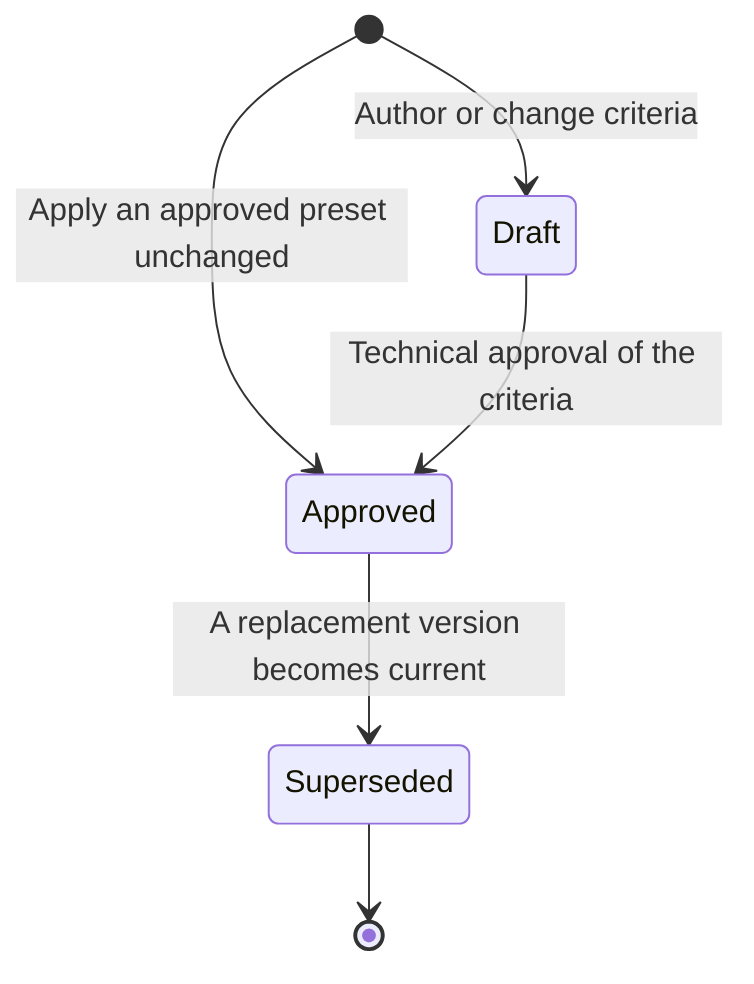

# Conformity assessments

Stories: US-AD07, US-AD14, US-SD06, US-T06, US-LH02, SH-07

## Goal

The laboratory defines and approves the requirements against which it will assess the requested work. A request can use several QCVNs, standards or technical specifications, with conclusions tied to their evidence and agreed scope. Testing and returning measured results remains possible without a requested conformity statement; that service choice never overrides an applicable legal obligation.

## Design

### Ownership and access

Laboratory owns comparison presets, request comparison plans, their criteria and conformity assessments. The laboratory determines technical and legal applicability; the software records and enforces the approved plan rather than deciding applicability from a sample name or imposing one QCVN per sample.

| Record | Access and responsibility |
| --- | --- |
| Comparison preset | Read access follows the internal master-data rules; create, edit and archive permissions are assignable through roles. Administrators maintain the configuration; availability requires laboratory technical approval. |
| Comparison plan | Request-scoped read, create and edit permissions allow staff to apply an approved preset unchanged without a separate approval on the request. Authoring or changing criteria requires technical approval through the configured laboratory chain; edit permission alone never grants that approval. |
| Conformity assessment | Read, create and edit permissions follow the relevant work and request scope. Testers record the evidence and assessment; the Lab Head reviews the assessments and their approved basis before signing the report. Measurement approval keeps its independent result-approval rules. |

Enforce access on every read, write, approval and report operation. A tester sees the technical criteria and evidence needed for assigned work without gaining access to customer identity or unrelated requests. Customers receive only information allowed by the existing report and portal permissions.

### Presets and request plans

A comparison preset is a reusable, laboratory-approved set of criteria for a product category and service. It identifies its version, scope, document references and decision rules. A draft can be edited; an approved version is immutable. Updating it creates another draft version. Archiving stops new selection without changing existing plans. Preset approval and approval of authored or changed request criteria use the configured roles under US-AD14; no fixed job title or extra organizational level is imposed.

A comparison plan belongs to a test request. Applying an approved preset in full without changing its criteria creates an approved request plan immediately, using the preset's approval. No separate request-plan approval or signature is required. Copy the criteria and retain the source preset version, its approval reference, and who applied it when. Later preset or catalog edits never rewrite this snapshot. Applying a preset is a selection action, not a new signature by the person receiving the samples.

Staff still check the actual product category, purpose, requested service, available methods, evidence and sampling requirements against the preset's approved applicability conditions during receipt. This check adds no separate approval step when the preset is used unchanged. Binding actual sample codes or sampling-unit groups within those conditions is not a criterion edit. If the preset does not fit, select a suitable approved preset or prepare changed criteria; unchanged reuse cannot extend its approved scope. Record customer agreement where required. Mandatory applicable requirements take precedence over a preference for a more favourable limit.

Authoring criteria or adding, removing or changing a criterion outside unchanged preset reuse creates a draft plan requiring technical approval before the affected work starts. Changes include the document or edition, clause, limit, comparison unit, decision rule, applicability conditions, assessment scope or required evidence. Preserve the difference from the source preset and the reason. Each approved plan records whether its approval comes from unchanged preset reuse or from direct technical approval; never fabricate a request signature for inherited approval. Selecting a criterion after seeing results solely to obtain a pass is not an amendment workflow.

One approved plan version is current for the request. Each criterion identifies the sample or named group of sampling units it covers. A plan can therefore cover different criteria on different samples and criteria needing several units, without treating a request or one physical sample as a lot by default. Approved versions are immutable. A replacement becomes current through unchanged preset reuse or technical approval of changed criteria; preserve both versions, their approval bases, changes and reasons.

The diagram describes request-plan versions. A preset itself always requires technical approval before it becomes available. Archiving an approved preset prevents future selection. A request without requested comparison needs no comparison plan solely to return measurements.

### Criteria and evidence

| Criterion information | Rule |
| --- | --- |
| Basis | Identify the QCVN, standard or technical specification, its edition, applicable clause or table, product category and applicability conditions. Multiple criteria may cite different documents or different requirements in the same document. |
| Scope | Identify the parameter or properties assessed, the relevant samples or sampling-unit group, and whether the statement concerns the tested material or a defined wider assessment. A lab code alone does not establish lot identity or a complete sampling plan. |
| Requirement | Preserve the applicable limit, comparison unit, decision rule and any sampling or other evidence requirements. Simple numeric or text limits use the exact regulation, parameter and sample-type catalog entry. Scope includes descendant types; limit values are never inherited. Missing configuration remains missing. |
| Non-scalar requirements | Keep requirements such as `n`, `c`, `m`, `M` and their evidence conditions explicitly. Recording them and supporting several documents does not implement a universal automatic sampling-plan decision engine. Professional assessment must identify whether the required evidence is complete. |
| Measurement suitability | Reuse a result only when its material, parameter, method, unit, sensitivity and other relevant conditions support that criterion. Matching the parameter name is insufficient. Add or change testing only through the existing agreed-scope and testing workflows. |

A conformity assessment binds a criterion and its approved plan version to the exact reported result versions and sampling units used. Preserve the assessment's author, time, reasoning, evidence completeness, comparison values and outcome: pass, fail or insufficient basis. Several criteria may use the same measurement; one criterion may need several results. Their conclusions and conversions remain separate.

The attempt retains its original measured value, unit, method and LOD/LOQ snapshots. The criterion and assessment retain their own requirement snapshots and comparison data. Within a unit category, suggest conversion for tester confirmation; across categories require an entered comparison value, unit and basis. Never replace the original measurement or share one mutable converted value across different assessments.

Text and below-LOD/LOQ results require professional assessment. Missing limits, unsuitable sensitivity, incomplete sampling units or unresolved decision rules cannot become a pass. Record insufficient basis with the reason when a conclusion cannot be supported. Measurement approval can proceed independently while an assessment waits for the rest of its evidence; report preparation requires every requested assessment to have a recorded, reviewable outcome.

### Validity, amendments and corrections

- New regulatory selections must be active, in force and applicable, including their last valid day. Check every selected regulation at receipt and again before report issue.
- Expiry during testing does not stop testing, switch documents or drop criteria automatically. The Lab Head confirms the applicable basis before issuing the affected conclusion. Sales obtains customer agreement when the agreed comparison scope changes.
- An explicit amendment requires a reason and agreement where required. Reusing another complete approved preset unchanged inherits its approval; authored or changed criteria require renewed technical approval. Identify affected assessments, confirm the new requirement snapshots, and clear their obsolete conclusions and comparison conversions. A pending criterion change blocks affected work and report preparation until resolved. Unaffected criteria and measurements keep their history.
- Keep raw measurements, selected ways and LOD/LOQ snapshots. A plan change alone never creates a retest; professional assessment determines whether further work is needed.
- Withdraw signatures first where permitted. A completed result or issued report changes only through its change request and replacement version. A plan amendment cannot change the sources of a frozen or issued report silently.

### Reporting and review

The report presents the measured results and identifies each assessed criterion's document, edition, applicable clause, requirement, decision rule, evidence scope and outcome. Cross-reference shared measurements without implying another measurement was performed. The reviewed PDF binds the approved plan and criteria, its inherited or direct approval basis, assessment records and exact result versions alongside the existing report source snapshot.

Conclusions apply only to the identified, requested assessment scope. Any assessed failure fails that scope; a pass requires all its required assessments to be complete and pass. With no failure but incomplete or unresolved evidence, the scope is insufficient basis. Independent scopes keep separate outcomes; do not collapse them into an unqualified sample-wide or all-QCVN pass.

A statement about the tested portion, a complete sampling-plan assessment and a product, lot or facility conformity claim have different evidence requirements. The software must not infer the wider claim from a single tested portion or a partially fulfilled plan. The Lab Head reviews wording and evidence before signing. Preparing or signing the report is blocked if requested assessments remain pending, authored or changed criteria lack technical approval, or source versions are stale. An unchanged preset's inherited approval satisfies the plan approval requirement without a request signature. An explicit insufficient-basis outcome can be reported with its limitation.

## Acceptance criteria

- A request can have criteria from two applicable QCVNs, including criteria using the same measurement, without assigning one exclusive regulation to its sample.
- Applying an approved preset unchanged copies its criteria into an approved request plan with the source version and approval reference; no separate request approval or signature is required. A later preset edit does not change the plan or an issued report.
- A request editor can apply an approved preset unchanged without technical approval permission, but cannot approve authored or changed criteria. Those criteria remain draft and block affected work until the configured laboratory chain approves them.
- Binding actual sample codes within the preset's scope does not trigger approval. Adding or removing a criterion, changing a limit, document, decision rule, scope or evidence requirement does.
- A criterion identifies its document edition and clause, scope, requirement, unit where applicable and decision rule. An absent exact sample-type limit is visible and never replaced by an ancestor's limit.
- Two criteria using one result retain different comparison values and conclusions while the original measurement stays unchanged.
- A criterion requiring several sampling units cannot pass using only one unit unless its documented rule and scope support that statement. Missing evidence yields insufficient basis with a reason.
- Applying a replacement plan preserves the previous version and its approval basis and invalidates only affected assessments and report candidates; it never silently creates a retest or changes an issued file.
- Expiry of one of several regulations requires confirmation of that basis without silently removing its criteria or switching the entire plan.
- A report identifies separate assessed scopes and their outcomes; a partial assessment never prints an unqualified lot, facility or all-QCVN conformity statement.
- A request without requested comparison can issue measured results without a forced pass/fail conclusion, subject to applicable mandatory requirements.

## Related documents

- [Laboratory overview](../functional/laboratory_module/overview.md)
- [Administrator catalog](../functional/laboratory_module/features/admin.md#1-catalog-us-ad01-to-us-ad08-us-ad26-to-us-ad28)
- [Sample delivery staff](../functional/laboratory_module/features/sample-delivery-staff.md#2-receiving-samples-us-sd06-to-us-sd12)
- [Tester results](../functional/laboratory_module/features/tester.md#2-results-us-t05-to-us-t09-us-t17-us-t18-us-t22)
- [Lab head reports](../functional/laboratory_module/features/lab-head.md#1-test-reports-us-lh01-to-us-lh03)
- [Test reports](test-reports.md)
- [Approval and signing chain](../business/approval-and-signing-chain.md)
- [Research sources and evidence limits](../reports/laboratory-comparison-research.md)
