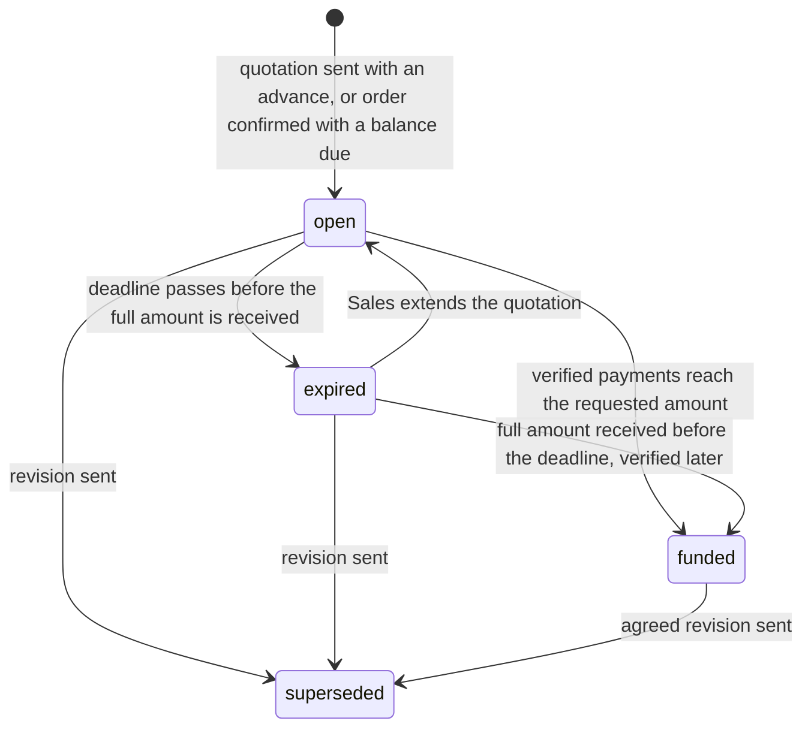

# Payment requests

Stories: US-S07, US-S08, US-S10, US-S11, US-C14, US-C17, US-A03, US-A06, US-A07, US-A08

## Goal

Ask the customer for money without posting a customer invoice before the money is received. A payment request is not an invoice: it posts no receivable and no revenue. The invoice is posted when the money is collected, as Nghị định 254/2026/NĐ-CP requires for a service paid before or while it is provided, and for a customer allowed to order on credit when the service is completed. Keep the quotation's agreement, the money actually received, its verification and the permission to start laboratory work separate.

## Design

### Requests

- Sending a quotation with an advance creates its **advance payment request**: the order, the quotation version, the requested amount (full, a percentage or a fixed amount), the payment deadline and the payment means (PayOS online, bank transfer, cash). The request and its notice are written in the customer's language. Only the current request takes new payments.
- Confirming the order of a customer who is not allowed to order on credit creates its **balance payment request**: the order total less the verified money already applied to the order. Sample collection starts once the balance is verified.
- A customer allowed to order on credit gets no payment request. Their quotation is sent without an advance and accepted on the portal, and the accountant posts the final invoice once testing is completed ([Invoices](invoices.md)).
- The portal shows each request's amount, the verified money applied to it, the payments awaiting verification and the amount still needed. An unpaid request past its deadline is expired, not an overdue invoice.

### Payments and their invoices

- PayOS payments are verified by the signed provider notification. A bank transfer or cash that Sales records, or a bank transfer the customer reports on the portal, is a **pending payment** until the accountant confirms or rejects it. A pending payment and a browser return count toward nothing.
- Each payment keeps its amount, the actual time the money was received, the time it was verified and its original reference. A repeated notification records no second payment.
- Verifying a payment posts a customer invoice for the amount received, reconciled with that payment: an advance invoice for money paid against the advance request, the final invoice for money paid against the balance request. The invoice is posted at collection, never when the request is sent.
- A payment above what the request still needs is recorded in full and flagged for the accountant; the excess is applied to the order's balance or recorded for manual refund. It is never refunded automatically or moved to another order.

### Acceptance and the start of work

- Verified payments applied to the current quotation accumulate. A partial advance does not accept the quotation. Reaching the full advance accepts it; the actual time at which the payments reached that amount decides whether payment was on time.
- When verified money from an earlier version already covers a revised quotation's advance, acceptance also needs the customer's explicit agreement to the new version, given on the portal or recorded by Sales from the customer's email or written agreement.
- For an order with an advance, confirming its test request needs the full verified advance; collection and testing need the verified balance as well. The credit flag does not bypass these conditions for an order that was sent with an advance.

### Pending payments block changes

While a payment of the order awaits the accountant's verification:

- Sales may draft a revision, but sending it waits until the accountant confirms or rejects the pending payment.
- The customer cannot decline the quotation and the order cannot be cancelled.

Once the accountant confirms the payment, the rules for verified money apply; once they reject it, the change is allowed again.

### Revisions

- Sending a revision supersedes the old request: it stops taking new payments and its open PayOS links are cancelled. A cancelled link does not guarantee that no money arrives; a transfer received through an old link is recorded once and reviewed by the accountant before it is applied to the new request.
- Verified money stays on the same order. The new request deducts it from the advance still needed and never asks the customer to pay it again. A posted invoice is never reset or cancelled because the quotation changed; the final invoice deducts every advance invoice, and an overpayment is corrected by an adjustment.
- Agreed service prices exclude VAT. When the applicable VAT changes before payment, Sales sends a new version with the new tax, total and advance.

### Expiry

- At the payment deadline the request stops taking new payments and its open PayOS links are cancelled. The quotation and its payments are kept; Sales extends it or sends a revision. Expiry neither cancels the order nor creates a refund.
- A payment received before the deadline and verified after it still counts: an unchanged quotation that was not declined, replaced or cancelled is accepted at verification when the full advance arrived before the deadline. Money received after the deadline is recorded and reviewed, and Sales extends the quotation before it counts.
- A partial advance received before the deadline stays on the same order while Sales agrees with the customer to extend, revise or cancel.

The diagram follows the request, not the customer's agreement or the test request.

## Acceptance criteria

The amounts use VAT 8% or 10% only as illustration.

| Scenario | Required result |
| --- | --- |
| Service 10,000,000 VND, VAT 800,000, total 10,800,000; advance 50% | Sending requests 5,400,000 and posts no invoice, receivable or revenue. |
| The customer transfers 2,000,000 and the accountant confirms it | One payment of 2,000,000 and one advance invoice of 2,000,000 are posted; 3,400,000 of the advance is still needed. The quotation is not accepted. |
| The rest of the advance, 3,400,000, arrives through PayOS | A second advance invoice of 3,400,000 is posted at verification and the quotation is accepted. |
| Sales confirms the order of a customer not on credit | A balance request of 5,400,000 is created; collection waits until it is verified, and its verification posts the final invoice deducting the advances. |
| A partly paid quotation expires | No further payment is taken; 2,000,000 stays on the order and nothing is refunded for expiry alone. |
| Full advance received at 16:55, deadline 17:00, verified at 18:00 | The unchanged quotation is accepted at verification. |
| Sales revises while a transfer awaits verification | Drafting is allowed; sending, declining and cancelling are refused until the accountant confirms or rejects it. |
| Revision with service 8,000,000, VAT 640,000, total 8,640,000, advance 50%; 5,400,000 verified earlier | The advance needed is 4,320,000, so nothing more is requested; acceptance waits for the customer's agreement to the new version. |
| A customer allowed to order on credit | No payment request is created; the test request is On credit and the final invoice is posted after testing. |

## Related documents

- [Payment and quotation](../business/payment-and-quotation.md)
- [Invoices](invoices.md)
- [Payments and reconciliation](payments.md)
- [PayOS](payos.md)
- [Sales](../functional/ecommerce_module/features/sales.md)
- [Accountant](../functional/ecommerce_module/features/accountant.md)
