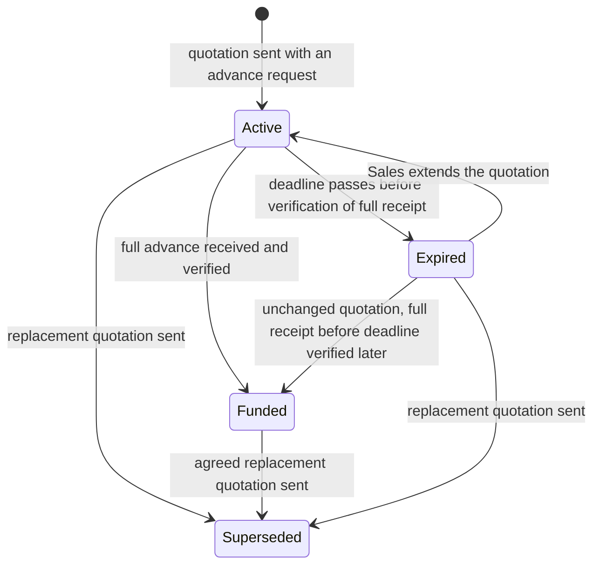

# Payment requests

Stories: US-S07, US-S08, US-S10, US-C14, US-A03, US-A06, US-A08

## Goal

Request an advance without posting a customer invoice or treating a request for money as revenue. Keep the quotation's agreement, actual receipts, their verification and the permission to start laboratory work separate.

## Design

### Request and payment evidence

Sending a quotation creates its advance payment request with the order, quotation version, requested amount, deadline and payment instructions. Only the current request is offered for new payment initiation. The portal distinguishes the required advance, verified receipts applied to it, receipts awaiting verification or allocation, and the amount still needed. The total unpaid order value is not the amount needed to reach the advance.

Each actual receipt keeps its amount, actual receipt time, verification time and original payment reference. Its history retains the original quotation, request and PayOS link where applicable. A reported payment does not become verified merely because Sales or the customer submitted it. A verified provider transaction proves receipt of money; applying money from an obsolete link to a newer agreement also needs accountant review.

No payment request posts revenue or a receivable. Verification records the received money and customer advance. Revenue recognition and invoicing follow the [invoice rules](invoices.md).

### Acceptance and permission to start

Accumulate verified receipts allocated to the current quotation. A partial advance does not accept it. Reaching the full required advance accepts the quotation; use the actual time at which cumulative receipts reached that amount to assess whether payment was timely. The acceptance event occurs only after verification.

When retained money from an earlier version already meets the new advance, acceptance also needs the customer's explicit agreement to the new version. The customer can agree on the portal, or Sales can save the customer's email or written agreement. Preserve the agreed version and evidence.

For an order requiring an advance, collection and testing require acceptance, the full verified advance and the existing order approval. A credit flag cannot bypass these conditions.

### Revisions and VAT changes

Sales may prepare a new draft while payment evidence is pending. Sending it waits until the accountant has confirmed or rejected those pending records. Keep the old request and quotation history.

When the replacement is sent, supersede the old request, stop initiating payments from it and request cancellation of its open PayOS links. Distinguish a cancellation request from confirmation that the provider cancelled a link. The new request deducts verified money applied to the same order when displaying the further advance needed; it never asks the customer to pay the retained amount again.

A verified transfer discovered through an old link is recorded in full once and flagged for accountant review before application to the new request. Retain its original reference and actual transfer time. Receipt does not by itself accept a replacement quotation.

Keep the agreed service price before VAT. If the applicable tax changes before payment, send a new quotation with the revised VAT, total and advance; do not silently edit the customer's sent copy.

### Expiry

On expiry, stop new payment initiation and request cancellation of open PayOS links. Preserve the quotation and its receipts. Sales can extend it or send a new version; expiry does not cancel the order or automatically establish a refund.

For an unchanged quotation that has not been replaced or declined and whose order is not cancelled, later verification may accept it if the full advance actually arrived before the deadline. If payment arrived in several transfers, use the time when the required total was reached. A transfer arriving after expiry is recorded and reviewed; it does not automatically reactivate the quotation.

If only part of the advance arrived before expiry, keep that money on the same order while Sales agrees whether to extend, revise or cancel. The displayed shortfall is not an active new collection request during expiry.

The diagram tracks the request, not customer agreement or order approval. A funded replacement using retained money still requires the customer's agreement.

## Acceptance criteria

The numerical examples assume VAT of 8% or 10% only for illustration. They do not establish the laboratory's VAT method, a tax schedule or the accounting entries for an advance.

| Scenario | Required result |
| --- | --- |
| Service 10,000,000 VND, illustrative VAT 800,000, total 10,800,000; advance 50% | Sending requests 5,400,000, receives 0 and posts no invoice, receivable or revenue. The order's uncollected total is 10,800,000. |
| The customer pays and the accountant verifies 2,000,000 | Record 2,000,000 once; 3,400,000 remains to meet the advance and 8,800,000 of the order total remains uncollected. Do not accept the quotation or start work. |
| That partially funded quotation expires | Stop requesting further payment. Retain 2,000,000 on the order; the refund due solely to expiry is 0. Sales agrees the next step. |
| VAT changes before payment from illustrative 8% to 10% | Send a new version retaining the 10,000,000 service price, showing 1,000,000 VAT, 11,000,000 total and 5,500,000 advance. Received money is 0. |
| Revised service price 8,000,000, illustrative VAT 640,000, total 8,640,000; retained verified money 5,400,000 | Required advance is 4,320,000; further advance is 0, remaining order value is 3,240,000 and refund is 0. Obtain the customer's agreement to the new version before acceptance. |
| Full 5,400,000 arrived at 16:55 before a 17:00 deadline; verified at 18:00 | For an otherwise unchanged valid agreement, accept at verification using the actual timely receipt. The remaining order value is 5,400,000; refund is 0. Order approval is still required. |
| A transfer is discovered through a superseded PayOS link | Preserve and verify the actual receipt once, show it as awaiting allocation, and require accountant review before applying it to the new request. Repeated notifications create no extra receipt or acceptance. |
| Sales drafts a revision while a receipt is pending | Drafting is allowed; sending is blocked until the accountant confirms or rejects the pending record. The earlier receipt history is retained. |

## Related documents

- [Payment and quotation](../business/payment-and-quotation.md)
- [Sales](../functional/ecommerce_module/features/sales.md)
- [Accountant](../functional/ecommerce_module/features/accountant.md)
- [Payments and reconciliation](payments.md)
- [PayOS](payos.md)
