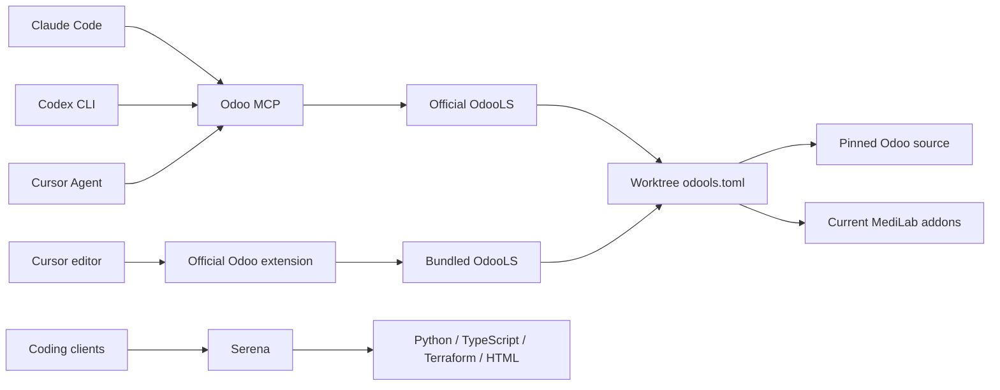

# Odoo intelligence

## Installation

Run from the checkout or Git worktree you want the clients to use:

```sh
task ai:setup
task ai:test
task ai:verify
```

Setup requires Git, uv and Node.js with npx. It creates the locked Python 3.13 environment in `tools/odoo-intelligence/.venv`, installs official OdooLS 1.6.0 with its matching typeshed, and fetches the repository-pinned Odoo 20 source. Release checksums are recorded in `tools/odoo-intelligence/odoo_intelligence/release.json` and checked before extraction. Terraform 1.15.8, matching `infra/terraform.tf`, is installed locally for Serena's Terraform server. Setup does not replace global tools, edit global client settings, initialize Terraform or change a database.

The Odoo mirror lives in `.local/odoo-intelligence/odoo-source`. It includes all Community addons, internal Odoo addons and the five MediLab addons under `src/core/modules`. It is separate from `.local/odoo-source`, which `task dev:odoo-source` prepares for Pyright. An incomplete or mismatched tooling mirror must be moved aside before reinstalling; setup does not overwrite it.

Open the worktree root as the editor workspace. `odools.toml` supplies the same default profile to the MCP bridge and the official Odoo extension. JavaScript processing is disabled in OdooLS; existing TypeScript services handle it.

## Architecture



The read-only Odoo MCP server exposes `definition`, `references`, `hover`, `completion`, `document_symbols`, `diagnostics` and `status`. Paths are relative to the worktree; line and character positions are zero-based, with characters counted as UTF-16 code units. It rejects paths that escape the checkout, including symlinks. Results include file URIs and source ranges from OdooLS.

Serena uses its built-in `python` server and retains its other language servers and editing tools. Use Odoo MCP for framework model strings, inherited fields and XML navigation; use Serena for general symbol search and edits. OdooLS has no rename support, so rename is not exposed by the bridge. The bridge also avoids unsupported pull-diagnostic requests and reads published diagnostics with freshness metadata instead. An unavailable or stale diagnostic report is not a clean validation result.

Each bridge owns a stdio OdooLS process and a distinct log directory. It waits for indexing, synchronizes queried files from disk and sends file-change notifications for the current checkout's Python/XML addons before subsequent navigation. It has no fixed TCP port. On-disk OdooLS file caching is disabled. Changes in unsaved editor buffers belong to the native editor session; MCP reads saved files.

Blocking LSP operations run in worker threads so MCP cancellation and disconnect can be handled during indexing. Cancellation stops this session's owned child; a subsequent query can initialize it again. Diagnostic document versions are checked when provided, with timestamps used only as a fallback.

## Clients

| Client | Project configuration | Navigation interface |
| --- | --- | --- |
| Claude Code | `.mcp.json`, `.claude/settings.json` | Odoo MCP; local Serena and its existing hooks |
| Codex CLI | `.codex/config.toml` | Odoo MCP and local Serena |
| Cursor Agent | `.cursor/mcp.json` | Odoo MCP and local Serena |
| Cursor editor | `odools.toml`, `.vscode/settings.json` | Official `Odoo.odoo` extension |

Start a new session after setup; existing agents keep their processes and configurations. The four existing Claude MCP definitions for Doppler, SonarQube, Postgres and Context7 are preserved and are also present in Cursor's project configuration. Codex's project configuration adds Odoo and Serena without changing global MCP definitions.

### Claude Code

Launch `claude` from the worktree root. Project MCP servers are enabled by the existing project settings. Check `claude mcp get odoo`, then request an Odoo-aware definition or hover. For a concrete check, resolve `medilab.reconciliation.day` in `src/core/modules/sol_commerce/models/invoicing/payment_transaction.py` at zero-based line 116, character 27; it should lead to the `ReconciliationDay` class. The nearby field check is `parameter.main_group_id` in `sol_laboratory/models/master_data/test_parameter.py` at line 58, character 27.

The Serena hooks run through the locked local environment. Claude's native LSP plugin mechanism is available upstream, but this integration uses the tested MCP interface and does not install an Odoo native LSP plugin.

### Codex CLI

Trust the specific worktree when Codex asks so it can load `.codex/config.toml`. Check `codex mcp get odoo --json` and use `/mcp` in a new session. Project configuration is ignored in untrusted checkouts. Launching from a subdirectory is supported: the launcher finds the nearest checkout containing `tools/odoo-intelligence/run.py`, and the package binds the server to that checkout.

For a noninteractive check without persisting trust globally, supply the worktree trust as a CLI override:

```sh
codex -c 'projects."/absolute/path/to/worktree".trust_level="trusted"' mcp get odoo --json
```

MCP is the configured Odoo interface; native Codex LSP access is not claimed. Do not use `--ignore-user-config` when checking this project configuration: its configuration loading behavior differs, and a CLI override containing only `mcp_servers.serena.enabled=false` can produce an invalid transport when the project table is absent.

### Cursor Agent

Launch a new Agent from the worktree and approve the project MCP servers. Ask it to use the `odoo` definition and hover tools. Cursor Agent CLI 2026.10.01 does not expand `${workspaceFolder}` in these MCP arguments in the tested environment; the launcher therefore discovers the checkout from its working directory. Cursor editor supports that variable, but the shared Cursor configuration avoids depending on it.

The tested Agent calls used normal agent mode. Ask mode refused MCP calls even with read-only tool annotations. `--approve-mcps` approves server connections; it does not guarantee that Ask mode will allow tool execution. For a controlled headless verification, `--print --force --approve-mcps` permits the requested calls; keep the prompt restricted to the read-only Odoo tools. This is a session setting and does not replace normal interactive approvals.

### Cursor editor

The repository recommends the official `Odoo.odoo` extension. For a separate profile that leaves existing editor sessions alone:

```sh
task ai:cursor-setup
cursor --new-window --user-data-dir "$PWD/.local/cursor/user-data" --extensions-dir "$PWD/.local/cursor/extensions" "$PWD"
```

The installer downloads the official platform-specific 1.6.0 VSIX, verifies its checksum, and installs it into this worktree's profile. It bundles its own matching OdooLS and typeshed. The extension requires a VS Code API version of at least 1.125.0; Cursor 3.21.18 uses API 1.128.0. Pylance, formatters and JavaScript services remain configured. Workspace settings suppress the extension's offers to disable Python/JavaScript services.

## Verification and compatibility

| Component | Verified behavior | Limits |
| --- | --- | --- |
| OdooLS 1.6.0 on Linux x86-64 | 662 indexed modules; core/custom model definitions, custom and inherited fields, Python/XML navigation | Only the exercised navigation cases are verified; indexing every manifest does not prove every dynamic ORM expression resolves |
| Claude Code 2.1.296 | Project MCP connects; two definition calls and relation hover return actual Odoo results | Native Odoo LSP plugin is unverified; account limits can prevent model-driven validation |
| Codex CLI 0.162.1 | Project MCP makes two definition calls and relation hover | Worktree trust is required; native LSP is unverified |
| Cursor Agent 2026.10.01-e373342 | Two definition calls and relation hover through project MCP | Ask mode rejects the tested calls; CLI variable interpolation differs from editor behavior |
| Cursor 3.21.18, Odoo extension 1.6.0 | Extension-host definition providers resolve core/custom models, inherited fields and an XML field; hover and completion resolve the relation | Native editor references have the upstream OdooLS caveat below; UI gestures and other editor versions are unverified |
| Serena pinned at `1bbe535` | Python symbol overview/search/references and TypeScript/Terraform symbol overview; editing tools remain exposed; all four servers start | Editing commands are not exercised on application code; generic Python cannot replace Odoo-aware navigation |
| Concurrent Git worktrees | Two MCP sessions resolve distinct fields on the same model in separate temporary Git worktrees; dependency edits update hover types; child processes stop on disconnect | Each real worktree still needs setup; source and binaries were shared read-only in the controlled fixture |
| Other platforms | Installer selects official Linux, macOS and Windows artifacts | Execution on macOS, Windows and other architectures is unverified |
| Other MCP servers | Existing definitions are preserved | External service credentials and availability require their own checks |

`task ai:verify` writes `.local/verification/mcp-navigation.json`: six asserted definitions, relation hover, field completion, references, document symbols and diagnostic freshness. `task ai:test` includes framed JSON-RPC, path and archive safety, error/timeout propagation, a references crash regression and concurrent-worktree tests. Live tests report skips when OdooLS is absent; inspect the summary before claiming integration passed.

For the native Cursor check, install the isolated profile and run:

```sh
cursor --new-window --classic --user-data-dir "$PWD/.local/cursor/user-data" --extensions-dir "$PWD/.local/cursor/extensions" --extensionDevelopmentPath="$PWD/tools/odoo-intelligence/tests/cursor" "$PWD"
```

The probe writes `.local/verification/cursor-editor.json`. It quits its test window after recording results, so use this command only with the isolated profile. Inspect `verified`, the definition targets, completion and hover values; installation alone is insufficient.

## Maintenance and troubleshooting

- **Unknown Serena `odoo` server:** use the repository's built-in `python` configuration and run `task ai:setup`. The separate MCP server supplies Odoo intelligence; no external Serena language-server registration is required.
- **Missing Terraform blocks Serena:** rerun setup, then use the repository's Serena launcher. It prepends the local Terraform directory only to that process's PATH.
- **Missing mirror or release:** run setup in this worktree. A different agent's `.local` directory is not searched automatically.
- **Incorrect root:** call Odoo `status` and compare `workspace` with the intended checkout. Open the worktree root in the editor. Do not combine several different Odoo worktrees in one OdooLS workspace.
- **Index timeout, crashes or empty results:** inspect the directory returned by `status` or the tool error, then check `odools.toml`, the source revision and module dependencies. Restart only this client's MCP session after a crashed server. Empty definitions can indicate unsupported expressions or incomplete analysis.
- **References panic:** OdooLS 1.6.0 can panic with `no text_document provided` when the definition is not open. The MCP bridge opens resolved definition documents before requesting references; its regression test exercises this case. The official native editor server does not use that workaround. Use MCP references when this affects native references.
- **Saved changes:** MCP synchronizes the queried file and watches other Python/XML addons before navigation. For unsaved changes, use the editor's native server or save first. The immutable Odoo mirror is not watched for local edits.
- **Account or approval errors:** MCP connectivity and tool schemas do not prove model-driven calls succeeded. Check actual tool responses after authentication, account limits or approvals are resolved.
- **Updating releases:** update the version and official asset digests in `odoo_intelligence/release.json`, update the source revision deliberately, and regenerate `uv.lock` for dependency changes. OdooLS releases use even minor versions for stable releases; prefer stable versions. Rerun all navigation and client checks. Source updates require moving this worktree's old tooling mirror aside, leaving Pyright's mirror intact.

## Rollback

Revert the integration commit on the implementation branch to restore the prior tracked configurations. Close only sessions and the isolated Cursor profile belonging to this worktree before removing local artifacts. Keep downloaded binaries while a client still uses them. Global clients and other worktrees need no rollback because their configuration and tools are not replaced.

The previous tracked Serena configuration depends on its external Odoo adapter and global installation; reverting restores that dependency, not a guarantee that a global Serena version supports it. Preserve the local artifacts until the chosen previous setup has been checked.

## Related documents

- [Odoo intelligence design](../specs/odoo-intelligence.md)
- [Python conventions](../conventions/python.md)
- [Testing](../conventions/testing.md)
- [Taskfile conventions](../conventions/taskfiles.md)
- [Issue #104](https://github.com/SoltuneMontepre/medilab/issues/104)
- [Official OdooLS release](https://github.com/odoo/odoo-ls/releases/tag/1.6.0)
- [OdooLS configuration](https://github.com/odoo/odoo-ls/wiki/3.-Configuration-files)
- [Official Odoo extension](https://github.com/odoo/odoo-vscode)
- [Claude Code MCP](https://code.claude.com/docs/en/mcp)
- [Codex MCP](https://developers.openai.com/codex/mcp)
- [Cursor MCP](https://cursor.com/docs/mcp)
