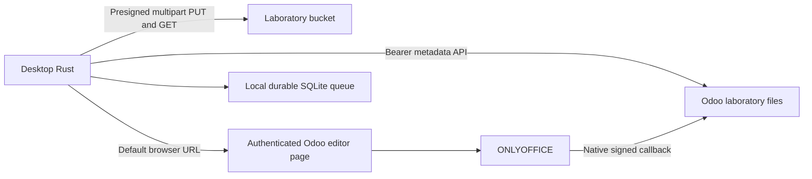

# MediLab Sync

MediLab Sync keeps a laboratory computer's selected folders in step with MediLab laboratory files. The application uses Tauri 2, Rust, React, TypeScript and Vite. Linux and Windows use the operating system's secure credential store. Vietnamese is the default interface language; English is also available.

## Architecture

The metadata API is `/medilab/api/v1`. Local paths never leave the computer, and document bytes travel directly between the computer and the bucket. Sync does not depend on the editor's availability. The desktop opens the server's editor page without receiving its JWT or configuration.

## Folders and versions

Folders are selected by their server ID. Owners and members can access only folders the server authorizes, including sample visibility rules. Sharing controls use `can_share`. Each computer chooses its own local binding. Stopping sync removes only that binding; local files and server records remain.

Upload-only folders send local changes. Two-way folders also download verified current versions. The queue persists before transfer; interrupted multipart uploads resume. Divergent versions remain as conflicts, and accepting a server version preserves a local backup. Explicit restore adds a new version.

Installed clients keep their application data and credential-store identity. Old bindings require explicit rebinding when folder identities have not been verified. Signing in again never authorizes deletion of queued local work.

## Related documents

- [Contract](contract.md)
- [Database](database.md)
- [Maintenance](maintenance.md)
- [Technician guide](technician.md)
- [Functional specification](../../../../docs/functional/laboratory_module/applications/medilab-sync.md)
